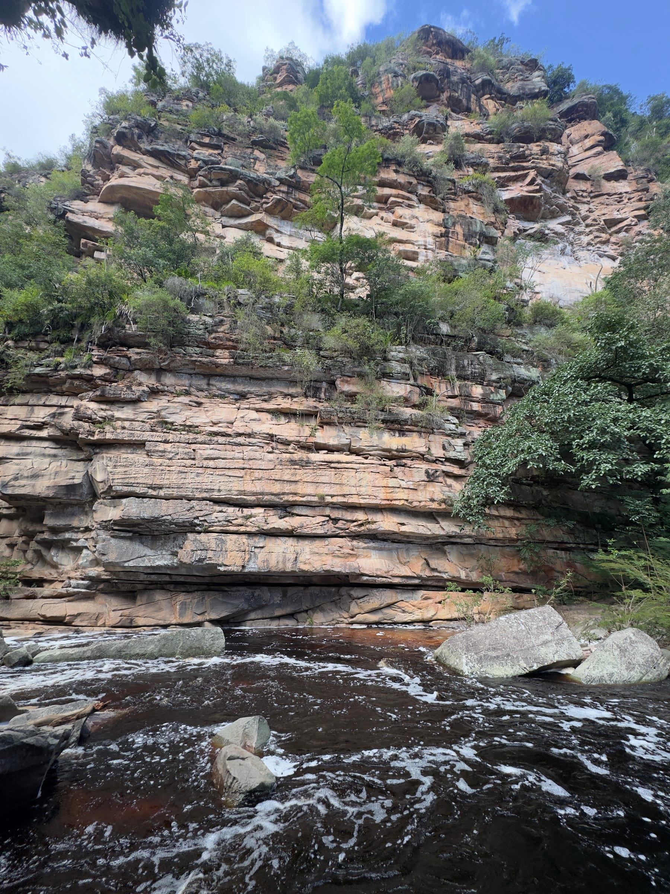
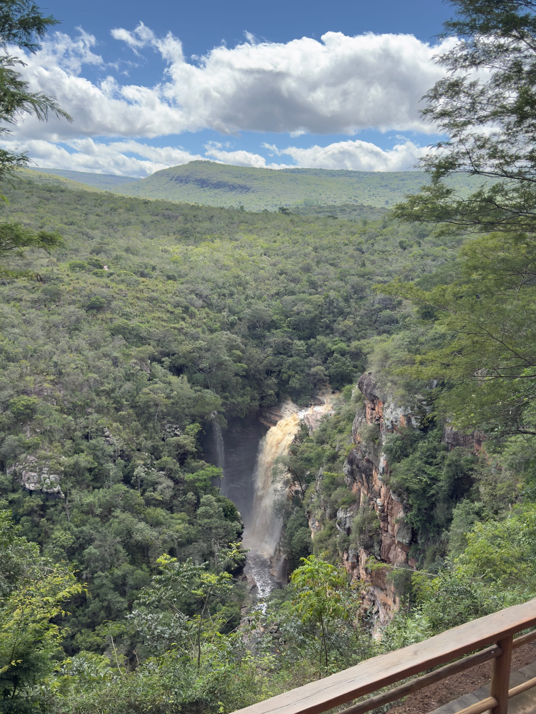
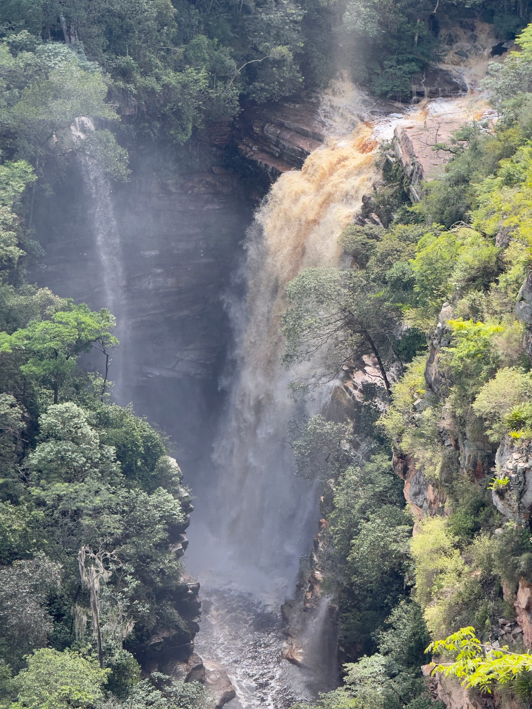
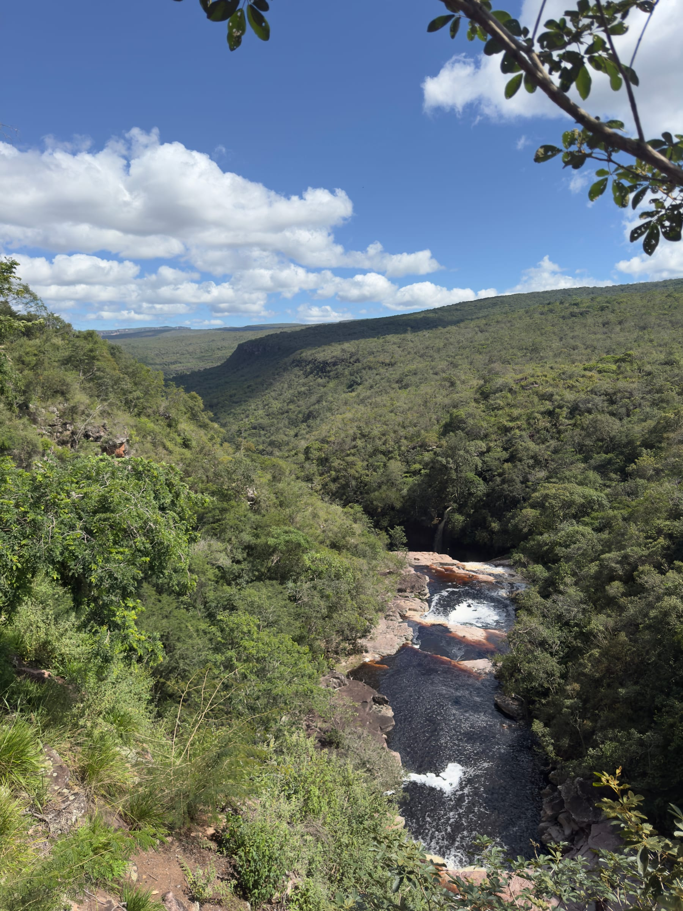
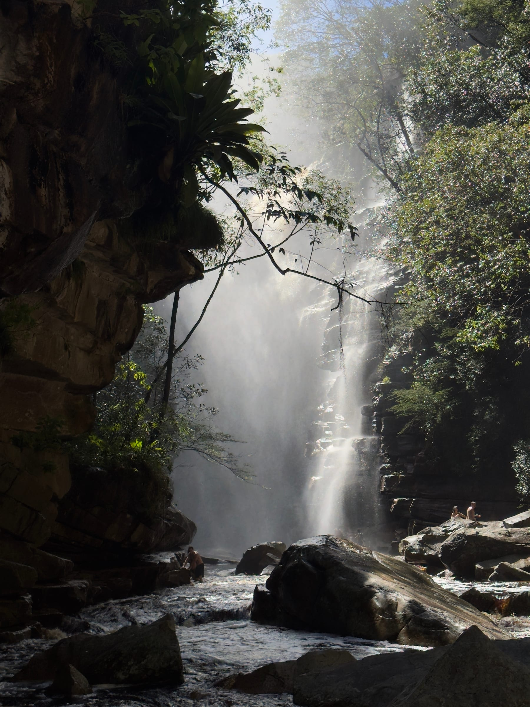
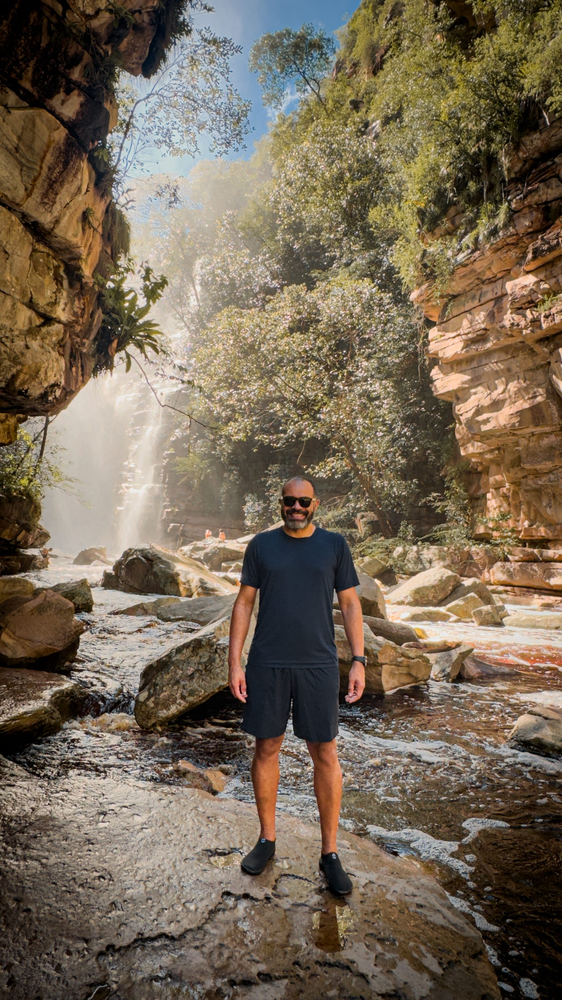
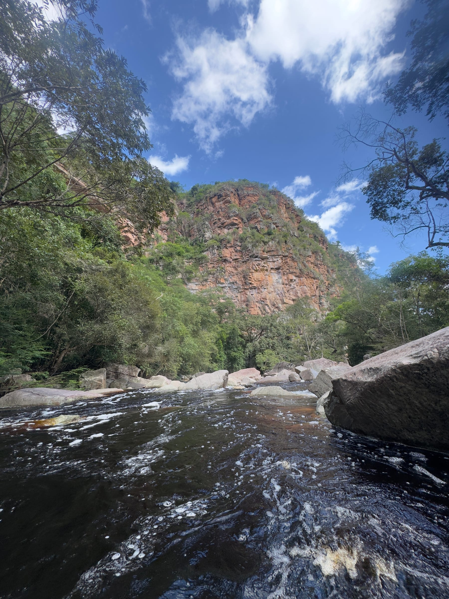

A Cachoeira do Mosquito é uma das quedas mais fotogênicas da Chapada Diamantina e uma das mais fáceis de visitar: a trilha é curta, começa num mirante com vista para o cânion e termina num poço grande, bom para banho. Fica a cerca de 40 km de Lençóis e cabe em meio dia de passeio.

Este guia reúne como chegar, como é a trilha e o que levar. Para montar o restante da viagem, veja o [guia de Lençóis](/blog/o-que-fazer-em-lencois-chapada-diamantina/) e o [roteiro completo pela Chapada Diamantina](/blog/roteiro-chapada-diamantina/). **As informações foram pesquisadas em novembro de 2026.** Taxas e horários mudam, por isso confirme antes de ir.

## Uma queda de 50 metros num cânion de arenito

A cachoeira despenca de cerca de 50 metros, algumas fontes falam em 60, dentro de um cânion de rochas sedimentares. As camadas de arenito nos paredões ficam bem visíveis da base, e a vegetação cobre as bordas do cânion.

O nome tem uma explicação curiosa: segundo relatos locais, "mosquitos" era como os garimpeiros chamavam os diamantes muito pequenos encontrados na região durante o auge do garimpo. Não há registro documental dessa origem, mas a história segue viva entre os moradores.

## Como chegar

A cachoeira fica dentro de uma propriedade particular, a Fazenda Santo Antônio, a cerca de 40 km de Lençóis. O caminho começa pelo asfalto da BR-242 e segue por uma estrada de terra que entra na fazenda. Os relatos falam em cerca de 20 km de asfalto e 18 km de terra.

| Item | Referência |
|---|---|
| Distância de Lençóis | Cerca de 40 km |
| Acesso | BR-242, depois estrada de terra até a Fazenda Santo Antônio |
| Taxa de visitação | Cobrada na portaria; o valor mais recente encontrado foi R$ 60 por pessoa |
| Horário | Das 9h às 16h, segundo agências locais |
| Guia | Não é obrigatório para a cachoeira |

:::logistica
A estrada de terra exige atenção, principalmente depois de chuvas, quando podem surgir buracos e trechos com lama: dirija devagar. Há estacionamento perto da portaria, onde se paga a taxa antes de seguir para a trilha. Leve dinheiro e cartão, e confirme o valor antes de sair de Lençóis.
:::

### Combinar com a Serra das Paridas

O [Complexo Serra das Paridas](/blog/serra-das-paridas-chapada-diamantina/), com pinturas rupestres, fica na mesma região, a cerca de 36 km de Lençóis, e as agências costumam combinar os dois passeios no mesmo dia. Nas Paridas, porém, a visita só é permitida com agência ou guia credenciado, e o voucher precisa ser comprado com antecedência em Lençóis.

## A trilha e o mirante

A caminhada é curta, de 15 a 20 minutos, e começa pelo melhor ponto de vista: um mirante no alto do cânion, de onde se vê a queda inteira entre os paredões e a mata ao redor.

Do mirante, a trilha desce até a base do cânion por uma sequência de escadas e degraus esculpidos na pedra. Uma das fontes fala em cerca de 800 degraus. A descida é tranquila, mas a volta é toda em subida, então guarde fôlego e água para o retorno.

## O banho no pé da cachoeira

Lá embaixo, a recompensa é o poço grande de águas escuras e geladas, bem perto da queda. Entrar na água com o borrifo da cachoeira no rosto é o ponto alto do passeio, e a luz que atravessa a névoa rende ótimas fotos.

:::dica
Leve sempre uma sapatilha aquática, de neoprene ou borracha, nesta e em todas as cachoeiras da viagem. O fundo e as margens dos poços da Chapada são cheios de pedras irregulares, seixos e lajes lisas com limo. A sapatilha dá aderência, protege os pés de cortes e torções e permite caminhar dentro d'água com segurança até perto da queda.
:::

:::alerta
Não salte no poço: as águas escuras escondem pedras, e o leito muda com as chuvas. Em dias de chuva forte na região, o volume pode subir rápido; nesse caso, saia da água e se afaste do leito do rio.
:::

## O que levar

- Sapatilha aquática, roupa de banho e toalha de secagem rápida.
- Água e lanche, porque a subida de volta cansa.
- Protetor solar, chapéu e repelente.
- Dinheiro ou cartão para a taxa da portaria.
- Saco para trazer o lixo de volta.

## Perguntas frequentes

### Precisa de guia para a Cachoeira do Mosquito?

Não é obrigatório. A trilha é curta, e a taxa é paga na portaria da fazenda. Para combinar com a Serra das Paridas, porém, é preciso agência ou guia credenciado.

### Quanto tempo leva a trilha?

De 15 a 20 minutos na descida, com mais tempo na volta, que é toda em subida. Reserve pelo menos duas horas para aproveitar o mirante e o banho.

### Dá para ir sem carro?

Sim, com agências de Lençóis, que costumam vender o passeio junto com a Serra das Paridas e incluem o transporte.

## Fontes consultadas

Acesso em novembro de 2026.

- [Chapada Adventure: como chegar na Cachoeira do Mosquito](https://www.chapadaadventure.com.br/como-chegar-na-cachoeira-do-mosquito/)
- [Guia dos Trilheiros: Cachoeira do Mosquito](https://guiadostrilheiros.com.br/cachoeira-do-mosquito/)
- [Um Pouquinho de Cada Lugar: a mais fotogênica da Chapada](https://umpouquinhodecadalugar.com/brasil/cachoeira-do-mosquito-a-mais-fotogenica-da-chapada-diamantina/)
- [Click na Estrada: Cachoeira do Mosquito](http://clicknaestrada.blogspot.com/2017/05/cachoeira-do-mosquito.html)
- [Pacote Barato: acesso à Cachoeira do Mosquito](https://pacotebarato.com.br/cachoeira-do-mosquito-beleza-natural-e-acesso-facil-na-chapada-diamantina/)
- [Guia Chapada Diamantina: pinturas rupestres](https://www.guiachapadadiamantina.com.br/uma-arte-milenar/)
- [Zentur: Cachoeira do Mosquito e Serra das Paridas](https://zentur.tur.br/atrativo/roteiro-05-cachoeira-do-mosquito-e-serra-das-paridas/)
- [ICMBio: informações sobre visitação no Parque Nacional da Chapada Diamantina](https://www.gov.br/icmbio/pt-br/assuntos/unidade-de-conservacao/unidades-de-biomas/caatinga/lista-de-ucs/parna-da-chapada-da-diamantina/informacoes-sobre-visitacao-parna-da-chapada-da-diamantina)
