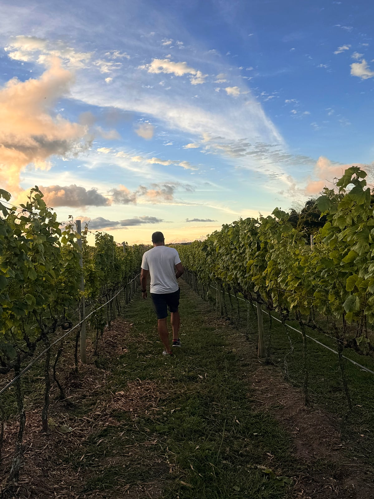
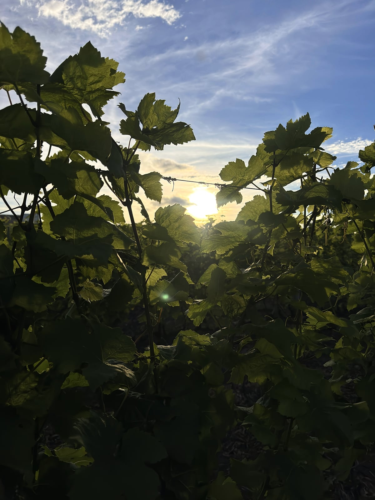
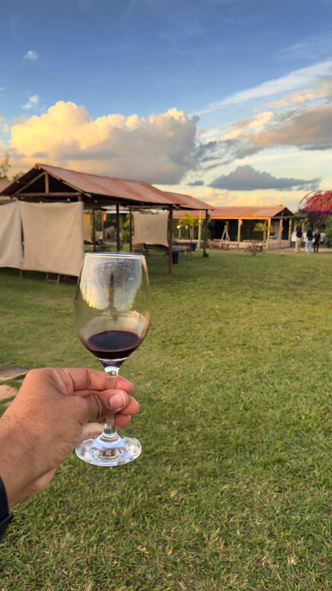
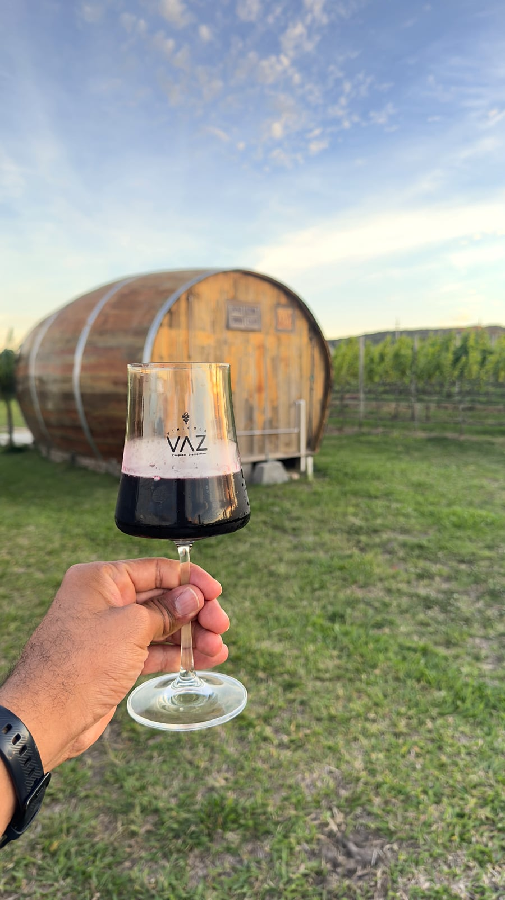
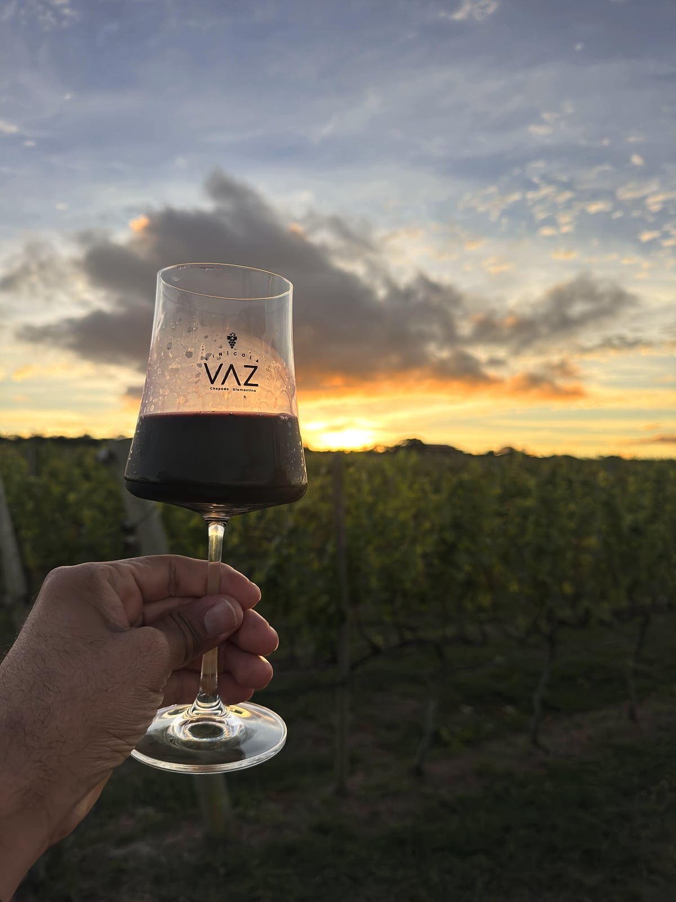
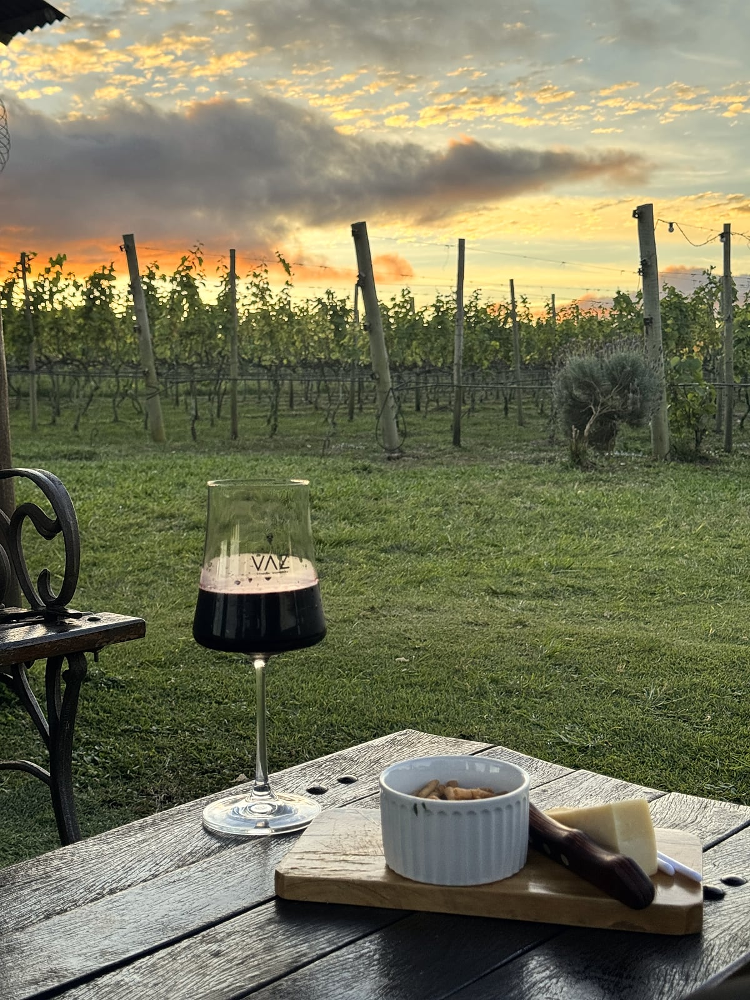
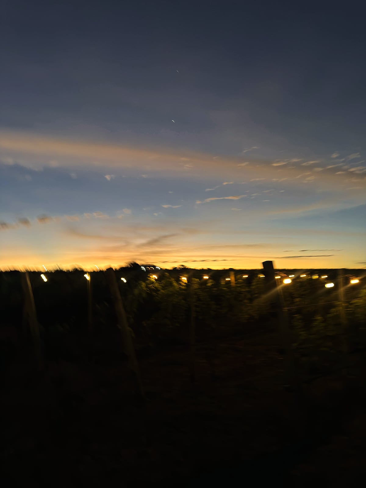
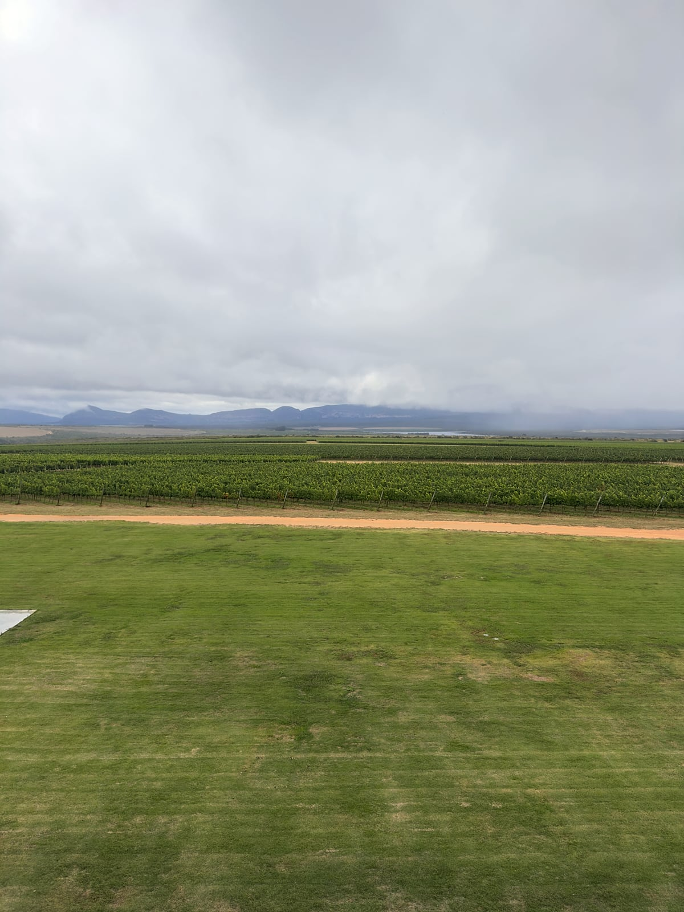
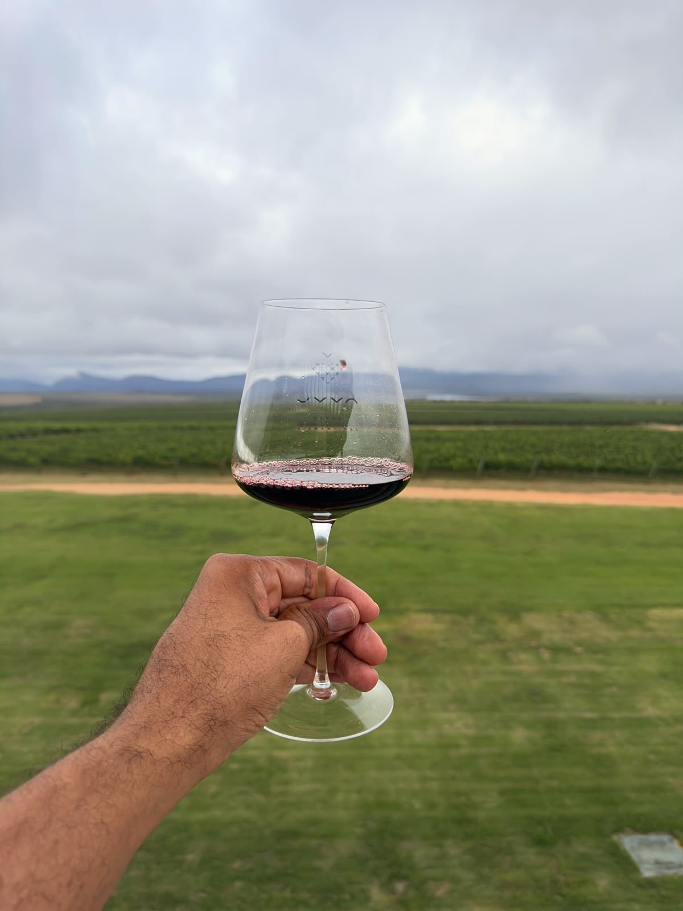

A Bahia faz vinho em dois cenários que não poderiam ser mais diferentes: no alto da Chapada Diamantina, acima de 1.000 metros, e no sertão do Vale do São Francisco, à beira do rio, onde a uva amadurece o ano inteiro. Na minha viagem pela Chapada, em maio e junho de 2026, visitei duas vinícolas de altitude: a UVVA, em Mucugê, onde almocei em 30 de maio, e a Vaz, em Morro do Chapéu, onde vi o pôr do sol entre os vinhedos em 2 de junho.

Este guia junta as duas visitas, explica por que a Chapada produz vinhos de inverno e apresenta o Vale do São Francisco, a primeira Indicação Geográfica de vinhos tropicais do Brasil. A visita completa à UVVA está no [guia da Vinícola UVVA](/blog/visita-vinicola-uvva-mucuge-chapada-diamantina/), e o resto da viagem, no [roteiro pela Chapada Diamantina](/blog/roteiro-chapada-diamantina/). **As informações práticas foram pesquisadas em novembro de 2026.** Preços e horários mudam, por isso confirme com cada vinícola antes de ir.

## As duas regiões de vinho da Bahia

| | Chapada Diamantina | Vale do São Francisco |
|---|---|---|
| Onde | Morro do Chapéu e Mucugê | Casa Nova e Curaçá (BA); Lagoa Grande, Petrolina e Santa Maria da Boa Vista (PE) |
| Altitude dos vinhedos | Acima de 1.000 m | De 350 a 400 m |
| Estilo | Vinhos de inverno, com colheita na estação seca | Vinhos tropicais, com colheita em qualquer mês |
| Safras | Dupla poda, com a colheita principal no inverno | Duas safras por ano |
| Base para a visita | Lençóis, Mucugê ou Morro do Chapéu | Juazeiro (BA) ou Petrolina (PE) |
| Distância de Salvador | Cerca de 400 a 450 km | Cerca de 500 km até Juazeiro |

As duas regiões ficam longe uma da outra. Numa mesma viagem, o mais prático é escolher uma: a Chapada combina vinho com trilhas e cachoeiras, e o Vale do São Francisco, com o rio e o Lago de Sobradinho.

## Vinho de inverno: por que a Chapada dá certo

Na Chapada Diamantina, o verão é a estação das chuvas, o pior momento para uma uva amadurecer. A saída é a dupla poda, técnica adaptada pela Epamig, a empresa de pesquisa agropecuária de Minas Gerais. Com duas podas por ano, a videira inverte o ciclo, e a maturação e a colheita caem no inverno seco, com dias ensolarados e noites frias. Segundo o governo de Minas, a Chapada Diamantina está entre as regiões que adotaram a técnica.

Em Morro do Chapéu, a Embrapa Semiárido e a Secretaria da Agricultura da Bahia plantaram um vinhedo experimental em 2011, com variedades como Sauvignon Blanc, Chardonnay, Syrah e Cabernet Sauvignon. O estudo, publicado em 2013, destacou o potencial do Sauvignon Blanc e do Syrah. Hoje, Vaz, Santa Maria e Reconvexo usam a dupla poda e colhem em fevereiro e em agosto, segundo o jornal A Tarde.

## Vinícola Vaz, em Morro do Chapéu

Cheguei à Vinícola Vaz no fim da tarde de 2 de junho. A primeira coisa que fiz foi caminhar entre as fileiras de videiras, ainda verdes, com o sol baixo atravessando as folhas.

A área de visitação fica num gramado amplo, com construções de madeira e um barril gigante sobre a grama. Pedi uma taça de tinto e segui para o vinhedo.

O melhor da visita foi o entardecer. Às 17h21, o sol já tocava o horizonte atrás de uma nuvem escura, e o céu ficou laranja por cima das fileiras de videiras. Acompanhei o pôr do sol numa mesa de madeira de frente para o vinhedo, com uma tábua de queijos.

Fiquei até escurecer. Às 17h52, as luzes do vinhedo já estavam acesas, e o letreiro da Vaz brilhava no gramado na saída.

### O que saber antes de ir à Vaz

A Vaz é uma vinícola familiar. Segundo o site oficial, os estudos de solo e clima começaram em 2008, e o plantio comercial, em 2016. São sete variedades viníferas: Syrah, Malbec e Pinot Noir entre as tintas, e Chardonnay, Sauvignon Blanc, Viognier e Muscat Petit Grain entre as brancas. Na Grande Prova Vinhos do Brasil 2025, o Ferro Doido Malbec levou ouro, e o Chapada Diamantina Sauvignon Blanc, prata.

| Item | Referência |
|---|---|
| Endereço | Estrada do Morrão, Alto do Bonito, Morro do Chapéu (BA) |
| Horário | Terça a domingo, das 9h às 18h; fechada às segundas (site oficial) |
| Reserva | Pelo WhatsApp ou pelo site; recomendada nos fins de semana |
| Degustações | De R$ 80, com 2 rótulos, a R$ 150, com 4 rótulos, segundo o A Tarde (outubro de 2025) |
| Para comer | Tábuas de queijos e frios; o site não cita restaurante |
| Vindimas | Festas de colheita no verão, perto do Carnaval, e no inverno, em agosto |

:::alerta
O site da Vaz não publica preços. Os valores da tabela são de uma reportagem de 2025 e podem ter mudado: confirme pelo WhatsApp da vinícola antes de ir.
:::

:::dica
Para ver o pôr do sol entre os vinhedos, chegue por volta das 16h30. Em junho, às 17h20 o sol já estava no horizonte, e às 17h50 já era noite.
:::

## As outras vinícolas de Morro do Chapéu

Morro do Chapéu concentra a maior parte das vinícolas da Chapada. Segundo o A Tarde, em março de 2026 eram cinco em funcionamento e outras cinco em implantação. Em dezembro de 2024, o governo da Bahia lançou a Rota do Vinho da Chapada Diamantina, com a Vaz, a Santa Maria, a Reconvexo e a Sertania, em Morro do Chapéu, e a UVVA, em Mucugê.

| Vinícola | O que oferece | Funcionamento |
|---|---|---|
| Reconvexo | Tours de R$ 80 a R$ 190, wine garden, almoço e chalés | Todos os dias, só com agendamento |
| Santa Maria | Fazenda Capãozinho, com tour às sextas e aos sábados | Quarta a domingo, das 10h às 17h |
| Sertania | Grupos de até 10 pessoas, às 15h ou às 17h | Reserva pelo WhatsApp |

Não visitei essas três. Os dados vêm de reportagens e guias locais de 2025 e 2026, por isso confirme antes de ir.

## Vinícola UVVA, em Mucugê

A UVVA fica a cerca de 25 minutos de Mucugê, no sul da Chapada, com vinhedos a 1.150 metros de altitude, segundo o site da vinícola. Foi a primeira das duas que visitei, em 30 de maio, para almoçar no restaurante Arenito, com vista para os parreirais e para a Serra do Sincorá.

A Vaz e a UVVA são experiências diferentes. A Vaz é uma visita informal, no gramado, que combina bem com o fim de tarde. A UVVA tem um prédio contemporâneo, restaurante e tours guiados, com reserva obrigatória.

| Experiência na UVVA | Preço | O que inclui |
|---|---|---|
| Visitação | R$ 160 | Sem tour; o valor vira crédito na loja |
| Entusiasta Sincorá | R$ 220 | Tour panorâmico de 30 minutos e degustação de 30 minutos |
| Experiência UVVA | R$ 310 | Tour de 1h30 e degustação de 30 minutos |

Segundo o site, a UVVA abre de terça a domingo, das 9h às 18h, com reserva obrigatória e pelo menos 24 horas de antecedência, pagamento só no cartão de crédito e entrada a partir de 12 anos. O almoço no Arenito e as regras de reserva estão no [guia da Vinícola UVVA](/blog/visita-vinicola-uvva-mucuge-chapada-diamantina/).

## Vale do São Francisco: os vinhos tropicais

O Vale do São Francisco ganhou, em novembro de 2022, a Indicação de Procedência concedida pelo INPI, a primeira de vinhos tropicais do Brasil. A área reconhecida inclui Casa Nova e Curaçá, na Bahia, e Lagoa Grande, Petrolina e Santa Maria da Boa Vista, em Pernambuco. Juazeiro não está na área, mas é, com Petrolina, a base para as visitas.

Ali, a 350 a 400 metros de altitude, com sol e irrigação o ano inteiro, a colheita acontece de 100 a 150 dias depois de cada poda, em qualquer mês. São duas safras por ano, e, segundo a Embrapa, até cinco a cada dois anos. O carro-chefe é o espumante, sobretudo o moscatel.

Não visitei o Vale do São Francisco. Os principais pontos para quem vai:

- **Terranova (Grupo Miolo), em Casa Nova, na Bahia.** É a vinícola baiana mais estruturada para visitas, com roteiro a partir de R$ 80, todos os dias, vendido pela plataforma Wine Locals.
- **Vapor do Vinho.** Passeio de barco pelo Lago de Sobradinho, com saída às 8h de Petrolina e volta até 17h30, almoço a bordo, banho no lago e degustação de espumantes na Terranova. Funciona às sextas, aos sábados, aos domingos e nos feriados, por R$ 286 por pessoa em 2026.
- **Lagoa Grande, em Pernambuco.** Concentra vinícolas como a Rio Sol e a Garziera. Os horários de visita não são publicados, por isso agende direto com cada uma.

## Como montar o roteiro do vinho na Bahia

**Na Chapada Diamantina.** Mucugê fica a cerca de 146 km de Lençóis, umas 2h20 de carro, e Morro do Chapéu, a cerca de 200 km, umas 3 horas. Eu encaixei a UVVA num dia em Mucugê e a Vaz três dias depois, num fim de tarde em Morro do Chapéu. Para conhecer as vinícolas de Morro do Chapéu com calma, durma na cidade: Vaz, Reconvexo e Santa Maria cabem em um ou dois dias.

**No Vale do São Francisco.** Juazeiro fica a cerca de 500 km de Salvador, de 6h30 a 7 horas de carro pela BR-324 e pela BR-407, e Petrolina tem aeroporto. Um dia com o Vapor do Vinho e outro em Lagoa Grande cobrem o essencial.

:::logistica
Em todas as vinícolas, combine com antecedência quem vai dirigir na volta. As estradas da Chapada têm trechos sem iluminação, e escurece cedo em junho: em Morro do Chapéu, às 17h50 já era noite.
:::

## Perguntas frequentes

### Quais vinícolas visitar na Bahia?

Na Chapada Diamantina, a UVVA, em Mucugê, e a Vaz, a Reconvexo, a Santa Maria e a Sertania, em Morro do Chapéu. No Vale do São Francisco, a Terranova, em Casa Nova, na Bahia, e as vinícolas de Lagoa Grande, em Pernambuco.

### Quanto custa visitar uma vinícola na Bahia?

Na UVVA, de R$ 160, a visitação simples, a R$ 310, a experiência completa. Na Vaz, as degustações citadas em 2025 iam de R$ 80 a R$ 150. Na Terranova, o roteiro tradicional custa a partir de R$ 80, e o Vapor do Vinho, R$ 286. Confirme os valores antes de ir.

### Qual é a melhor época para o enoturismo na Chapada Diamantina?

O inverno seco, de maio a agosto, coincide com a colheita dos vinhos de inverno e com a melhor época para as trilhas. Em agosto, a Vaz costuma fazer a sua vindima de inverno, com colheita e pisa de uvas.

### O que é vinho de inverno?

É o vinho feito com a dupla poda, técnica que inverte o ciclo da videira para que a uva amadureça e seja colhida no inverno seco, e não no verão chuvoso. Na Chapada Diamantina, ela permite vinhos finos acima de 1.000 metros de altitude.

### Precisa reservar para visitar a Vinícola Vaz?

O site não diz que é obrigatório, mas a reserva pelo WhatsApp é recomendada, principalmente nos fins de semana. Na UVVA, a reserva é obrigatória, com pelo menos 24 horas de antecedência.

## Fontes consultadas

Acesso em novembro de 2026.

- [Vinícola Vaz: site oficial](https://vinicolavaz.com)
- [Vinícola UVVA: sobre a vinícola](https://vinicolauvva.com.br/sobre-a-vinicola-uvva/)
- [Vinícola UVVA: enoturismo](https://vinicolauvva.com.br/enoturismo/)
- [A Tarde: vinícolas de altitude da Chapada e a dupla poda (outubro de 2025)](https://atarde.com.br/bahia/vinicolas-de-altitude-da-chapada-revelam-o-segredo-do-terroir-e-da-dupla-poda-1363084)
- [A Tarde: Morro do Chapéu, a nova capital do vinho (março de 2026)](https://atarde.com.br/municipios/o-terroir-do-mediterraneo-morro-do-chapeu-virou-a-nova-capital-do-vinho-1383718)
- [Bahia Notícias: lançamento da Rota do Vinho da Chapada Diamantina (dezembro de 2024)](https://www.bahianoticias.com.br/noticia/299028-lancamento-da-rota-do-vinho-na-chapada-diamantina-fortalece-enoturismo-regional)
- [Morro Guia: roteiros de enoturismo em Morro do Chapéu](https://morroguia.com.br/quais-sao-os-melhores-roteiros-de-enoturismo-em-morro-do-chapeu/)
- [Correio da Manhã: Vindima de Inverno na Vinícola Vaz (agosto de 2025)](https://www.correiodamanha.com.br/nacional/nordeste/2025/08/213476-vindima-de-inverno-beba-vinho-no-interior-da-bahia.html)
- [Embrapa: vinhos finos de altitude elaborados em Morro do Chapéu (2013)](https://www.infoteca.cnptia.embrapa.br/infoteca/handle/doc/953827)
- [Governo de Minas Gerais: a dupla poda adaptada pela Epamig](https://www.mg.gov.br/agricultura/noticias/tecnica-de-dupla-poda-da-videira-adaptada-pela-epamig-consolida-novo-polo-viticola-no-brasil)
- [INPI: ficha técnica da Indicação de Procedência Vale do São Francisco](https://www.gov.br/inpi/pt-br/servicos/indicacoes-geograficas/arquivos/fichas-tecnicas-de-indicacoes-geograficas/ValedoSoFrancisco.pdf)
- [Embrapa Uva e Vinho: IP Vale do São Francisco](https://www.embrapa.br/en/web/uva-e-vinho/indicacoes-geograficas-de-vinhos-do-brasil/ip-vale-do-sao-francisco)
- [Embrapa: vinhos tropicais, um desafio à tradição](https://www.embrapa.br/en/busca-de-noticias/-/noticia/24428160/vinhos-tropicais-um-desafio-a-tradicao)
- [Wine Locals: Vinícola Terranova](https://www.wine-locals.com/lugares/vinicola-terranova)
- [Vapor do São Francisco: roteiro Vapor do Vinho](https://vapordosaofrancisco.com/roteiro-vapor-vinho.php)
