No Alasca, a estrada não é o caminho entre as atrações: muitas vezes, ela é a atração. Em 16 dias de motorhome, de 3 a 18 de maio de 2025, dirigimos cerca de 3.800 a 4.000 km por cinco rodovias que, sozinhas, já justificariam a viagem: a Seward Highway, à beira do Turnagain Arm; a Richardson Highway e a Tok Cut-Off, entre vulcões, geleiras e cachoeiras; a Dalton Highway, de cascalho, até o Círculo Polar Ártico; a Parks Highway, do vale do Matanuska ao Denali; e a Sterling Highway, que cruza a Península Kenai até o fim da estrada, em Homer.

Este guia compara as cinco: extensão, piso, onde abastecer, os mirantes que valem a parada, o nível de exigência para quem dirige um motorhome e a melhor época. No fim, reunimos um manual prático para dirigir no Alasca, com o que aprendemos sobre contratos e seguro no cascalho, ondulações do asfalto, tempo nas passagens de montanha, o túnel de Whittier e a etiqueta dos acostamentos. O roteiro completo está no [roteiro de 16 dias pelo Alasca de motorhome](/blog/roteiro-alasca-16-dias-motorhome/). **As informações práticas foram pesquisadas em novembro de 2026.** Condições de estrada mudam a cada temporada; consulte o site Alaska 511 antes de cada trecho. As fontes estão no fim do artigo.

## Comparativo das 5 estradas

| Estrada | Trecho | Extensão | Piso | Onde abastecer | Exigência para motorhome | Melhor época |
|---|---|---|---|---|---|---|
| Seward Highway | Anchorage a Seward | 127 milhas (204 km) | Asfalto | Anchorage, Girdwood, Seward | Baixa | Maio a setembro |
| Richardson Highway e Tok Cut-Off | Fairbanks ou Tok a Valdez | 365 milhas (585 km) de Fairbanks a Valdez pela Richardson; 125 milhas (201 km) na Tok Cut-Off | Asfalto | Delta Junction, Tok, Glennallen, Valdez | Média: passagens altas e trechos longos sem serviços | Fim de maio a setembro |
| Dalton Highway | Livengood ao Círculo Polar (milha 115) | 414 milhas (666 km) até Deadhorse | Quase todo cascalho | Ponte do Yukon (milha 56), Coldfoot (milha 175) e Deadhorse | Alta: cascalho, caminhões, sem sinal e restrições de contrato | Junho a agosto; maio com neve |
| Parks Highway | Glenn Highway, perto de Anchorage, a Fairbanks | 323 milhas (520 km) | Asfalto | Wasilla, Healy, Nenana, Fairbanks | Baixa a média: trecho alto com neve no começo da temporada | Maio a setembro |
| Sterling Highway | Tern Lake a Homer | 132 a 138 milhas (212 a 222 km), conforme a fonte | Asfalto | Soldotna, Kenai, Homer | Baixa | Maio a setembro |

As "melhores épocas" refletem a nossa experiência em maio e as datas de abertura de campings e serviços. As estradas pavimentadas funcionam o ano inteiro, mas o inverno exige outra preparação.

## 1. Seward Highway: Anchorage a Seward

A Seward Highway tem 127 milhas (204 km) e é uma All-American Road, a principal designação de estrada cênica dos Estados Unidos, além de Scenic Byway do Serviço Florestal e do estado. Tem a vantagem de começar na saída de Anchorage, o que a torna a mais fácil de incluir em qualquer roteiro.

**O que ver.** Logo depois de Anchorage, a estrada acompanha o Turnagain Arm, um braço de mar espremido entre a estrada, a ferrovia e as montanhas Chugach, com a segunda maior amplitude de maré da América do Norte. Depois vêm o desvio para o Portage Lake e o túnel de Whittier, a subida para a Península Kenai, o Kenai Lake, de água verde-azulada, e, no fim, a estrada do Exit Glacier, já na entrada de Seward.

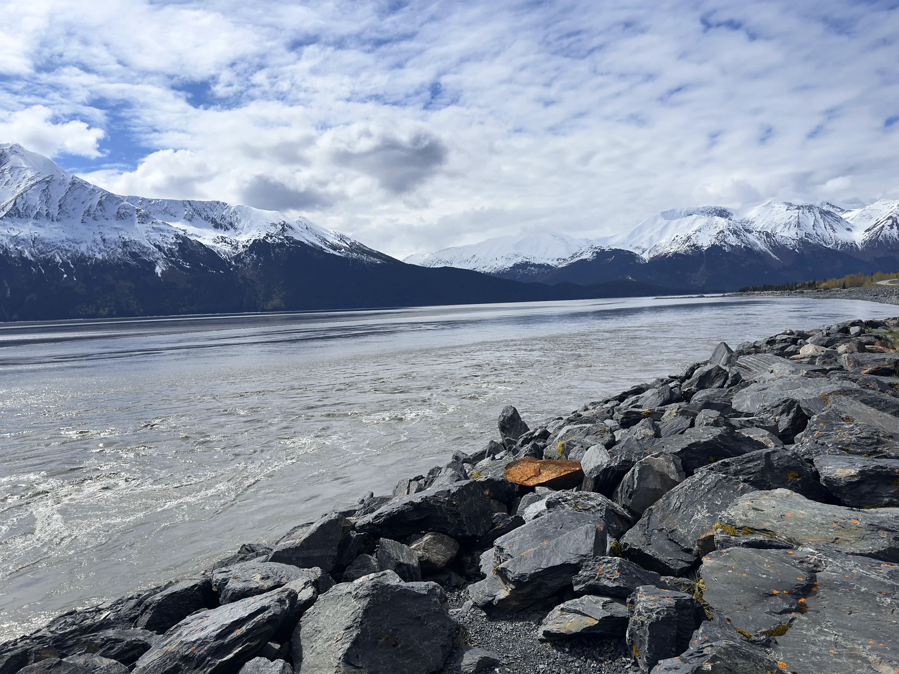

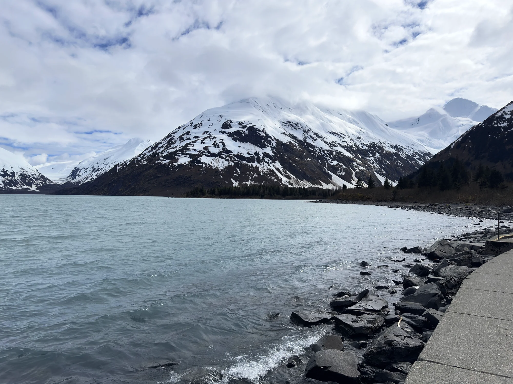

Para quem dirige, a Seward Highway é tranquila: pista asfaltada, com acostamentos e mirantes à beira do Turnagain Arm. Use esses acostamentos para as fotos, e não pare na pista.

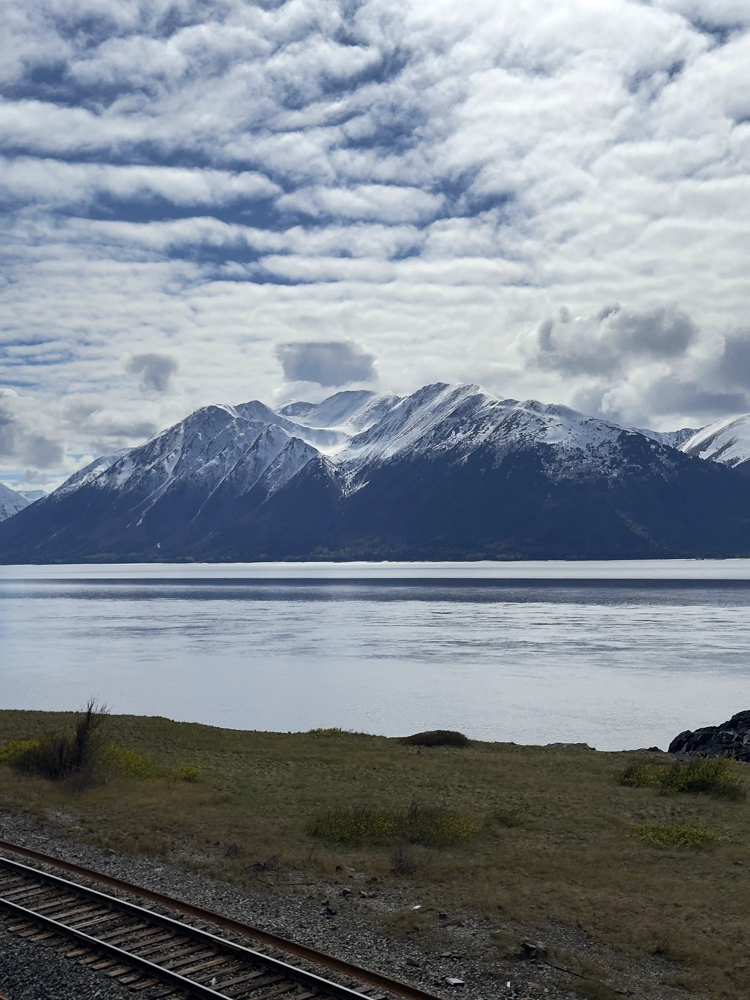

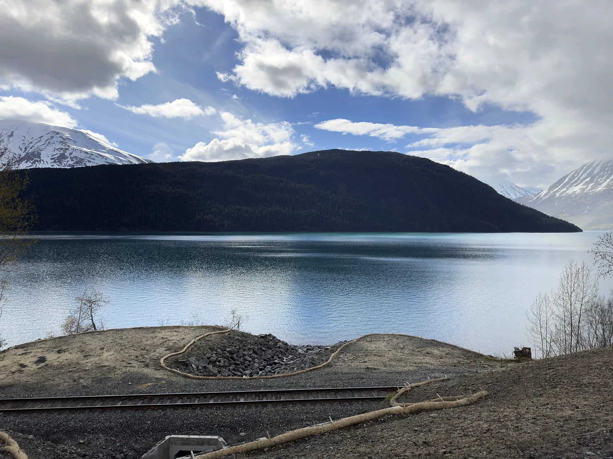

Em Seward, a estrada termina na Resurrection Bay. O vale do Exit Glacier, com o rio entrelaçado e a geleira ao fundo, fica a poucos quilômetros.

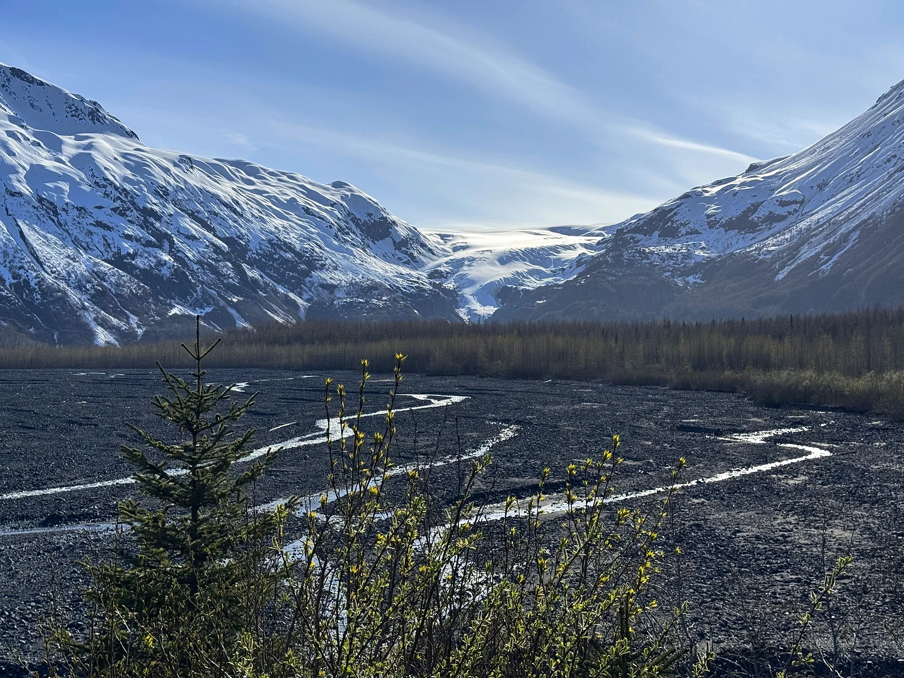

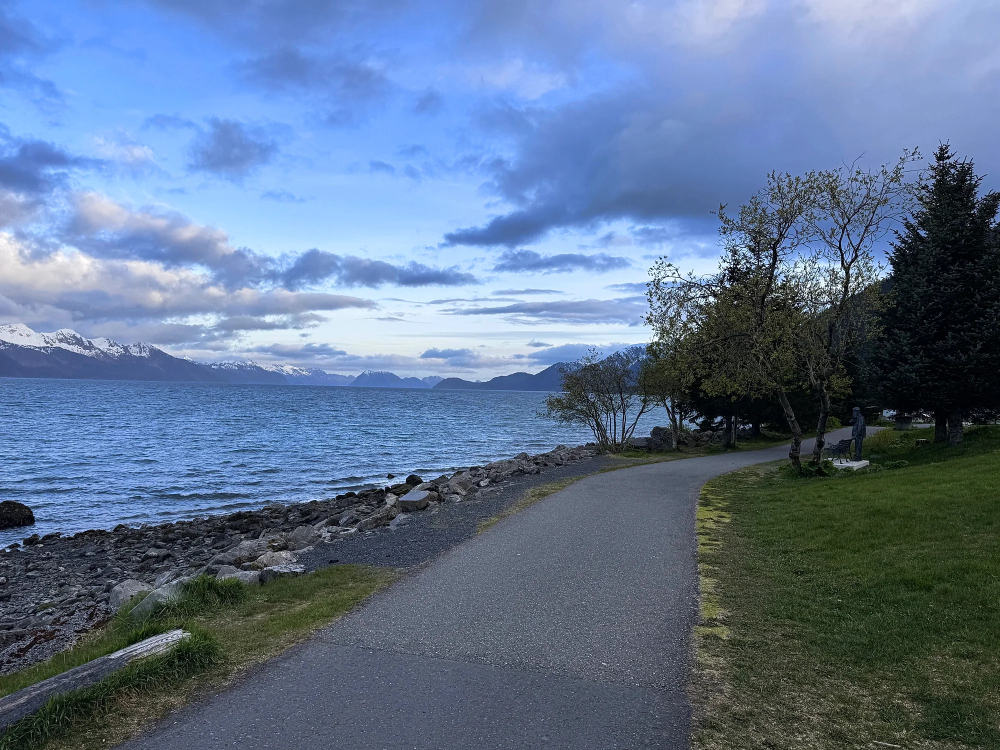

As paradas dos primeiros quilômetros, como o Potter Marsh e Girdwood, estão no guia de [Anchorage e arredores](/blog/anchorage-e-arredores-o-que-fazer/), e as geleiras do caminho, no guia das [geleiras do Alasca sem cruzeiro](/blog/geleiras-do-alasca-sem-cruzeiro/). O guia completo do trecho está no [guia de Seward e do Exit Glacier](/blog/seward-exit-glacier-alasca/), e o desvio para Whittier, no [guia de Whittier e do Túnel Anton Anderson](/blog/whittier-tunel-anton-anderson-alasca/).

## 2. Richardson Highway e Tok Cut-Off: até Valdez

A combinação da Tok Cut-Off com a Richardson Highway foi o dia mais bonito de estrada da nossa viagem. A Richardson, que liga Valdez a Fairbanks, nasceu de uma trilha da corrida do ouro e é considerada a estrada mais antiga do Alasca, como lembra um marco histórico no Keystone Canyon. A Tok Cut-Off tem 125 milhas (201 km) e liga Tok à Richardson, em Gakona Junction.

**O que ver.** Na Tok Cut-Off, lagos congelados e cordilheiras a cada curva. Perto de Gakona e Glennallen, os vulcões das Montanhas Wrangell, como o Mount Drum, com 12.010 pés (3.661 m). Depois, já na Richardson, o maciço das Chugach, a Worthington Glacier quase à beira da estrada, o Thompson Pass e as cachoeiras do Keystone Canyon, antes de Valdez.

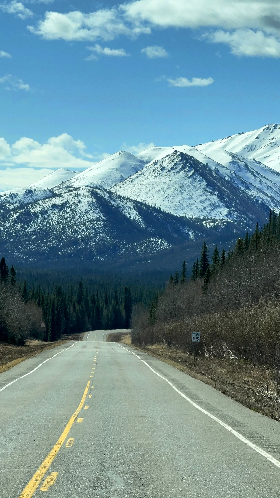

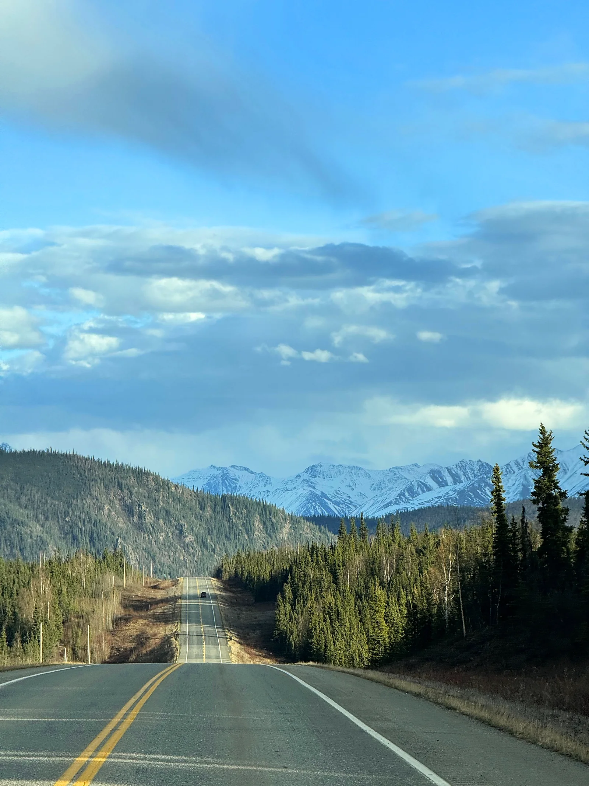

Quem vem de Fairbanks pode ir direto pela Richardson, cerca de 365 milhas (585 km), ou, como nós, pegar a Alaska Highway até Tok e descer pela Tok Cut-Off. A segunda opção soma cerca de 735 km e vale cada quilômetro.

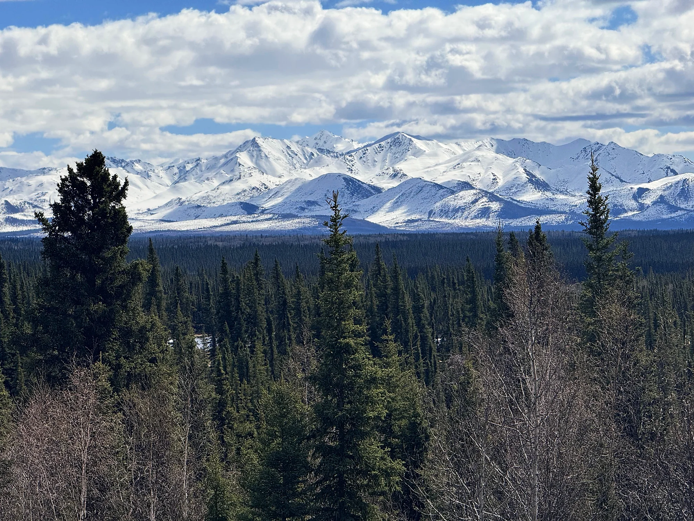

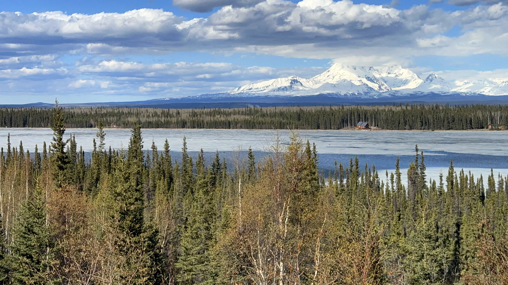

**Para quem dirige.** O ponto crítico é o Thompson Pass, a cerca de 800 m, conhecido como o lugar mais nevado do Alasca. Em 11 de maio, passamos com céu azul e neve alta dos dois lados da estrada; no dia seguinte, na volta, pegamos neve e neblina no mesmo trecho. Os postos ficam distantes uns dos outros na Tok Cut-Off: abasteça em Tok e em Glennallen.

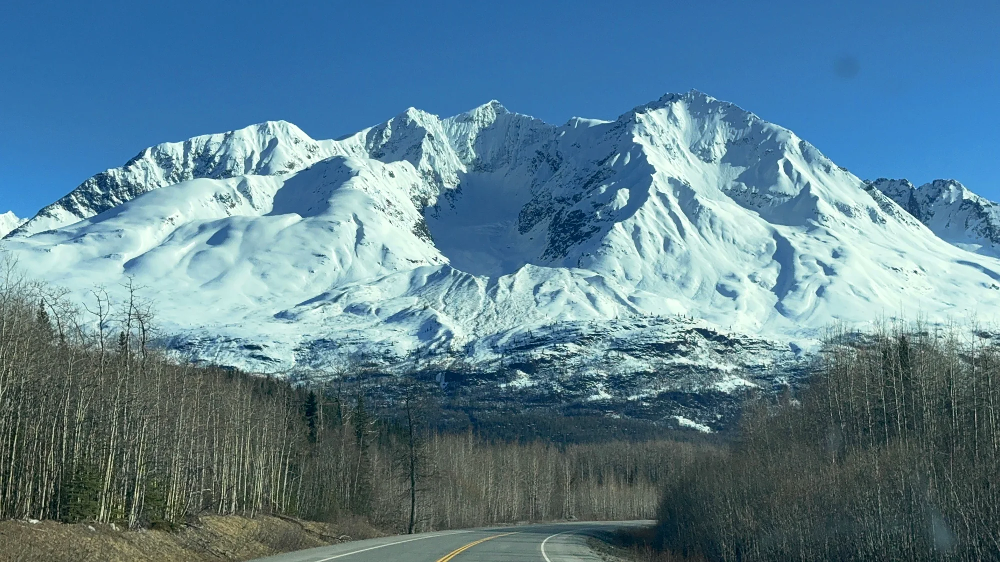

O trajeto trecho a trecho está no [guia de Valdez e da Richardson Highway](/blog/valdez-richardson-highway-thompson-pass-alasca/).

## 3. Dalton Highway: até o Círculo Polar Ártico

A Dalton Highway é a estrada mais isolada do Alasca, e a mais exigente das cinco. Ela tem cerca de 414 milhas (666 km), começa na Elliott Highway, perto de Livengood, e termina em Deadhorse, nos campos de petróleo de Prudhoe Bay. Foi construída em 1974 para os caminhões do petróleo, acompanha o Oleoduto Trans-Alasca e é quase toda de cascalho. Nós fomos até o Círculo Polar Ártico, na milha 115.

**O que ver.** As colinas de floresta do começo da estrada, a ponte do rio Yukon, com o piso de madeira e o oleoduto ao lado, a tundra e as torres de granito da Finger Mountain e a placa do Círculo Polar. Em maio, o sol ainda estava acima do horizonte às 22h na Finger Mountain.

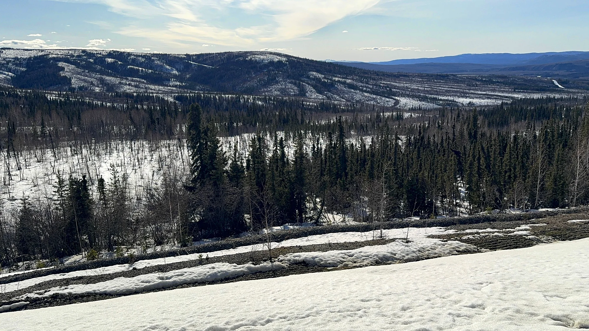

**Para quem dirige.** Na Dalton, os caminhões têm prioridade, os faróis devem ficar acesos o tempo todo, segundo a BLM, e não há sinal de celular na maior parte do trajeto. Combustível, só na ponte do Yukon, em Coldfoot e em Deadhorse. E a questão do contrato do aluguel, que tratamos no manual abaixo, é decisiva. Tudo sobre a estrada está no [guia da Dalton Highway e do Círculo Polar Ártico](/blog/dalton-highway-circulo-polar-artico-alasca/).

:::alerta
Antes de subir além de Livengood, confira **por escrito** as cláusulas do contrato do seu veículo. A maioria das locadoras do Alasca restringe estradas não pavimentadas ou exige autorização específica, e danos no cascalho, como pneus furados e para-brisa trincado, costumam ficar fora da cobertura do seguro.
:::

## 4. Parks Highway: do Matanuska ao Denali e a Fairbanks

A George Parks Highway tem 323 milhas (520 km), da Glenn Highway, perto de Anchorage, até Fairbanks. Foi concluída em 1971, com o nome de Anchorage-Fairbanks Highway, e depois rebatizada em homenagem a George A. Parks, governador do território do Alasca de 1925 a 1933. É a estrada do Denali.

**O que ver.** O desvio para Talkeetna, com vista para a Cordilheira do Alasca, o trecho alto da região de Broad Pass, a entrada do Parque Nacional Denali e o vale do rio Nenana. Em dia claro, o próprio Denali aparece da estrada; no nosso dia, ficou nas nuvens.

**Para quem dirige.** É uma estrada larga e asfaltada, com serviços em Wasilla, na entrada do Denali, em Healy e em Nenana. No começo de maio, a neve voltou no trecho alto: a partir das 19h de 5 de maio, ela já cobria as margens, e na região de Broad Pass o GPS das nossas fotos marcou cerca de 700 m de altitude. O guia do trecho está no [Denali em maio](/blog/denali-national-park-em-maio-alasca/), e Fairbanks, no fim da estrada, no [guia de Fairbanks, Chena Hot Springs e North Pole](/blog/fairbanks-chena-hot-springs-north-pole-alasca/).

:::dica
Na Parks Highway, saia cedo de Anchorage e reserve a tarde para o desvio até Talkeetna e para as paradas no trecho alto. Entre a entrada do Denali e Fairbanks são cerca de 120 milhas (195 km); dá para fazer no fim do dia, com a luz longa de maio.
:::

## 5. Sterling Highway: até o fim da estrada, em Homer

A Sterling Highway sai da Seward Highway em Tern Lake Junction e atravessa a Península Kenai até Homer. As fontes dão de 132 a 138 milhas (212 a 222 km). No caminho, passa por Soldotna, perto de Kenai, e desce pela costa da Cook Inlet. Anchor Point, uma das paradas, é descrita como o ponto mais a oeste da rede de rodovias da América do Norte.

**O que ver.** A costa da Cook Inlet, com falésias e praias largas, como Kalifornsky Beach, o mirante da chegada a Homer, sobre a Kachemak Bay, e o Homer Spit, uma língua de terra de cerca de 7 km mar adentro, onde a estrada termina.

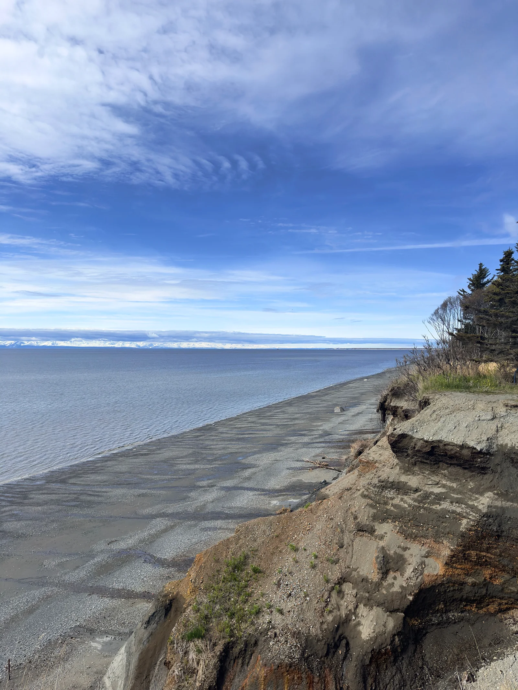

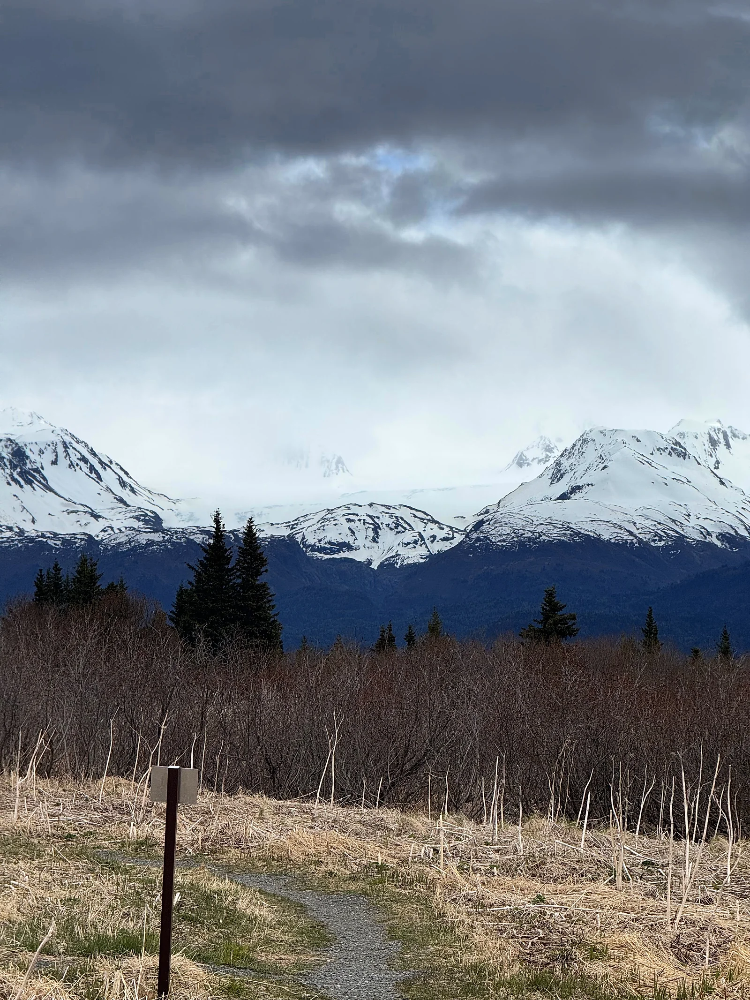

**Para quem dirige.** É a mais tranquila das cinco: asfalto, cidades próximas umas das outras e muitos campings. O cuidado é com os alces, que vimos à beira da estrada em Kalifornsky Beach e em Homer.

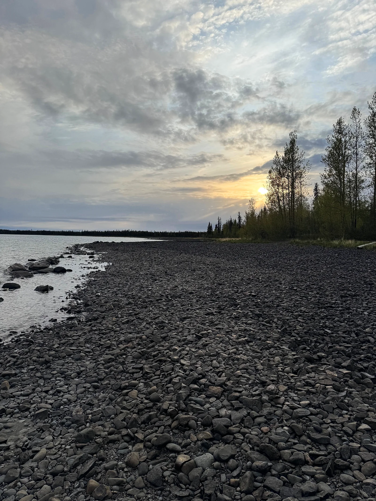

O guia completo está no [guia de Homer e da Península Kenai](/blog/homer-peninsula-kenai-alasca/).

## Bônus: Glenn Highway e o vale do Matanuska

Ela não entrou na lista das cinco porque fizemos só um trecho, de Glennallen a Anchorage, e com chuva e neve. Mesmo assim, a Glenn Highway merece a menção: o vale do rio Matanuska, com a Matanuska Glacier descendo das montanhas até perto da estrada, é um dos trechos mais bonitos do Alasca.

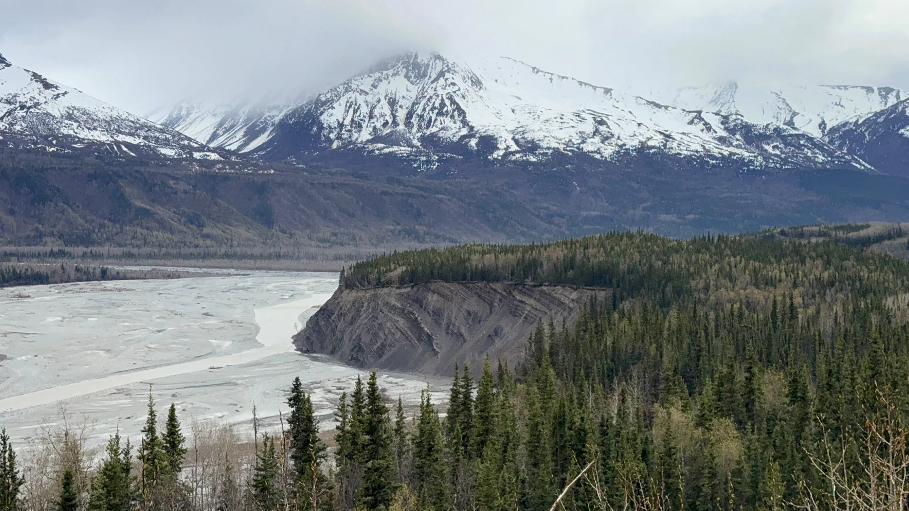

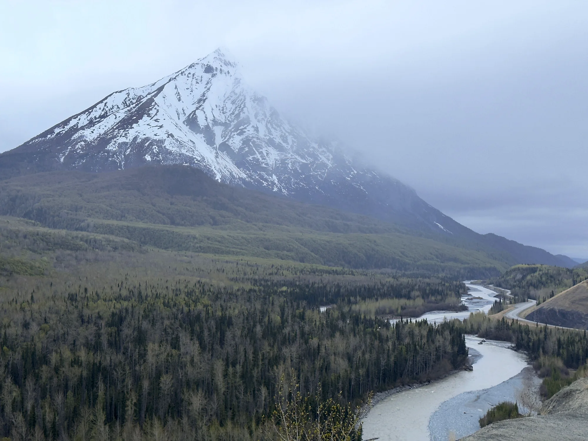

## Manual prático para dirigir no Alasca

### Contrato, seguro e estradas de cascalho

O ponto mais importante de qualquer road trip no Alasca está no contrato do aluguel. As regras variam por locadora:

| Locadora | Regra para estradas não pavimentadas |
|---|---|
| Cruise America | Os termos publicados permitem estradas públicas e numeradas e proíbem estradas não públicas e estradas secundárias sem pavimento; a empresa pode restringir trechos conforme as condições |
| Great Alaskan Holidays | Proíbe a Dalton do Círculo Polar a Prudhoe Bay e outras estradas, como a McCarthy Road; em estradas restritas, limite de 25 mph (40 km/h) |
| Fraserway | Só permite o trecho de Coldfoot a Prudhoe Bay com caminhonetes 4x4, de 15 de junho a 15 de setembro; dirigir em área restrita anula o seguro |

No balcão da retirada, não fomos informados de nenhuma restrição para o trecho da Dalton até o Círculo Polar. Mesmo assim, a orientação é clara: leia as cláusulas, pergunte por escrito e confirme até onde vai a cobertura antes de pegar o cascalho. Mais detalhes no [guia de motorhome no Alasca](/blog/viajar-de-motorhome-no-alasca/).

### Ondulações do asfalto e buracos

O turismo oficial do Alasca avisa que, mesmo nas rodovias pavimentadas, há ondulações causadas pelo congelamento do solo (as *frost heaves*) e buracos. Num motorhome, elas sacodem tudo o que estiver solto. Reduza a velocidade quando vir as placas de aviso, guarde louça e objetos antes de sair e não confie na pista lisa: as ondulações aparecem de repente, principalmente no interior.

### Tempo nas passagens de montanha

Em maio, a neve pode voltar a qualquer momento nas passagens altas. No Thompson Pass, passamos com céu azul na ida e neve com neblina na volta, no dia seguinte. No trecho alto da Parks Highway e na Glenn Highway, a neve também apareceu. Consulte o Alaska 511, que mostra fechamentos, obras e câmeras das estradas, e leve sempre roupa de frio no carro.

### O túnel de Whittier

Para chegar a Whittier, é preciso passar pelo túnel Anton Anderson, de pista única, dividido com o trem. No verão, de 1º de maio a 30 de setembro, ele funciona das 5h30 às 23h15, com janelas de 15 minutos: o sentido Whittier abre aos 30 minutos de cada hora, e o sentido Anchorage, nas horas cheias. O pedágio, de ida e volta, é de US$ 13 para carros e motorhomes abaixo de 28 pés e de US$ 22 para motorhomes maiores. Chegue ao pátio de espera pelo menos 10 minutos antes.

### Etiqueta dos acostamentos e regras de trânsito

- **Encoste para deixar passar.** A lei do Alasca exige que o motorista encoste quando cinco ou mais veículos se acumularem atrás dele. Num motorhome lento, isso acontece com frequência; use os acostamentos largos, os *pullouts*.
- **Faróis acesos.** A lei exige faróis acesos na maioria das rodovias.
- **Pare fora da pista.** Para fotografar alces e paisagens, use os acostamentos e as áreas de estacionamento. Nunca pare no meio da estrada.
- **Prioridade aos caminhões na Dalton.** Diminua a velocidade e encoste ao cruzar com eles, por causa das pedras e da poeira.

:::dica
Planeje o combustível pela metade do tanque: sempre que o ponteiro chegar ali e houver um posto, abasteça. Na Tok Cut-Off, na Dalton e em trechos longos da Richardson, a próxima bomba pode estar a mais de 150 km.
:::

## Qual estrada escolher?

- **Com pouco tempo:** a Seward Highway, saindo de Anchorage, é a melhor relação entre tempo e paisagem.
- **Para montanhas e geleiras:** a Richardson Highway com a Tok Cut-Off, até Valdez.
- **Para uma aventura:** a Dalton Highway até o Círculo Polar, se o contrato permitir.
- **Para o Denali:** a Parks Highway.
- **Para fauna e litoral:** a Sterling Highway, até Homer.

Num circuito como o nosso, dá para fazer as cinco em 16 dias, saindo e voltando a Anchorage.

## Perguntas frequentes

### Qual é a estrada mais bonita do Alasca?

Depende do gosto, mas, na nossa viagem, o dia mais bonito de estrada foi na Tok Cut-Off e na Richardson Highway até Valdez, com lagos congelados, os vulcões Wrangell, o Thompson Pass e as cachoeiras do Keystone Canyon. A Seward Highway, à beira do Turnagain Arm, é a mais fácil de incluir num roteiro curto.

### Dá para dirigir a Dalton Highway com carro ou motorhome alugado?

Depende do contrato. A maioria das locadoras do Alasca restringe estradas não pavimentadas ou exige autorização específica, e algumas proíbem a Dalton ou parte dela. Confira por escrito antes de reservar.

### As estradas do Alasca são asfaltadas?

As principais rodovias, como a Seward, a Parks, a Richardson, a Glenn, a Sterling e a Alaska Highway, são asfaltadas. A Dalton Highway é quase toda de cascalho, assim como outras estradas restritas por muitas locadoras, como a Denali Highway e a McCarthy Road.

### Como saber as condições das estradas no Alasca?

Pelo site Alaska 511, do governo do estado, que mostra fechamentos, obras e câmeras ao vivo. Consulte antes de cada trecho de montanha, como o Thompson Pass.

### Quanto tempo leva para fazer as 5 estradas?

Num circuito saindo e voltando a Anchorage, como o nosso, fizemos as cinco em 16 dias, com cerca de 3.800 a 4.000 km de estrada. Sem a Dalton Highway, o roteiro pode ser feito em menos tempo.

## Fontes consultadas

- [Departamento de Transportes do Alasca: Seward Highway Scenic Byway](https://dot.alaska.gov/scenic/byways-seward.shtml)
- [Alaska.org: a maré do Turnagain Arm](https://www.alaska.org/blog/the-thrill-of-witnessing-a-bore-tide-along-turnagain-arm)
- [Alaska.org: tabela de distâncias entre as cidades](https://www.alaska.org/advice/mileage-chart)
- [Bell's Alaska: Tok Cut-Off](https://www.bellsalaska.com/highway/tok-cut-off/)
- [HMdb: marco histórico da Richardson Highway no Keystone Canyon](https://www.hmdb.org/m.asp?m=257002)
- [NPS Wrangell-St. Elias: as montanhas do parque](https://www.nps.gov/wrst/learn/nature/mountains.htm)
- [Wikipedia: Thompson Pass](https://en.wikipedia.org/wiki/Thompson_Pass)
- [BLM: recreação na Dalton Highway](https://www.blm.gov/learn/interpretive-centers/arctic-interagency-visitor-center/dalton-highway-recreation)
- [Alyeska: a Dalton Highway e a Haul Road](https://alyeska-pipe.com/pipeline_facts/the-dalton-highway-the-haul-road/)
- [Wikipedia: George Parks Highway](https://en.wikipedia.org/wiki/George_Parks_Highway)
- [Wikipedia: Sterling Highway](https://en.wikipedia.org/wiki/Sterling_Highway)
- [Travel Alaska: dicas para viajar de motorhome no Alasca](https://www.travelalaska.com/explore-alaska/articles/tips-rv-travel-alaska)
- [Travel Alaska: Dalton Highway saindo de Fairbanks](https://www.travelalaska.com/explore-alaska/itineraries/dalton_highway_road_trip_from_fairbanks)
- [Cruise America: perguntas frequentes sobre o aluguel](https://www.cruiseamerica.com/rv-rentals/renters-resources/rv-rental-faqs)
- [Great Alaskan Holidays: estradas restritas e proibidas](https://www.greatalaskanholidays.com/alaska-rv-rentals/important-rental-information/restrictions-on-operating-the-motorhome/)
- [Fraserway: termos e condições do aluguel](https://rent.fraserway.com/rent-terms-conditions.html)
- [Departamento de Transportes do Alasca: horários do túnel de Whittier](https://dot.alaska.gov/creg/whittiertunnel/schedule.shtml)
- [Departamento de Transportes do Alasca: tarifas do túnel de Whittier](https://dot.alaska.gov/creg/whittiertunnel/tolls.shtml)
