Muita gente acha que, para ver geleiras no Alasca, é preciso fazer um cruzeiro. Não é. Algumas das geleiras mais impressionantes do estado ficam a poucos minutos das rodovias principais, com estacionamento, trilhas curtas e mirantes, e boa parte delas pode ser vista sem pagar nada. Num motorhome, em três dias de estrada, passamos por quatro: a Worthington, quase à beira da Richardson Highway; a Matanuska, que desce até perto da Glenn Highway; a Exit Glacier, no Parque Nacional Kenai Fjords, perto de Seward; e o vale do Portage, a caminho de Whittier.

Este guia reúne como chegar a cada uma, o que dá para ver sem guia, o que é pago, as trilhas, o que esperar em maio e os cuidados de segurança perto do gelo. O roteiro completo da viagem está no [roteiro de 16 dias pelo Alasca de motorhome](/blog/roteiro-alasca-16-dias-motorhome/). **As informações práticas foram pesquisadas em novembro de 2026.** Acessos e preços mudam a cada temporada, por isso confirme tudo antes de ir. As fontes estão no fim do artigo.

## As 4 geleiras em resumo

| Geleira | Onde fica | Distância de Anchorage | Acesso | Caminhada | Custo |
|---|---|---|---|---|---|
| Exit Glacier | Parque Nacional Kenai Fjords, perto de Seward | Cerca de 132 milhas (213 km): 124 pela Seward Highway e 8,4 pela estrada de acesso | Herman Leirer Road, a partir da milha 3 da Seward Highway | Trilhas de 0,6 a 8 milhas; a mais curta leva ao mirante | Grátis: o parque não cobra entrada |
| Worthington Glacier | Richardson Highway, a cerca de 28,7 milhas (46 km) de Valdez | Cerca de 270 milhas (435 km), pela Glenn e pela Richardson | Área de recreação estadual à beira da estrada | Curta, a partir do estacionamento | Sem caminhada paga |
| Matanuska Glacier | Glenn Highway, milhas 101 e 102 | Cerca de 100 milhas (160 km) | Mirantes da estrada e área de recreação estadual na milha 101; acesso ao gelo por terra particular, na milha 102 | No gelo, só pela entrada particular, com taxa e, em boa parte do ano, com guia | Mirantes grátis; acesso ao gelo pago |
| Portage Glacier | Vale do Portage, a caminho de Whittier | Cerca de 55 a 60 milhas (90 a 95 km) | Portage Glacier Road, a partir da Seward Highway | A geleira não aparece mais do lago; para vê-la, barco ou trilha | O lago é de graça; o barco é pago |

## 1. Exit Glacier: a mais fácil de chegar perto

A Exit Glacier é a única parte do Parque Nacional Kenai Fjords que se alcança por estrada, e a geleira mais fácil de ver de perto no nosso roteiro. Ela desce do Harding Icefield, o grande campo de gelo que cobre as montanhas da Península Kenai.

**Como chegar.** A Herman Leirer Road, conhecida como Exit Glacier Road, sai da Seward Highway na milha 3, já na entrada de Seward, e segue por 8,4 milhas (13,5 km) até o estacionamento do centro de visitantes. Segundo o Serviço Nacional de Parques, o parque não cobra entrada nem camping.

**As trilhas.** O Glacier View Loop tem 1 milha (1,6 km) em circuito e é acessível. O Glacier Overlook Trail tem 0,6 milha (1 km) a partir do quiosque da trilha e leva ao mirante da geleira. O Harding Icefield Trail, de 8 milhas (12,9 km) ida e volta, sobe até a vista do campo de gelo e exige um dia inteiro.

Nós chegamos às 18h40 de 13 de maio e fizemos a trilha do centro de visitantes até a área do mirante, a cerca de 1 km do estacionamento. O caminho começa pavimentado e plano e depois sobe por um terreno de pedras.

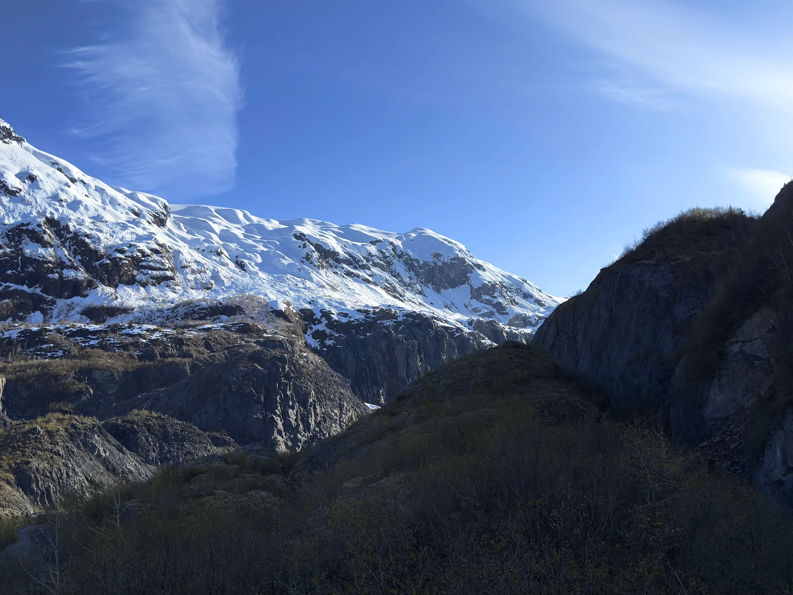

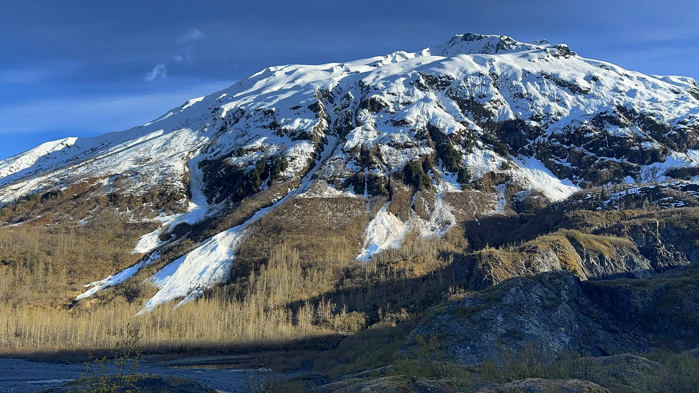

**O que torna a visita especial.** Ao longo da estrada e da trilha, placas com anos marcam até onde a frente do gelo chegava em cada época. Na nossa caminhada, a placa de 2005 já ficava longe do gelo atual. Segundo o Serviço Nacional de Parques, a última placa da trilha marca a borda de 2010, e dali em diante se vê o vale que a geleira deixou ao recuar. É uma das formas mais diretas de ver as mudanças do clima na paisagem.

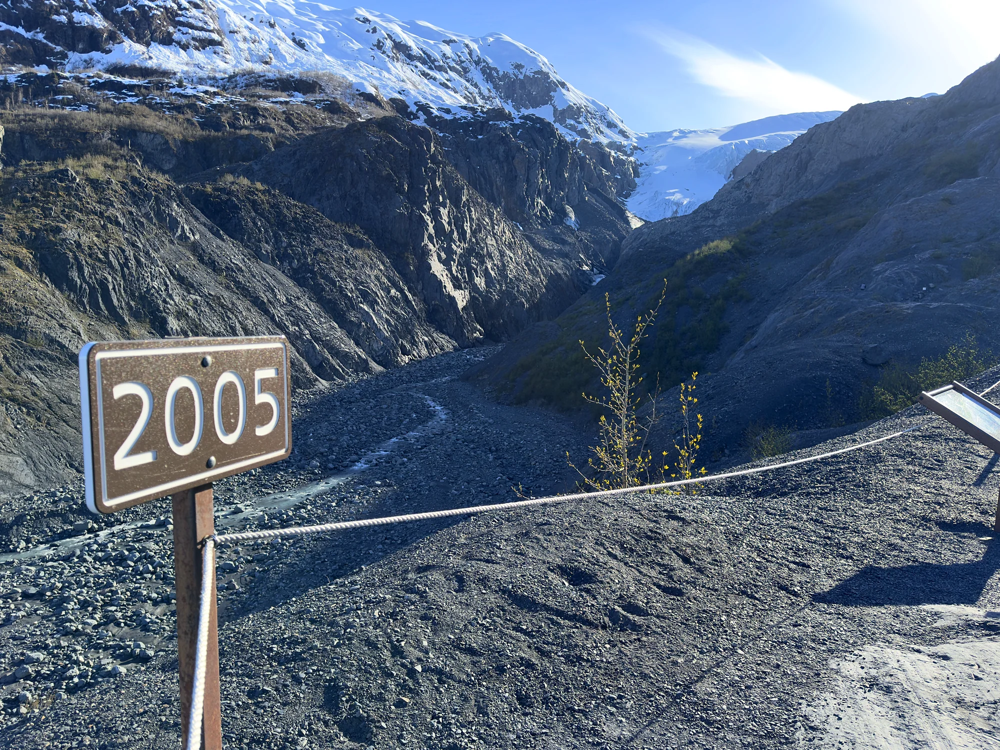

:::alerta
Do fim de outubro a meados de maio, a estrada da Exit Glacier costuma ficar fechada aos carros por causa da neve. Em 2026, o portão abriu em 14 de maio; em 2025, quando fomos, a estrada já estava aberta em 13 de maio. Consulte a página de condições do Kenai Fjords antes de ir. No verão, o estacionamento lota entre 10h30 e 15h30.
:::

O guia completo da área, com a cidade de Seward, está no [guia de Seward e do Exit Glacier](/blog/seward-exit-glacier-alasca/).

## 2. Worthington Glacier: quase à beira da estrada

A Worthington Glacier fica numa área de recreação estadual à beira da Richardson Highway, por volta da milha 28,7, contada a partir de Valdez, logo depois do Thompson Pass. Segundo o Alaska.org, é uma geleira de cerca de 4 milhas (6,4 km) que desce quase até o asfalto e é fácil de alcançar a pé. A área tem estacionamento, banheiros secos e um pavilhão com uma maquete da geleira e painéis informativos. Ela é também um Marco Natural Nacional dos Estados Unidos.

**Como foi em maio.** Passamos pela Worthington duas vezes. Em 11 de maio, às 19h08, com sol entre as nuvens, a área ainda estava coberta de neve funda. No dia seguinte, na volta de Valdez, às 11h41, a neve caía e a neblina cobria as montanhas. O mesmo lugar, com 16 horas de diferença, parecia outro.

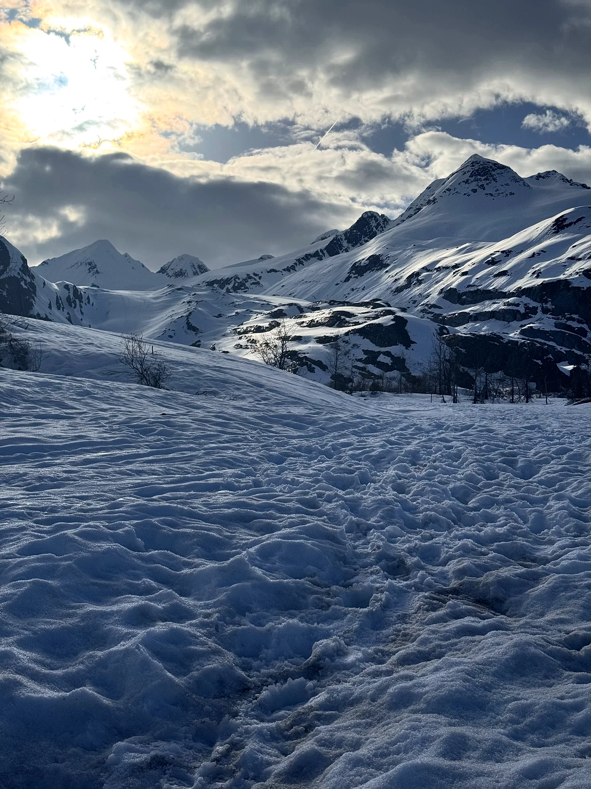

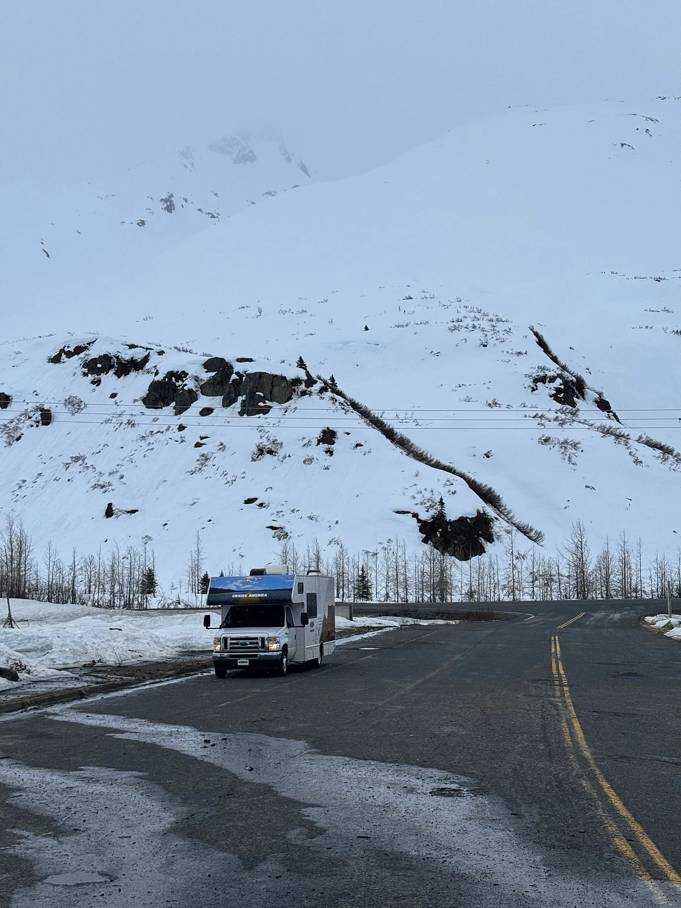

:::dica
Combine a Worthington com o Thompson Pass e as cachoeiras do Keystone Canyon, todos na mesma meia hora de estrada antes de Valdez. Em maio, saia com roupa de neve à mão: o tempo nas passagens altas muda em minutos.
:::

O trajeto completo até Valdez está no [guia de Valdez e da Richardson Highway](/blog/valdez-richardson-highway-thompson-pass-alasca/).

## 3. Matanuska Glacier: a maior vista da estrada

A Matanuska Glacier é a maior das quatro. Segundo o Alaska.org, é um rio de gelo de 27 milhas (43 km) que desce das montanhas Chugach quase até a Glenn Highway, com uma frente de 4 milhas (6,4 km) de largura visível da estrada.

**Duas formas de ver.**

- **Dos mirantes da estrada e da área de recreação estadual, na milha 101.** A área tem trilhas, camping e plataformas de observação. Não há acesso ao gelo a partir dali.
- **Caminhando sobre o gelo, pela entrada particular, na milha 102.** Todos os acessos por estrada até a geleira passam por terra particular, com taxa. Segundo o Anchorage Daily News, as visitas guiadas funcionam o ano inteiro, mas o acesso sem guia só existe no verão. As taxas variam por fonte e mudam; confirme antes de ir.

**Como foi para nós.** Passamos pela Glenn Highway em 12 de maio, na volta de Valdez, num dia de chuva e neve. Paramos nos mirantes da estrada, entre 17h49 e 18h45, e ficamos neles: com o céu fechado, a geleira aparecia como uma faixa branca entre as montanhas, acima de uma floresta escura.

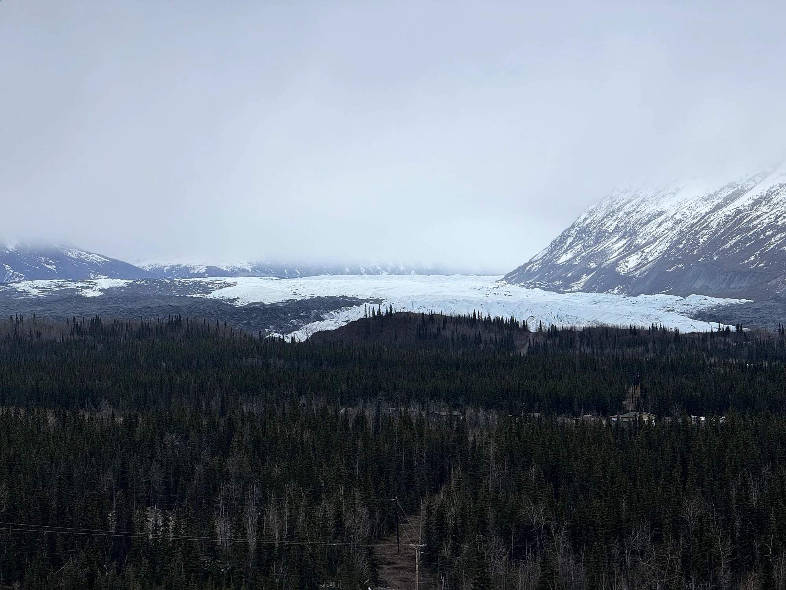

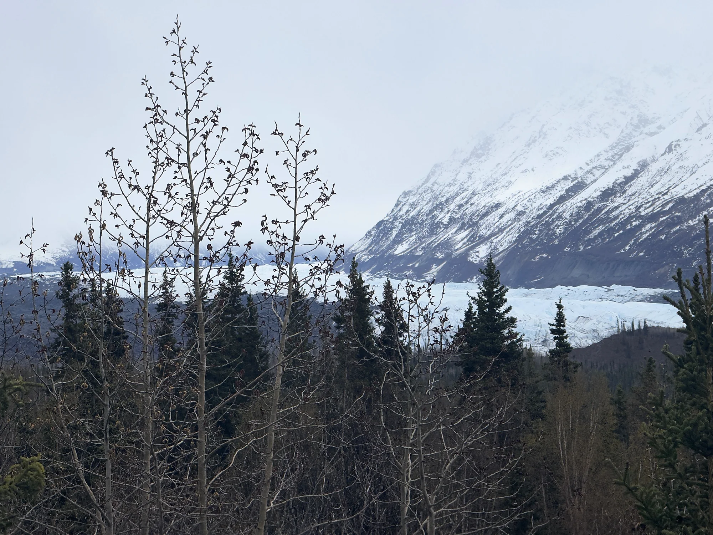

Do mesmo trecho da estrada, o vale do rio Matanuska, alimentado pela geleira, se abre com o leito largo e cinzento entre florestas.

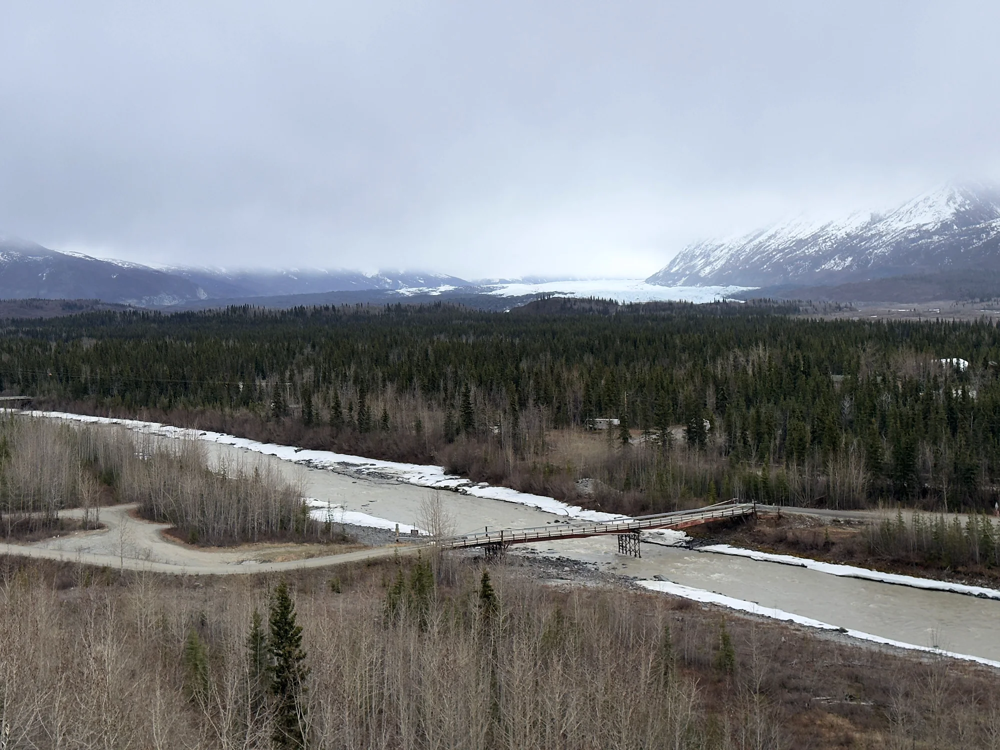

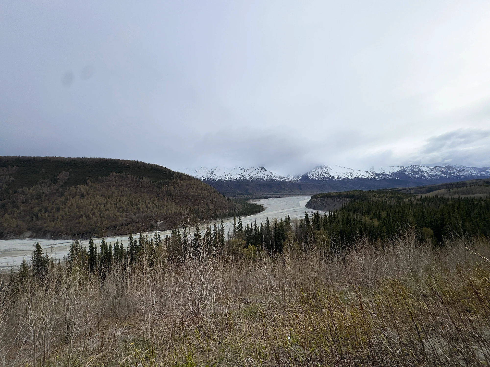

:::alerta
Não caminhe sobre a Matanuska, nem sobre nenhuma outra geleira, sem guia. A superfície tem fendas, gelo escorregadio e trechos que mudam a cada dia. Use a entrada particular e as visitas guiadas para pisar no gelo.
:::

## 4. Portage Glacier e o Portage Lake

O vale do Portage fica no fundo do Turnagain Arm, no caminho de Whittier, e foi por muito tempo o lugar clássico para ver uma geleira saindo de Anchorage. Hoje, a Portage Glacier não aparece mais do lago. Segundo o Serviço Florestal dos Estados Unidos, o centro de visitantes Begich, Boggs fica sobre a morena que a geleira deixou antes de começar a recuar, por volta de 1914, e ela já recuou mais de 3 milhas (4,8 km) desde então.

**O que dá para ver.** O Portage Lake, um lago glacial de água cinza-azulada, cercado de montanhas com geleiras suspensas. Para ver a própria Portage Glacier, há um passeio de barco de cerca de uma hora que sai perto do centro de visitantes e, segundo o Alaska.org, chega a cerca de 300 jardas (275 m) da frente de gelo, ou a trilha do Portage Pass, do lado de Whittier. O centro de visitantes funciona do Memorial Day, no fim de maio, ao Labor Day, no começo de setembro.

**Como foi para nós.** Paramos no Portage Lake em 13 de maio, às 15h20, a caminho de Seward, e voltamos ao vale no dia 17, a caminho de Whittier. Em 13 de maio, o lago estava praticamente sem gelo, e o estacionamento, quase vazio. As geleiras suspensas nas montanhas ao redor e as nuvens baixas compensaram a ausência da Portage Glacier.

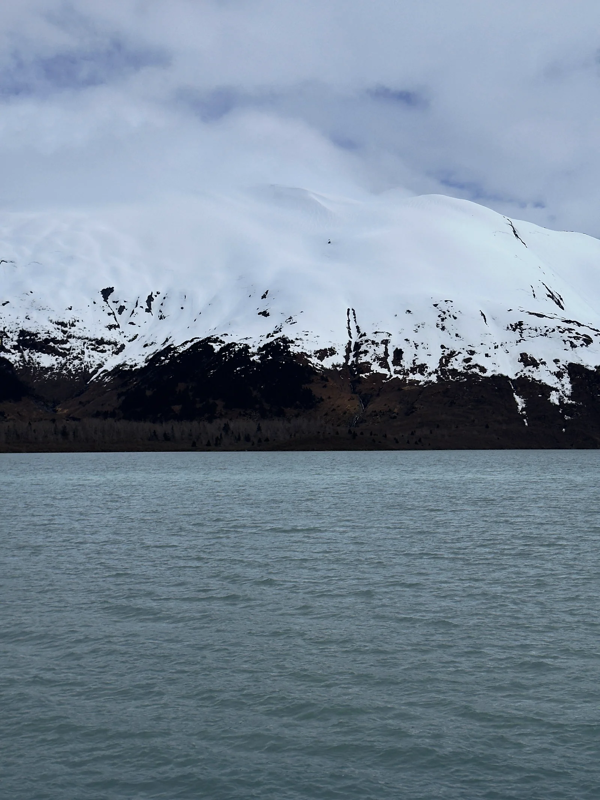

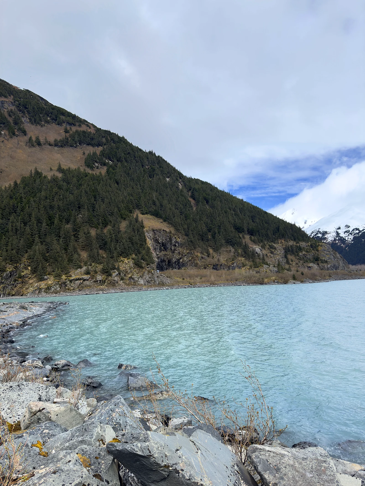

A cor da água muda com a luz e com o sedimento trazido pelo degelo das geleiras: cinza sob as nuvens, turquesa nas margens rasas.

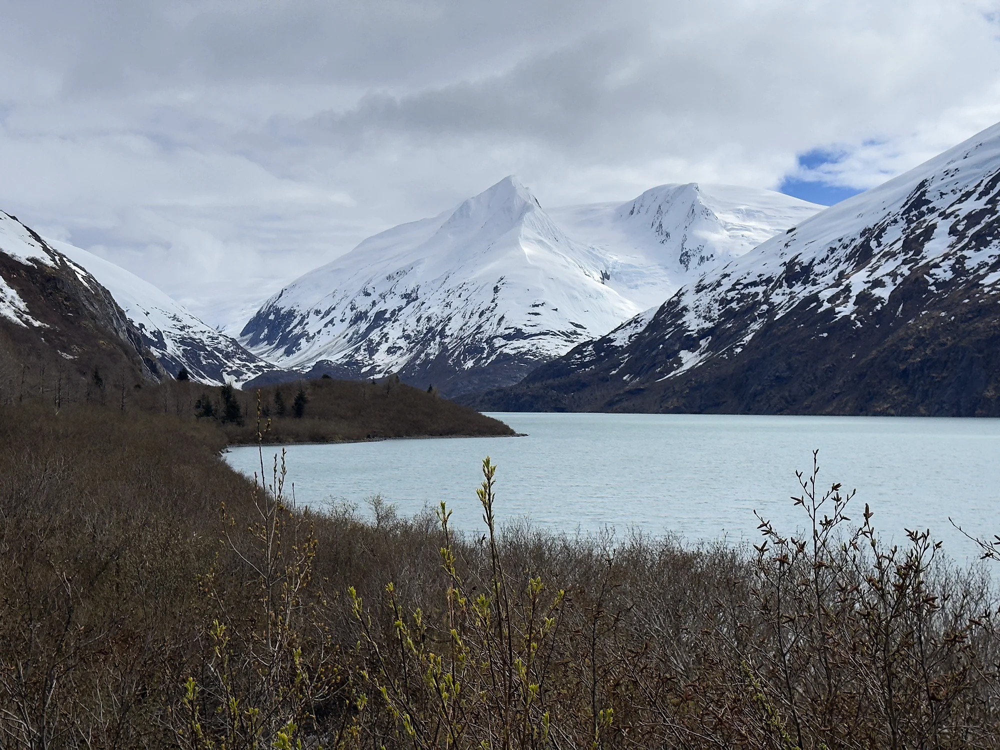

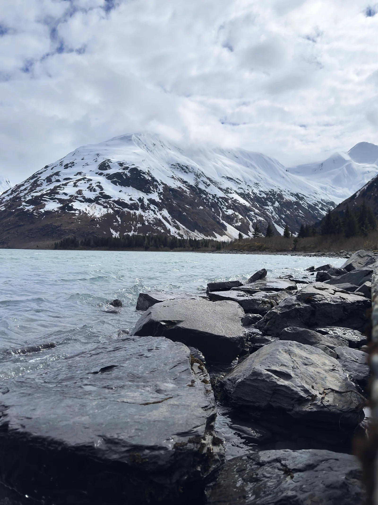

O caminho do vale até o túnel de Whittier está no [guia de Whittier e do Túnel Anton Anderson](/blog/whittier-tunel-anton-anderson-alasca/).

## Segurança perto de geleiras

- **Fique atrás das placas e das cercas.** A frente de uma geleira pode desmoronar sem aviso, e o terreno perto do gelo é instável.
- **Não suba no gelo sem guia.** Fendas, gelo escorregadio e água de degelo correndo por baixo tornam a superfície perigosa.
- **Não se aproxime de blocos de gelo nos lagos.** Icebergs podem virar ou se partir.
- **Cuidado com a água de degelo.** Os rios que saem das geleiras são gelados e rápidos.
- **Leve camadas de roupa.** Perto do gelo, a temperatura cai e o vento aumenta.
- **Consulte as condições antes de ir.** Em maio, estradas como a da Exit Glacier podem ainda estar fechadas.

## Qual geleira escolher?

- **Para chegar perto a pé, de graça:** a Exit Glacier.
- **Para ver sem sair do carro, numa viagem até Valdez:** a Worthington.
- **Para a maior vista e para pisar no gelo com guia:** a Matanuska.
- **Para uma parada curta saindo de Anchorage:** o Portage Lake, com o barco até a Portage Glacier no verão.

Num roteiro de motorhome como o nosso, dá para passar pelas quatro sem desvios longos. A Exit, a Worthington e o Portage ficam em rodovias do guia das [5 estradas mais cênicas do Alasca](/blog/estradas-mais-cenicas-do-alasca-road-trip/), e a Matanuska, na Glenn Highway, aparece no bônus do mesmo guia; o que muda em cada mês está no guia da [melhor época para ir ao Alasca](/blog/melhor-epoca-para-ir-ao-alasca-maio/).

## Perguntas frequentes

### Dá para ver geleiras no Alasca sem cruzeiro?

Dá. A Exit Glacier, a Worthington, a Matanuska e o vale do Portage ficam junto às rodovias principais, e boa parte delas pode ser vista de graça, dos mirantes e das trilhas. Nós vimos as quatro de motorhome, em três dias de estrada.

### Qual é a geleira mais fácil de visitar perto de Anchorage?

O Portage Lake fica a cerca de 90 km de Anchorage, mas a Portage Glacier não aparece mais do lago. Para chegar perto de uma geleira a pé, a Exit Glacier, perto de Seward, é a melhor opção, a cerca de 213 km de Anchorage. A Matanuska, a cerca de 160 km, tem a maior vista da estrada.

### Precisa pagar para ver a Exit Glacier?

Não. Segundo o Serviço Nacional de Parques, o Kenai Fjords não cobra entrada nem camping.

### Dá para caminhar sobre a Matanuska Glacier?

Dá, mas só pela entrada particular, na milha 102 da Glenn Highway, com taxa e, em boa parte do ano, com guia. A área de recreação estadual, na milha 101, tem mirantes e trilhas, mas não dá acesso ao gelo.

### Por que não se vê mais a Portage Glacier do lago?

Porque ela recuou. Segundo o Serviço Florestal, a geleira começou a recuar por volta de 1914 e já está a mais de 3 milhas (4,8 km) de onde fica o centro de visitantes. Para vê-la, é preciso fazer o passeio de barco pelo lago ou a trilha do Portage Pass.

## Fontes consultadas

- [NPS Kenai Fjords: área do Exit Glacier](https://www.nps.gov/kefj/planyourvisit/exit-glacier-area.htm)
- [NPS Kenai Fjords: taxas e passes](https://www.nps.gov/kefj/planyourvisit/fees.htm)
- [NPS Kenai Fjords: condições atuais](https://www.nps.gov/kefj/planyourvisit/conditions.htm)
- [NPS Kenai Fjords: abertura da área do Exit Glacier em 14 de maio de 2026](https://www.nps.gov/kefj/learn/news/exit-glacier-area-to-open-for-summer-season-on-may-14-2026.htm)
- [NPS Kenai Fjords: placa de 2010 e fim da trilha da Exit Glacier](https://www.nps.gov/places/exit-glacier-2010-sign-and-end-of-trail.htm)
- [Alaska.org: Worthington Glacier](https://alaska.org/detail/worthington-glacier)
- [Alaska.org: geleiras à beira da estrada](https://www.alaska.org/things-to-do/roadside-glaciers)
- [Alaska State Parks: Matanuska Glacier State Recreation Site](https://dnr.alaska.gov/parks/aspunits/matsu/matsuglsrs.htm)
- [Alaska.org: Matanuska Glacier State Recreation Site](https://alaska.org/detail/matanuska-glacier-state-recreation-site)
- [Anchorage Daily News: acesso à Matanuska Glacier por terra particular](https://www.adn.com/alaska-news/2021/10/17/matanuska-glacier-is-public-but-most-visitors-can-reach-it-only-via-private-land/)
- [Serviço Florestal dos EUA: Begich, Boggs Visitor Center e Portage Glacier](https://fs.usda.gov/media/197764)
- [Travel Alaska: Portage Glacier](https://www.travelalaska.com/destinations/parks-public-lands/portage-glacier)
- [Alaska.org: Begich Boggs e a história da Portage Glacier](https://www.alaska.org/detail/begich-boggs-portage-glacier)
- [Alaska.org: tabela de distâncias entre as cidades](https://www.alaska.org/advice/mileage-chart)
