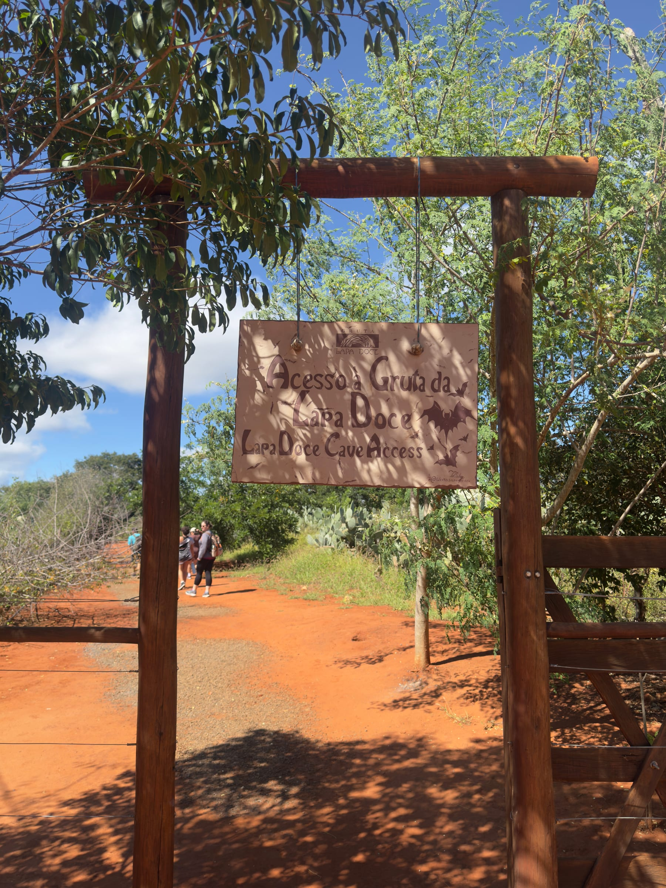
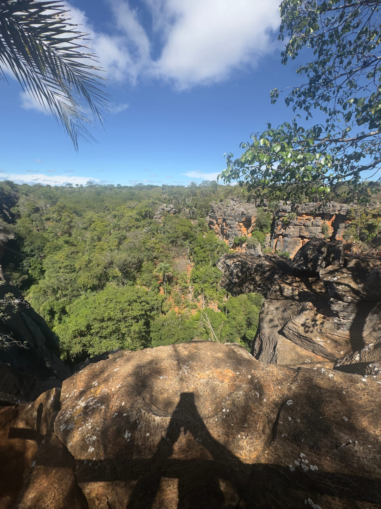
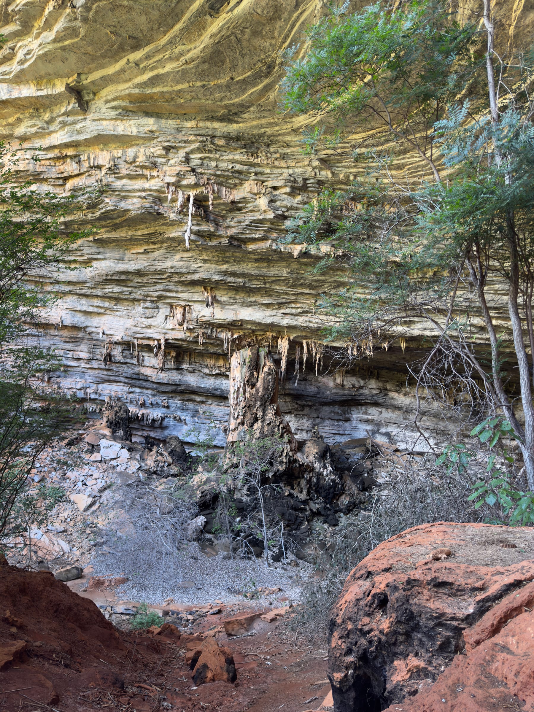
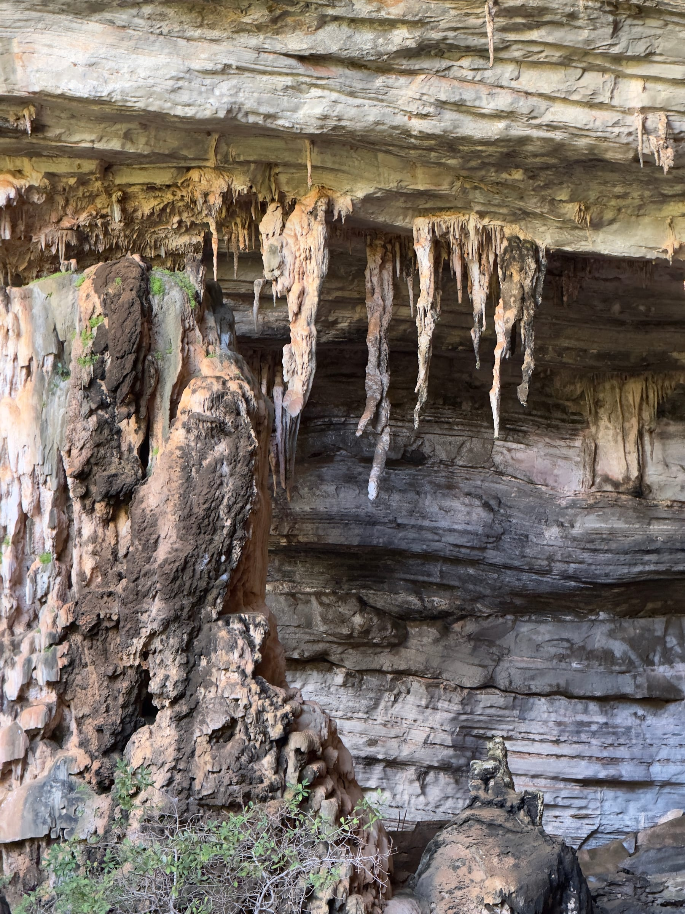
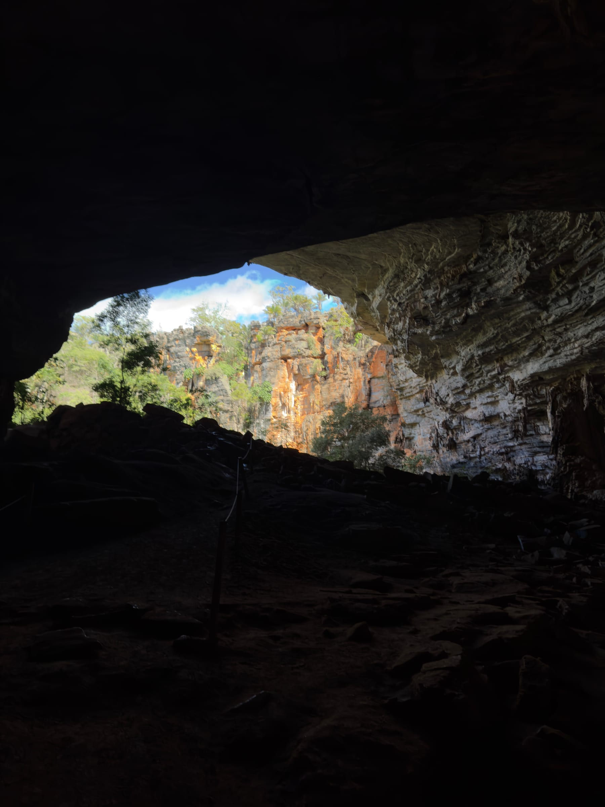
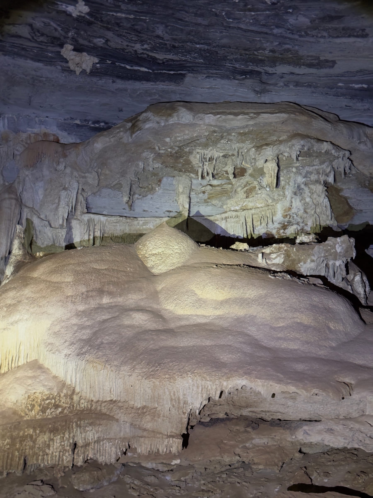
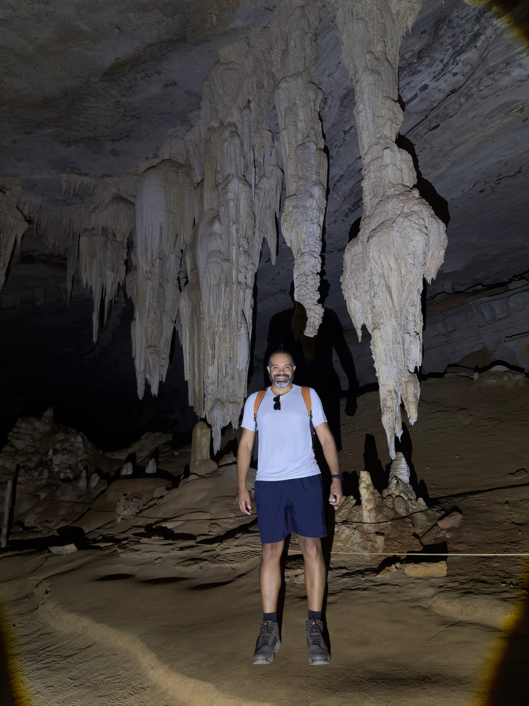
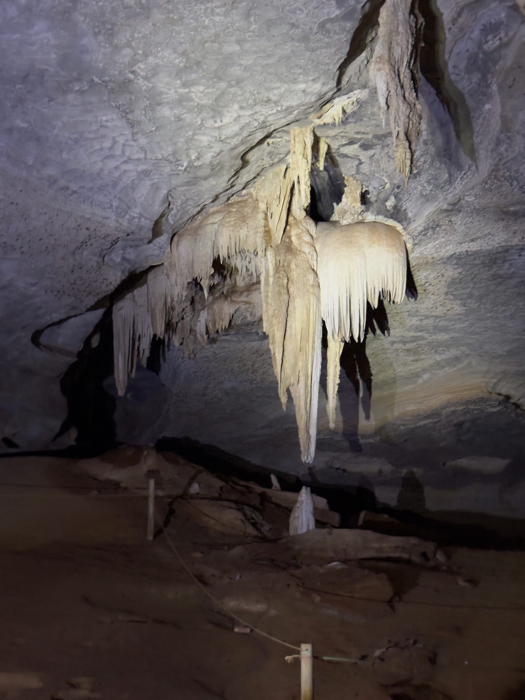
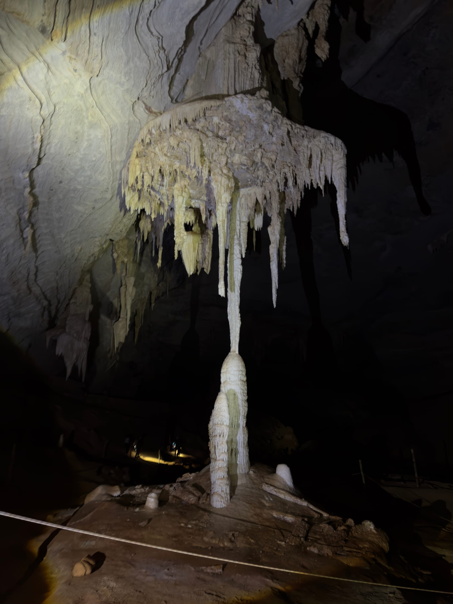
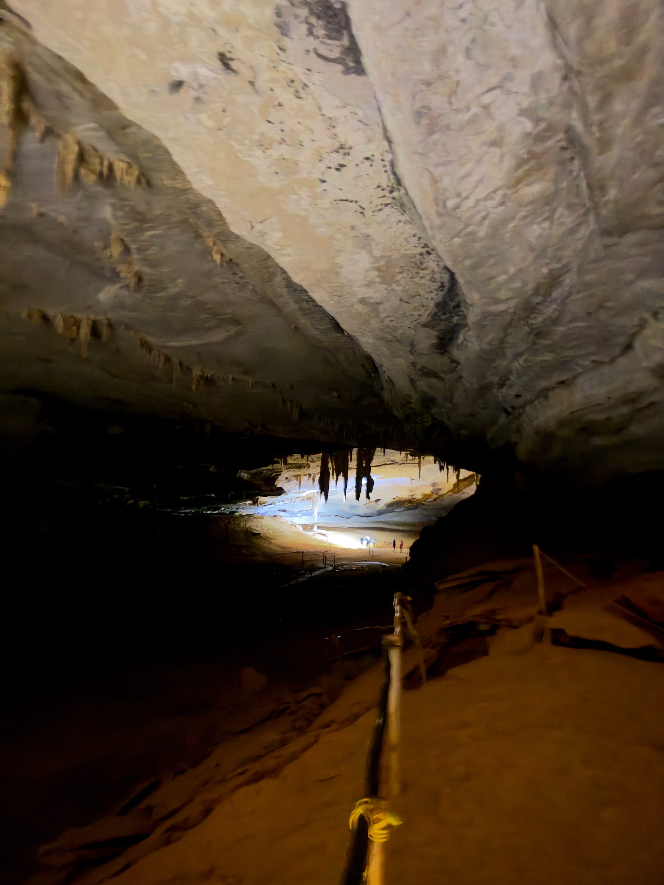

A Gruta da Lapa Doce é uma das cavernas mais conhecidas da Chapada Diamantina e uma das maiores do Brasil, com mais de 40 km de galerias mapeadas. A visita tradicional é uma travessia subterrânea guiada de cerca de 850 metros, no escuro total, iluminada só por lampiões e lanternas, entre salões de teto alto e formações de calcário.

Este guia explica como funciona a travessia, as regras de conservação e como encaixar a gruta num dia de passeio por Iraquara. Para planejar o restante da viagem, veja o [guia de Lençóis](/blog/o-que-fazer-em-lencois-chapada-diamantina/) e o [roteiro completo pela Chapada Diamantina](/blog/roteiro-chapada-diamantina/). **As informações foram pesquisadas em novembro de 2026.** Taxas e horários mudam, por isso confirme antes de ir.

## Uma das maiores cavernas do Brasil

A Lapa Doce fica em Iraquara, município conhecido como a "Cidade das Grutas" por reunir um dos maiores conjuntos de cavernas da América do Sul. Reportagens recentes falam em mais de 40 km de galerias já mapeadas, e guias locais a colocam entre as maiores cavernas topografadas do país. A gruta também já revelou ossadas fósseis e outros registros paleontológicos.

O acesso começa pela descida de uma grande dolina, uma depressão formada pelo desabamento do teto de antigas cavernas, com um desnível de cerca de 70 metros. Lá embaixo, a vegetação cresce dentro do buraco, e as paredes de calcário em camadas já mostram as primeiras estalactites.

## Como é a travessia subterrânea

O roteiro tradicional percorre cerca de 850 metros dentro da caverna, entrando por uma dolina e saindo por outra. Poucos metros depois da entrada, a luz do dia desaparece, e a partir daí só existe a iluminação que o grupo leva.

O guia carrega um lampião, e os visitantes usam lanternas. É essa luz em movimento que vai revelando as formações: estalactites que descem do teto, estalagmites que sobem do chão, colunas, cortinas e escorrimentos de calcita. Longe da entrada, o silêncio do interior é absoluto.

O percurso termina numa galeria que leva à outra dolina, onde a luz do dia volta a aparecer. Para quem quer mais, guias locais citam roteiros mais longos, de 2,5 km e 3 km, e uma visita à Lapa do Sol, com pinturas rupestres.

:::alerta
A visita só é permitida com guia, contratado na portaria da propriedade. Ajude a conservar a caverna: não toque nas formações, porque a gordura das mãos interrompe o crescimento do calcário, que leva milhares de anos, e mancha a rocha. Não saia da trilha demarcada e evite usar flash forte no rosto de outros visitantes e do guia, que ficam ofuscados no escuro.
:::

## Como chegar e roteiro pela região

A Lapa Doce fica a cerca de 70 km de Lençóis e a 11 km do centro de Iraquara. O acesso é asfaltado pela BR-242 e pela BA-122, com um trecho final curto de estrada de terra. O valor mais recente que encontramos para a entrada é de R$ 50 por pessoa, de 2023; confirme na portaria.

:::logistica
Use tênis ou bota fechada com boa aderência: o piso alterna areia fofa com trechos irregulares e úmidos. Para aproveitar o dia em Iraquara, combine a Lapa Doce com a Gruta da Pratinha e a Gruta Azul, também no município, e termine o fim de tarde no Morro do Pai Inácio, no caminho de volta para Lençóis.
:::

## Perguntas frequentes

### Precisa de guia na Gruta da Lapa Doce?

Sim. A visita só acontece com guia, contratado na portaria da propriedade.

### Quanto tempo dura a visita?

A travessia tradicional tem cerca de 850 metros. Os roteiros mais longos, de 2,5 km e 3 km, levam em média 1h30 e 2 horas.

### Tem claustrofobia: dá para visitar?

Os salões da travessia tradicional são amplos e de teto alto, mas a caverna é escura e só tem luz artificial. Converse com o guia antes de entrar se tiver qualquer receio.

## Fontes consultadas

Acesso em novembro de 2026.

- [Jornal da Chapada: Lapa Doce com mais de 40 km de galerias mapeadas](https://jornaldachapada.com.br/2026/02/26/chapada-gruta-da-lapa-doce-impressiona-com-mais-de-40-km-de-galerias-mapeadas/)
- [Guia Chapada Diamantina: Gruta da Lapa Doce](https://www.guiachapadadiamantina.com.br/gruta-da-lapa-doce/)
- [iChapada Diamantina: Gruta da Lapa Doce](https://www.ichapadadiamantina.com.br/iraquara/gruta-da-lapa-doce/)
- [Um Pouquinho de Cada Lugar: a Gruta da Lapa Doce](https://umpouquinhodecadalugar.com/brasil/a-gruta-da-lapa-doce-na-chapada-diamantina/)
- [Um Pouquinho de Cada Lugar: as grutas de Iraquara](https://umpouquinhodecadalugar.com/brasil/as-grutas-de-iraquara/)
- [eTrilhas: Gruta da Lapa Doce](https://etrilhas.com.br/en-us/trails/gruta-da-lapa-doce)
- [Bahia.ws: principais grutas de Iraquara](https://bahia.ws/en/grutas-do-municipio-de-iraquara/)
- [Perambulando na Trilha: relato da Lapa Doce](http://perambulandonatrilha.blogspot.com/2009/09/gruta-da-lapa-doce-chapada-da.html)
