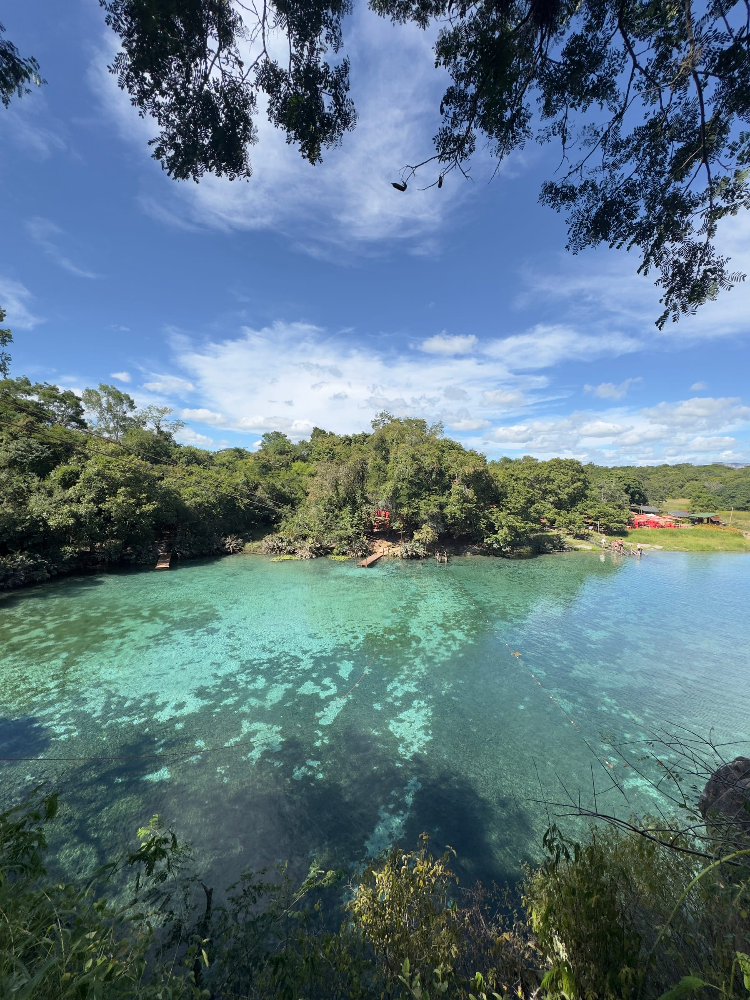
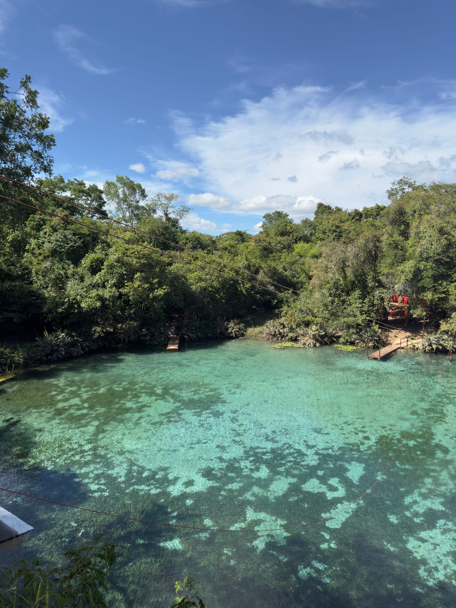
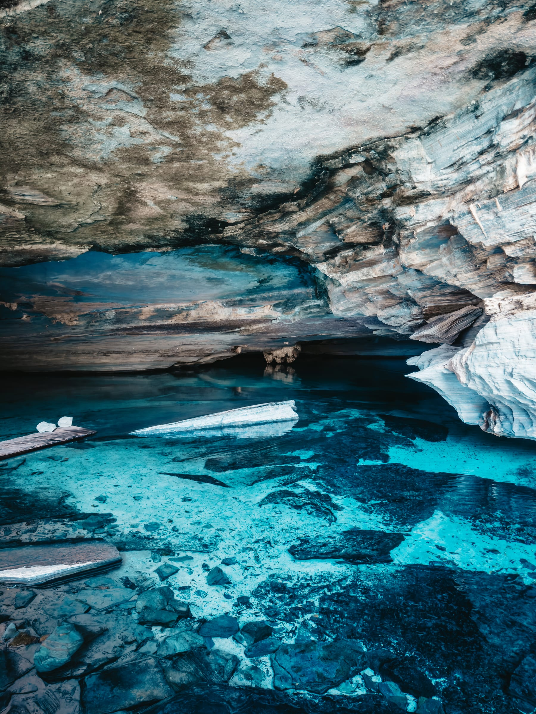
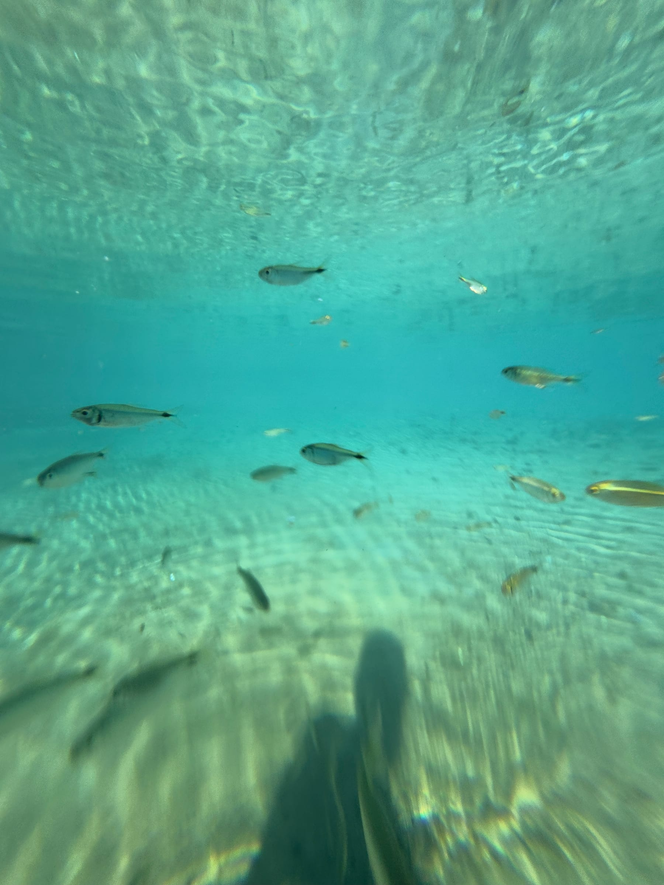
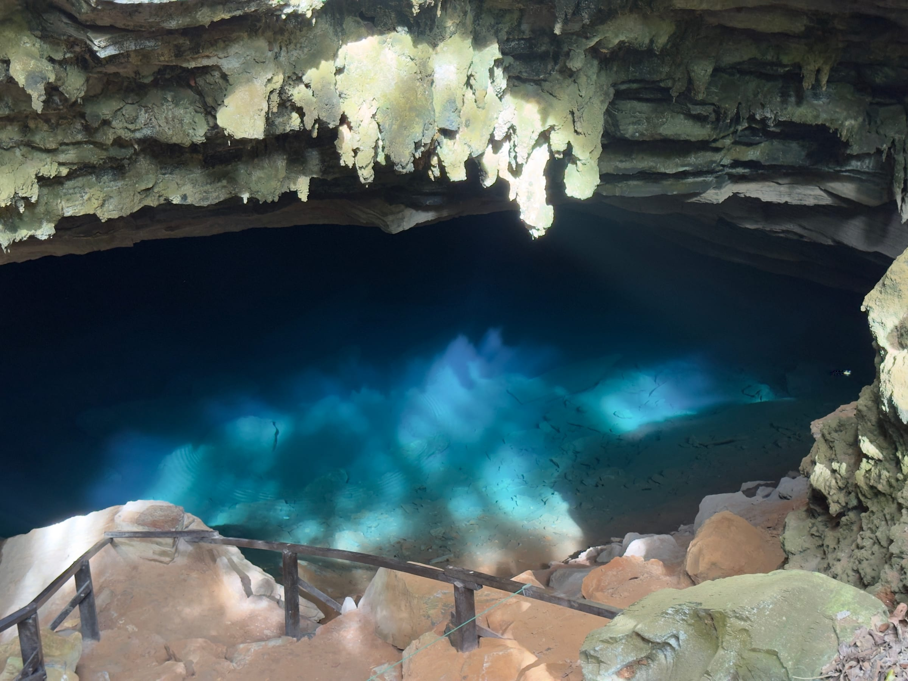
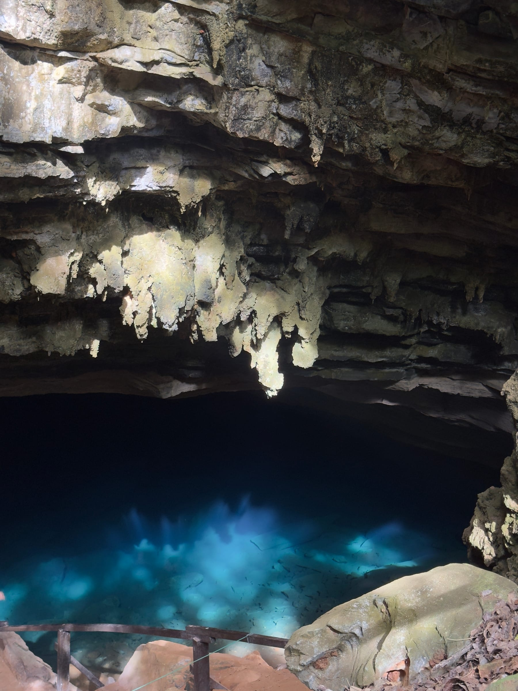
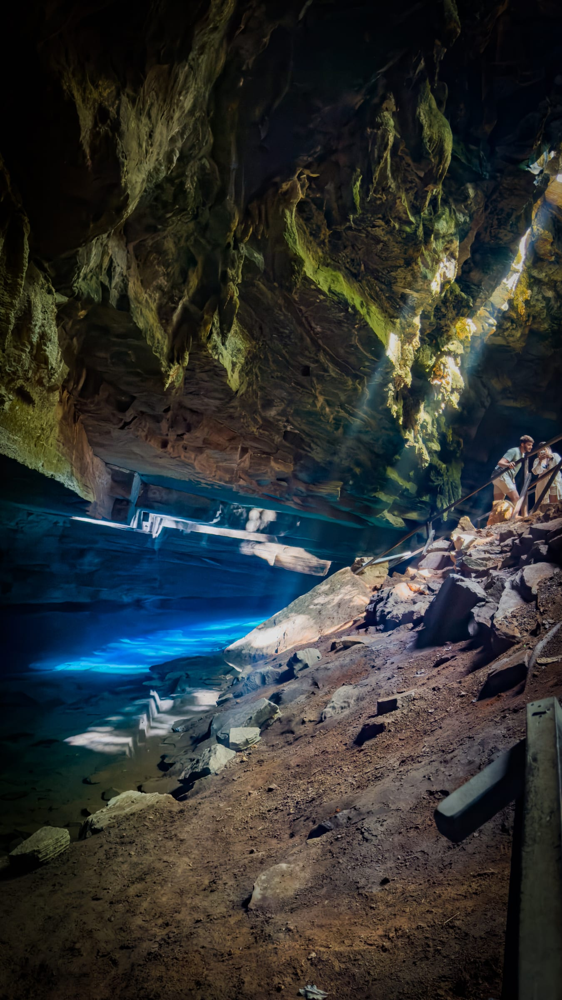

A Fazenda Pratinha reúne dois dos cenários mais fotogênicos da Chapada Diamantina: o rio e a Gruta da Pratinha, de água azul-turquesa tão transparente que dá para ver o fundo, e a Gruta Azul, onde um feixe de sol atravessa a água em parte do dia. Dá para nadar no rio, fazer flutuação dentro da gruta e terminar contemplando a Gruta Azul.

Este guia explica cada atração, as regras para conservar a água e como encaixar a fazenda num dia por Iraquara. Para planejar o restante da viagem, veja o [guia de Lençóis](/blog/o-que-fazer-em-lencois-chapada-diamantina/) e o [roteiro completo pela Chapada Diamantina](/blog/roteiro-chapada-diamantina/). **As informações foram pesquisadas em novembro de 2026.** Preços e horários mudam, por isso confirme antes de ir.

## O complexo da Fazenda Pratinha

A Fazenda Pratinha é uma propriedade particular em Iraquara, estruturada em torno do Rio Pratinha. A água chama a atenção pela transparência e pelo tom azulado, que costuma ser atribuído aos minerais dissolvidos, como carbonatos de cálcio e magnésio, comuns em regiões de calcário.

A área externa do rio funciona como uma grande piscina natural, livre para banho. A fazenda também oferece atividades opcionais, como tirolesa sobre o rio, caiaque, stand-up paddle, pedalinho e fotos subaquáticas.

## A Gruta da Pratinha e a flutuação

O rio nasce numa gruta, e é nela que acontece a flutuação. Paga à parte, a atividade dura de 25 a 30 minutos e percorre um trecho do túnel inundado, com colete e snorkel. Os relatos citam também máscara e lanterna, que ajudam a ver as formações submersas e o contraste da luz que entra pela boca da gruta.

## A Gruta Azul

A Gruta Azul fica dentro da mesma fazenda, mas a experiência é outra. Na Gruta da Pratinha você entra na água; na Gruta Azul, a visita é só de contemplação, e não é permitido nadar. O espetáculo é o fenômeno óptico: em parte do ano, no início da tarde, um feixe de luz do sol entra pela abertura da gruta e acende o poço em tons de azul profundo. O melhor horário costuma ser entre 14h e 15h.

:::alerta
Para conservar a água cristalina, não entre no rio nem na gruta usando protetor solar, repelente ou cremes: aplique depois do banho ou tome uma ducha antes de entrar. Na Gruta Azul, não é permitido nadar; a visita é só para contemplar.
:::

:::dica
Leve sapatilha aquática: as margens e o acesso ao rio têm pedras lisas e irregulares, e ela dá aderência e protege os pés. Chegue cedo, logo na abertura, para aproveitar o rio e a gruta com calma, antes dos ônibus de excursão.
:::

## Como chegar e roteiro pela região

A Fazenda Pratinha fica em Iraquara, a cerca de 70 a 75 km de Lençóis e a poucos quilômetros da [Gruta da Lapa Doce](/blog/gruta-da-lapa-doce-chapada-diamantina/). Segundo a fazenda, a rota principal a partir de Lençóis é mais longa, mas permite a passagem de ônibus; a alternativa encurta o caminho, com cerca de 15 km de estrada de terra. O horário mais citado é das 8h às 16h.

:::logistica
A fazenda tem estacionamento, restaurante, cafeteria e banheiros, além das atividades opcionais, como tirolesa e foto subaquática, cobradas à parte. O roteiro clássico de um dia é visitar a Lapa Doce pela manhã, seguir para a Pratinha para almoçar, fazer a flutuação e ver a Gruta Azul no início da tarde, e fechar com o pôr do sol no Morro do Pai Inácio, no caminho de volta para Lençóis.
:::

## Perguntas frequentes

### Pode nadar na Gruta Azul?

Não. Na Gruta Azul a visita é só de contemplação. O banho e a flutuação acontecem no rio e na Gruta da Pratinha.

### Qual o melhor horário para ver a Gruta Azul?

No início da tarde, por volta das 14h às 15h, quando o feixe de sol ilumina o poço. O fenômeno depende da época do ano, então confirme com a fazenda.

### Quanto custa?

A entrada e a flutuação são cobradas separadamente, e os valores publicados variam muito entre as fontes. Confirme a tabela atual com a fazenda antes de ir.

## Fontes consultadas

Acesso em novembro de 2026.

- [Fazenda Pratinha: site oficial](https://www.fazendapratinha.com.br/)
- [Fazenda Pratinha: flutuação na Gruta Pratinha](https://www.fazendapratinha.com.br/flutuacao-na-gruta-pratinha/)
- [Melhores Destinos: Gruta da Pratinha e Gruta Azul](https://guia.melhoresdestinos.com.br/gruta-da-pratinha-e-gruta-azul-221-6131-l.html)
- [Quanto Custa Viajar: Gruta da Pratinha e Gruta Azul](https://quantocustaviajar.com/blog/gruta-da-pratinha-e-gruta-azul/)
- [Mala de Aventuras: Gruta da Pratinha e Gruta Azul](https://maladeaventuras.com/chapada-diamantina-conheca-a-gruta-da-pratinha-e-a-gruta-azul/)
- [Casal de Mochilão: Pratinha, Gruta da Pratinha e Gruta Azul](https://casaldemochilao.com.br/gruta-da-pratinha-gruta-azul-chapada-diamantina/)
- [Viajante Comum: as atrações da Fazenda Pratinha](https://viajantecomum.com/chapada-diamantina-as-atracoes-da-fazenda-pratinha/)
- [Bahia.ws: principais grutas de Iraquara](https://bahia.ws/en/grutas-do-municipio-de-iraquara/)
