Se você chegou aqui pelo nosso vídeo, já viu a cena: o barco cruzando o Estreito de Magalhães de manhã cedo, a ilha baixa surgindo no horizonte e, logo no desembarque, os primeiros pinguins andando pela praia de pedras como se fôssemos nós os visitantes. E somos. Na Isla Magdalena, a trilha é demarcada por cordas, os pinguins atravessam o caminho o tempo todo, e a preferência é sempre deles.

Fizemos o passeio em 27 de outubro de 2026, a partir de Punta Arenas, a última base da nossa viagem de carro pela Patagônia. Este guia reúne a história da ilha e do farol, como funciona a navegação, a melhor época para cada fase da colônia, as regras da CONAF e o que levar. A logística da cidade e o que mais fizemos por lá estão no [guia de Punta Arenas e da Isla Magdalena](/blog/o-que-fazer-em-punta-arenas-isla-magdalena-pinguins/). **As informações práticas foram pesquisadas em novembro de 2026.** Temporadas, horários e regras mudam, por isso confirme antes de ir. As fontes estão no fim do artigo.

## A Isla Magdalena em resumo

| Item | O que saber |
|---|---|
| Onde fica | No Estreito de Magalhães, cerca de 35 km a nordeste de Punta Arenas |
| Proteção | Monumento Natural Los Pingüinos, criado em 1966 e administrado pela CONAF |
| Tamanho | 85 hectares; a vizinha Isla Marta, que também faz parte do monumento, tem 12 |
| Acesso | Só de barco, em navegações de turismo que saem de Punta Arenas |
| Temporada | De outubro a março |
| Na ilha | Uma hora, num circuito de 1.400 m que atravessa a colônia até o farol |
| Colônia | 7.014 casais reprodutores, segundo um relatório técnico da CONAF de novembro de 2025 |

## A travessia: o que vimos no caminho

Saímos do Muelle Prat, o porto do centro de Punta Arenas, por volta das 7h. Às 7h18, o sol ainda baixo já iluminava a água do estreito atrás da bandeira da popa.

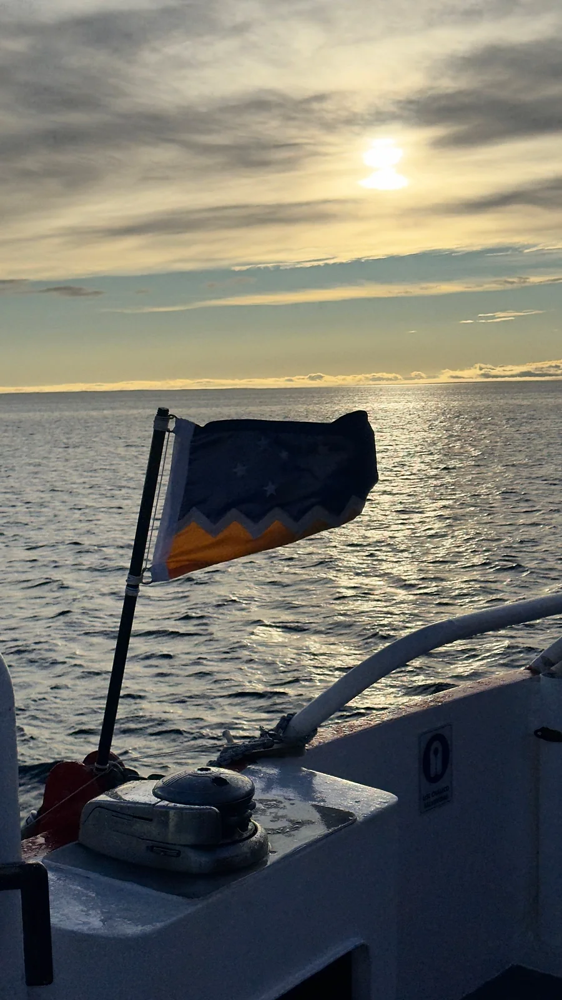

A primeira hora é de mar aberto, vento frio e aves marinhas. Em vários trechos, bandos grandes pousavam na água e levantavam voo quando o barco se aproximava.

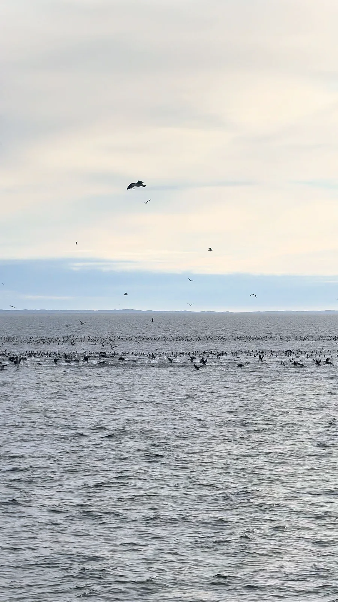

Às 8h07, a ilha apareceu como uma faixa baixa e escura no horizonte. Pouco depois, já dava para ver o farol no alto.

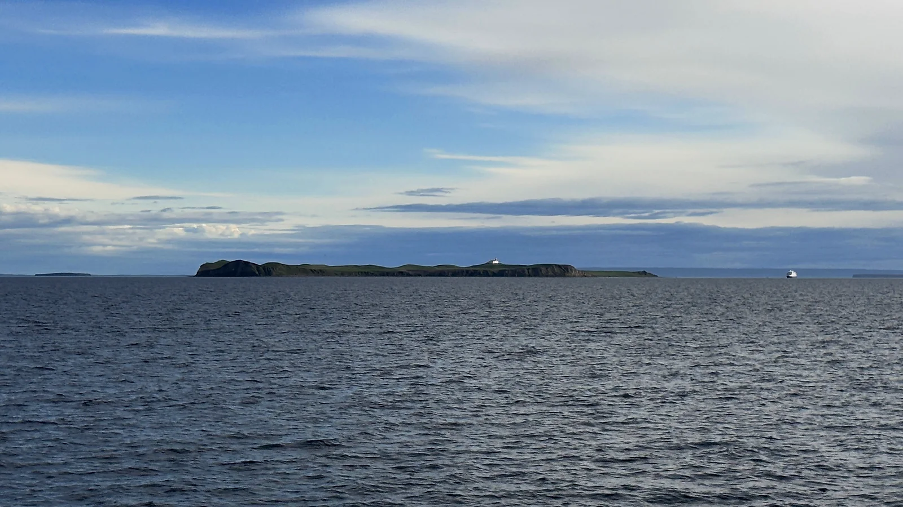

Desembarcamos às 8h29. Os primeiros pinguins estavam ali mesmo, na praia de pedras ao lado do cais.

:::galeria
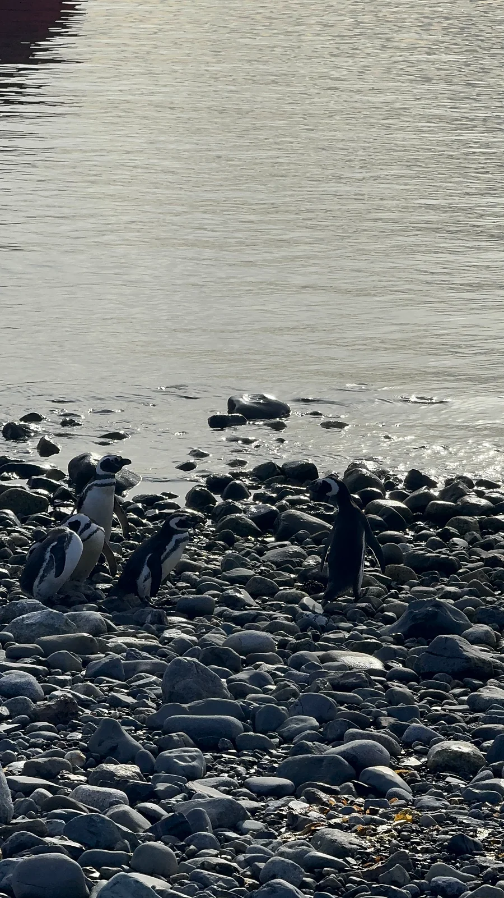

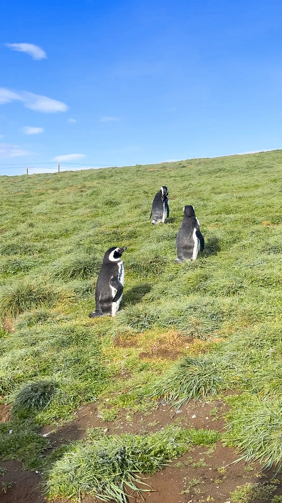
:::

## História da Isla Magdalena e do farol

### Uma ilha no caminho entre dois oceanos

A Isla Magdalena e a Isla Marta, junto com as ilhas Isabel e Contramaestre, são as mais orientais do Estreito de Magalhães. Segundo o folheto oficial da CONAF, com informações do arqueólogo Alfredo Prieto, essa posição fazia delas o limite leste do território dos Kawésqar, povo de canoeiros que navegava a região havia milhares de anos. As ilhas eram um lugar privilegiado pela fauna abundante e funcionavam como uma ponte entre os caçadores do continente e os da Terra do Fogo, que não navegavam. Sítios arqueológicos mostram essa ligação.

O estreito leva o nome de Fernão de Magalhães, cuja expedição o atravessou em 1520. Ainda segundo a CONAF, a partir desse ano os exploradores europeus passaram a usar as ilhas para se abastecer de grandes quantidades de ovos e carne antes de seguir viagem. Até a abertura do Canal do Panamá, em 1914, o estreito foi uma das principais passagens entre o Atlântico e o Pacífico, e as ilhas, com os seus pinguins, ficavam bem no meio dessa rota.

### O farol, Monumento Nacional do Chile

O farol no alto da ilha é o ponto final do circuito. Segundo o Chile Travel, o serviço de turismo do governo chileno, ele foi construído em 1902, e o Meteored atribui a obra ao engenheiro escocês George Slight. A casa do farol foi declarada Monumento Nacional pela antiguidade, segundo a CONAF, e hoje abriga uma sala de informações com a história da ilha e dados sobre a fauna e a flora da região, além da base dos guarda-parques.

:::galeria
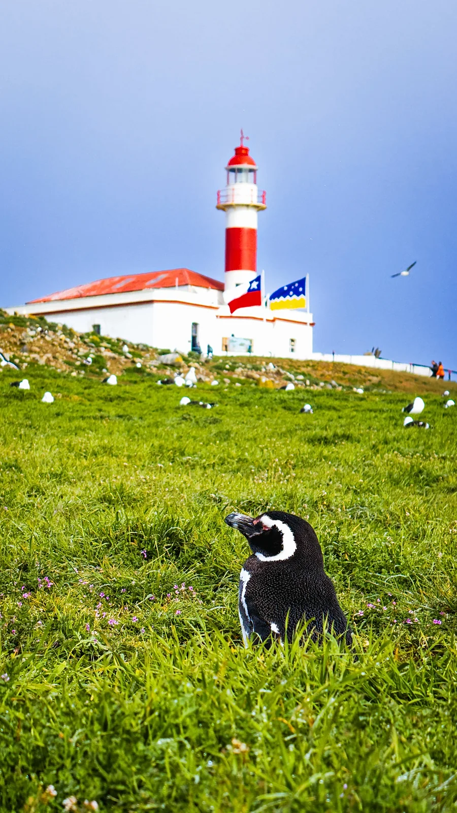

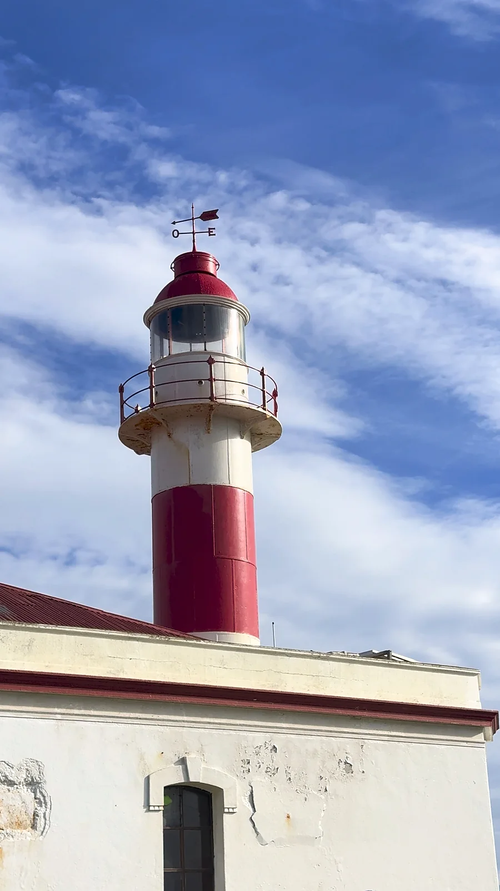
:::

### O Monumento Natural Los Pingüinos

A Isla Magdalena e a Isla Marta formam o Monumento Natural Los Pingüinos, criado em 1966 e administrado pela CONAF, o órgão chileno de áreas protegidas. Os pinguins-de-magalhães fazem os ninhos na Magdalena. Na Marta, segundo a CONAF, ficam outras espécies, como cormorões, gaivotas, leões-marinhos e lobos-marinhos-sul-americanos.

:::dica
A colônia diminuiu muito. Um estudo de 2019 citado pela CNN Chile registrou cerca de 60 mil casais no começo dos anos 2000 e cerca de 6 mil em 2018. O relatório técnico da CONAF de novembro de 2025 estimou 7.014 casais reprodutores. As causas apontadas pelos pesquisadores estão fora da ilha, mas uma colônia menor sente mais a presença humana. Por isso as regras da visita importam tanto.
:::

## Como funciona o passeio saindo de Punta Arenas

A Isla Magdalena só pode ser visitada em barcos de turismo que saem de Punta Arenas, vendidos por operadoras e agências da cidade. Segundo o Chile Travel, as saídas são do Muelle Prat, no centro, do Terminal Tres Puentes ou de Bahía Laredo, e a travessia leva de 1h30 a 2 horas, conforme o vento e o mar. A CONAF calcula 5 horas no total, ida e volta, com uma hora de permanência na ilha.

**Como foi o nosso:**

| Horário | O que aconteceu |
|---|---|
| ~7h | Saída do Muelle Prat |
| 8h07 | A ilha aparece no horizonte |
| 8h29 | Desembarque |
| 8h29 a 9h37 | Circuito até o farol e volta ao cais |
| ~11h | Chegada ao Muelle Prat, com golfinhos e leões-marinhos na volta |

No total, foram cerca de 4 horas. A volta e os animais que vimos no caminho estão no [guia de Punta Arenas](/blog/o-que-fazer-em-punta-arenas-isla-magdalena-pinguins/).

**Na ilha.** Segundo a CONAF, o circuito tem 1.400 m e uma hora é suficiente para percorrê-lo. Ele sai do cais, sobe pelo gramado entre as tocas e termina no farol. O caminho é demarcado por cordas, e um trecho tem passarela de madeira.

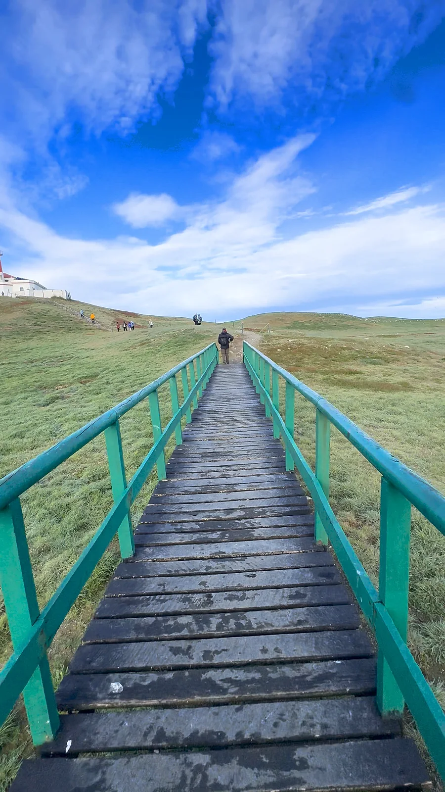

**Manhã ou tarde?** Há saídas de manhã cedo e no começo da tarde. Nós fomos às 7h e pegamos mar tranquilo e sol, mas não encontramos dados que garantam que a manhã seja sempre mais calma. Segundo o Meteored, a Armada do Chile pode fechar o porto por mau tempo ou vento forte, e o passeio é cancelado no mesmo dia.

:::alerta
**Deixe uma folga no roteiro.** Se o barco não sair, você vai precisar de outro dia para tentar de novo. Por isso, não marque a Isla Magdalena para o último dia em Punta Arenas, como nós fizemos: deixe ao menos um dia de reserva depois dela.
:::

## Melhor época para visitar a Isla Magdalena

A CONAF abre a visita de outubro a março. Cada mês mostra uma fase diferente da colônia, segundo o calendário publicado pela própria CONAF:

| Mês | O que acontece na colônia |
|---|---|
| Setembro | Os pinguins chegam à ilha (ainda sem visitação) |
| Outubro | Postura dos ovos nas tocas, geralmente dois por ninho |
| Novembro | Os filhotes nascem, depois de cerca de 40 dias de incubação |
| Dezembro | Os filhotes crescem nas tocas, cuidados pelos pais |
| Janeiro e fevereiro | Os filhotes ficam independentes |
| Fevereiro e março | Depois da independência dos filhotes, os adultos trocam as penas; março é o último mês de visita |
| Abril | Os adultos deixam a colônia rumo ao mar; a ilha fecha até a temporada seguinte |

O Chile Travel aponta dezembro e janeiro como os melhores meses, com os pinguins cuidando dos filhotes. Nós fomos no fim de outubro, na época da postura: não havia filhotes, mas muitos pinguins ficavam parados na entrada das tocas, protegendo os ovos, enquanto outros iam e voltavam do mar.

:::galeria
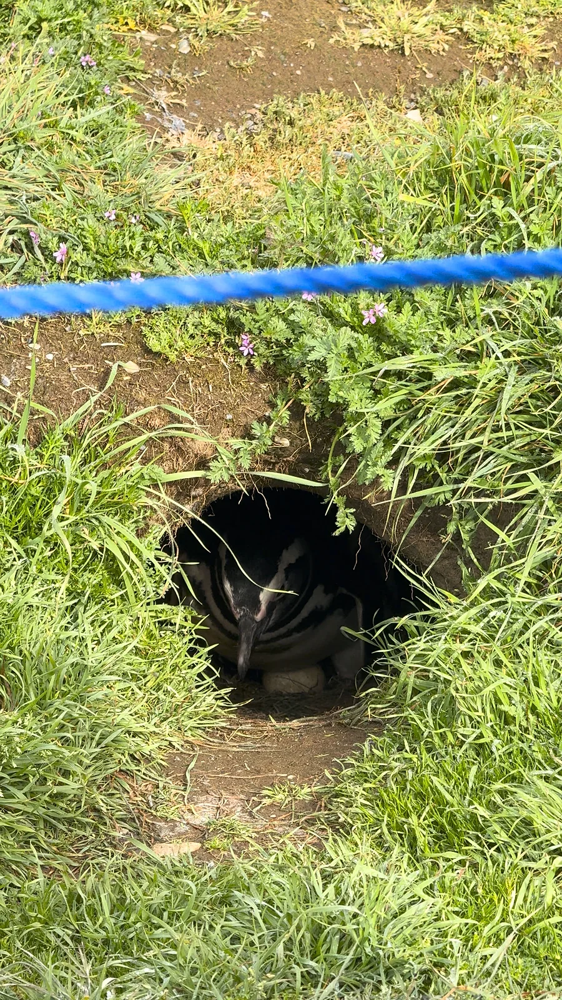

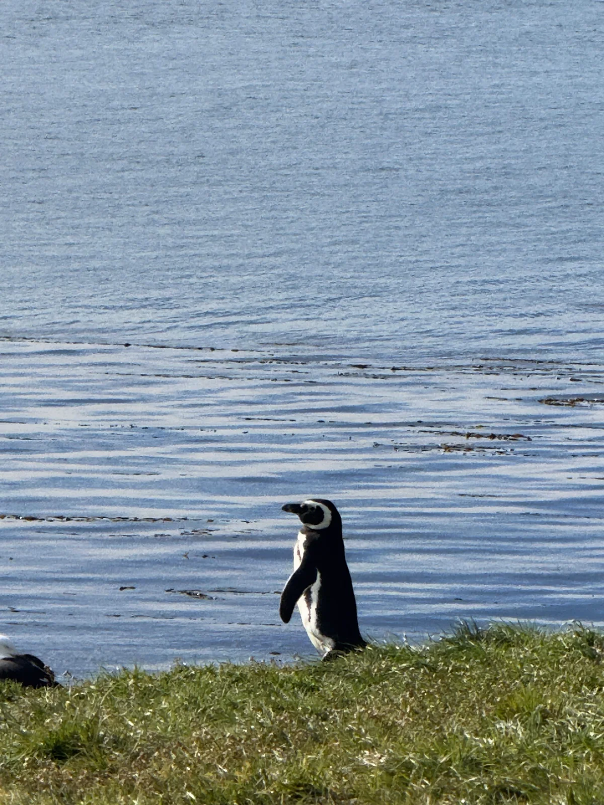

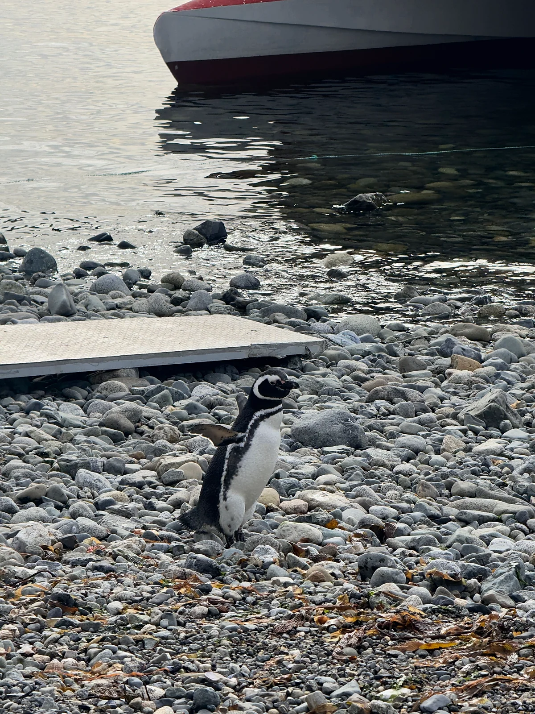
:::

## Regras da CONAF e o que levar na mochila

### As regras na ilha

A normativa do Monumento Natural Los Pingüinos proíbe, entre outras coisas:

- incomodar os pinguins ou ficar muito tempo parado perto dos ninhos, alguns a menos de 1 m do caminho;
- atrapalhar a passagem deles entre as tocas e o mar: é preciso deixar no mínimo 2 m de distância, sem segui-los;
- comer durante a visita;
- usar pau de selfie, drone, flash ou som da câmera e do celular;
- deixar lixo na ilha, levar pedras, plantas ou qualquer material natural.

Na prática, isso significa ficar dentro das cordas e parar quando um pinguim decide cruzar o caminho, esperando até ele passar.

### O que levar

- **Roupa para vento:** casaco corta-vento ou impermeável, gorro e luvas. Mesmo com sol, o vento no barco e no alto da ilha é frio. O Chile Travel fala em temperaturas de 5 °C a 15 °C na primavera e no verão.
- **Camadas:** uma camada térmica por baixo do casaco ajuda a alternar entre a cabine do barco e o convés.
- **Protetor solar e óculos escuros:** o sol reflete na água.
- **Remédio para enjoo:** se você enjoa em barco, tome antes de embarcar, seguindo a orientação do seu médico. São de 1h30 a 2 horas de mar aberto em cada sentido.
- **Água:** pode levar, mas não dá para comer na ilha.
- **Câmera ou celular no silencioso e sem flash.** Uma lente zoom ajuda a fotografar sem chegar perto.

O circuito termina na casa do farol, onde fica a sala de informações da CONAF.

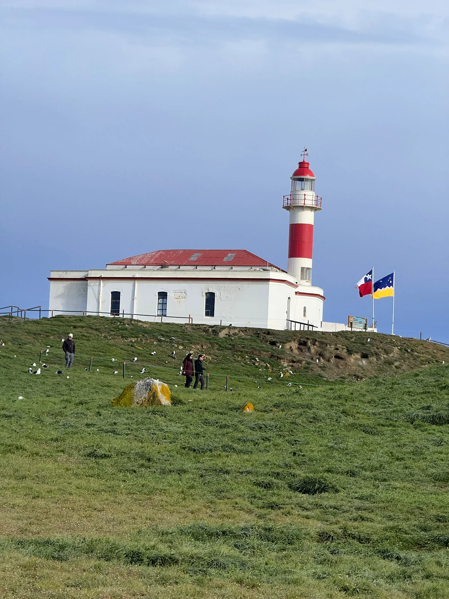

## Perguntas frequentes

### Vale a pena ir à Isla Magdalena?

Para nós, foi o ponto alto de Punta Arenas. Poucos lugares permitem caminhar no meio de uma colônia de pinguins-de-magalhães, com eles cruzando o caminho a poucos metros, e ainda ver golfinhos, leões-marinhos e aves marinhas na travessia. O passeio ocupa só meio dia e deixa a tarde livre para a cidade.

### Quanto tempo dura o passeio à Isla Magdalena?

A CONAF calcula 5 horas ida e volta, com uma hora na ilha. O nosso levou cerca de 4 horas, das 7h às 11h, com 1h08 em terra. A travessia leva de 1h30 a 2 horas em cada sentido, conforme o barco, o vento e o mar.

### Dá para visitar a Isla Magdalena o ano inteiro?

Não. A CONAF abre a visita de outubro a março. Em abril, os pinguins adultos deixam a colônia e só voltam em setembro.

### Crianças podem ir à Isla Magdalena?

Sim. Segundo o Meteored, a TABSA, uma das empresas que fazem a navegação, tinha em 2026 tarifa reduzida para crianças de 5 a 13 anos e gratuidade para menores de 5. Para crianças pequenas, vale pensar no frio e no tempo de barco, e lembrar que na ilha não se come. Confirme as condições com a operadora na hora de reservar.

### Qual é a melhor época para ver filhotes?

Os filhotes nascem em novembro e ficam independentes entre janeiro e fevereiro, segundo a CONAF. Dezembro e janeiro são os meses com mais chance de vê-los. Em outubro, como fomos, os pinguins estão chocando os ovos.

## Continue pela Patagônia

A Isla Magdalena foi o fechamento da nossa viagem de carro pela Patagônia. A cidade, o dia de estrada até lá e o que fazer à tarde estão no [guia de Punta Arenas e da Isla Magdalena](/blog/o-que-fazer-em-punta-arenas-isla-magdalena-pinguins/). A viagem inteira, com Torres del Paine, El Calafate e El Chaltén, está no [roteiro de 15 dias pela Patagônia chilena e argentina](/blog/roteiro-patagonia-chilena-e-argentina/).

## Fontes consultadas

- [CONAF: folheto oficial do Monumento Natural Los Pingüinos](https://parquetorresdelpaine.cl/wp-content/uploads/2026/01/Folleto-MNLP.pdf)
- [Chile Travel: Isla Magdalena e os pinguins](https://chile.travel/blog/la-magica-isla-en-medio-de-la-patagonia-que-esta-repleta-de-pinguinos/)
- [Chile Travel: Monumento Natural Los Pingüinos](https://chile.travel/atractivos/monumento-natural-los-pinguinos/)
- [Meteored: as visitas à Isla Magdalena](https://www.meteored.cl/noticias/ocio/vuelven-las-visitas-a-isla-magdalena-cuando-y-como-ver-pinguinos-en-magallanes-esta-primavera.html)
- [CNN Chile: a queda da colônia de pinguins da Isla Magdalena](https://www.cnnchile.com/pais/detalles-drastica-caida-colonia-pinguinos-isla-magdalena_20260121/)
- [Nomades: navegação à Isla Magdalena](https://www.nomades.com/punta-arenas/navegacion-isla-magdalena-id318)
