Não existe uma única melhor época para ir ao Alasca: existe a melhor época para o que você quer ver. Quem sonha com auroras boreais precisa de noites escuras, que só existem de agosto a abril. Quem quer trilhas, passeios de barco e todas as estradas abertas vai no verão, de junho a agosto, junto com a maioria dos visitantes. E quem aceita um pouco de inverno em troca de estradas vazias, preços menores e dias que quase não terminam encontra em maio uma janela rara.

Nós fomos em maio, de 3 a 18 de maio de 2025, num motorhome que saiu e voltou de Anchorage. Este guia junta o calendário do Alasca mês a mês, com temperaturas, horas de luz, auroras e o que abre em cada época, e conta com franqueza como é viajar em maio: as vantagens e os perrengues que quase ninguém menciona. A viagem completa está no [roteiro de 16 dias pelo Alasca de motorhome](/blog/roteiro-alasca-16-dias-motorhome/). **As informações foram pesquisadas em novembro de 2026.** Datas de abertura de estradas e parques mudam a cada ano, por isso confirme tudo antes de ir. As fontes estão no fim do artigo.

## As quatro estações do Alasca, em resumo

| Época | Meses | O que esperar | Para quem |
|---|---|---|---|
| Inverno | Novembro a março | Frio intenso, poucas horas de luz, neve, auroras | Quem vai atrás das auroras e de atividades de inverno |
| Primavera e degelo | Abril e maio | Dias que crescem rápido, neve nas regiões altas, lagos congelados, estradas vazias | Quem quer estrada, paisagem de inverno e luz de verão ao mesmo tempo |
| Verão | Junho a agosto | Sol da meia-noite, tudo aberto, mais gente e preços altos | Quem quer trilhas, passeios de barco e todos os serviços |
| Outono | Setembro e outubro | Cores de outono, chuva, primeiras neves, volta das auroras | Quem combina estrada e auroras com menos gente |

## O Alasca mês a mês

As temperaturas abaixo são as médias de mínima e máxima publicadas pelo turismo oficial do Alasca para Anchorage, no litoral sul, e Fairbanks, no interior, convertidas para graus Celsius. O interior é bem mais extremo: mais frio no inverno, mais quente no verão.

| Mês | Anchorage (mín. / máx.) | Fairbanks (mín. / máx.) | Horas de luz | Auroras em Fairbanks |
|---|---|---|---|---|
| Janeiro | -13 / -5 °C | -27 / -17 °C | 5 a 6 h em Anchorage; menos de 4 h em Fairbanks | Sim |
| Fevereiro | -11 / -3 °C | -25 / -13 °C | Fairbanks ganha cerca de 2 h ao longo do mês | Sim |
| Março | -8 / 1 °C | -19 / -5 °C | 11 a 12 h | Sim |
| Abril | -1 / 7 °C | -9 / 5 °C | Mais de 14 h | Até 21 de abril |
| Maio | 4 / 13 °C | 2 / 16 °C | Até 18 h em Fairbanks; crepúsculo contínuo a partir de cerca de 17 de maio | Não |
| Junho | 9 / 17 °C | 11 / 22 °C | Quase 24 h em Fairbanks; até 19h21 em Anchorage | Não |
| Julho | 11 / 19 °C | máx. de 24 °C | Dias muito longos | Não |
| Agosto | 10 / 17 °C | 9 / 19 °C | 14 a 15 h | A partir de 21 de agosto |
| Setembro | 5 / 13 °C | 2 / 13 °C | Cerca de 12 h | Sim |
| Outubro | -2 / 7 °C | -8 / 2 °C | 8 a 9 h | Sim |
| Novembro | -8 / -1 °C | -19 / -10 °C | Menos de 7 h em Fairbanks no fim do mês | Sim |
| Dezembro | -12 / -4 °C | -25 / -16 °C | Pouco mais de 5 h em Anchorage; menos de 4 h em Fairbanks | Sim |

**Sobre as auroras.** Segundo o turismo oficial de Fairbanks, a temporada de auroras vai de 21 de agosto a 21 de abril, e, com céu limpo e escuro, elas aparecem em média em quatro de cada cinco noites. De 22 de abril a 20 de agosto é a temporada do sol da meia-noite: o céu não escurece o suficiente. **Em maio, não há auroras.**

## O que abre em cada época

O calendário do Alasca não é só de clima: estradas, parques e campings abrem e fecham com a neve. Alguns exemplos das regiões que visitamos:

| Lugar | Quando funciona | Fonte |
|---|---|---|
| Denali Park Road para carros particulares até Teklanika (milha 30) | Do fim de abril ou começo de maio até 19 de maio, se o tempo permitir | NPS Denali |
| Ônibus de trânsito do Denali | A partir de 20 de maio; carros ficam restritos até Savage River (milha 15) | NPS Denali |
| Riley Creek Campground, no Denali | Aberto na primavera, gratuito até meados de maio | NPS Denali |
| Estrada do Exit Glacier, no Kenai Fjords | Costuma ficar fechada aos carros do fim de outubro a meados de maio; em 2026, abriu em 14 de maio | NPS Kenai Fjords |
| Campings da BLM na Dalton Highway | Mais ou menos de maio a setembro, por ordem de chegada | BLM |
| Campings da prefeitura no Homer Spit | De 1º de abril ao fim de outubro | Prefeitura de Homer |
| Lojas e restaurantes do Pioneer Park, em Fairbanks | Do Memorial Day, no fim de maio, ao Labor Day, no começo de setembro | Explore Fairbanks |
| Túnel de Whittier, horário de verão | De 1º de maio a 30 de setembro | DOT do Alasca |

**Lotação e preço.** O turismo oficial do Alasca aponta julho como o auge da temporada. As semanas de maio e de setembro, nas pontas, costumam ter aluguéis de motorhome de 10% a 20% mais baratos, segundo a plataforma Outdoorsy. No inverno, o foco muda para as auroras e as atividades na neve, e muitos serviços de verão fecham.

## Como é viajar em maio: as vantagens

### Dias que quase não terminam

Maio é o mês em que a luz explode no Alasca. Em Fairbanks, os dias chegam a 18 horas, e por volta de 17 de maio começa o crepúsculo civil contínuo: a noite deixa de escurecer de verdade. Na Finger Mountain, já perto do Círculo Polar Ártico, o sol só tocou o horizonte por volta das 22h20 de 8 de maio, e chegamos à placa do Círculo Polar às 23h18 com o céu claro. À 0h14 do dia 7, em Chena Lakes, perto de Fairbanks, o horizonte ainda tinha cor.

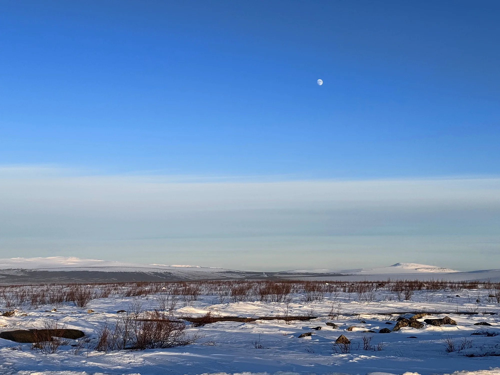

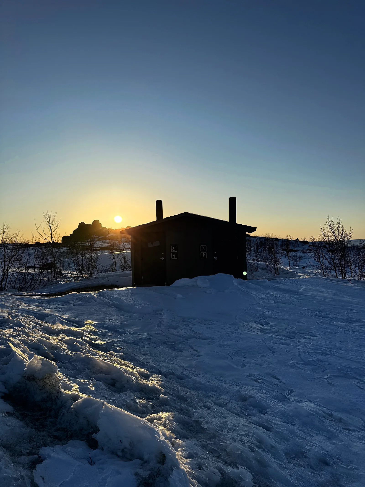

Na prática, isso muda o ritmo da viagem: dá para dirigir até tarde, chegar aos lugares na luz dourada do fim do dia e não se preocupar com a escuridão. Em troca, é preciso fechar bem as cortinas e usar máscara de dormir.

### Paisagem de inverno com luz de verão

Em maio, o Alasca ainda está saindo do inverno. Os lagos da Tok Cut-Off e do interior continuavam congelados, o rio Yukon estava coberto de gelo de margem a margem em 9 de maio, e a neve ainda cobria a tundra da Dalton e as passagens altas das montanhas. Ao mesmo tempo, os dias eram longos e, em boa parte da viagem, de céu azul.

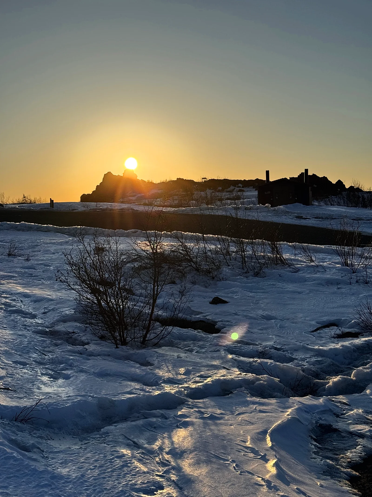

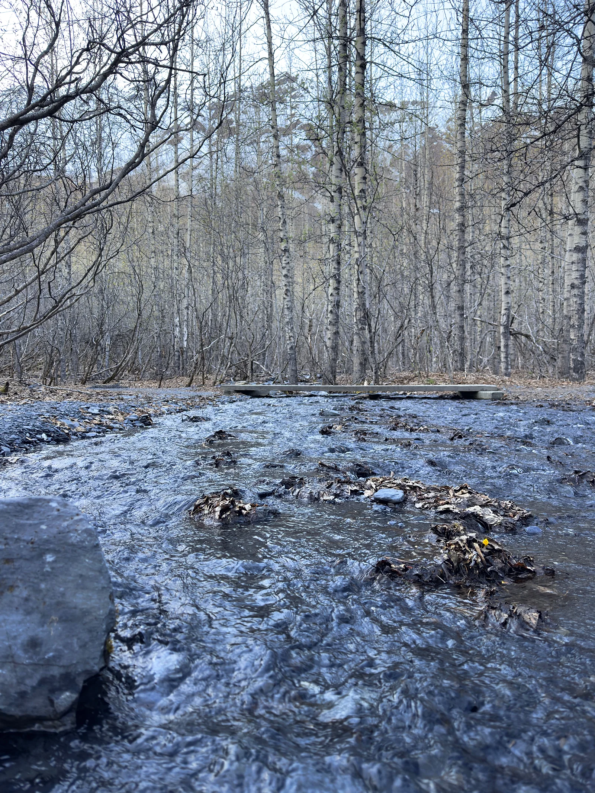

O contraste entre as regiões também impressiona. Enquanto a tundra da Dalton ainda estava branca, o Potter Marsh, em Anchorage, já mostrava os primeiros brotos, e, perto de Seward, a floresta estava verde.

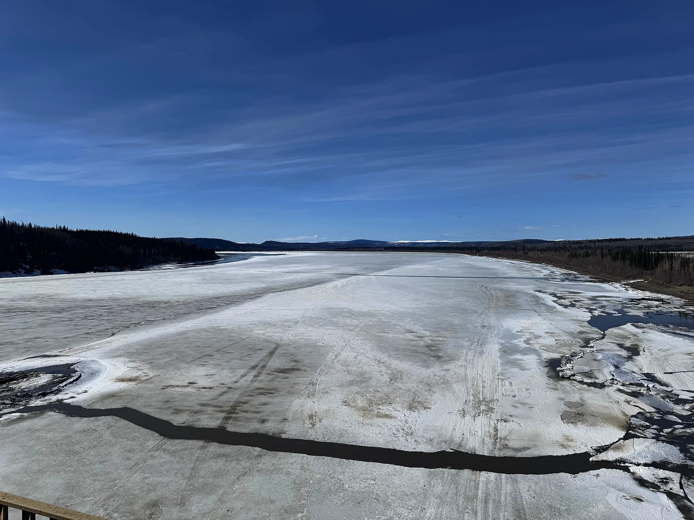

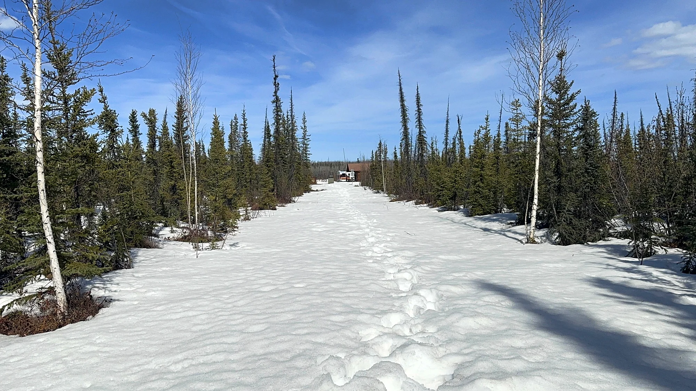

### Estradas vazias e preços menores

Em maio, mirantes, estacionamentos e trilhas estavam quase vazios. No Portage Lake e no Exit Glacier, encontramos estacionamentos praticamente livres, e na Tok Cut-Off paramos em vários acostamentos ao longo do dia. A reserva do motorhome também saiu mais barata: as semanas de maio costumam ter aluguéis menores, e nós ainda reservamos com meses de antecedência numa promoção de Black Friday. Os detalhes de custo estão no [guia de quanto custa viajar para o Alasca](/blog/quanto-custa-viajar-para-o-alasca/).

### A Denali Park Road aberta ao seu próprio carro

Esta é uma vantagem exclusiva do começo da temporada. Até 19 de maio, se o tempo permitir, os carros particulares podem entrar na Denali Park Road até Teklanika, na milha 30. A partir de 20 de maio, com os ônibus do parque, o acesso de carro fica restrito até Savage River, na milha 15. Nós entramos de motorhome em 6 de maio e fomos até perto da milha 28.

## Como é viajar em maio: os perrengues que quase ninguém conta

### Camping fechado pela neve no Círculo Polar Ártico

Na noite de 8 de maio, chegamos à placa do Círculo Polar Ártico, na Dalton Highway, contando dormir no camping da BLM, cerca de 1 km adiante. O acesso estava fechado e tomado pela neve. Acabamos dormindo no motorhome, no estacionamento da placa. Há placas no local proibindo o pernoite na área do monumento; com o acesso aberto, o camping da BLM, de US$ 12 a noite, é o lugar regulamentado. Os detalhes estão no [guia da Dalton Highway e do Círculo Polar Ártico](/blog/dalton-highway-circulo-polar-artico-alasca/).

### O Denali sem ônibus e sem o pico

O começo de maio no Denali é bonito, mas incompleto. A Park Road só vai até Teklanika, os ônibus de trânsito ainda não circulam, o Denali Visitor Center abre assim que o tempo permite e boa parte dos hotéis da entrada do parque só abre no começo ou em meados de maio. No dia em que estivemos lá, o céu ficou fechado e o pico do Denali não apareceu nem por um instante. Segundo o Serviço Nacional de Parques, os motoristas dos ônibus dizem que só um em cada três dias permite ver a montanha. O guia completo está no [Denali em maio](/blog/denali-national-park-em-maio-alasca/).

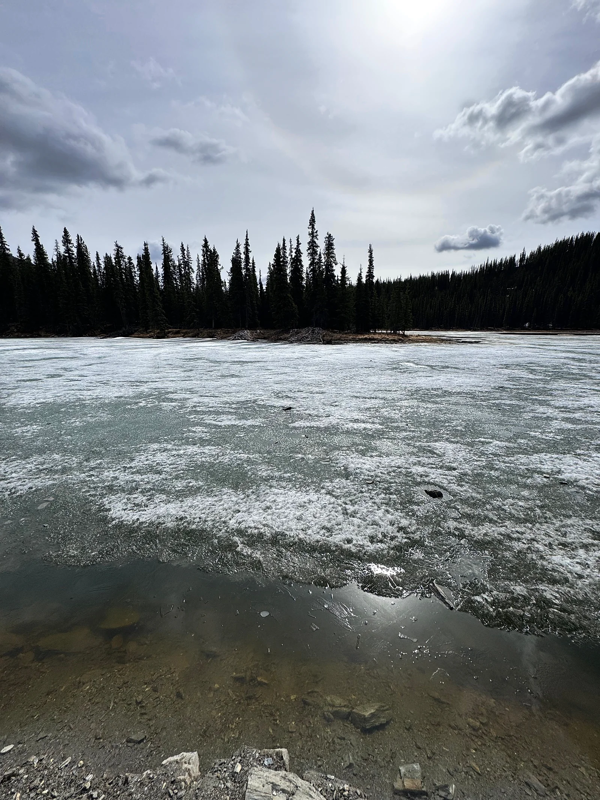

### Estradas e trilhas que ainda não abriram

A estrada do Exit Glacier costuma ficar fechada aos carros até meados de maio (veja o guia das [geleiras do Alasca sem cruzeiro](/blog/geleiras-do-alasca-sem-cruzeiro/)); nós tivemos sorte, e ela já estava aberta em 13 de maio de 2025. Os banheiros com descarga do centro de visitantes do Exit Glacier só abrem no fim de maio. Na Parks Highway, a caminho do Denali, encontramos um acesso lateral fechado por cancela e neve. Muitos campings estaduais e municipais abrem aos poucos, e alguns parques de motorhome particulares só começam a temporada perto de 20 de maio.

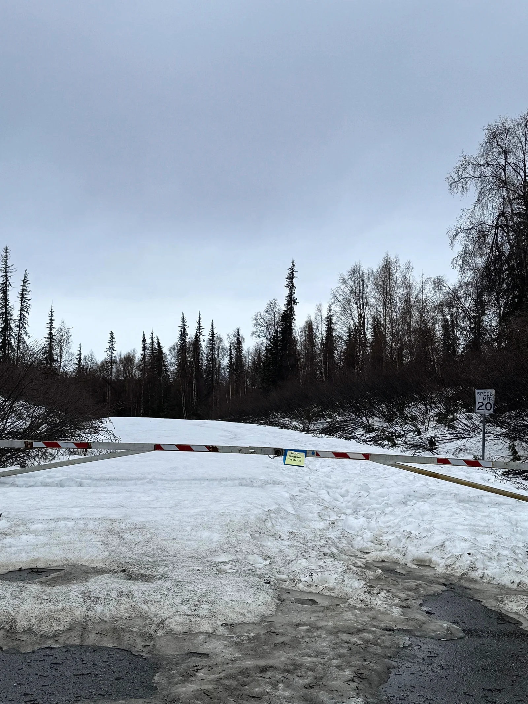

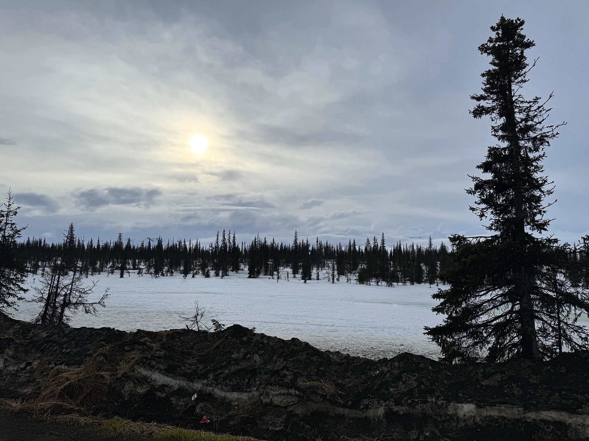

### Neve e tempo instável nas passagens altas

Em maio, a neve pode voltar a qualquer momento nas regiões altas. Pegamos neve no trecho alto da Parks Highway, a caminho do Denali, no Thompson Pass, antes de Valdez, e na Glenn Highway. No Thompson Pass, passamos com céu azul no dia 11 e, na volta, no dia 12, pegamos neve e neblina no mesmo trecho.

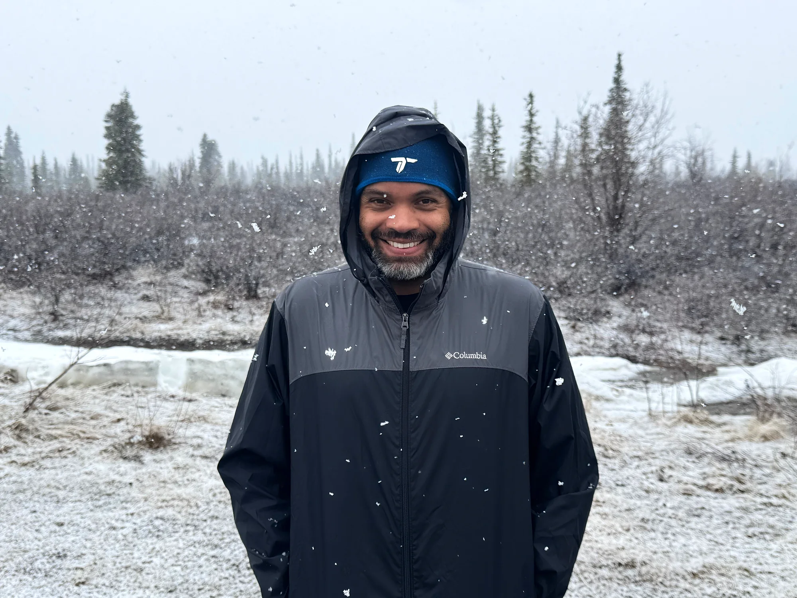

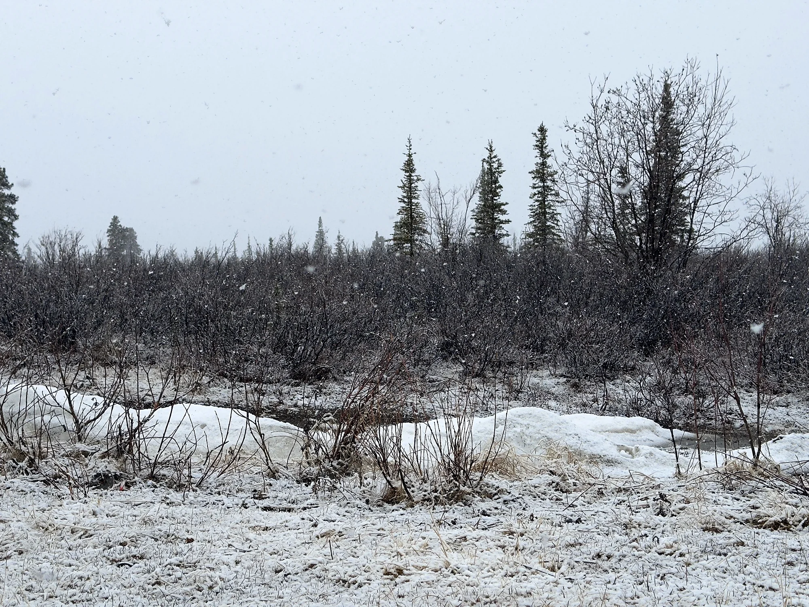

### Paisagens em transição

Maio também tem um lado menos fotogênico: a vegetação ainda está seca e marrom em muitas regiões, as árvores sem folhas, e o degelo deixa margens de lama e gelo sujo. Em troca, os lagos congelados e as montanhas nevadas compensam.

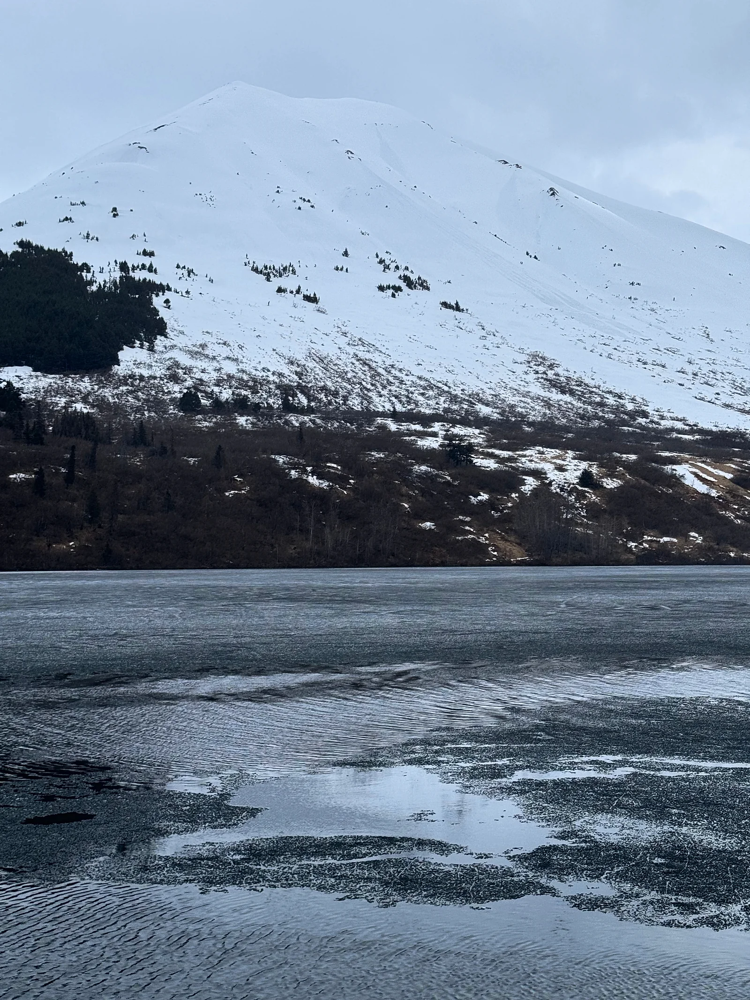

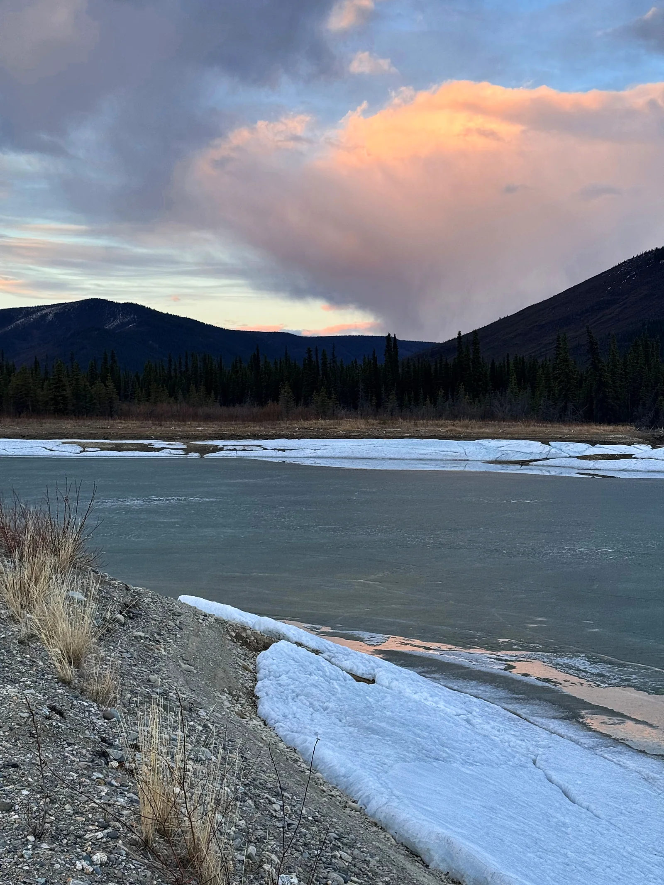

## Maio vale a pena?

Para nós, valeu. As estradas vazias, a luz das 22h e os lagos congelados sob céu azul compensaram o pico do Denali escondido e o camping fechado pela neve. Mas maio não é para todos:

- **Vá em maio** se você quer dirigir, fotografar paisagens de inverno com luz de verão, pagar menos e evitar multidões, e se aceita que alguns serviços ainda estejam fechados.
- **Prefira junho a agosto** se você quer passeios de barco, trilhas longas sem neve, os ônibus do Denali e todos os serviços abertos.
- **Prefira setembro** se quer combinar estrada, cores de outono e a volta das auroras.
- **Prefira o inverno** se o objetivo é ver auroras boreais.

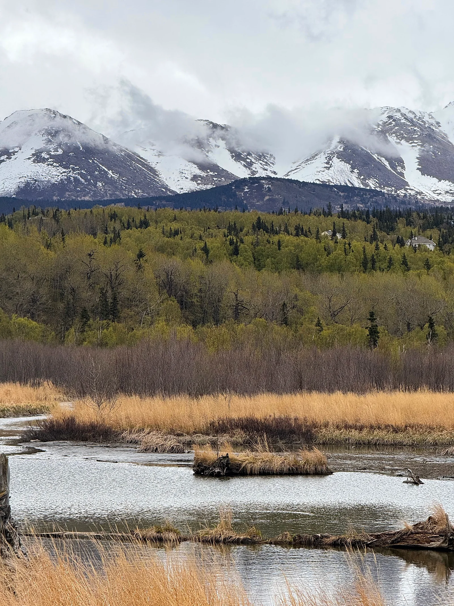

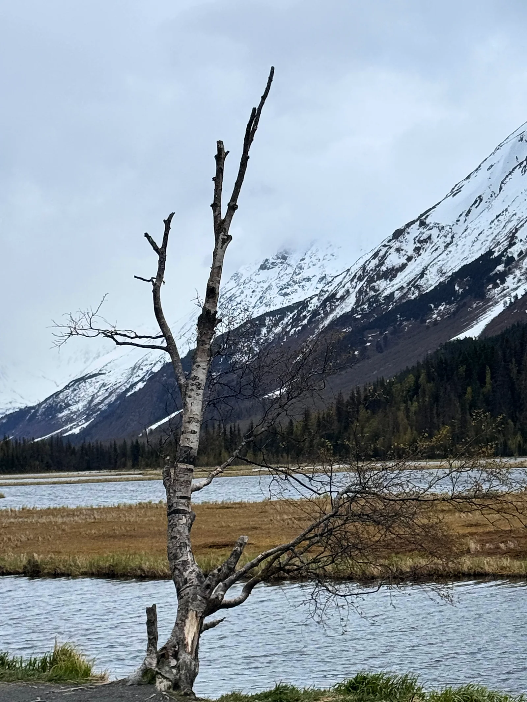

## Checklist de roupas para maio: camadas

Numa mesma viagem em maio, passamos por neve fresca na Glenn Highway, noites frias perto do Círculo Polar Ártico e tardes de sol na Península Kenai. As médias ajudam a dimensionar: em Fairbanks, maio vai de cerca de 2 °C de mínima a 16 °C de máxima; em Anchorage, de 4 °C a 13 °C. Nas regiões altas e no extremo norte, as noites são mais frias. A solução é vestir camadas:

- **Segunda pele térmica**, de lã merino ou sintética, para as manhãs e as noites.
- **Fleece ou casaco leve de pluma**, a camada que esquenta sem pesar.
- **Jaqueta impermeável com capuz**, para a neve molhada e a chuva de Valdez e da Glenn Highway.
- **Calça de trilha** e, para os dias de chuva ou neve, uma calça impermeável por cima.
- **Bota impermeável** com boa aderência, para trilhas com neve, gelo e lama.
- **Gorro, luvas e cachecol ou buff**, sempre à mão.
- **Óculos de sol e protetor solar**: a neve reflete a luz o dia inteiro.
- **Máscara de dormir**, por causa da luz quase contínua.
- **Roupa de banho**, se o roteiro incluir o Chena Hot Springs.

:::dica
Monte a mala pensando em vestir e tirar camadas ao longo do dia. Deixe a jaqueta impermeável sempre no topo da mochila.
:::

:::alerta
Em maio, o tempo nas passagens altas muda em minutos. Antes de cada trecho de montanha, como o Thompson Pass e o trecho alto da Parks Highway, consulte o site Alaska 511 e leve roupa de frio no carro, mesmo que o dia tenha começado com sol.
:::

## Perguntas frequentes

### Qual é a melhor época para ir ao Alasca?

Depende do objetivo. Para trilhas, passeios de barco e todos os serviços abertos, de junho a agosto. Para auroras boreais, de agosto a abril, com noites escuras. Para estradas vazias, preços menores e dias muito longos, maio e setembro, nas pontas da temporada.

### Dá para ver aurora boreal em maio no Alasca?

Não. Segundo o turismo oficial de Fairbanks, a temporada de auroras vai de 21 de agosto a 21 de abril. De 22 de abril a 20 de agosto, o céu não escurece o suficiente.

### Faz muito frio no Alasca em maio?

Faz frio, mas não de inverno. As médias de maio vão de cerca de 4 °C a 13 °C em Anchorage e de 2 °C a 16 °C em Fairbanks. Nas regiões altas e no norte, as noites são mais frias, e ainda pode nevar nas passagens de montanha.

### O Denali está aberto em maio?

Está, com limitações. Até 19 de maio, se o tempo permitir, os carros particulares podem ir pela Park Road até Teklanika, na milha 30. Os ônibus de trânsito começam em 20 de maio. Parte dos serviços e hotéis só abre no começo ou em meados de maio.

### Maio é uma boa época para viajar de motorhome no Alasca?

Para nós, foi. As estradas estavam vazias, o aluguel sai mais barato e os dias são muito longos. Em troca, alguns campings ainda estão fechados ou sem ligação de água, e é preciso contar com neve nas passagens altas.

## Fontes consultadas

- [Travel Alaska: clima do Alasca mês a mês](https://www.travelalaska.com/explore-alaska/articles/alaska-weather-month)
- [Explore Fairbanks: temporada de auroras](https://www.explorefairbanks.com/explore-the-area/seasonal-explorations/aurora-season/)
- [Explore Fairbanks: nove meses de auroras em Fairbanks](https://www.explorefairbanks.com/blog/post/nine-months-of-northern-lights-in-fairbanks/)
- [Explore Fairbanks: crepúsculo contínuo no verão](https://www.explorefairbanks.com/blog/post/70-straight-days-of-sunshine/)
- [NPS Denali: visita na primavera e no outono](https://www.nps.gov/dena/planyourvisit/shoulder-season.htm)
- [NPS Denali: onde ver e fotografar a montanha](https://www.nps.gov/dena/planyourvisit/photography.htm)
- [NPS Kenai Fjords: área do Exit Glacier](https://www.nps.gov/kefj/planyourvisit/exit-glacier-area.htm)
- [NPS Kenai Fjords: abertura da área do Exit Glacier em 14 de maio de 2026](https://www.nps.gov/kefj/learn/news/exit-glacier-area-to-open-for-summer-season-on-may-14-2026.htm)
- [BLM: recreação na Dalton Highway](https://www.blm.gov/learn/interpretive-centers/arctic-interagency-visitor-center/dalton-highway-recreation)
- [BLM: Arctic Circle Wayside](https://www.blm.gov/visit/arctic-circle-wayside)
- [Prefeitura de Homer: campings](https://www.cityofhomer-ak.gov/node/7456)
- [Explore Fairbanks: Pioneer Park](https://explorefairbanks.com/explore-the-area/fairbanks/pioneer-park)
- [Departamento de Transportes do Alasca: horários do túnel de Whittier](https://dot.alaska.gov/creg/whittiertunnel/schedule.shtml)
- [Outdoorsy: alugar um motorhome no Alasca](https://www.outdoorsy.com/blog/renting-an-rv-in-alaska-cost-timing-and-how-to-plan-it)
- [The Weather Network: médias de Fairbanks](https://www.theweathernetwork.com/en/city/us/alaska/fairbanks/monthly)
