O Morro do Pai Inácio é o cartão-postal da Chapada Diamantina: uma subida curta leva a um platô de pedra com vista para vales profundos e morros tabulares de paredões alaranjados. No fim da tarde, a luz baixa acende o arenito, e o pôr do sol no topo virou um dos programas mais concorridos da região.

Este guia explica como é a trilha, o que ver no platô, como aproveitar o pôr do sol com segurança e como encaixar o morro num dia de passeio. Para planejar o restante da viagem, veja o [guia de Lençóis](/blog/o-que-fazer-em-lencois-chapada-diamantina/) e o [roteiro completo pela Chapada Diamantina](/blog/roteiro-chapada-diamantina/). **As informações foram pesquisadas em novembro de 2026.** Taxas e horários mudam, por isso confirme antes de ir.

## O cartão-postal da Chapada Diamantina

O morro fica no município de Palmeiras, dentro da área do Parque Nacional da Chapada Diamantina, quase à beira da BR-242. Guias de viagem citam cerca de 1.120 metros de altitude no topo; outras fontes dão números um pouco menores, perto de 1.050 metros. No dia da nossa visita, o GPS do celular marcou entre 1.140 e 1.160 metros no platô.

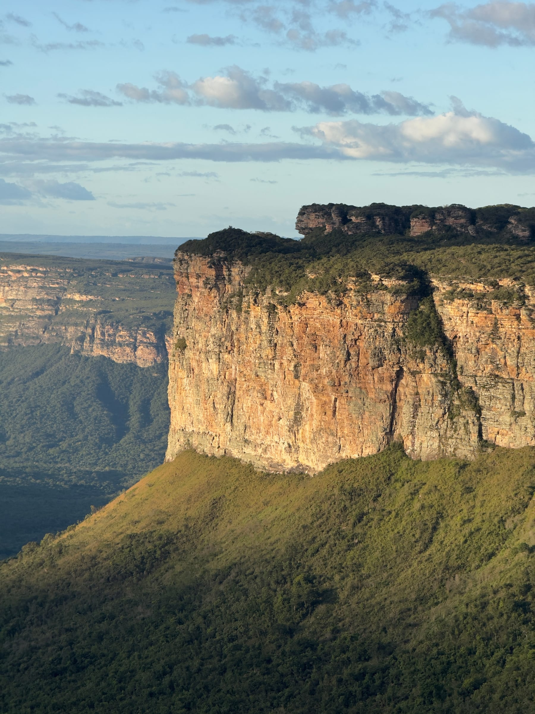

Do alto, a vista é de 360 graus: vales cobertos de mata, a planície cortada pela estrada e uma sequência de morros de topo plano, com o Morro do Camelo e o Morrão entre os mais citados pelos guias locais. É essa paisagem de mesas de pedra que aparece em boa parte das fotos de divulgação da Chapada.

O nome vem de uma lenda do século XIX, contada em várias versões. A mais conhecida fala de Inácio, um homem escravizado que se apaixonou pela esposa (em outras versões, pela filha) de um fazendeiro. Descoberto e encurralado no alto do morro, ele teria saltado do paredão segurando uma sombrinha e sobrevivido à queda. Há guias da região que contam outra versão: ele teria pulado para uma pedra mais baixa, fora da vista dos perseguidores. É folclore, mas ajuda a entender por que o morro virou símbolo da Chapada.

## Como é a subida

A trilha é curta, com cerca de 500 metros, e leva de 20 a 30 minutos a partir do estacionamento, no pé do morro. O percurso é íngreme, com degraus naturais de pedra e alguns trechos em que vale apoiar as mãos, mas não exige experiência em trilhas. O guia não é obrigatório.

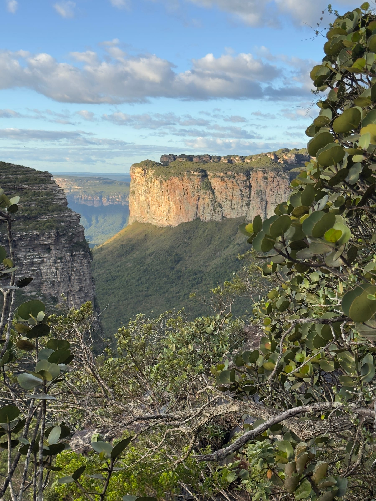

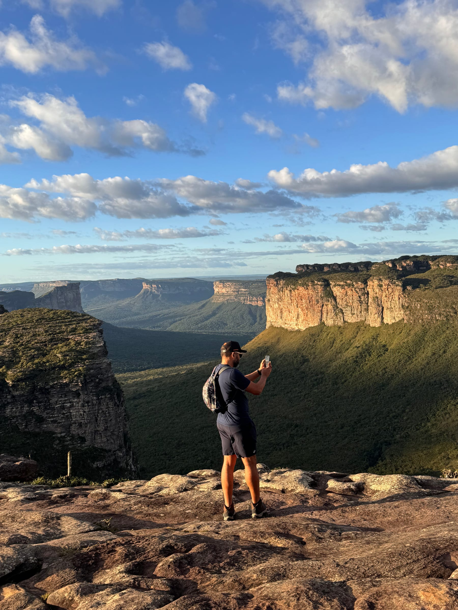

Conforme a trilha ganha altura, a vegetação baixa abre janelas para o vale, e o último trecho desemboca direto nas lajes do platô. Suba sem pressa: o esforço é concentrado, e o visual compensa logo na chegada.

## O platô e os mirantes naturais

O topo é um grande lajedo de arenito, irregular, com fendas, poças de água da chuva e manchas de vegetação de altitude, como cactos e arbustos de folhas grossas. Não há um único mirante: cada borda mostra um ângulo diferente dos vales, e vale a pena caminhar com calma pelo platô.

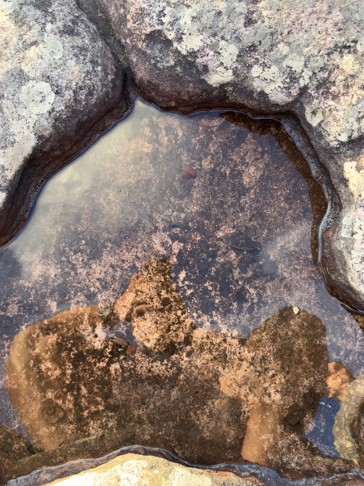

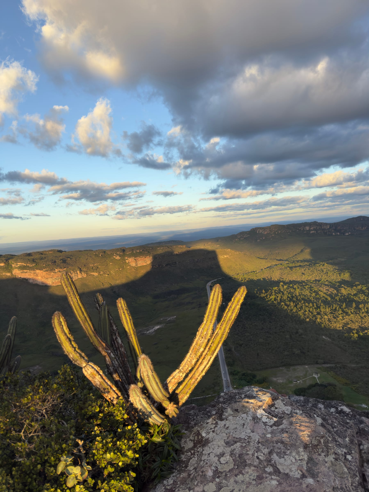

No fim da tarde, com o sol às costas, a sombra do próprio morro se projeta sobre o vale do lado da BR-242. A silhueta de topo plano avança aos poucos sobre a planície, um dos detalhes mais bonitos da visita.

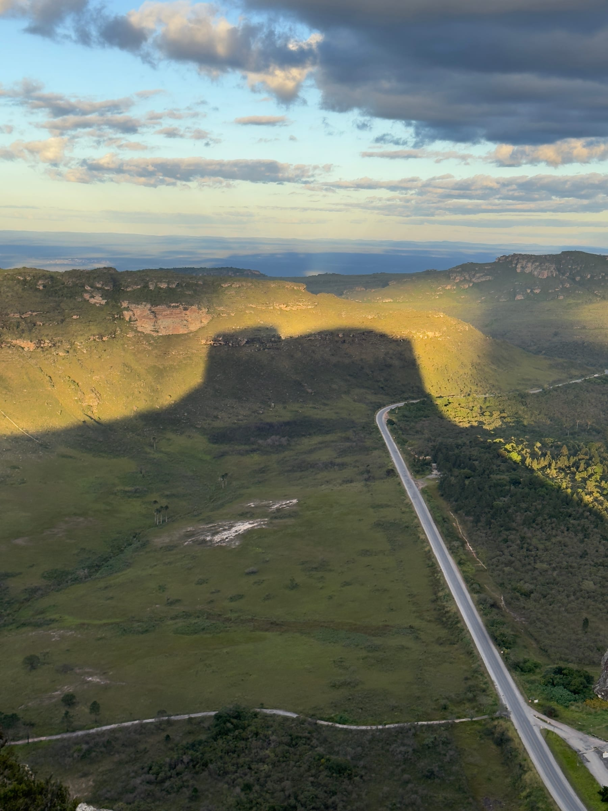

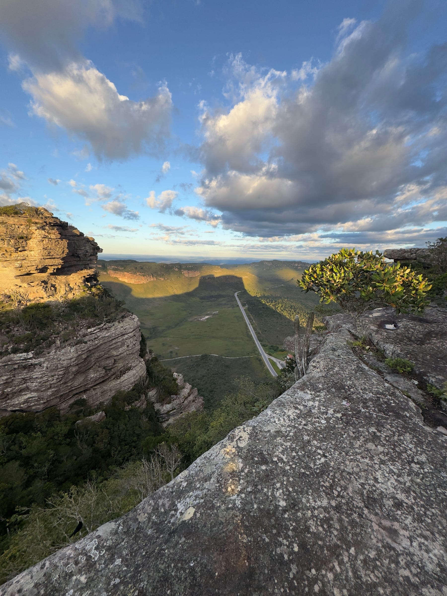

Em outro trecho da borda, a vista se abre para um cânion largo, entre paredões de arenito e encostas de mata, com outros morros tabulares enfileirados no horizonte.

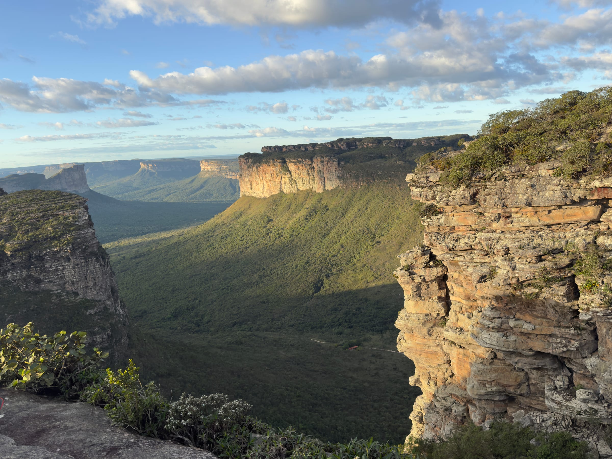

Foi nessa borda que fiz uma pausa antes do pôr do sol, com a luz já dourada sobre os paredões.

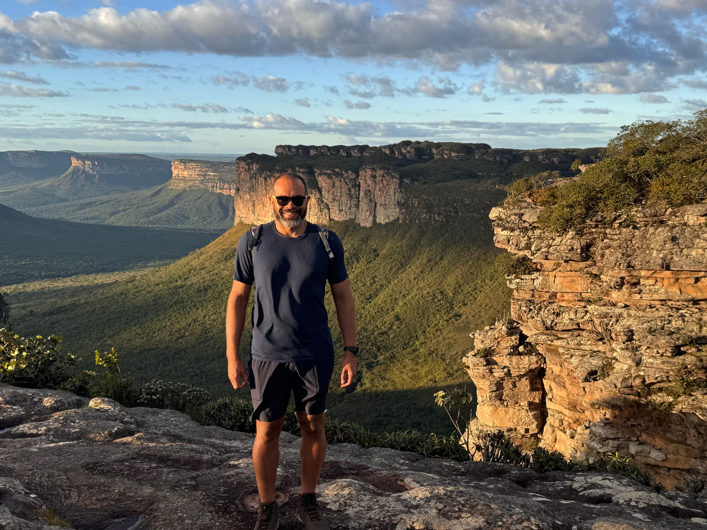

## O pôr do sol no topo

O sol se põe sobre a linha reta do horizonte, sem montanhas na frente. Nos minutos finais, o céu ganha tons de laranja e as poças do platô refletem a luz. Na nossa visita, em maio, o sol tocou o horizonte por volta das 17h20.

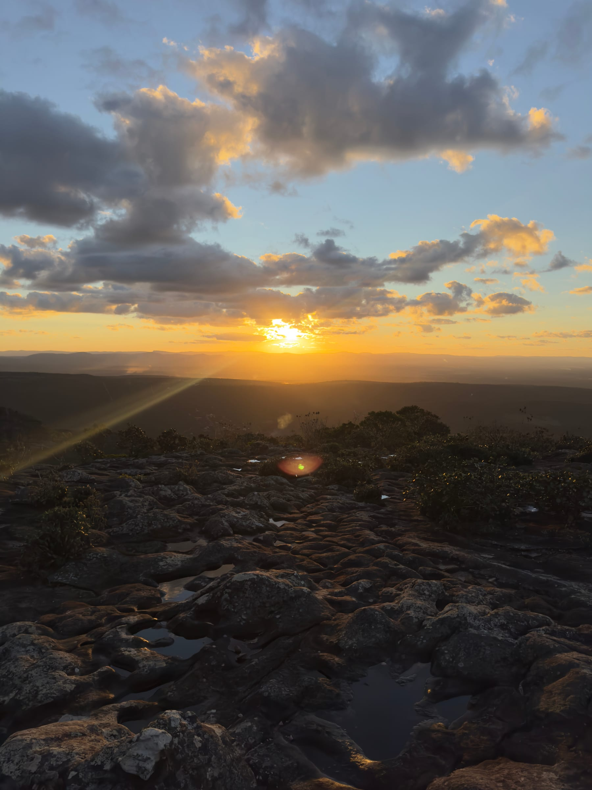

Fique até o fim: depois que o sol some, o céu ainda muda de cor por alguns minutos. Mas planeje a descida, porque escurece rápido.

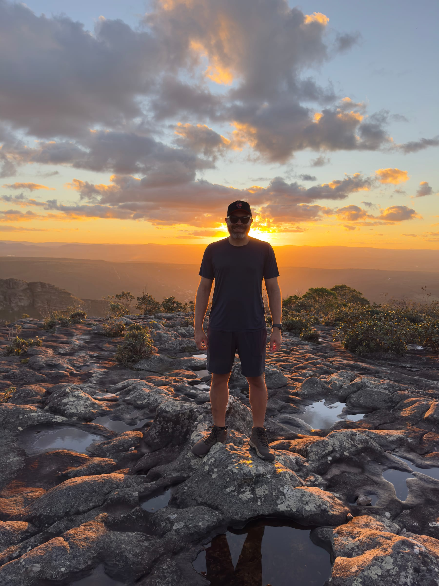

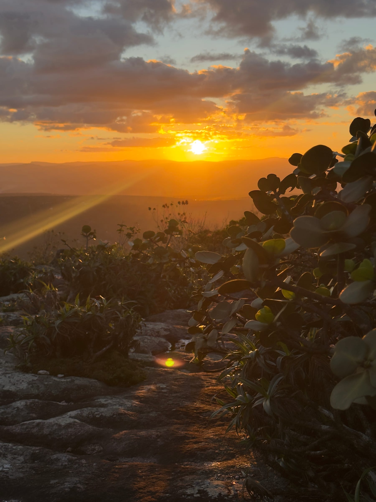

:::dica
Chegue à portaria com folga: a última subida costuma ser liberada até as 17h, e o fim de tarde é o horário mais movimentado. Subindo por volta das 16h, dá tempo de explorar o platô com calma antes do pôr do sol e escolher um lugar seguro para assistir.
:::

:::alerta
Leve lanterna de cabeça (ou o celular bem carregado) para descer depois do ocaso: a trilha de pedra fica escura muito rápido. Leve também um corta-vento ou agasalho leve, porque venta bastante no topo e esfria assim que o sol baixa. As bordas do platô não têm guarda-corpo: mantenha distância segura do precipício, principalmente para fotos.
:::

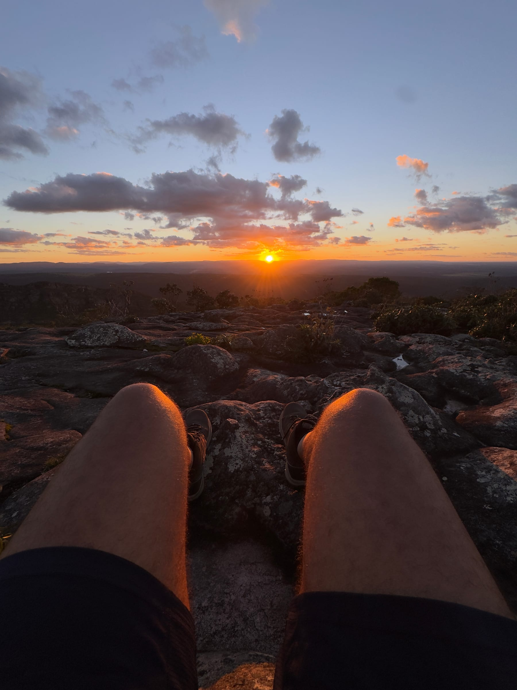

## Como chegar e roteiro de um dia

O Morro do Pai Inácio fica em Palmeiras, às margens da BR-242, a cerca de 26 km de Lençóis. O acesso é asfaltado e sinalizado, com estacionamento na base e controle de acesso na portaria, administrada pela Prefeitura de Palmeiras. Desde abril de 2026, a taxa é de R$ 20, com meia-entrada de R$ 10.

| Período | Atração | Leia o guia |
|---|---|---|
| Manhã | Gruta da Lapa Doce, em Iraquara | [Gruta da Lapa Doce](/blog/gruta-da-lapa-doce-chapada-diamantina/) |
| Tarde | Gruta da Pratinha e Gruta Azul, na Fazenda Pratinha | [Gruta da Pratinha e Gruta Azul](/blog/gruta-da-pratinha-chapada-diamantina/) |
| Fim de tarde | Pôr do sol no Morro do Pai Inácio | Este guia |

:::logistica
O roteiro clássico de um dia saindo de Lençóis combina a [Gruta da Lapa Doce](/blog/gruta-da-lapa-doce-chapada-diamantina/) pela manhã, a [Gruta da Pratinha e a Gruta Azul](/blog/gruta-da-pratinha-chapada-diamantina/) à tarde e o pôr do sol no Pai Inácio, que fica no caminho de volta pela BR-242. Agências de Lençóis vendem esse roteiro com transporte e guia; de carro próprio, dá para fazer por conta. Veja como ele se encaixa nos outros dias no [roteiro completo pela Chapada Diamantina](/blog/roteiro-chapada-diamantina/).
:::

## Perguntas frequentes

### Precisa de guia para subir o Morro do Pai Inácio?

Não. A trilha é curta e bem marcada, e o guia não é obrigatório. Basta pagar a taxa na portaria.

### Quanto tempo leva a subida?

De 20 a 30 minutos, em ritmo tranquilo, por uma trilha de cerca de 500 metros com degraus de pedra.

### Até que horas dá para subir?

A última subida costuma ser liberada até as 17h. Confirme o horário na portaria, porque ele pode mudar.

## Fontes consultadas

Acesso em novembro de 2026.

- [A Tarde: reajuste da taxa do Morro do Pai Inácio](https://atarde.com.br/bahia/acesso-a-cartao-postal-da-chapada-diamantina-fica-mais-caro-a-partir-de-abril-1382172)
- [Wikipédia: Morro do Pai Inácio](https://pt.wikipedia.org/wiki/Morro_do_Pai_In%C3%A1cio)
- [Um Viajante: Morro do Pai Inácio na Chapada Diamantina](https://www.umviajante.com.br/bahia/7779-morro-do-pai-inacio-na-chapada-diamantina)
- [Mala de Aventuras: pôr do sol no Morro do Pai Inácio](https://www.maladeaventuras.com/chapada-diamantina-por-do-sol-no-morro-do-pai-inacio/)
- [Melhores Destinos: Morro do Pai Inácio](https://guia.melhoresdestinos.com.br/morro-do-pai-inacio-221-6153-l.html)
- [Fodor's: Morro de Pai Inácio](https://www.fodors.com/world/south-america/brazil/salvador-and-the-bahia-coast/things-to-do/sights/reviews/morro-de-pai-inacio-114834820)
- [Avygeo: Morro do Pai Inácio](https://www.avygeo.com/pt/guia/atividades/69619-morro-do-pai-inacio)
