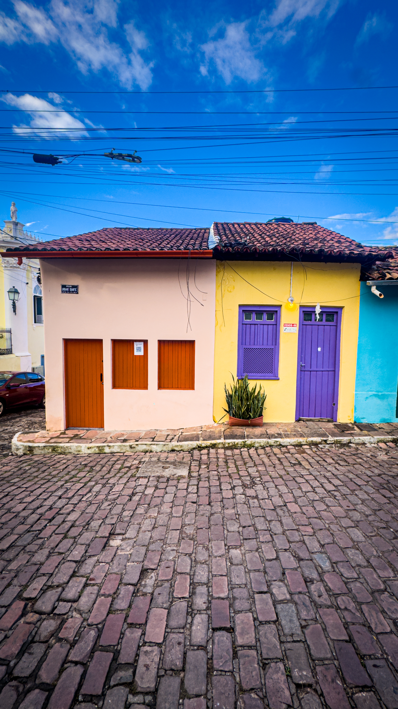
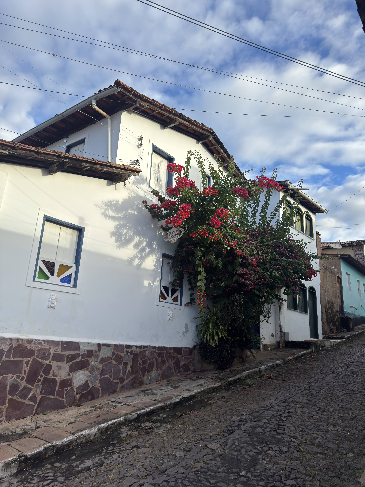
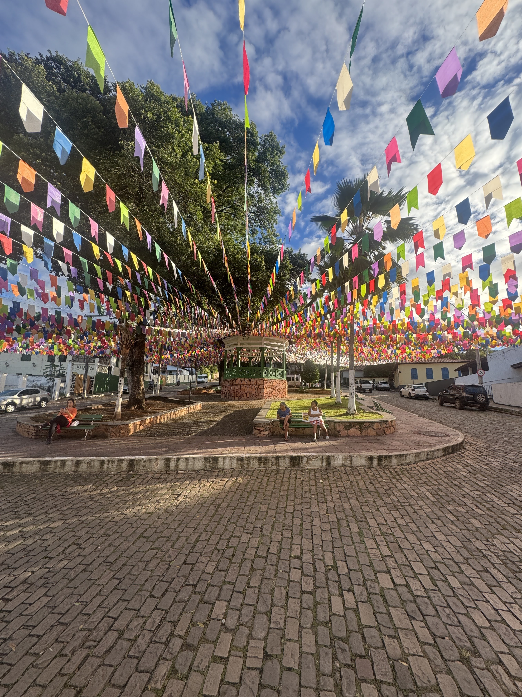
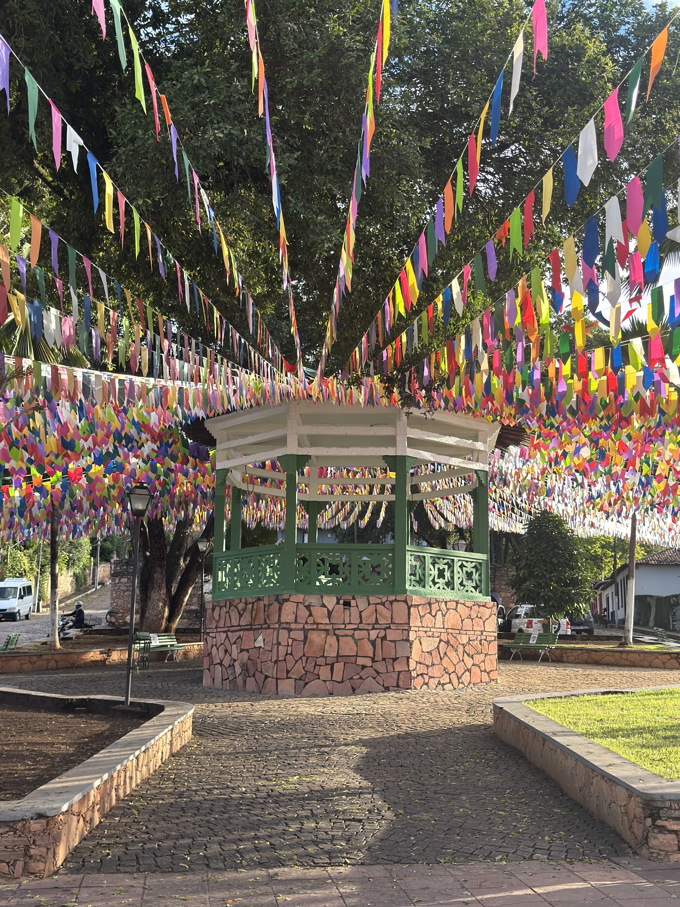
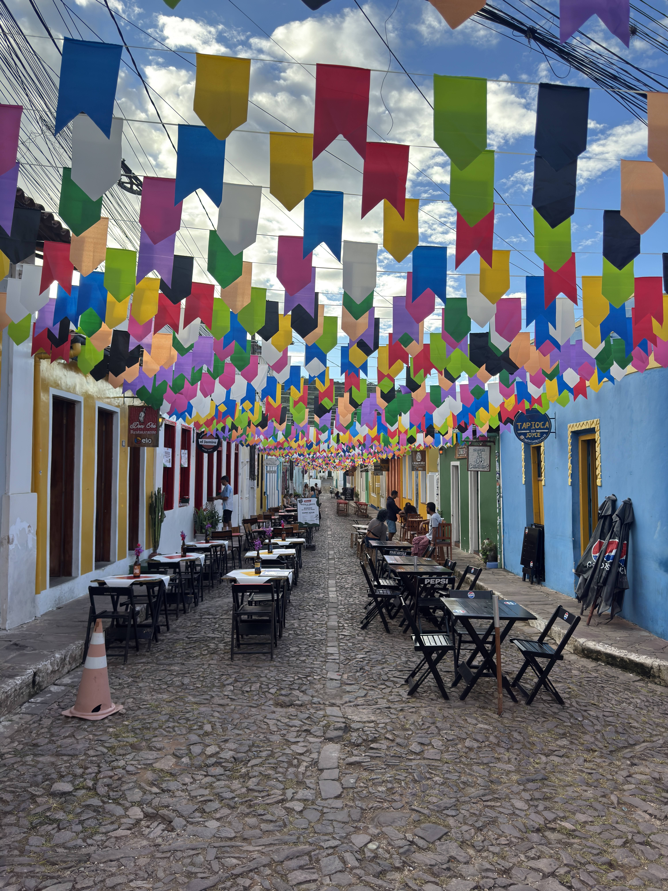
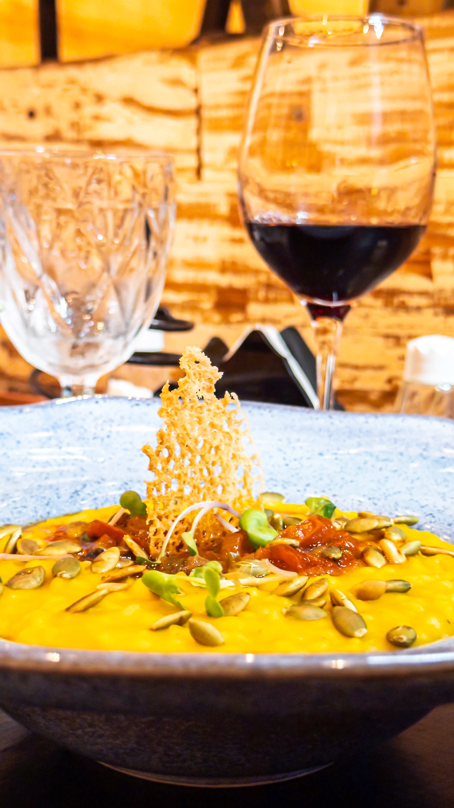
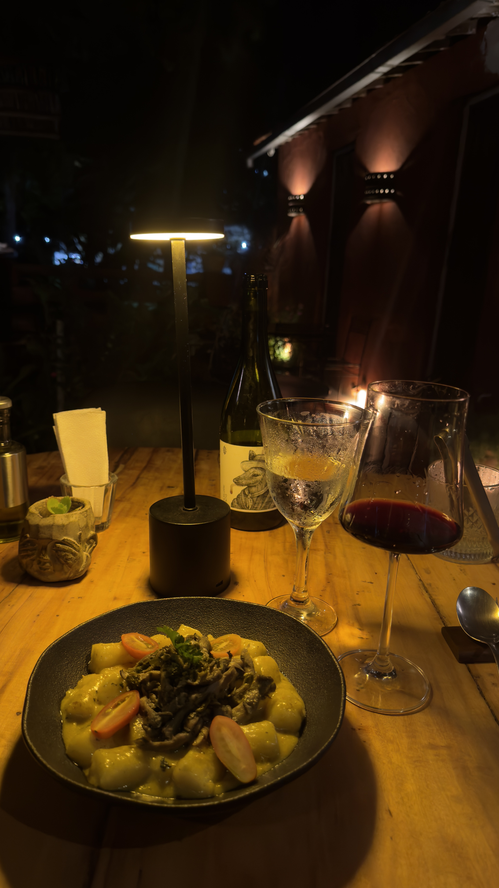
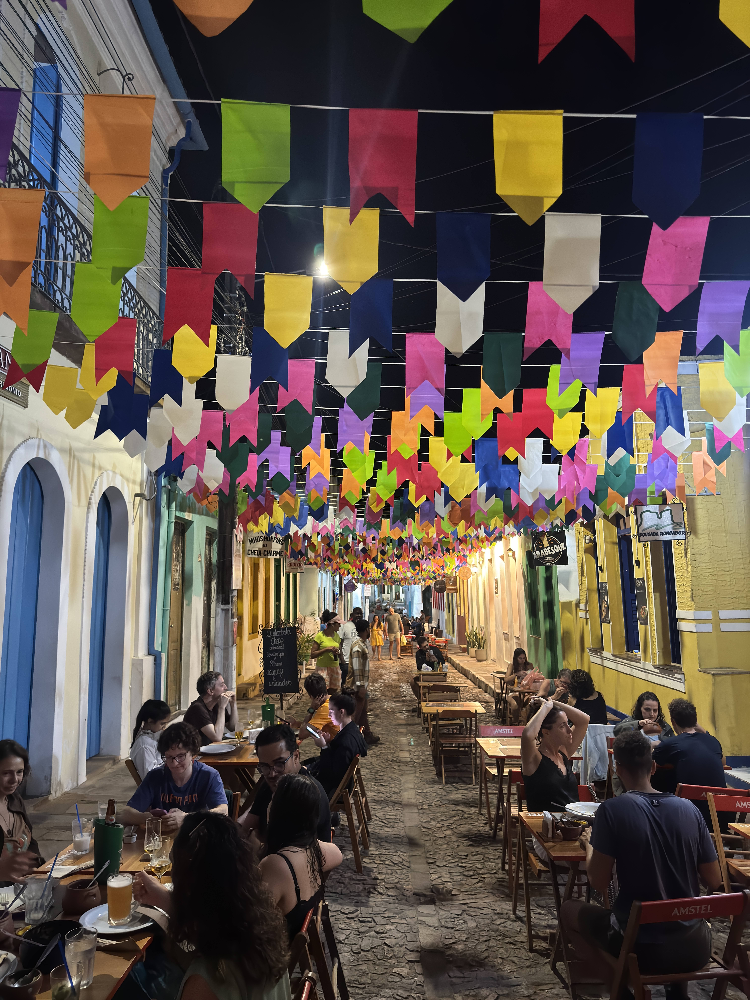
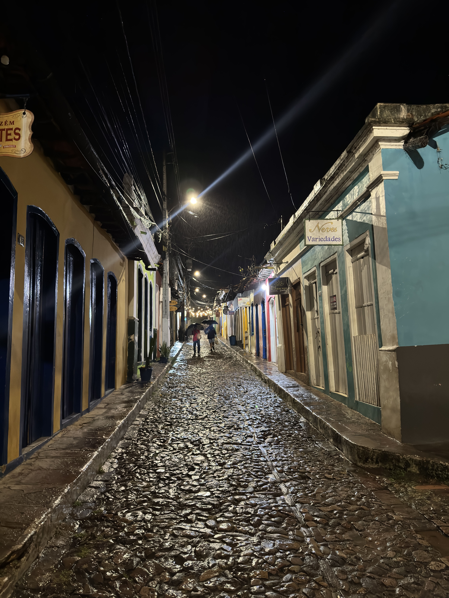

Lençóis é a cidade mais prática para se hospedar na Chapada Diamantina, e também vale a visita por si mesma: tem centro histórico tombado, trilhas e poços que começam a pé e uma noite animada em torno das mesas na rua. Reserve ao menos um dia só para ela, além dos passeios pela região.

Este guia foca a cidade. Para planejar a viagem inteira, com Vale do Pati, poços e custos, consulte o nosso [roteiro completo pela Chapada Diamantina](/blog/roteiro-chapada-diamantina/). **As informações foram pesquisadas em novembro de 2026.** Horários, taxas e regras mudam, por isso confirme antes de ir.

## Atmosfera e hospitalidade

Lençóis nasceu com o garimpo de diamantes no século XIX, e essa história continua visível no desenho da cidade. Em 1973, o conjunto arquitetônico e paisagístico foi tombado pelo IPHAN, o que ajudou a preservar o casario colorido e as ruas em calçamento de pedra.

O que torna a estadia mais rica, porém, são as pessoas. A simpatia e a receptividade de moradores, comerciantes e guias nativos fazem parte da experiência, e uma caminhada no fim da tarde costuma render boas conversas. Muitos casarões hoje abrigam pousadas, cafés e ateliês, então dá para conhecer quem vive ali enquanto se explora o centro.

:::dica
Guarde um fim de tarde sem programa. Caminhe sem pressa pelas ruas de pedra, entre nas lojinhas e converse com quem mora ali. Os guias nativos também são uma ótima fonte de indicações sobre a região.
:::

## Logística e base operacional

### Como chegar

A escolha principal é entre voar direto para Lençóis ou seguir por terra a partir de Salvador.

| Opção | Tempo aproximado | Observação |
|---|---|---|
| Voo até o aeroporto de Lençóis (LEC) | Cerca de 1h10 desde Salvador | Poucos voos por semana; o aeroporto fica a cerca de 20 km do centro |
| Ônibus desde Salvador | 6h40 a 7 horas | Real Expresso e Rápido Federal; cerca de R$ 175 por trecho, em média |
| Carro ou transfer desde Salvador | Cerca de 400 km | Mais flexível; cote o transfer com antecedência |

Em agosto de 2026, a imprensa local informava dois voos regulares por semana no aeroporto de Lençóis, para Salvador e Confins. Confirme a malha antes de comprar a passagem. Os detalhes de transporte e custos estão no [roteiro completo](/blog/roteiro-chapada-diamantina/#como-chegar-a-lençóis).

:::logistica
Sem carro, combine com a pousada como ir do aeroporto até o centro. Verifique se ela está em uma rua de acesso fácil, já que à noite algumas vias concentram pedestres, como a Rua da Baderna.
:::

### Como circular pela cidade

O centro histórico é compacto e funciona bem a pé: restaurantes, lojas e agências ficam a uma caminhada curta de distância. Para os atrativos mais distantes da região, a saída costuma ser contratar um passeio por agência ou alugar um carro.

:::alerta
O calçamento de pedra é irregular e pode ficar escorregadio depois da chuva. Use calçado firme, principalmente à noite, e redobre a atenção com malas de rodinhas.
:::

## Atrativos a pé, sem carro

Uma das vantagens de Lençóis é poder sair do centro caminhando em direção à natureza. O Parque Municipal da Muritiba fica a cerca de 2 km do centro e reúne as principais paradas.

| Atrativo | O que esperar |
|---|---|
| Serrano | Piscinas naturais e caldeirões no rio, os mais próximos da cidade |
| Salão de Areias Coloridas | Formações rochosas e areias coloridas, em área protegida |
| Poço Halley | Poço para banho e descanso |
| Ribeirão do Meio | Tobogã natural na rocha e poço, a cerca de 3,8 km por trilha quase plana |

:::alerta
Ir a pé não significa ir sem guia. Fontes recentes indicam taxa de visitação a partir de R$ 20 e guia local obrigatório em parte do circuito da Muritiba, geralmente das 8h às 17h. Confirme as regras em Lençóis antes de sair. O ICMBio também recomenda não saltar nos poços, porque as chuvas alteram o leito dos rios.
:::

Passeios mais longos, como a Cachoeira da Fumaça e o Poço Azul, exigem transporte. Eles aparecem no [roteiro de 7 dias pela Chapada](/blog/roteiro-chapada-diamantina/#roteiro-de-7-dias-com-o-vale-do-pati).

## Gastronomia de destaque

Depois das trilhas, comer bem faz parte do programa. O polo gastronômico fica no próprio centro histórico, e boa parte das mesas ocupa a rua.

### Onde procurar restaurantes

- **Rua das Pedras:** concentra boa parte dos restaurantes, muitos com mesas do lado de fora. Quilombola, de cozinha regional, e Cozinha Italiana da Marisa são endereços citados com frequência.
- **Rua da Baderna (Rua Miguel Calmon):** reúne bares e restaurantes, como Garimpo Gourmet e Quarar. Segundo relatos de viajantes, a rua fecha para carros à noite.
- **Praça das Nagôs (hoje Praça Aureliano Sá):** o entorno inclui opções como o Lampião Cozinha Nordestina.

Em 2023, um levantamento de pratos em restaurantes da cidade encontrou valores entre cerca de R$ 25 e R$ 85. Use essa faixa só como referência e confirme se os restaurantes continuam abertos.

### Sabores da Chapada e da Bahia

- **Godó de banana verde com carne-seca:** ensopado ligado à cozinha dos garimpeiros, é um dos pratos mais associados à região.
- **Pastel de palmito de jaca:** a jaca verde é um ingrediente versátil na cozinha local, usada também em moquecas no lugar de peixe ou camarão.
- **Moquecas:** aparecem em versões com camarão e banana-da-terra, além de opções com jaca.
- **Cozinha regional contemporânea:** alguns restaurantes reinterpretam ingredientes locais em pratos autorais, como o nhoque nordestino.

## Vida noturna

As noites de Lençóis têm um ritmo próprio: depois de um dia de trilha, a cidade se reúne em torno das mesas na rua, para comer sem pressa e trocar histórias sobre os passeios. O clima costuma ser mais de conversa ao ar livre do que de balada.

Alguns restaurantes já tiveram música ao vivo em certos dias da semana, e muitos fecham entre 22h e 23h30, segundo um levantamento de 2023. Vale confirmar no local. Quando o movimento diminui, as ruas de pedra iluminadas ainda rendem um bom passeio.

## Perguntas frequentes

### Quantos dias ficar em Lençóis?

Reserve um dia inteiro para a cidade e a Muritiba. Como Lençóis costuma ser a base da viagem, a estadia total depende dos passeios escolhidos: o nosso [roteiro completo](/blog/roteiro-chapada-diamantina/) sugere de 5 a 7 dias na região.

### Dá para visitar Lençóis sem carro?

Sim. O centro funciona a pé, e as agências locais organizam o transporte para os passeios mais distantes.

### Precisa de guia nos passeios a pé?

Depende do trecho. Fontes recentes indicam guia obrigatório em parte da Muritiba, então confirme em Lençóis antes de sair.

## Fontes consultadas

Acesso em novembro de 2026.

- [UAI: Lençóis, casario e patrimônio tombado](https://www.uai.com.br/cidades/2026/06/03/a-antiga-capital-mundial-do-diamante-guarda-casas-antigas-e-o-caminho-para-o-maior-paraiso-escondido-da-bahia/)
- [A Tarde: 169 anos de história de Lençóis](https://atarde.com.br/bahia/lencois-169-anos-de-historia-viva-no-coracao-da-chapada-diamantina-1372741)
- [Movimento Econômico: voos e aeroporto de Lençóis](https://movimentoeconomico.com.br/estados/bahia/2026/08/13/bahia-amplia-aeroportos-para-atrair-turistas-a-chapada-e-ao-sao-francisco/)
- [ICMBio: informações sobre visitação no Parque Nacional da Chapada Diamantina](https://www.gov.br/icmbio/pt-br/assuntos/unidade-de-conservacao/unidades-de-biomas/caatinga/lista-de-ucs/parna-da-chapada-da-diamantina/informacoes-sobre-visitacao-parna-da-chapada-da-diamantina)
- [Como Viajei: um dia no Parque da Muritiba](https://comoviajeiblog.wordpress.com/2024/09/13/um-dia-no-parque-municipal-da-muritiba-em-lencois/)
- [ParqueMunicipal.com: Parque Municipal da Muritiba](https://www.parquemunicipal.com/parque-municipal-da-muritiba/)
- [Diamantina Mountains: Parque Muritiba com Ribeirão do Meio](https://diamantinamountains.com/parque-muritiba-com-ribeirao-do-meio/)
- [Rota 1976: onde comer em Lençóis](https://rota1976.com/tour-gastro-onde-comer-bem-em-lencois-na-chapada-diamantina-ba/)
- [Slow Food Brasil: cozinha de garimpo na Chapada Diamantina](https://slowfoodbrasil.org.br/2007/07/cozinha-de-garimpo-na-chapada-diamantina/)
- [Guia Chapada Diamantina: motivos para visitar Lençóis](https://www.guiachapadadiamantina.com.br/20-razoes-para-visitar-lencois-no-proximo-feriado/)
- [Infonet: Lençóis, mais que coadjuvante](https://infonet.com.br/blogs/chapada-diamantina-ba-lencois-mais-que-coadjuvante/)
- [Kupi: Lampião Cozinha Nordestina](https://www.kupi.com/en/explore/brazil/lencois/lampiao-northeastern-cuisine)
