Mucugê é a cidade mais tranquila entre as bases da Chapada Diamantina: casario colonial preservado, noites frescas de serra, o Cemitério Bizantino encravado na rocha e fazendas de café especial nos arredores. Também é a melhor base para explorar o sul da região, com o Poço Encantado e a Cachoeira do Buracão.

Este guia foca a cidade e os seus arredores. Para planejar a viagem inteira, consulte o nosso [roteiro completo pela Chapada Diamantina](/blog/roteiro-chapada-diamantina/). Se for começar pelo norte, veja também [o que fazer em Lençóis](/blog/o-que-fazer-em-lencois-chapada-diamantina/). **As informações foram pesquisadas em novembro de 2026.** Taxas, horários e regras mudam, por isso confirme antes de ir.

## Atmosfera e história

Mucugê nasceu do garimpo de diamantes: segundo o IBGE, a povoação surgiu em 1844, com a chegada de garimpeiros de outras regiões. Esse passado ficou registrado no centro histórico, que foi tombado pelo IPHAN em 1980, junto com o cemitério da cidade.

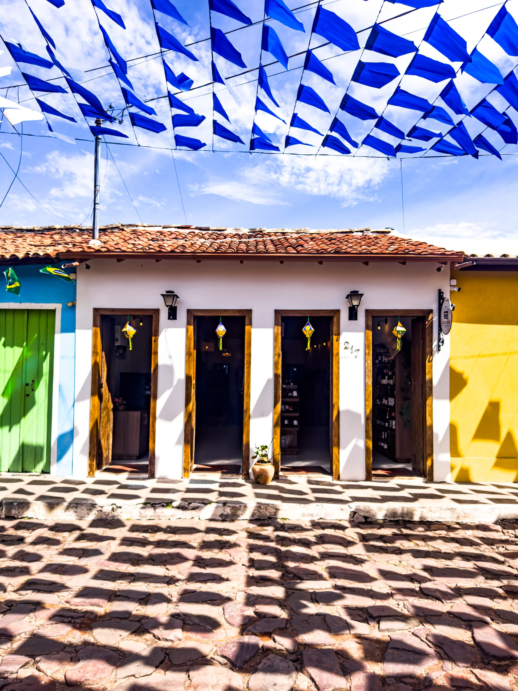

O ritmo é pacato, e a cidade se percorre a pé com facilidade. Mucugê fica na borda da Serra do Sincorá, cercada por montanhas, e o clima de serra é um dos seus atrativos: as noites podem chegar perto de 10 °C, então leve um agasalho mesmo no verão.

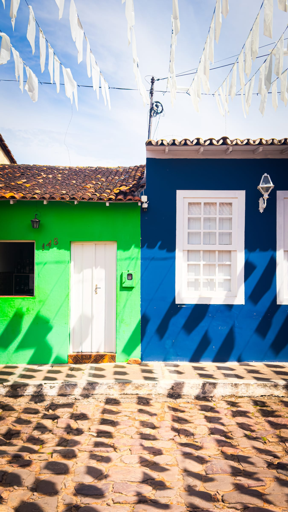

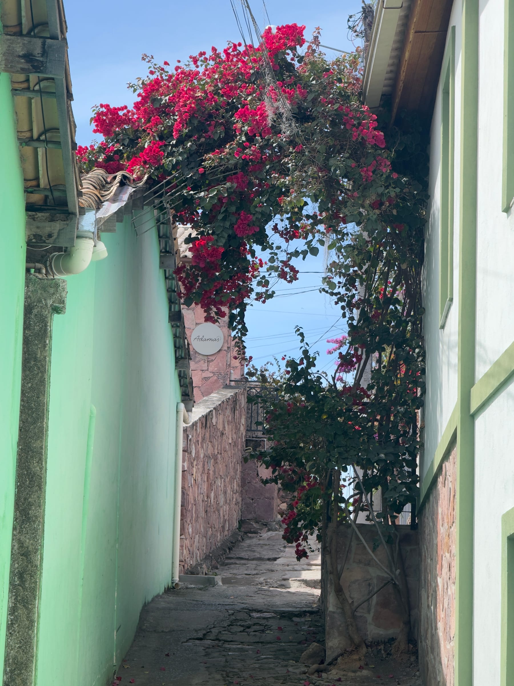

### Cemitério Bizantino

O cartão-postal de Mucugê é o Cemitério Santa Isabel, conhecido como Cemitério Bizantino. Os mausoléus brancos lembram pequenas fachadas de igrejas e ficam sobre um paredão de rocha, na beira da BA-142, com o Morro do Cruzeiro ao fundo.

A construção é associada a uma epidemia de cólera que atingiu a região em meados do século XIX. As fontes divergem sobre as datas: algumas citam 1855, e outras falam em obras de 1854 a 1886. O conjunto foi reconhecido pelo IPHAN em 1980.

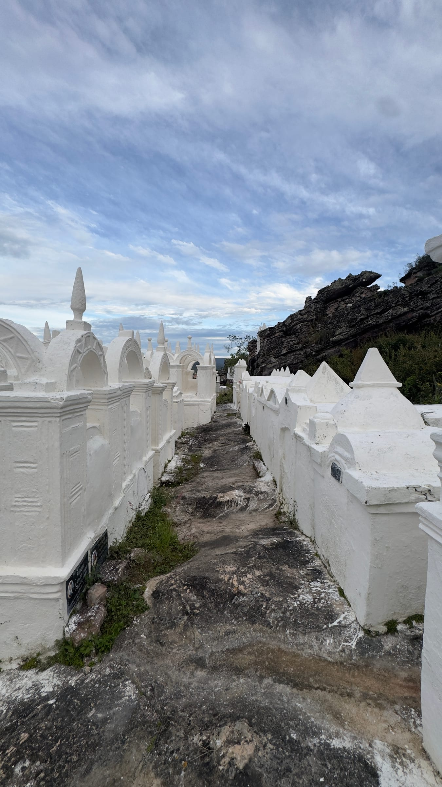

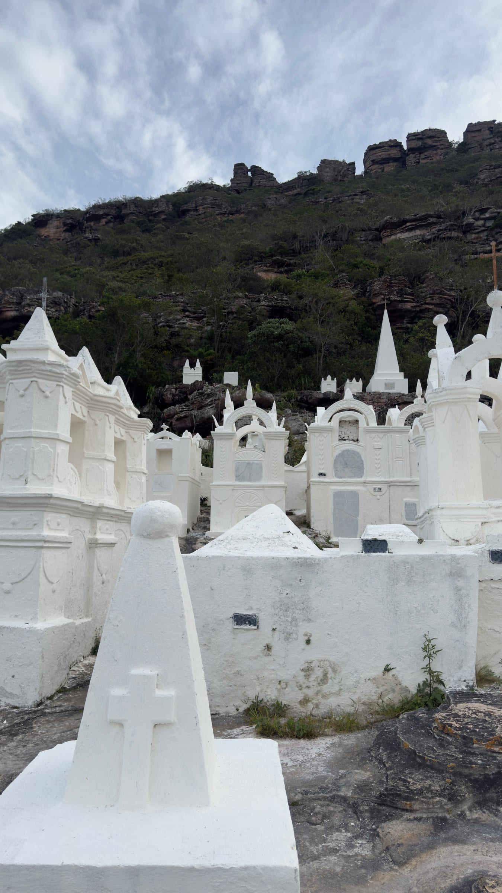

:::dica
O cemitério fica na encosta logo na entrada da cidade. O melhor momento para visitar e fotografar é no começo da manhã ou no final da tarde, quando a luz suave destaca o branco dos túmulos contra o paredão de pedra sem a incidência de sol forte a pino. A visita é rápida e pode ser combinada facilmente com uma caminhada a pé a partir do centro histórico.
:::

## Logística e base operacional

### Como chegar

| Saída | Distância | Tempo aproximado | Caminho |
|---|---|---|---|
| Lençóis | Cerca de 146 km | 2h20 de carro | BA-142, passando por Andaraí |
| Salvador | Cerca de 449 km | 6h a 6h30 de carro | BR-324, BR-242 e BA-142 |
| Vitória da Conquista | Não informado | Cerca de 4h de carro | BA-252, BA-407 e BA-142 |

Não encontramos horários atualizados de ônibus para Mucugê. Para quem não está de carro, o mais prático é combinar um transfer ou um passeio por agência a partir de Lençóis. Os detalhes de voos e ônibus até Lençóis estão no [guia de Lençóis](/blog/o-que-fazer-em-lencois-chapada-diamantina/#como-chegar).

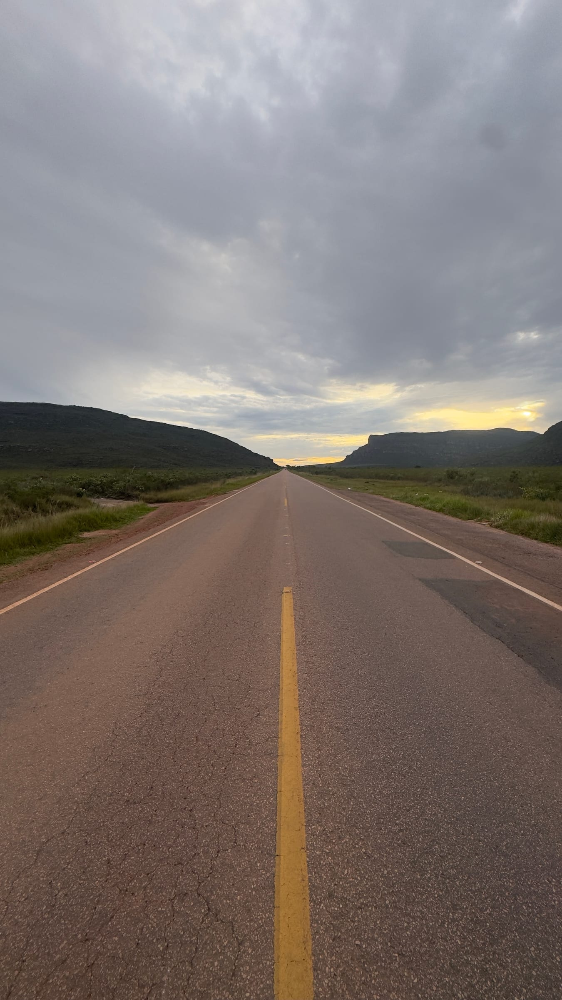

### Por que se hospedar em Mucugê

Lençóis concentra a maior oferta de serviços, mas fica longe dos atrativos do sul. Dormir em Mucugê encurta bastante esses deslocamentos.

:::logistica
O Poço Encantado fica a cerca de 46 km de Mucugê, perto de 1 hora de carro, contra cerca de 140 km a partir de Lençóis. Até Ibicoara, a cidade de acesso à Cachoeira do Buracão, são cerca de 80 km.
:::

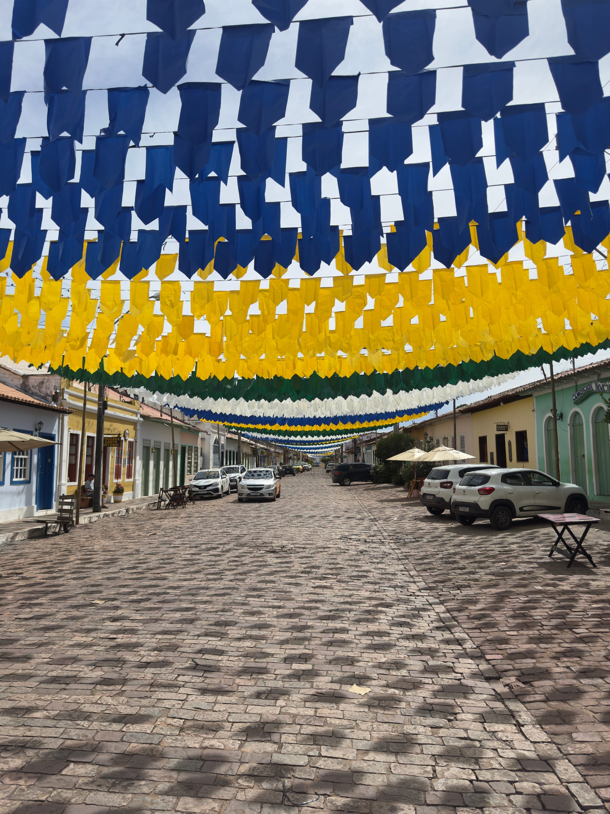

## Atrativos principais

### Parque Municipal de Mucugê e Projeto Sempre-Viva

O Parque Natural Municipal de Mucugê fica na BA-142, cerca de 10 minutos de carro da cidade, no sentido de Andaraí. É ali que funciona o Projeto Sempre-Viva, criado para preservar as sempre-vivas, plantas que se conservam por décadas depois de colhidas. O parque também abriga o Museu Vivo do Garimpo, que conta a história da mineração na região.

As trilhas até as cachoeiras são descritas como praticamente planas. A Cachoeira do Piabinha fica a poucos minutos da trilha principal, e a Cachoeira do Tiburtino, cerca de 25 minutos adiante, segundo relatos de visitantes.

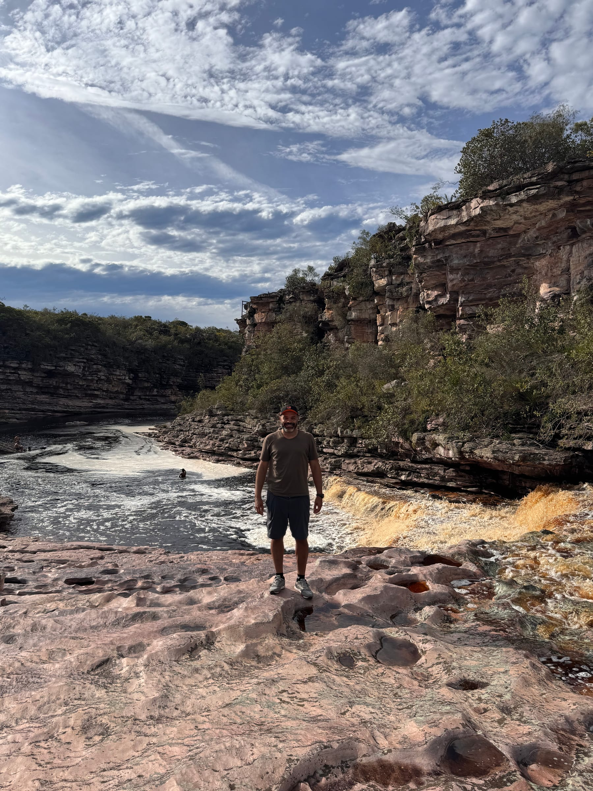

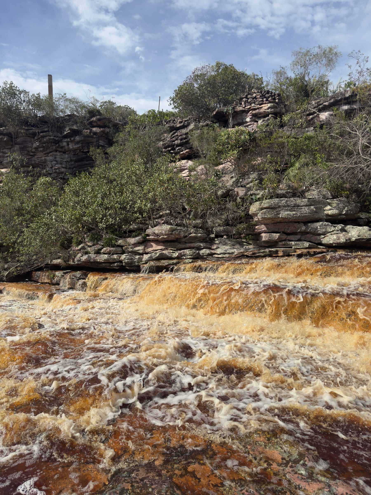

:::alerta
As fontes divergem sobre as regras do parque. Os relatos mais citados indicam funcionamento das 8h30 às 17h30 e taxa de R$ 20 por pessoa, mas há quem informe guia obrigatório na alta temporada. Confirme antes de ir e não salte nos poços: as águas escuras escondem pedras.
:::

### Cachoeira do Buracão

O Buracão fica no Parque Municipal do Espalhado, em Ibicoara, a cerca de 80 km de Mucugê. Depois do trecho de estrada de terra, uma trilha de cerca de 3 km, com escadas de pedra, leva em torno de uma hora. Para ver a queda de perto, é preciso nadar alguns minutos contra a correnteza, com colete. Uma lei municipal exige guia local.

### Poço Encantado

O Poço Encantado, em Itaetê, fica a cerca de 46 km de Mucugê. A visita é paga, e não é permitido nadar. O raio de sol que atravessa a água aparece em parte do ano, no fim da manhã. Veja o ingresso e o período do raio de sol no [roteiro completo](/blog/roteiro-chapada-diamantina/#melhor-época-para-visitar).

## Rota do café especial

A Chapada Diamantina se tornou referência em café especial, com cafés reconhecidos em concursos nacionais e internacionais. Segundo a Associação Brasileira de Cafés Especiais (BSCA), Piatã e Mucugê são os maiores produtores do estado. Piatã reúne vários premiados no Cup of Excellence Brasil, e Mucugê tem produtores que torram o café na própria origem.

### Nossa base em Mucugê: Licuri Experience

Em Mucugê, a nossa base de hospedagem e vivência rural foi o Licuri Experience, uma fazenda de café nos arredores da cidade. O que mais marcou foi o acolhimento: os anfitriões, extremamente simpáticos e agradáveis, conduziram conversas ricas sobre todo o ciclo do café, do cultivo e do manejo no pé até o ponto de torra e a extração dos cafés especiais, deliciosos, preparados ali mesmo na propriedade.

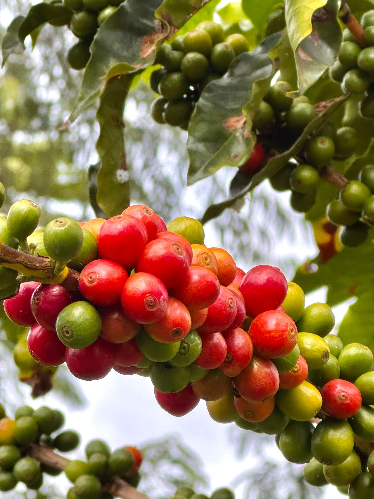

A fazenda também produz chocolates artesanais, que nos surpreenderam pelo sabor e pela qualidade.

As conversas foram além do café. Segundo os próprios anfitriões, o proprietário é parente direto do coronel Horácio de Matos, figura lendária da história da Chapada Diamantina. As memórias e os relatos que eles compartilharam durante a estadia transformaram cada conversa em uma verdadeira aula de história viva sobre a região e o garimpo.

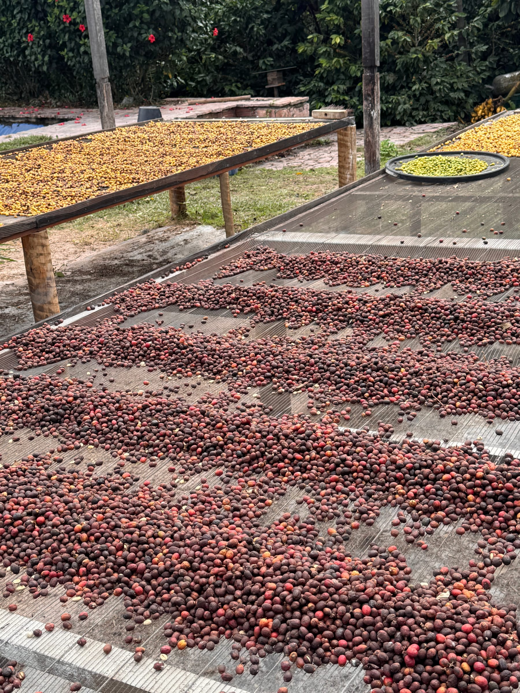

Não teve como voltar para São Paulo sem trazer na mala os pacotes do café especial Licuri Experience e as barras de chocolate da fazenda.

:::dica
Antes de pegar a estrada de terra até a fazenda, entre em contato pelo Instagram (<a href="https://www.instagram.com/licuriexperience/" target="_blank" rel="noopener noreferrer">@licuriexperience</a>) e alinhe com antecedência o horário de chegada e a degustação. O sinal de celular oscila fora do perímetro urbano de Mucugê, então não deixe para combinar no caminho.
:::

*Nota de transparência: a hospedagem e a experiência no Licuri Experience foram pagas por nós, de forma independente, sem nenhuma parceria comercial. As opiniões refletem apenas a nossa vivência.*

### Outras fazendas de café na região

Outras propriedades também recebem visitantes para mostrar o processo, do pé à xícara. A Latitude 13, por exemplo, reúne duas fazendas em Mucugê e torra na origem desde 2015. Na divisa entre Mucugê e Ibicoara, o Agrocafé Igaraçu oferece uma imersão no processo do café.

## Gastronomia da serra

As noites frescas de Mucugê combinam com refeições sem pressa, em restaurantes pequenos e acolhedores no centro. Entre os endereços citados por guias da cidade estão o Restaurante Dona Nena, na Rua Direita do Comércio, o Point da Chapada, na Praça dos Garimpeiros, e o Beco da Bateia, na Rua da Várzea. Como essa lista é de 2023, confirme se continuam abertos.

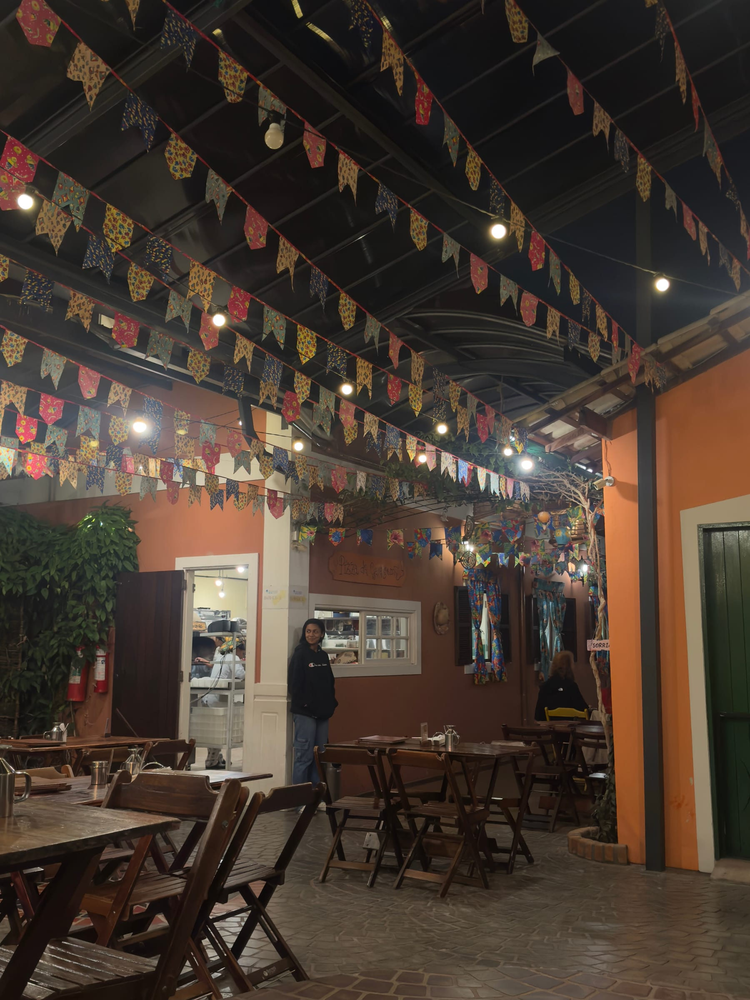

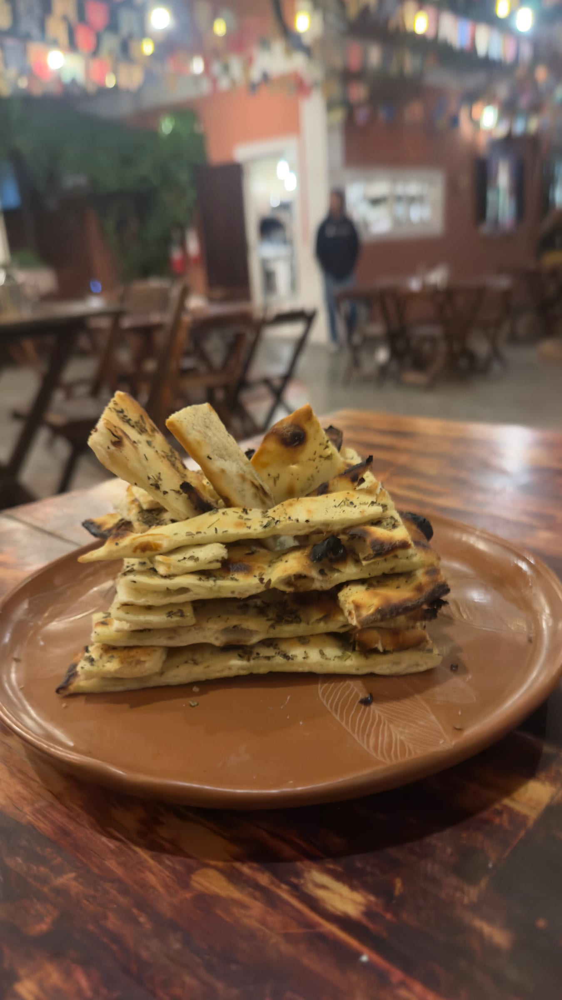

## Perguntas frequentes

### Quantos dias ficar em Mucugê?

Dois dias permitem conhecer o centro, o Cemitério Bizantino e o Parque Municipal. Para incluir o Buracão e o Poço Encantado, considere de três a quatro dias.

### Vale a pena dormir em Mucugê ou em Lençóis?

Depende do roteiro. Para os atrativos do sul, como o Buracão e o Poço Encantado, Mucugê é mais próxima. Para o norte da Chapada, Lençóis oferece mais estrutura, como explicamos no [guia de Lençóis](/blog/o-que-fazer-em-lencois-chapada-diamantina/).

### Faz frio em Mucugê?

As noites podem ficar frias, perto de 10 °C, principalmente na estação seca, de maio a setembro. Leve agasalho.

## Fontes consultadas

Acesso em novembro de 2026.

- [IBGE: histórico de Mucugê](https://biblioteca.ibge.gov.br/visualizacao/dtb/bahia/mucuge.pdf)
- [Wikipédia: Cemitério Santa Isabel de Mucugê](https://pt.wikipedia.org/wiki/Cemit%C3%A9rio_Santa_Isabel)
- [Arte Funerária Brasil: Cemitério de Santa Isabel](https://www.artefunerariabrasil.com.br/wp-content/uploads/2019/08/cemiterio-de-santa-isabel-mucuge_cbha2008.pdf)
- [Outras Fronteiras: patrimonialização de Mucugê e do Cemitério Santa Isabel](https://periodicoscientificos.ufmt.br/outrasfronteiras/index.php/outrasfronteiras/article/view/284)
- [iBahia: como chegar e onde comer em Mucugê](https://www.ibahia.com/turismo/bahia417/mucuge-como-chegar-o-que-fazer-quando-ir-onde-ficar-e-onde-comer)
- [Viciada em Viajar: o que fazer em Mucugê](https://www.viciadaemviajar.com/o-que-fazer-em-mucuge-bahia/)
- [Vem pra Bahia: Projeto Sempre Viva e Cachoeira do Tiburtino](https://vemprabahia.com.br/mucuge-visite-o-projeto-sempre-viva-e-a-cachoeira-do-tiburtino/)
- [Guia Mucugê: Projeto Sempre-Viva](http://guiamucuge.com.br/chapada-diamantina/mucuge/projeto-sempre-viva/)
- [Guia Chapada Diamantina: Cachoeira do Buracão](https://www.guiachapadadiamantina.com.br/cachoeira-do-buracao/)
- [Jornal da Chapada: café especial de Piatã e Mucugê](https://jornaldachapada.com.br/2024/03/31/turismo-exportacao-de-cafe-especial-de-piata-e-mucuge-fortalece-economia-e-aquece-setor-turistico-na-chapada-diamantina1/)
- [Rua do Café: cafés especiais da Chapada Diamantina](https://blog.ruadocafe.com.br/chapada-diamantina/)
- [Latitude 13 Cafés Especiais](https://www.latitude13cafesespeciais.com.br/post/caf%C3%A9-com-raiz-tem-neg%C3%B3cio-que-come%C3%A7a-grande-mas-o-que-come%C3%A7a-pequeno-come%C3%A7a-mais-forte)
- [A Tarde: Agrocafé Igaraçu e os cafés especiais](https://atarde.com.br/bahia/da-fazenda-a-xicara-igaracu-revela-segredo-por-tras-dos-cafes-especiais-1362793)
