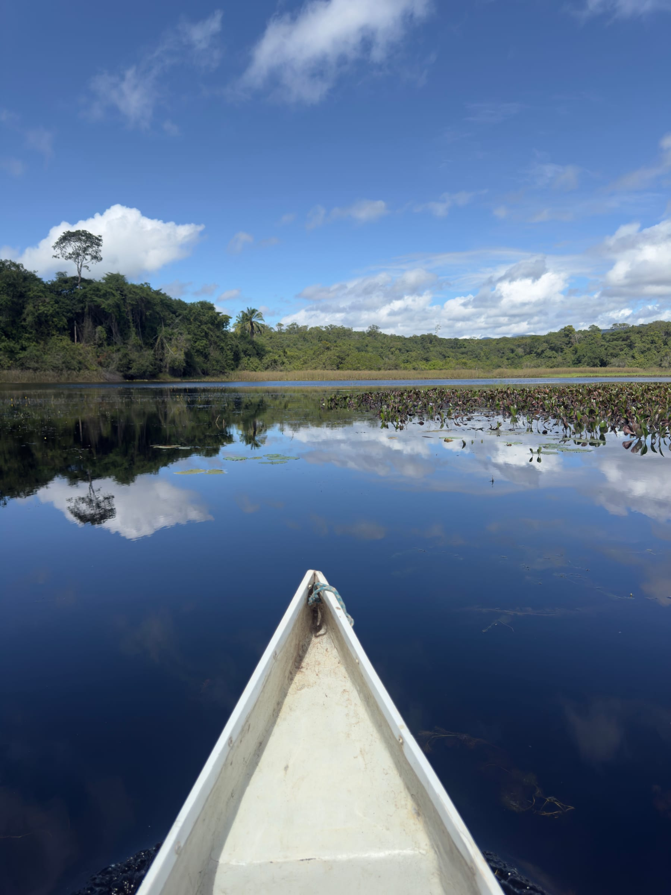
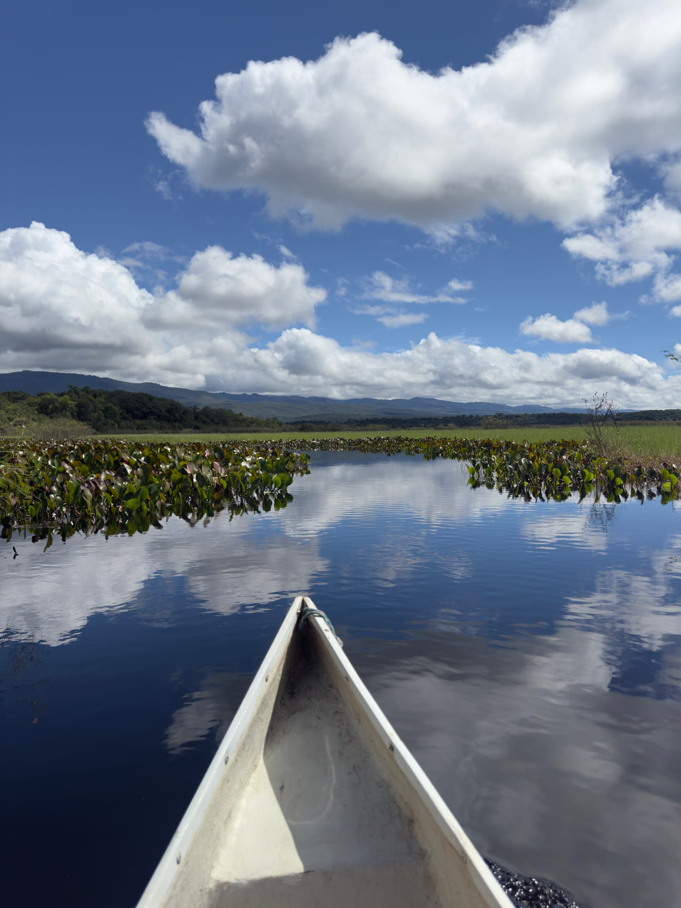
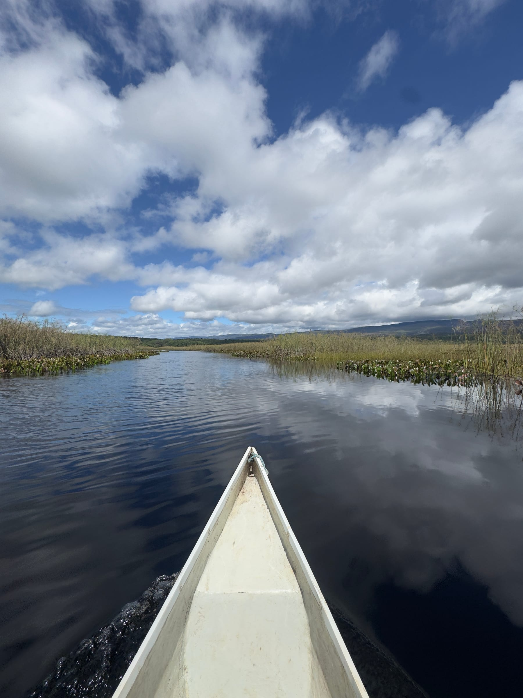
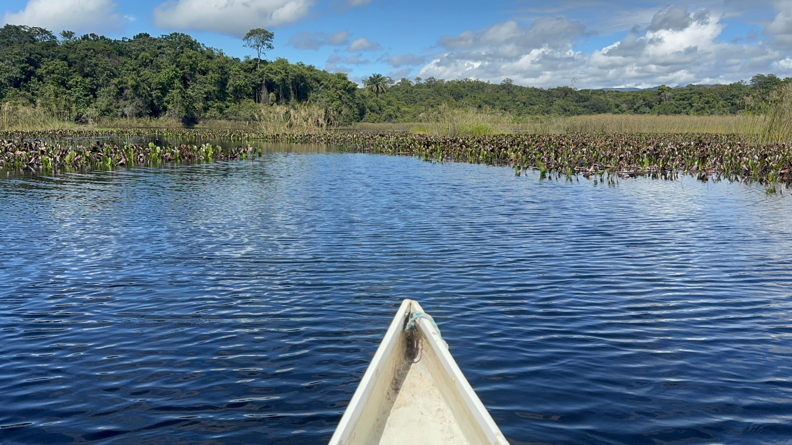
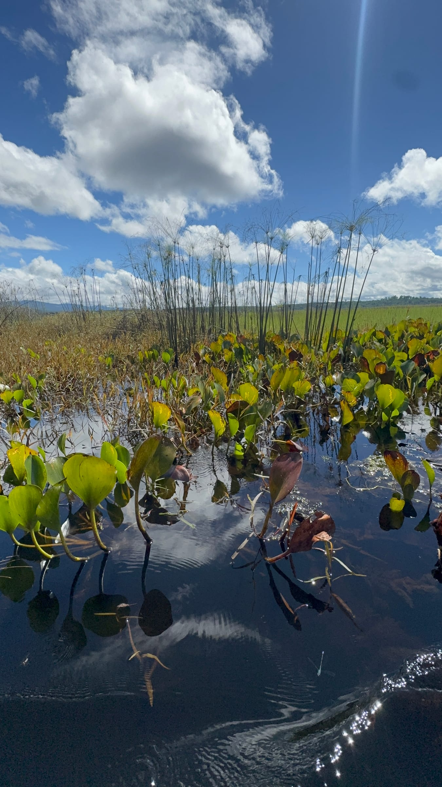
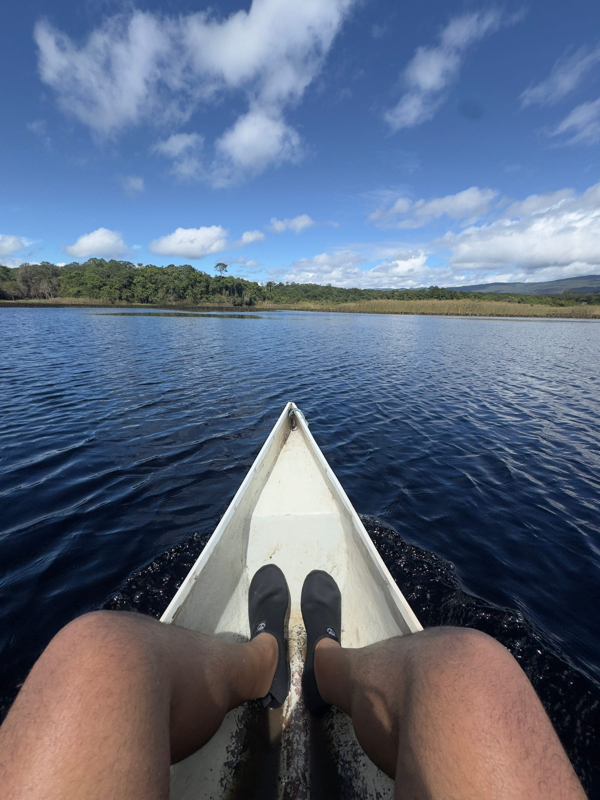

O Pantanal Marimbus é o passeio mais tranquilo da Chapada Diamantina: em vez de trilhas e subidas, você desliza de canoa por canais cobertos de plantas aquáticas e por lagoas tão paradas que o céu e a serra se refletem na água. É o programa ideal para um dia de descanso entre trilhas mais pesadas.

Este guia explica o que é o Marimbus, como é o passeio e por onde chegar. Para montar o restante da viagem, veja o [guia de Lençóis](/blog/o-que-fazer-em-lencois-chapada-diamantina/) e o [roteiro completo pela Chapada Diamantina](/blog/roteiro-chapada-diamantina/). **As informações foram pesquisadas em novembro de 2026.** Preços e formatos de passeio mudam, por isso confirme antes de ir.

## O que é o Pantanal Marimbus

O Marimbus é uma grande área alagada entre os municípios de Lençóis e Andaraí, formada pela confluência dos rios Santo Antônio, Utinga e São José. Pela paisagem plana e pela quantidade de aves, peixes e plantas aquáticas, ganhou o apelido de "mini-Pantanal" da Bahia.

A região faz parte da Área de Proteção Ambiental Marimbus-Iraquara, criada em 1993, que se estende por cerca de 125 mil hectares em cinco municípios. Na água, as ninfeias e outras plantas aquáticas formam ilhas e corredores verdes que mudam o desenho dos canais.

## Como é o passeio de barco

O passeio costuma ser feito em canoas conduzidas por remadores locais, que conhecem os canais. A canoa avança devagar, em silêncio, alternando canais estreitos entre a vegetação e lagoas abertas, onde a água parada vira um espelho.

O ritmo é contemplativo: dá tempo de fotografar os reflexos, observar as plantas aquáticas de perto e simplesmente descansar. As fotos deste guia foram feitas no lado de Andaraí, perto da Fazenda Marimbus.

## Como chegar e combinar com o Rio Roncador

Há duas portas de entrada principais para o Marimbus.

| Acesso | Onde fica | Observação |
|---|---|---|
| Fazenda Marimbus | BA-142, km 149,5, a cerca de 4 km de Andaraí | Passeios diários em canoa canadense e stand-up paddle |
| Comunidade Quilombola do Remanso | Cerca de 40 minutos de carro de Lençóis | Guias remadores da própria comunidade |

:::logistica
Pelo lado do Remanso, o passeio de canoa costuma seguir até a foz do [Rio Roncador](/blog/rio-roncador-chapada-diamantina/). De lá, uma trilha leva às piscinas naturais do rio, e por isso o Marimbus e o banho no Roncador costumam ser feitos no mesmo dia. Agências de Lençóis vendem esse roteiro combinado, com transporte e guia; os valores publicados variam bastante, então compare antes de fechar.
:::

:::dica
Leve chapéu ou boné, protetor solar, repelente e roupa leve com proteção UV: nos trechos abertos, a canoa fica sob sol direto por bastante tempo. Se for estender o passeio até o Rio Roncador, leve também a sapatilha aquática para as pedras do rio.
:::

## Perguntas frequentes

### O passeio no Marimbus é cansativo?

Não. É um passeio de canoa conduzido por remadores locais, com ritmo tranquilo, bom para descansar entre trilhas mais exigentes.

### Por onde é melhor começar: Andaraí ou Remanso?

Pela Fazenda Marimbus, perto de Andaraí, o acesso é pela BA-142. Pelo Remanso, mais perto de Lençóis, o passeio costuma seguir até o Rio Roncador. Escolha conforme a sua base e se quer incluir o banho no Roncador.

### Precisa de guia?

O formato mais comum é com remador local, que conhece os canais. Na Fazenda Marimbus também há stand-up paddle; pergunte as regras ao reservar.

## Fontes consultadas

Acesso em novembro de 2026.

- [Secretaria do Meio Ambiente da Bahia: APA Marimbus-Iraquara](https://www.ba.gov.br/meioambiente/noticia/2024-02/13976/sema-participa-da-ia-reuniao-de-planejamento-da-apa-marimbus-iraquara)
- [Jornal da Chapada: 30 anos da APA Marimbus-Iraquara](https://jornaldachapada.com.br/2023/06/14/turismo-chapada-diamantina-comemora-30-anos-da-area-de-protecao-ambiental-marimbus-iraquara)
- [Biodiversidade Brasileira (ICMBio): estudo sobre o Marimbus](https://revistaeletronica.icmbio.gov.br/BioBR/article/download/1782/1290/10654)
- [Guia Chapada Diamantina: Fazenda Marimbus](https://www.guiachapadadiamantina.com.br/fazenda-marimbus/)
- [Guia Chapada Diamantina: Pantanal Marimbus via Andaraí](https://www.guiachapadadiamantina.com.br/pantanal-marimbus-via-andarai/)
- [Bahia Terra: como é o Pantanal Marimbus](https://www.bahiaterra.com/posts/pantanal-marimbus-chapada-diamantina)
- [Metro 1: Pantanal Marimbus](https://www.metro1.com.br/noticias/turismo/72416,pantanal-marimbus-sossego-e-contato-com-a-natureza-na-chapada-diamantina)
- [Volta ao Parque: Marimbus e Roncador](https://voltaaoparque.com.br/tour/marimbus-roncador/)
