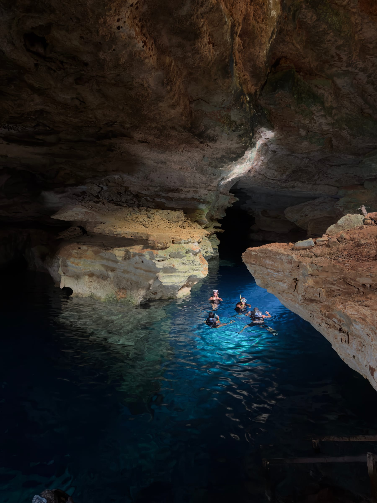
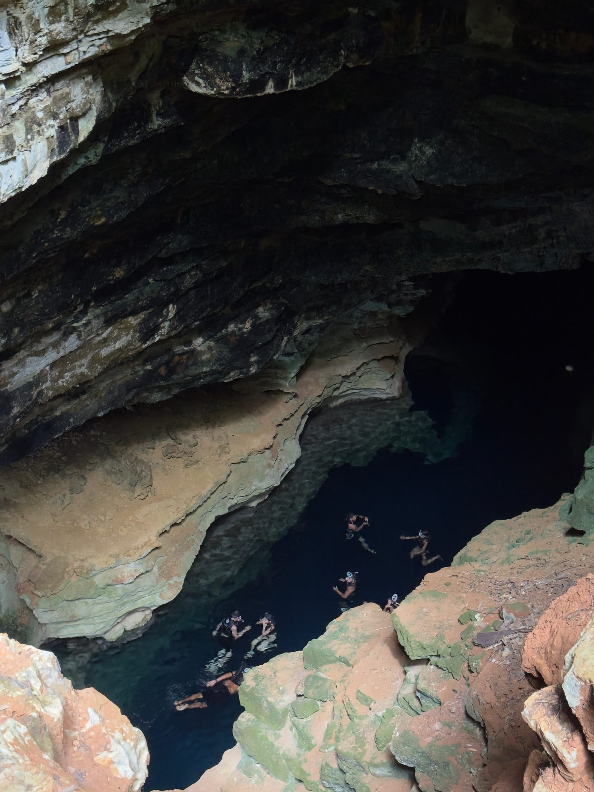
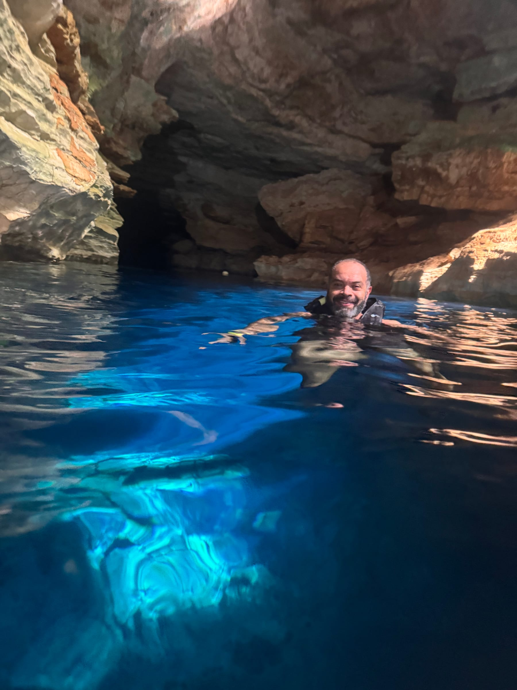
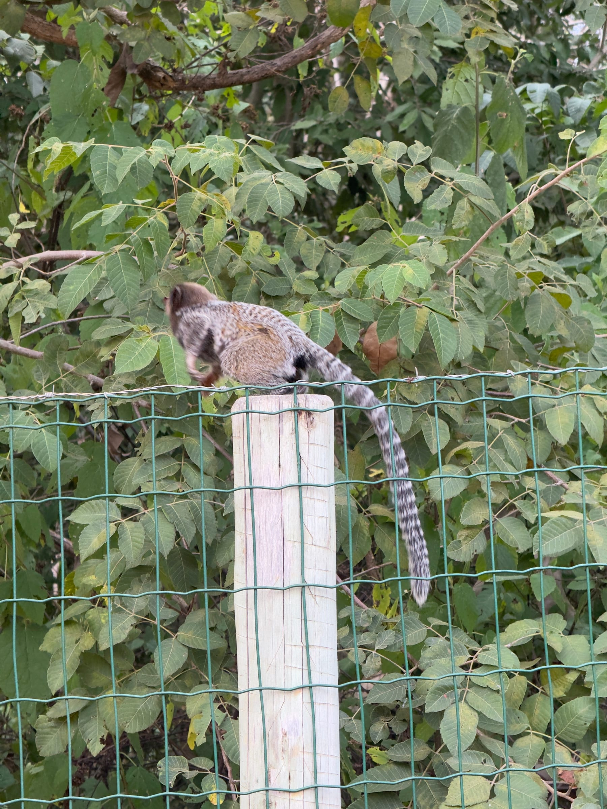

O Poço Azul é uma caverna inundada em Nova Redenção, no sul da Chapada Diamantina, com água tão transparente que dá para enxergar o fundo rochoso a mais de 20 metros de profundidade. Em parte do ano, um feixe de sol atravessa a água e pinta o poço de azul intenso. E, ao contrário do Poço Encantado, aqui você pode entrar na água e flutuar.

Este guia explica quando ver o feixe de luz, como funciona a flutuação e como encaixar o passeio no roteiro. Para planejar o restante da viagem, veja o [guia de Mucugê](/blog/o-que-fazer-em-mucuge-chapada-diamantina/), a base mais próxima, e o [roteiro completo pela Chapada Diamantina](/blog/roteiro-chapada-diamantina/). **As informações foram pesquisadas em novembro de 2026.** Preços e horários mudam, por isso confirme no site oficial antes de ir.

## O que torna o Poço Azul único

A primeira impressão é a transparência: de cima do deck, a água parece rasa, mas o fundo está a mais de 20 metros. A cor varia do turquesa ao azul profundo, conforme a luz que entra pela abertura da caverna.

O poço também tem importância científica. Em 1995, foram encontrados ali fósseis submersos, entre eles um esqueleto de preguiça-gigante (*Eremotherium laurillardi*), um animal pré-histórico que podia passar de cinco metros. Por isso, a conservação da água e do fundo é levada a sério.

## Melhor época e horário para ver o feixe de luz

O feixe de sol só entra no poço entre **25 de fevereiro e 25 de outubro**. O horário muda ao longo do ano, segundo o próprio atrativo:

| Mês | Início aproximado do feixe |
|---|---|
| Fevereiro (a partir do dia 25) | 13h40 |
| Março | 13h30 |
| Abril | 13h10 |
| Maio | 12h50 |
| Junho e julho | 12h20 |
| Agosto | 12h30 |
| Setembro | 13h10 |
| Outubro (até o dia 25) | 13h40 |

O fenômeno depende de céu aberto e não acontece em dias nublados. Na estação seca, de maio a setembro, as chances de céu limpo são maiores. Fora da janela, de fim de outubro a fim de fevereiro, o feixe não incide diretamente no poço, mas a transparência e a cor da água continuam impressionantes para flutuar.

## Como funciona a flutuação

A visita é em grupos de até 14 pessoas, com horário marcado. Todos usam colete salva-vidas, máscara e snorkel, fornecidos no local. A flutuação dura de 15 a 20 minutos, e a visita completa, cerca de meia hora. O acesso até a água é por uma escadaria e por um deck de madeira.

:::alerta
A ducha é obrigatória antes de descer, com lavagem do cabelo, para remover protetor solar, repelente, hidratante e suor. Na água, use sempre o colete e permaneça na superfície. Evite tocar ou bater os pés no fundo: o sedimento levantado turva a água para os próximos grupos e pode danificar o sítio.
:::

## Como chegar e roteiro

O Poço Azul fica no povoado da Peruca, em Nova Redenção, a cerca de 13 km da sede do município. Pelas distâncias do próprio atrativo, são cerca de 48 km de Andaraí, 51 km de Mucugê, 47 km de Itaetê e 94 km de Lençóis.

:::logistica
O atrativo recomenda chegar pela estrada asfaltada. Os atalhos têm trechos de estrada de terra, e para eles a orientação é contratar um guia local. Há estacionamento gratuito, restaurante e banheiros. O ingresso é comprado com horário marcado, e é preciso chegar com 15 minutos de antecedência. Para aproveitar a viagem, combine o Poço Azul com o Poço Encantado, em Itaetê, no mesmo dia.
:::

### Poço Azul, Poço Encantado e Gruta Azul: qual a diferença?

No Poço Azul, você flutua. No Poço Encantado, em Itaetê, a visita é só de contemplação. Em Iraquara, a [Gruta Azul](/blog/gruta-da-pratinha-chapada-diamantina/) também é só para contemplar, enquanto a flutuação acontece na vizinha Gruta da Pratinha.

## Perguntas frequentes

### Quanto custa o Poço Azul?

O site oficial mostra ingresso de R$ 70, com meia-entrada para idosos e pessoas com deficiência. Crianças a partir de 5 anos pagam inteira, e menores de 5 anos não pagam, mas devem ser incluídas na compra.

### Qual o melhor mês para ver o feixe de luz?

Qualquer mês entre o fim de fevereiro e o fim de outubro, com céu aberto. De maio a setembro, a estação seca aumenta as chances de sol.

### Precisa saber nadar?

Não. A flutuação é feita com colete salva-vidas, máscara e snorkel.

## Fontes consultadas

Acesso em novembro de 2026.

- [Poço Azul: site oficial do atrativo](https://pocoazul.com.br/poco-azul-8871)
- [Guia Chapada Diamantina: Poço Azul](https://www.guiachapadadiamantina.com.br/poco-azul/)
- [Guia Chapada Diamantina: Poço Azul e Poço Encantado](https://www.guiachapadadiamantina.com.br/pocos-azul-e-encantado/)
- [Terræ Didatica (Unicamp): fósseis do Poço Azul](https://www.ige.unicamp.br/terraedidatica/v12_3/PDF12_3/Td-123-2.pdf)
- [Show Caves: Poço Azul](https://www.showcaves.com/english/br/springs/Azul.html)
- [Melhores Destinos: Poço Azul](https://guia.melhoresdestinos.com.br/poco-azul-221-6152-l.html)
- [Quanto Custa Viajar: Poço Azul e Poço Encantado](https://quantocustaviajar.com/blog/poco-azul-e-poco-encantado-na-chapada-diamantina/)
