O Alasca tem fama de destino caro, e boa parte dessa fama vem dos cruzeiros, em que tudo vem num pacote fechado. Viajando por conta própria, de motorhome, a conta é outra: dá para controlar quase todos os gastos, desde que se entenda como cada um funciona. O motorhome não é só a hospedagem, é também o transporte e a cozinha, e é ali que estão as maiores economias e as maiores armadilhas.

Este guia explica como montar o orçamento de uma viagem de 10 a 16 dias pelo Alasca, com base no circuito que fizemos de 3 a 18 de maio de 2025: 16 dias, 15 noites a bordo de um motorhome da Cruise America e cerca de 3.800 a 4.000 km entre Anchorage, o Denali, Fairbanks, o Círculo Polar Ártico, Valdez e a Península Kenai. O roteiro está no [roteiro de 16 dias pelo Alasca de motorhome](/blog/roteiro-alasca-16-dias-motorhome/), e o funcionamento do veículo, no [guia de motorhome no Alasca](/blog/viajar-de-motorhome-no-alasca/).

**Como ler os números.** Os preços unitários vêm de fontes oficiais ou das próprias empresas e foram pesquisados em novembro de 2026; as fontes estão no fim do artigo. Onde não existe preço público, como a diária do motorhome, que muda a cada cotação, usamos premissas e dizemos isso com todas as letras. Tarifas, câmbio e combustível mudam o tempo todo: use este guia para montar a sua planilha, não como orçamento fechado.

## Onde vai o dinheiro numa viagem de motorhome

Numa viagem como a nossa, quatro itens concentram a maior parte do gasto:

1. **A diária do motorhome**, que varia com a época, o tamanho do veículo e a antecedência da reserva.
2. **As milhas rodadas**, cobradas à parte pela maioria das locadoras.
3. **O combustível**, porque um motorhome classe C bebe muito e as distâncias no Alasca são enormes.
4. **A comida**, que pode custar pouco, se cozinhada a bordo, ou muito, se feita em restaurantes.

Hospedagem, que costuma ser o maior gasto de uma viagem, aqui quase some: dormimos todas as noites no motorhome, alternando campings pagos, campings públicos baratos e pernoites gratuitos. Passeios e taxas de parques pesam menos do que se imagina, porque boa parte do que há de mais bonito no Alasca é de graça: estradas, mirantes, trilhas e geleiras à beira da estrada.

## Passagens aéreas: Brasil a Anchorage

Não há voo direto do Brasil para Anchorage. O caminho comum é voar até uma cidade americana com conexão para Anchorage, como Seattle, e às vezes com uma segunda escala. O preço muda muito com a cidade de origem, a época e a antecedência, por isso não vamos cravar um valor: cote com antecedência e compare rotas com uma e com duas conexões.

O que pesa no Alasca é a bagagem. Viajar em maio exige casaco, segunda pele, bota impermeável, gorro e luvas, e isso ocupa espaço. Na hora de comparar tarifas, some o preço da mala despachada em todos os trechos. Se a sua tarifa não incluir bagagem, uma conexão barata pode sair cara.

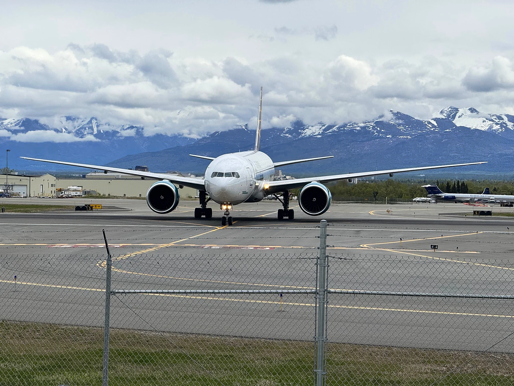

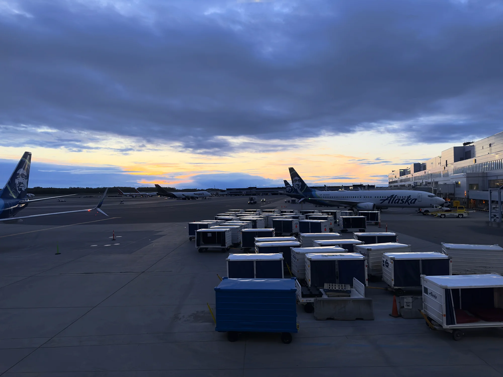

:::dica
Na hora de escolher os voos, prefira chegar a Anchorage com uma tarde livre. A retirada do motorhome, a demonstração dos equipamentos e as compras de mercado tomam boa parte do primeiro dia, e começar a estrada cansado de um voo longo não compensa.
:::

## Aluguel do motorhome: como o preço é montado

O preço final de um motorhome no Alasca não é só a diária. Usando a Cruise America como exemplo, porque foi a locadora que usamos e porque ela publica as regras na própria página de perguntas frequentes, a conta tem estas partes:

| Item | Como funciona | Valor publicado |
|---|---|---|
| Diária | Muda com a época, o tamanho do veículo e a antecedência | Sob cotação |
| Milhas | Cobradas por milha rodada; uma estimativa por noite é cobrada na reserva, e o que sobrar é devolvido | US$ 0,39 por milha |
| Kit pessoal | Roupa de cama e banho, por pessoa | US$ 75 por pessoa |
| Kit do veículo | Utensílios de cozinha, por veículo | US$ 125 |
| Gerador | Cobrado por hora de uso, na devolução | US$ 3,50 por hora |
| Sinal da reserva | Pago na reserva | US$ 300 |
| Caução | Devolvida conforme o estado do veículo | A partir de US$ 500 |
| Limpeza | Cobrada se o interior não for devolvido limpo | Até US$ 250 |

Sobre os valores da tabela incide imposto, inclusive sobre os kits. A locadora também vende pacotes que reúnem milhas ilimitadas, kits e uso do gerador; vale comparar com a soma dos itens avulsos para o seu roteiro.

**A diária.** Comparadores de aluguel mostram diárias da Cruise America em Anchorage que vão de pouco mais de US$ 65 a mais de US$ 200 por noite, conforme a data e o tamanho do motorhome. É uma faixa larga porque o preço é dinâmico: sobe muito no auge do verão e cai nas semanas de maio e de setembro. Segundo a plataforma Outdoorsy, as semanas de começo e fim de temporada costumam sair de 10% a 20% mais baratas.

**As milhas.** Este é o item que mais surpreende. No nosso circuito, de cerca de 3.800 a 4.000 km, ou 2.360 a 2.490 milhas, as milhas a US$ 0,39 somam de US$ 920 a US$ 970. É quase o preço de mais uma semana de aluguel. Num roteiro longo, compare com cuidado a cobrança por milha e os pacotes de milhas ilimitadas.

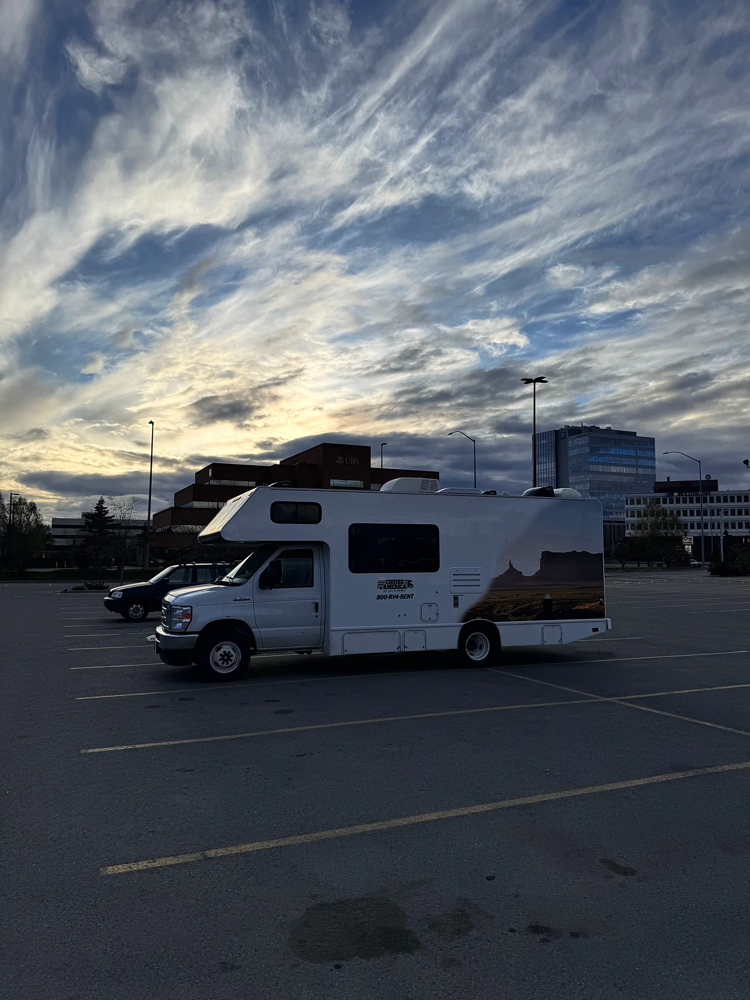

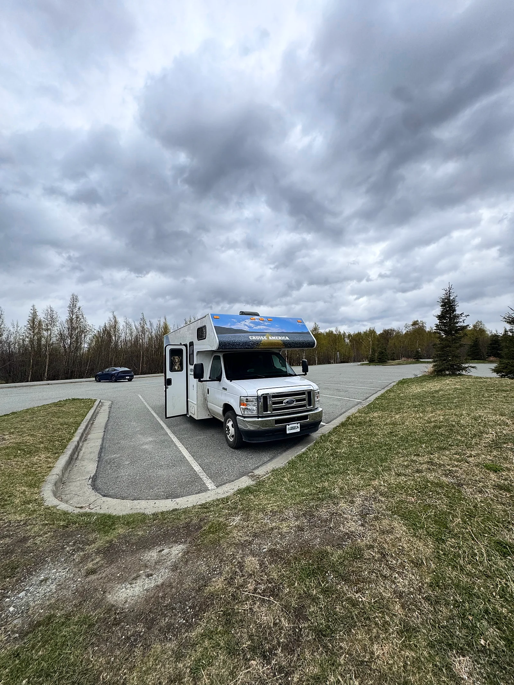

### A estratégia que funcionou para nós: reservar na Black Friday

Reservamos o motorhome com muitos meses de antecedência, aproveitando uma promoção de Black Friday, e isso reduziu bastante o valor da diária e dos pacotes de milhas para maio. Para quem viaja no começo da temporada, juntar as duas coisas, a reserva antecipada em promoção e as datas de ombro de temporada, é a forma mais eficiente de derrubar o maior item do orçamento.

:::dica
Comece a acompanhar os preços das locadoras no segundo semestre do ano anterior à viagem e espere as promoções de fim de ano, como a Black Friday. Antes de pagar o sinal, leia as regras de cancelamento e de alteração de datas, e confirme por escrito as estradas permitidas no contrato, principalmente se o seu roteiro incluir a Dalton Highway.
:::

## Combustível: a conta que mais assusta

Um motorhome classe C sobre chassi Ford, como o nosso, faz em geral de 8 a 10 milhas por galão na estrada, segundo relatos de donos desses veículos. Em subidas, com vento contra ou em velocidade mais alta, o consumo piora. Para planejar, use 8 a 10 milhas por galão, o equivalente a uns 3,4 a 4,3 km por litro.

O preço do galão no Alasca oscila bastante. Segundo a AAA, a média da gasolina comum no fim de maio de 2025 era de cerca de US$ 3,58 em Anchorage, US$ 3,71 em Fairbanks e US$ 3,67 no estado. Um ano depois, no fim de maio de 2026, a média estadual tinha passado de US$ 5,20. Nas regiões isoladas, o preço é mais alto: um guia de viagem de estrada cita de US$ 7 a mais de US$ 10 por galão na Dalton Highway, em Coldfoot e Deadhorse, mas não encontramos um preço oficial para esses postos.

| Cenário de preço | Galões (2.420 milhas, 8 a 10 mpg) | Custo estimado |
|---|---|---|
| Preços de maio de 2025 (US$ 3,60 a 3,70) | 242 a 303 galões | US$ 870 a 1.120 |
| Preços de maio de 2026 (cerca de US$ 5,20) | 242 a 303 galões | US$ 1.260 a 1.580 |

A conta considera um circuito de cerca de 3.900 km, ou 2.420 milhas, como o nosso. Ela não inclui o gerador nem o propano.

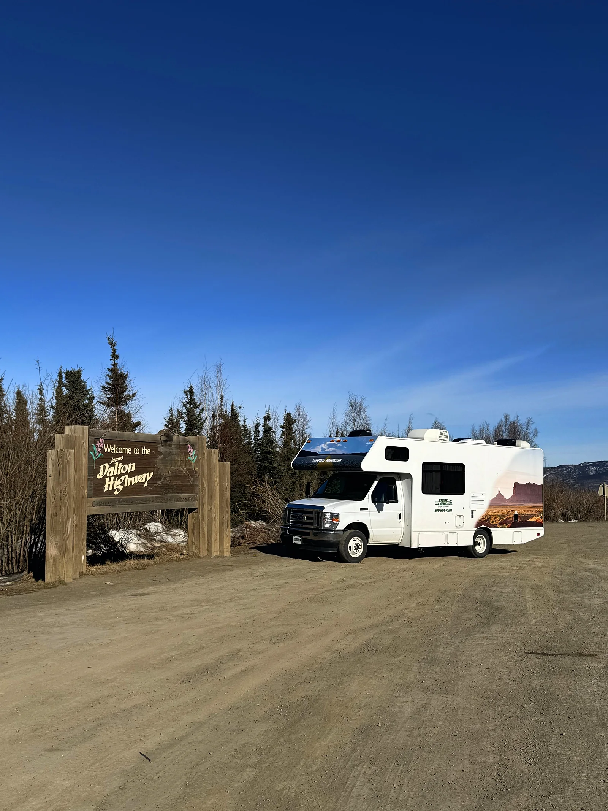

:::alerta
Na Dalton Highway, há combustível na ponte do Yukon, na milha 56, em Coldfoot, na milha 175, e depois só em Deadhorse. Encha o tanque em Fairbanks e não passe por um posto sem abastecer; o [guia da Dalton Highway](/blog/dalton-highway-circulo-polar-artico-alasca/) tem o checklist completo. Na Tok Cut-Off e em trechos longos da Richardson Highway, os postos também ficam distantes; abasteça sempre que o tanque chegar à metade.
:::

## Onde dormir: de US$ 0 a US$ 75 por noite

Com o motorhome, a hospedagem vira uma escolha diária, e cada noite pode custar de zero a algumas dezenas de dólares. Os valores de referência:

| Tipo de pernoite | Exemplos | Faixa de preço |
|---|---|---|
| Pernoite fora de camping | Acostamentos e áreas de parada sem placa de proibição, fora de terras particulares | Grátis |
| Campings federais | Arctic Circle Campground, da BLM, na Dalton | US$ 12 por noite |
| Campings sem taxa na primavera | Riley Creek, no Denali, até meados de maio; o camping do Exit Glacier, no Kenai Fjords, não cobra taxa | Grátis |
| Campings estaduais | Alaska State Parks | US$ 10 a 45 por noite |
| Campings municipais | Orla de Seward, Homer Spit | Segundo o Alaska.org, de US$ 20 (barraca) a US$ 65 (motorhome com luz e água) em Seward |
| Parques de motorhome com ligação | Nas cidades maiores | Em geral as opções mais caras; consulte cada parque |

A própria Cruise America calcula que os campings custam, em geral, de US$ 10 a US$ 50 por noite. No nosso roteiro, alternamos campings com estrutura, como o de Chena Lakes, e noites gratuitas em áreas de parada, como na Tok Cut-Off e na Chena Hot Springs Road. Em maio, alguns campings ainda nem cobram, porque a temporada não começou.

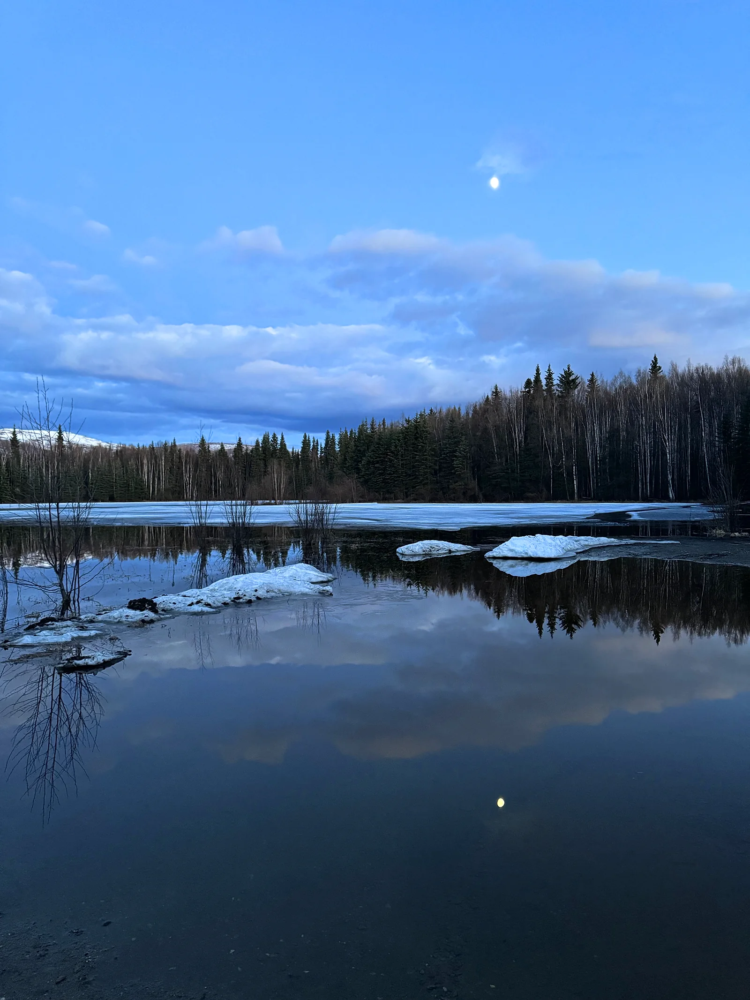

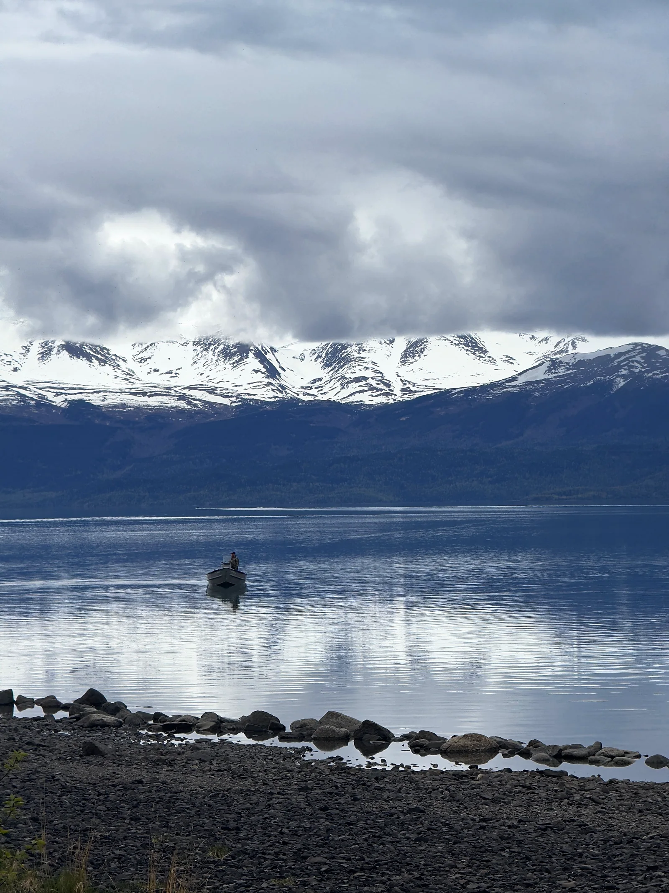

Há custos pequenos que somam: o ponto de despejo do Five Mile Campground, na Dalton, cobra US$ 5 por uso, e muitos parques de motorhome cobram pelo despejo de quem não está hospedado. As regras de pernoite fora de camping, água e despejo estão no [guia de motorhome no Alasca](/blog/viajar-de-motorhome-no-alasca/).

## Comida: onde o orçamento pode dobrar

Cozinhar a bordo é a maior economia de uma viagem de motorhome. Fizemos boa parte das refeições no motorhome e em mesas de piquenique dos lugares onde paramos.

Uma régua oficial para estimar a comida de mercado é o plano alimentar econômico do Departamento de Agricultura dos Estados Unidos (USDA), que tem uma tabela própria para o Alasca. Em dezembro de 2025, ele calculava US$ 1.277 por mês para uma família de referência de quatro pessoas em Anchorage, dois adultos e duas crianças. Fora de Anchorage, o próprio USDA aplica acréscimos que vão de menos de 1% nas áreas urbanas a mais de 50% nas áreas rurais mais isoladas.

Na prática, isso significa duas coisas. Primeiro: faça as compras grandes em Anchorage e Fairbanks, onde há mais concorrência e os preços são menores. Segundo: nas cidades pequenas e na estrada, compre só o que faltar.

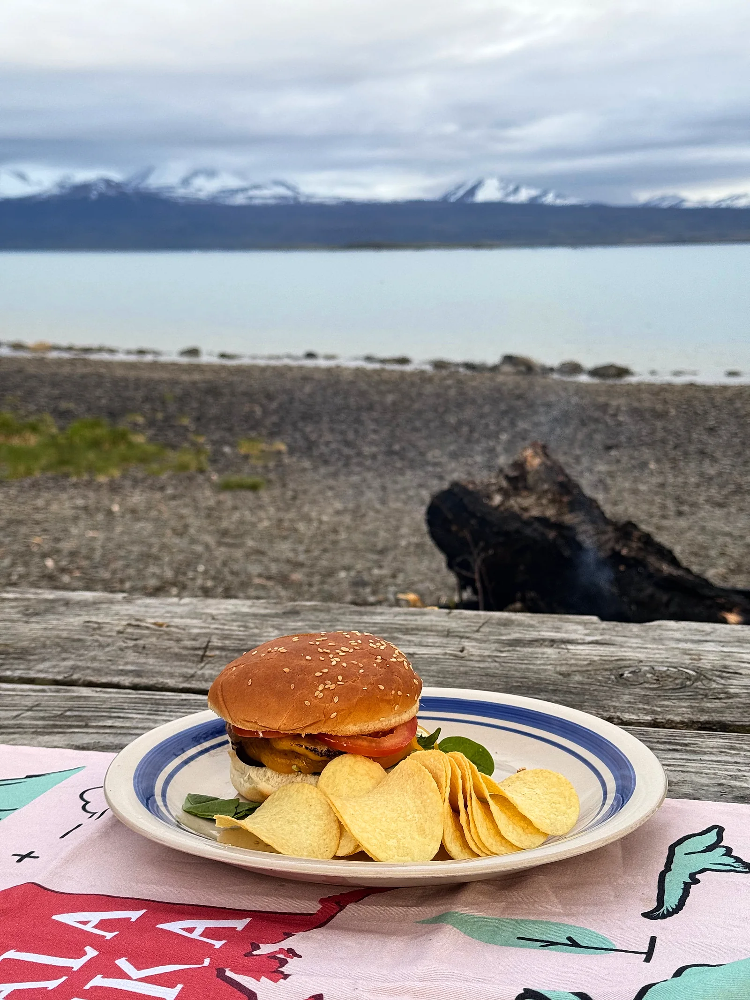

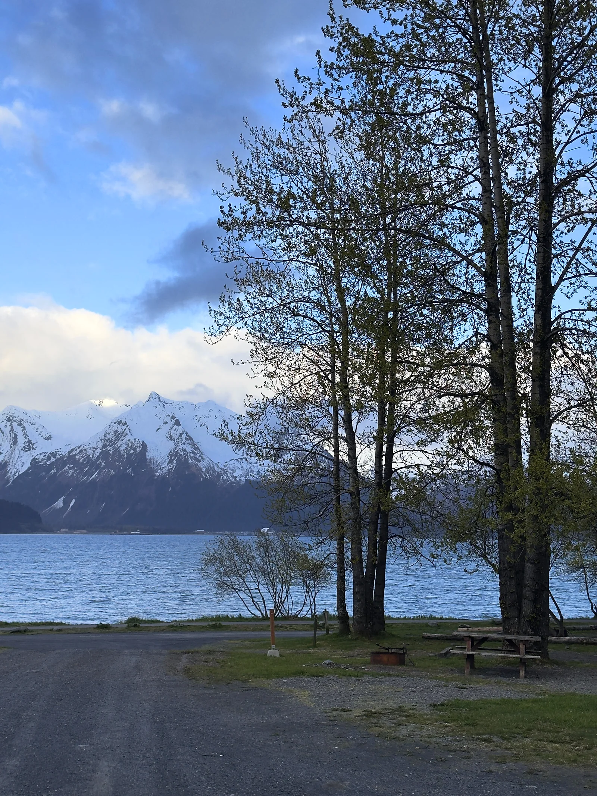

Comer fora é o item que mais faz a conta variar, principalmente nas cidades turísticas, como Seward, Homer e a entrada do Denali. Um meio-termo que funciona é cozinhar a maior parte das refeições e reservar algumas para experiências que valem a pena, como o peixe fresco nos portos.

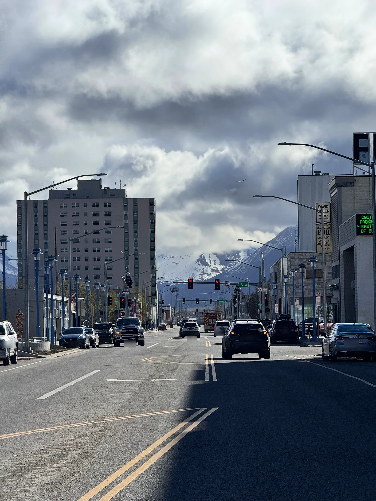

## Parques, taxas e pedágios

Esta é a parte que mais surpreende, para o bem: no nosso roteiro, as taxas obrigatórias foram pequenas.

| Item | Preço | Observação |
|---|---|---|
| Parque Nacional Denali | US$ 15 por pessoa de 16 anos ou mais | Válido por 7 dias; menores de 16 não pagam |
| Parque Nacional Kenai Fjords (Exit Glacier) | Grátis | O parque não cobra entrada nem camping |
| Passe America the Beautiful | US$ 250 para não residentes, US$ 80 para residentes | Preço para não residentes vigente desde 1º de janeiro de 2026 |
| Taxa extra de US$ 100 para não residentes | Não se aplica ao Denali nem ao Kenai Fjords | Vale só para 11 parques, como Yellowstone e Yosemite |
| Túnel de Whittier | US$ 13 ida e volta (carro ou motorhome abaixo de 28 pés); US$ 22 (motorhome de 28 pés ou mais) | Paga-se uma vez só |
| Dump station do Five Mile, na Dalton | US$ 5 por uso | O único ponto de despejo da estrada |

Os horários e as regras do túnel estão no [guia de Whittier](/blog/whittier-tunel-anton-anderson-alasca/), e o que esperar de cada estação, no guia da [melhor época para ir ao Alasca](/blog/melhor-epoca-para-ir-ao-alasca-maio/).

**Vale comprar o passe anual?** Para um roteiro como o nosso, não. O Denali cobra US$ 15 por pessoa, ou US$ 30 para um casal, e o Kenai Fjords é gratuito. O passe para não residentes, de US$ 250, só compensa para quem vai visitar vários parques pagos nos Estados Unidos no mesmo ano, principalmente os 11 com taxa extra.

## Passeios opcionais: onde gastar vale a pena

Os passeios são o item mais flexível do orçamento. Alguns valores de referência:

- **Chena Hot Springs:** o passe diário das piscinas custa US$ 20 para adultos de 18 a 59 anos, segundo o próprio resort. Veja o [guia de Fairbanks, Chena Hot Springs e North Pole](/blog/fairbanks-chena-hot-springs-north-pole-alasca/). Os passeios saindo de Fairbanks com transporte começam em cerca de US$ 180, porque incluem o traslado.
- **Passeios de barco pelo Kenai Fjords, saindo de Seward:** um operador anuncia o passeio de meio dia, de 3h30, a US$ 209 por pessoa, e o de 7 horas, a US$ 419, de 15 de maio a 31 de agosto. Os preços mudam por operador e por data. A cidade e o Exit Glacier, que é gratuito, estão no [guia de Seward e do Exit Glacier](/blog/seward-exit-glacier-alasca/).
- **Passeios em Homer e em Valdez:** saem dos portos e incluem pesca e observação de vida marinha. Cote diretamente com as agências.

Nós não fizemos passeios de barco nesta viagem, e boa parte do que mais marcou a viagem não custou nada: o sol das 22h na Finger Mountain, as águias na Bishop's Beach, o Exit Glacier, o Thompson Pass e as cachoeiras do Keystone Canyon.

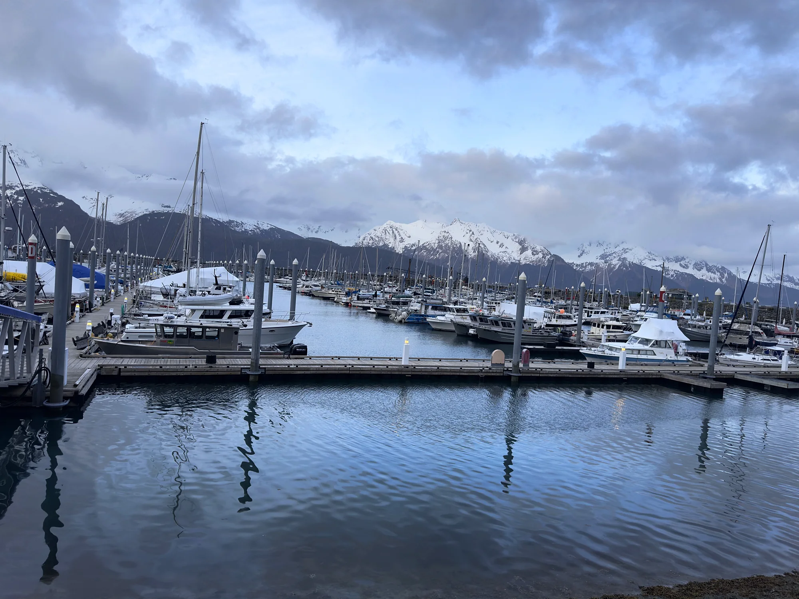

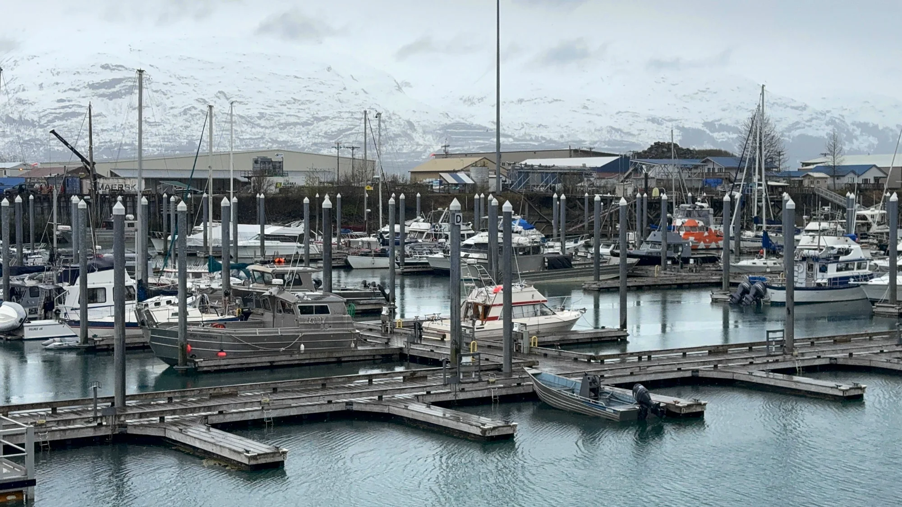

E há muito para fazer de graça: as trilhas do Denali e do Exit Glacier, os calçadões dos portos, as praias de Homer e as trilhas das colinas acima da cidade.

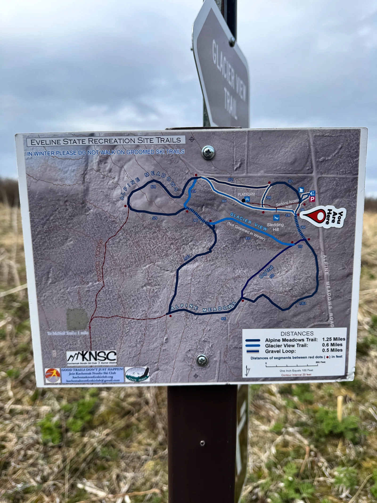

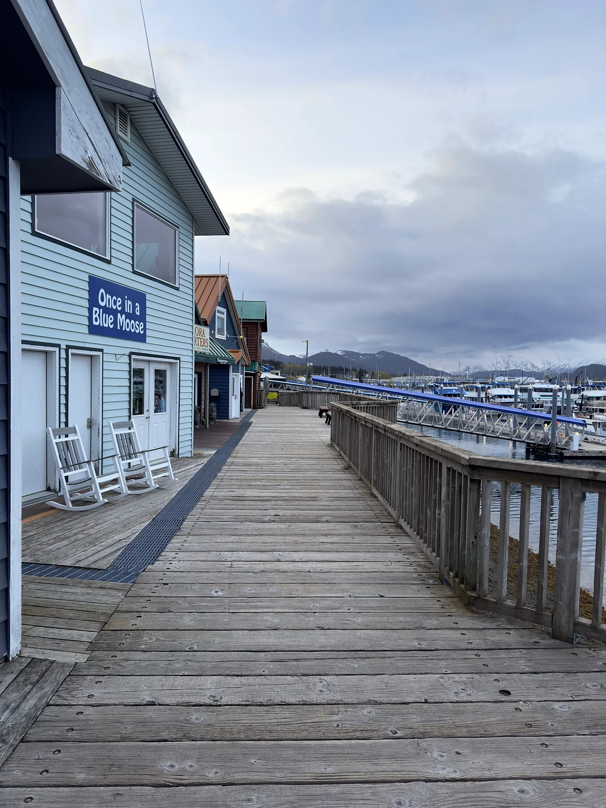

## Três cenários de orçamento: 16 dias para 2 pessoas

A tabela abaixo junta os preços pesquisados num orçamento completo, **sem as passagens aéreas** e sem o imposto sobre o aluguel e os kits. As diárias do motorhome, os gastos com restaurantes e o preço médio dos campings pagos são **premissas nossas**, escolhidas dentro das faixas pesquisadas, porque não existe um preço público fixo para eles. A comida de mercado, de cerca de US$ 400 para dois adultos em 16 dias, foi estimada pela régua do USDA para Anchorage.

| Item | Econômico | Intermediário | Confortável |
|---|---|---|---|
| Diária do motorhome (15 noites) | US$ 100/noite: **US$ 1.500** | US$ 175/noite: **US$ 2.625** | US$ 250/noite: **US$ 3.750** |
| Milhas (2.420 milhas a US$ 0,39) | **US$ 950** | **US$ 950** | **US$ 950** |
| Kits (2 pessoais + 1 do veículo) | **US$ 275** | **US$ 275** | **US$ 275** |
| Combustível (preços de 2025) | **US$ 1.000** | **US$ 1.000** | **US$ 1.300**, motorhome maior |
| Pernoites | 8 grátis + 7 a US$ 25: **US$ 175** | 5 grátis + 10 a US$ 40: **US$ 400** | 15 a US$ 60: **US$ 900** |
| Comida | Só mercado: **US$ 400** | Mercado + US$ 60/dia fora: **US$ 1.360** | Mercado + US$ 120/dia fora: **US$ 2.320** |
| Taxas e pedágios (Denali, Whittier, Chena, despejo) | **US$ 105** | **US$ 105** | **US$ 105** |
| Passeios | Nenhum | Barco de meio dia em Seward: **US$ 420** | Barco de 7 h em Seward: **US$ 840** |
| **Total aproximado (2 pessoas)** | **cerca de US$ 4.400** | **cerca de US$ 7.100** | **cerca de US$ 10.400** |
| **Por pessoa** | **cerca de US$ 2.200** | **cerca de US$ 3.550** | **cerca de US$ 5.200** |

**Onde está a maior economia.** A diferença entre os cenários vem de três lugares: a diária do motorhome, que a reserva antecipada em promoção ajuda a derrubar; a comida, em que cozinhar a bordo corta mais de mil dólares; e os pernoites, em que alternar noites gratuitas com campings públicos baratos faz diferença. Milhas, kits e combustível pesam igual nos três cenários, porque dependem da distância, e não do estilo da viagem.

**Como encurtar a conta.** Num roteiro de 10 dias, sem a Dalton Highway e sem a volta por Tok e Valdez, a distância cai muito, e com ela as milhas e o combustível. Para quem tem menos tempo, a Península Kenai e o Denali, saindo e voltando a Anchorage, concentram boa parte das paisagens com um custo bem menor de estrada.

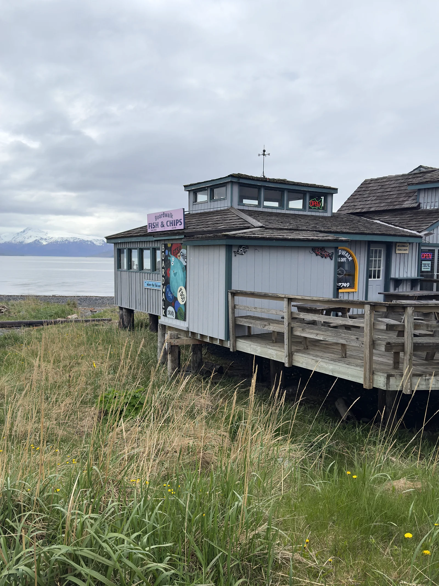

:::alerta
Os números deste guia não incluem as passagens aéreas, o imposto sobre o aluguel e os kits, seguros opcionais nem imprevistos, como um pneu furado no cascalho, que muitos contratos deixam fora da cobertura. Reserve uma margem para isso e confirme cada valor na hora de reservar.
:::

## Checklist para montar o seu orçamento

- **Cote o motorhome cedo**, compare a cobrança por milha com os pacotes ilimitados e fique de olho nas promoções de fim de ano.
- **Calcule as milhas do seu roteiro** somando as distâncias entre as bases, e multiplique pelo preço por milha.
- **Estime o combustível** com 8 a 10 milhas por galão e o preço atual do galão no site da AAA.
- **Planeje os pernoites**, misturando noites gratuitas, campings públicos e algumas noites com ligação elétrica e de água para recarregar tudo.
- **Faça as compras grandes em Anchorage e Fairbanks.**
- **Liste os parques que vai visitar** antes de comprar o passe anual; para Denali e Kenai Fjords, ele não compensa.
- **Escolha um ou dois passeios pagos** que façam diferença para você, em vez de vários.

## Perguntas frequentes

### Quanto custa viajar para o Alasca de motorhome por 16 dias?

Pelos nossos cálculos, sem as passagens aéreas, de cerca de US$ 4.400 a US$ 10.400 para duas pessoas, ou de US$ 2.200 a US$ 5.200 por pessoa, conforme o tamanho do motorhome, a comida e os passeios. A diária do motorhome, as milhas, o combustível e a comida são os maiores itens.

### O que é mais barato no Alasca: motorhome ou carro com hotel?

Depende do número de pessoas e do estilo da viagem. O motorhome junta transporte, hospedagem e cozinha e permite dormir em lugares remotos, como o Círculo Polar Ártico, onde não há hotel. Em troca, cobra milhas e gasta muito mais combustível que um carro. Para nós, que cozinhamos a bordo e alternamos noites gratuitas com campings públicos, compensou.

### Quanto custa o combustível de um motorhome no Alasca?

Num circuito de cerca de 3.900 km, como o nosso, um motorhome classe C, que faz de 8 a 10 milhas por galão, consome de 242 a 303 galões. Aos preços de maio de 2025, isso dá de US$ 870 a US$ 1.120; aos de maio de 2026, de US$ 1.260 a US$ 1.580.

### Vale a pena comprar o passe America the Beautiful para o Alasca?

Para um roteiro como o nosso, não. O Denali cobra US$ 15 por pessoa, e o Kenai Fjords é gratuito. O passe para não residentes custa US$ 250 desde 2026 e só compensa para quem vai visitar vários parques pagos no mesmo ano.

### Como economizar no aluguel do motorhome no Alasca?

Reserve com bastante antecedência, de preferência numa promoção de fim de ano, como fizemos na Black Friday, e viaje nas semanas de começo ou fim de temporada, como maio e setembro. Compare a cobrança por milha com os pacotes de milhas ilimitadas.

## Fontes consultadas

- [Cruise America: perguntas frequentes sobre o aluguel (milhas, kits, gerador, caução)](https://www.cruiseamerica.com/rv-rentals/renters-resources/rv-rental-faqs)
- [Cruise America: milhas ilimitadas e cobrança por milha](https://www.cruiseamerica.com/trip-inspiration/unlimited-mileage-rv-rental-vs-mileage-fees)
- [RoadSmiles: preços da Cruise America em Anchorage](https://roadsmiles.com/suppliers/cruise-america-anchorage-ak/)
- [Rent-Motorhome: aluguel de motorhome em Anchorage](https://www.rent-motorhome.com/rv-rental/anchorage)
- [Outdoorsy: alugar um motorhome no Alasca](https://www.outdoorsy.com/blog/renting-an-rv-in-alaska-cost-timing-and-how-to-plan-it)
- [AAA: preços médios da gasolina no Alasca](https://gasprices.aaa.com/?state=AK)
- [Alaska's News Source: preços da gasolina no Alasca em maio de 2026](https://www.alaskasnewssource.com/2026/05/13/what-are-you-giving-up-alaska-gas-prices-inch-closer-record-high/)
- [Alaska Road Trip: planejamento de combustível no Alasca](https://alaskaroadtrip.com/blog/fuel-planning-alaska)
- [Good Sam Community: consumo de motorhomes classe C](https://community.goodsam.com/t5/motorhome-group/what-is-the-fuel-economy-or-uneconomy-on-a-quot-c-quot/m-p/267939)
- [BLM: recreação na Dalton Highway (campings e despejo)](https://www.blm.gov/learn/interpretive-centers/arctic-interagency-visitor-center/dalton-highway-recreation)
- [Alaska State Parks: taxas](https://dnr.alaska.gov/parks/asp/fees.htm)
- [Alaska.org: Seward Waterfront Park](https://www.alaska.org/detail/seward-waterfront-park)
- [NPS Denali: visita na primavera (Riley Creek)](https://www.nps.gov/dena/planyourvisit/shoulder-season.htm)
- [NPS Denali: taxas de entrada](https://www.nps.gov/dena/planyourvisit/fees.htm)
- [NPS Kenai Fjords: taxas e passes](https://www.nps.gov/kefj/planyourvisit/fees.htm)
- [NPS: taxas para não residentes](https://www.nps.gov/aboutus/nonresident-fees.htm)
- [Departamento de Transportes do Alasca: tarifas do túnel de Whittier](https://dot.alaska.gov/creg/whittiertunnel/tolls.shtml)
- [Chena Hot Springs Resort: piscinas e preços](https://chenahotsprings.com/pool-house/)
- [Alaska.org: passeios de barco em Seward](https://www.alaska.org/detail/seward-ocean-excursions)
- [USDA: custo mensal da alimentação (Alasca e Havaí)](https://www.fns.usda.gov/research/cnpp/usda-food-plans/cost-food-monthly-reports)
