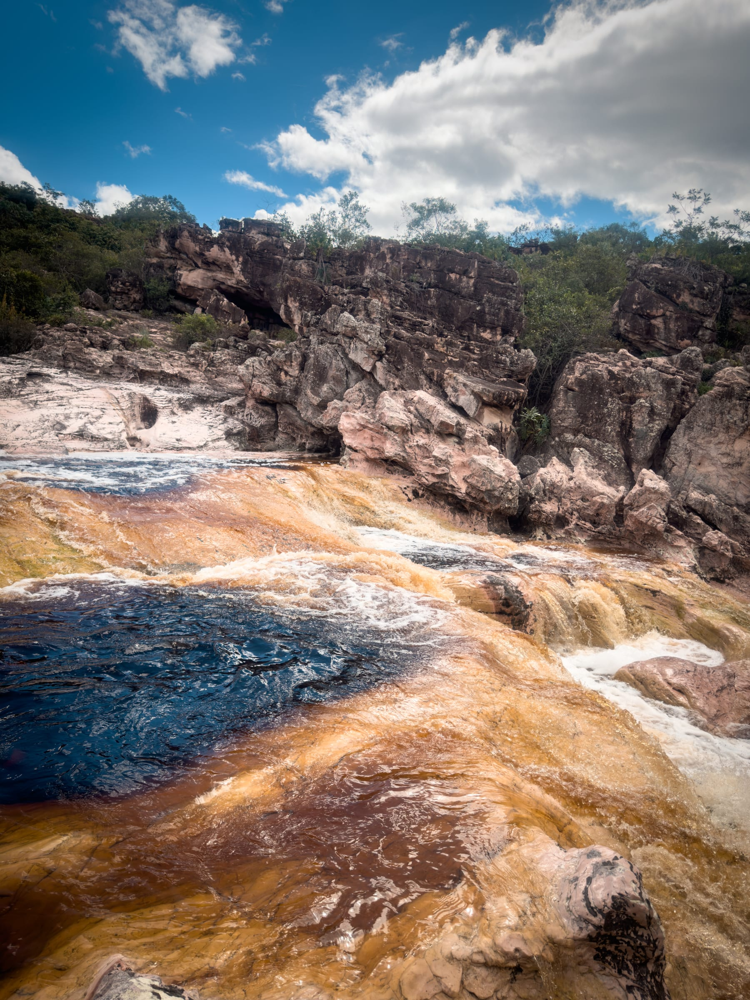
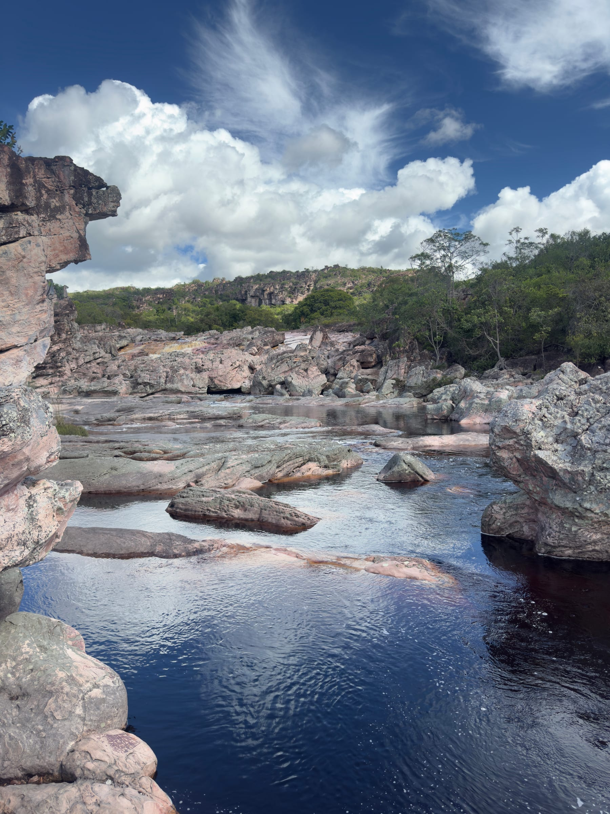
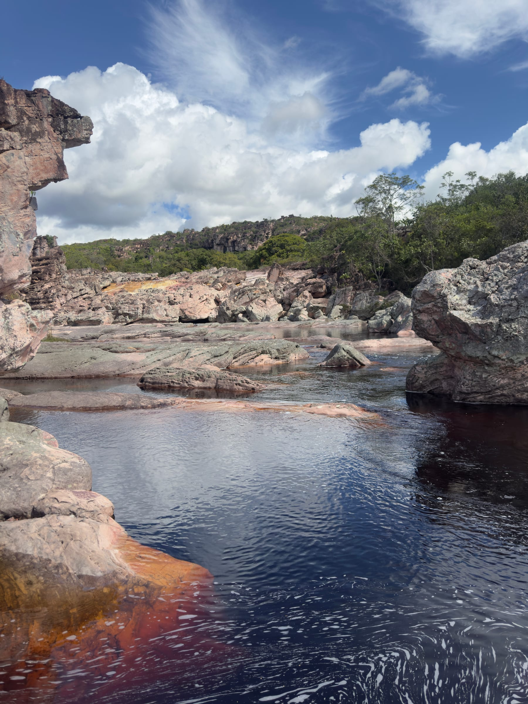
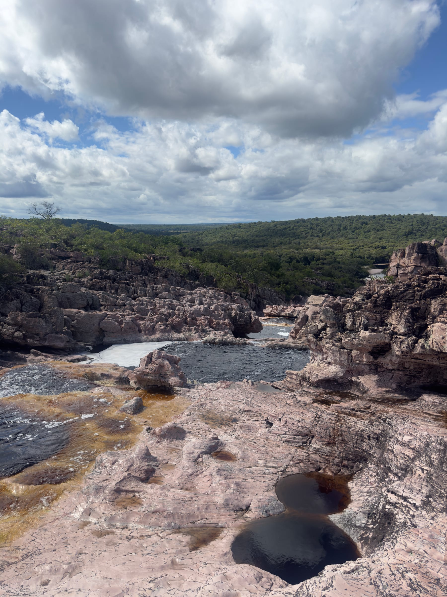
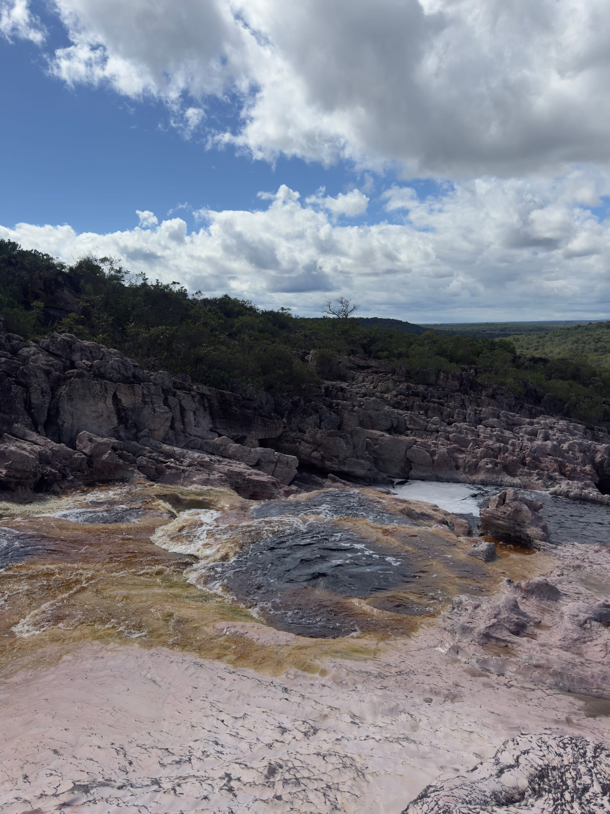

O Rio Roncador corre sobre grandes lajedos de arenito rosado e forma, ao longo do caminho, uma sequência de piscinas naturais, corredeiras e pequenas quedas. É o tipo de lugar para passar horas pulando de um poço para outro, com hidromassagem natural nas quedas e trechos lisos de pedra que funcionam como escorregador.

Este guia explica como são os poços, como é a trilha e as duas formas de chegar, inclusive de canoa pelo [Pantanal Marimbus](/blog/pantanal-marimbus-chapada-diamantina/). Para planejar o restante da viagem, veja o [guia de Lençóis](/blog/o-que-fazer-em-lencois-chapada-diamantina/) e o [roteiro completo pela Chapada Diamantina](/blog/roteiro-chapada-diamantina/). **As informações foram pesquisadas em novembro de 2026.** Acessos e taxas mudam, por isso confirme antes de ir.

## O que é o Rio Roncador

Os caldeirões do Roncador ficam no município de Andaraí, dentro do Parque Nacional da Chapada Diamantina. O rio escava o arenito polido, de tom rosado, e cria poços de vários tamanhos, ligados por corredeiras e pequenas quedas.

A água é escura, cor de chá, como em muitos rios da Chapada: a cor vem da matéria orgânica dissolvida, e não de sujeira. Nas quedas ela ganha tons de âmbar e cobre, e nos poços parados fica quase preta, refletindo o céu.

## Como é a trilha e o banho nos poços

Pelo lado de Andaraí, a caminhada é leve: a trilha atravessa trechos de mata e segue pelas margens de pedra até os caldeirões. Lá, o programa é ir de poço em poço. Nas quedas, a força da água faz uma hidromassagem natural; nas piscinas mais calmas, dá para nadar com tranquilidade; e as pedras lisas formam escorregadores naturais entre um poço e outro.

:::dica
Leve sapatilha aquática com boa aderência: os lajedos molhados e com limo escorregam muito na hora de passar de um poço para outro. Antes de descer por um escorregador natural, confira a profundidade e se há pedras no fundo. E não salte nos poços: a água escura esconde o que está embaixo, e o leito muda com as chuvas.
:::

## Como chegar e combinar com o Pantanal Marimbus

Há duas formas principais de chegar ao Roncador.

| Acesso | Como é |
|---|---|
| Por terra, pelo lado de Andaraí | Pela região da BA-142, a partir da Fazenda Roncador, de carro 4×4 até o rio ou a pé, por trilhas leves de cerca de 4 km ou 6,5 km |
| De canoa, pelo Marimbus | Saindo da Comunidade Quilombola do Remanso, a canoa desce o rio Santo Antônio até o Roncador, e uma trilha leva aos poços |

:::logistica
O Roncador é a extensão tradicional do passeio de canoa pelo [Pantanal Marimbus](/blog/pantanal-marimbus-chapada-diamantina/): partindo do Remanso, dá para fazer os dois no mesmo dia. Relatos citam uma taxa de visitação no acesso pelo restaurante da Fazenda Roncador; confirme o valor e as condições da estrada com um guia local antes de ir.
:::

## Perguntas frequentes

### A trilha do Rio Roncador é difícil?

Não. As trilhas pelo lado de Andaraí são consideradas leves, com trechos de mata e de pedra.

### Dá para ir ao Roncador e ao Marimbus no mesmo dia?

Sim. É o roteiro mais tradicional: canoa pelo Marimbus a partir do Remanso e banho nos poços do Roncador.

### O que levar?

Sapatilha aquática, roupa de banho, protetor solar, repelente e água. Relatos de visitantes mencionam bastante mosquito na trilha.

## Fontes consultadas

Acesso em novembro de 2026.

- [Jornal da Chapada: Rio Roncador, piscinas naturais entre Lençóis e Andaraí](https://jornaldachapada.com.br/2023/02/03/chapada-rio-roncador-e-um-verdadeiro-santuario-com-piscinas-naturais-e-cachoeiras-entre-lencois-e-andarai/)
- [Guia Chapada Diamantina: Piscinas do Rio Roncador via Andaraí](https://www.guiachapadadiamantina.com.br/piscinas-do-rio-roncador-via-andarai/)
- [Um Viajante: Marimbus e Rio Roncador](https://www.umviajante.com.br/bahia/7487-marimbus-e-rio-roncador-chapada-diamantina)
- [Wikiloc: Caldeirões do Roncador](https://www.wikiloc.com/offroading-trails/pn-chapada-diamantina-caldeiroes-do-roncador-21938695)
- [Bahia Terra: Pantanal Marimbus](https://www.bahiaterra.com/posts/pantanal-marimbus-chapada-diamantina)
- [ICMBio: informações sobre visitação no Parque Nacional da Chapada Diamantina](https://www.gov.br/icmbio/pt-br/assuntos/unidade-de-conservacao/unidades-de-biomas/caatinga/lista-de-ucs/parna-da-chapada-da-diamantina/informacoes-sobre-visitacao-parna-da-chapada-da-diamantina)
