Quinze dias de carro, duas fronteiras e quatro bases: foi assim que percorremos a Patagônia chilena e argentina em outubro de 2026, entre Punta Arenas, Puerto Natales, El Calafate e El Chaltén. O circuito tem forma de "U" e passa pelo Parque Nacional Torres del Paine, pelo Glaciar Perito Moreno, pelo maciço do Fitz Roy e pelos pinguins do Estreito de Magalhães.

Este guia é o ponto de partida do nosso conteúdo sobre a Patagônia. Ele reúne a divisão das noites, a lógica da ordem das cidades, o aluguel do carro com autorização para cruzar a fronteira e o que fizemos em cada base, dia a dia. **As informações práticas foram pesquisadas em novembro de 2026.** Regras de parques, tarifas e condições das estradas mudam com frequência, por isso confirme tudo antes de viajar. As fontes estão no fim do artigo.

## Resumo do roteiro

| Datas e noites | Base | País | Foco principal |
|---|---|---|---|
| 14 a 19/10 (5 noites) | Puerto Natales | Chile | Parque Nacional Torres del Paine: mirantes de carro, Lago Grey e trilha da Base Torres |
| 19 a 22/10 (3 noites) | El Calafate | Argentina | Glaciar Perito Moreno: passarelas e navegação pelo Lago Argentino |
| 22 a 26/10 (4 noites) | El Chaltén | Argentina | Trilhas da Laguna Torre e do Fitz Roy, Lago del Desierto e gastronomia |
| 26 a 28/10 (2 noites) | Punta Arenas | Chile | Estreito de Magalhães e pinguins da Isla Magdalena |

**Voos:** São Paulo (GRU) → Santiago (SCL) → Punta Arenas (PUQ), com o mesmo caminho na volta.

**Transporte:** carro alugado em Punta Arenas, na Salfa, reservado pela Rentcars, com autorização para entrar na Argentina.

## Por que o circuito em "U" termina em Punta Arenas

A ordem das bases foi pensada para proteger o voo de volta. Saindo de Punta Arenas, seguimos direto para Puerto Natales, subimos até El Calafate e El Chaltén, e só no fim voltamos ao Chile, para dormir duas noites perto do aeroporto.

Na Patagônia, vento forte, neve fora de época e filas na aduana podem atrasar um dia de estrada. Com Punta Arenas no fim, o trecho mais longo do roteiro, de El Chaltén até o Estreito de Magalhães, fica com uma noite e um dia inteiro de folga antes do voo internacional. Se algo der errado na estrada, a margem absorve o atraso.

A ordem também distribui melhor o esforço. As trilhas mais longas ficam no meio da viagem, em Torres del Paine e El Chaltén, e o último dia é de um passeio de barco, sem caminhada pesada.

## Por que outubro: as vantagens da meia-estação

Outubro é primavera no sul, antes do pico do verão, entre dezembro e fevereiro. Na nossa viagem, isso significou três vantagens:

- **Dias longos.** Já na primeira noite em Puerto Natales, o céu ainda tinha cor depois das 21h. Sobra luz para dirigir sem pressa e terminar trilhas longas com folga.
- **Trilhas abertas.** As trilhas que fizemos, como a da Base Torres, a da Laguna Torre e a do Fitz Roy, estavam abertas e bem sinalizadas.
- **Menos lotação.** Mirantes, estacionamentos e passarelas ficaram mais tranquilos do que costumam estar no auge da temporada.

O outro lado da meia-estação é o clima instável. Pegamos dias de céu limpo e outros fechados, com chuva e vento, às vezes no mesmo dia. Monte o roteiro com dias de folga e mantenha um plano B curto para os dias ruins.

:::dica
Os pinguins da Isla Magdalena chegam à ilha na primavera. Operadores de Punta Arenas anunciam saídas de outubro a março, mas o site oficial de turismo do Chile fala em novembro a março. Se a visita for no começo de outubro, confirme a data com o operador antes de fechar o roteiro.
:::

## Carro alugado e fronteira entre Chile e Argentina

O carro foi o que deu ritmo à viagem. Com ele, paramos em cada mirante de Torres del Paine quando a luz estava boa, esperamos as nuvens saírem do Fitz Roy e atravessamos a estepe no nosso tempo, sem depender de horários de ônibus nem de excursões.

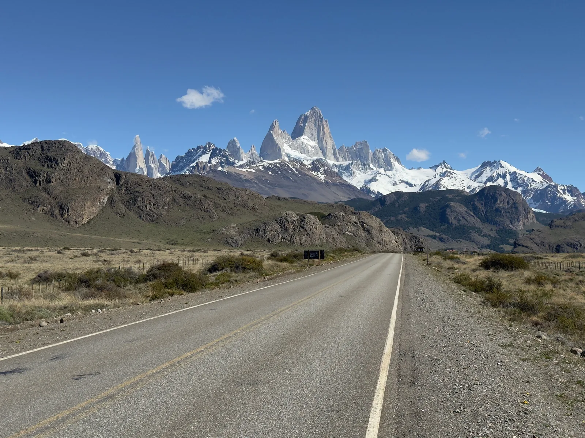

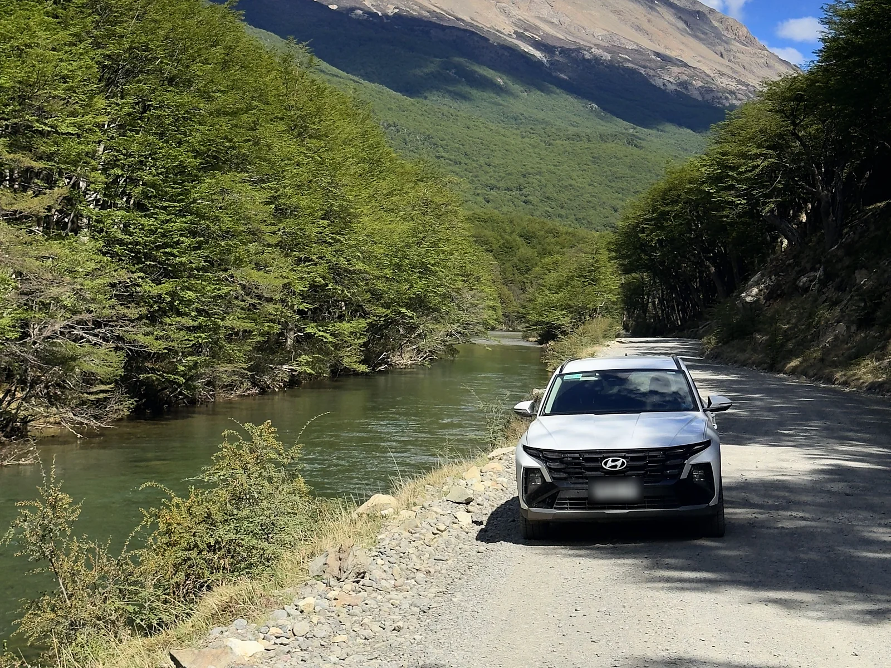

### Aluguel com autorização internacional

Alugamos o carro na Salfa, em Punta Arenas, e fizemos a reserva pela Rentcars. O ponto mais importante é a **autorização para sair do Chile**: sem ela, o carro não passa da fronteira. Peça a autorização no momento da reserva. Cada locadora tem as próprias regras de prazo, validade e cobertura.

Pelas regras da Aduana do Chile, a locadora precisa estar registrada para levar carros à Argentina, e cada veículo recebe uma autorização de saída temporária, válida por no máximo 90 dias. Antes de sair do balcão, confira se a pasta do carro tem:

- **Documento do veículo:** o padrón, que comprova a propriedade.
- **Autorização da locadora:** o documento que permite ao motorista levar o carro para a Argentina.
- **Seguro com cobertura na Argentina:** confira se ele vale pelo período inteiro em território argentino.

Pergunte também o que o seguro cobre na Argentina. Algumas locadoras limitam a cobertura de roubo ou não oferecem carro reserva fora do Chile.

### Na aduana

Em cada travessia, o carro e os passageiros passam pela saída de um país e pela entrada do outro. Leve os passaportes, a documentação do carro e a autorização da locadora numa pasta fácil de achar. Entre Puerto Natales e El Calafate, as fontes citam o Paso Río Don Guillermo, do lado chileno, e Cancha Carrera, do lado argentino. Elas calculam cerca de uma hora a mais no tempo de viagem por causa da fronteira.

Não leve frutas, carnes, laticínios ou sementes ao entrar no Chile. O país tem controle rigoroso de produtos de origem animal e vegetal.

### Rípio e abastecimento

Boa parte das estradas principais é asfaltada, como as rodovias entre Punta Arenas e Puerto Natales e entre El Calafate e El Chaltén. O rípio (estrada de cascalho) aparece dentro de Torres del Paine, no acesso à fronteira do lado argentino e em estradas secundárias, como a que leva ao Lago del Desierto. No rípio, reduza a velocidade, aumente a distância do carro da frente e cuidado ao cruzar com outros veículos, porque as pedras soltas trincam para-brisas.

Os postos de gasolina ficam distantes uns dos outros. Encha o tanque em Puerto Natales antes de entrar no parque e antes de seguir para a Argentina, e não deixe o tanque baixar demais nas estradas da estepe.

:::logistica
**Distâncias de referência por estrada:**
- Punta Arenas a Puerto Natales: cerca de 250 km, em umas 3 horas.
- Puerto Natales a El Calafate: cerca de 270 km, de 4 a 5 horas com a fronteira.
- El Calafate ao Glaciar Perito Moreno: cerca de 80 km pela Ruta Provincial 11, asfaltada.
- El Calafate a El Chaltén: de 215 a 220 km, pela Ruta 40 e pela Ruta 23.
- El Chaltén a Punta Arenas: cerca de 700 km por El Calafate, com fronteira no caminho. É o dia mais longo do roteiro; saia cedo.

A Patagônia chilena (região de Magallanes) e a Argentina usam o mesmo fuso horário, UTC-3, então o relógio não muda nas fronteiras.
:::

## Puerto Natales e Torres del Paine (14 a 19/10)

Puerto Natales é uma cidade pequena à beira do Canal Señoret e a base mais prática para o Parque Nacional Torres del Paine. A estrada é asfaltada até Cerro Castillo e segue em rípio até a entrada do parque. São cerca de 129 km até a portaria de Laguna Amarga. Ficar cinco noites permitiu ir ao parque em quatro dias diferentes e esperar o tempo abrir. Os detalhes de cada dia, a entrada no parque e o que fazer na cidade estão no [guia de Torres del Paine e Puerto Natales](/blog/o-que-fazer-em-torres-del-paine-e-puerto-natales/).

A entrada do parque é comprada pela internet, no sistema oficial da Conaf (Pases Parques). Na portaria, apresente o QR Code da entrada. Se for dormir dentro do parque, as reservas de hospedagem são separadas e também precisam estar garantidas.

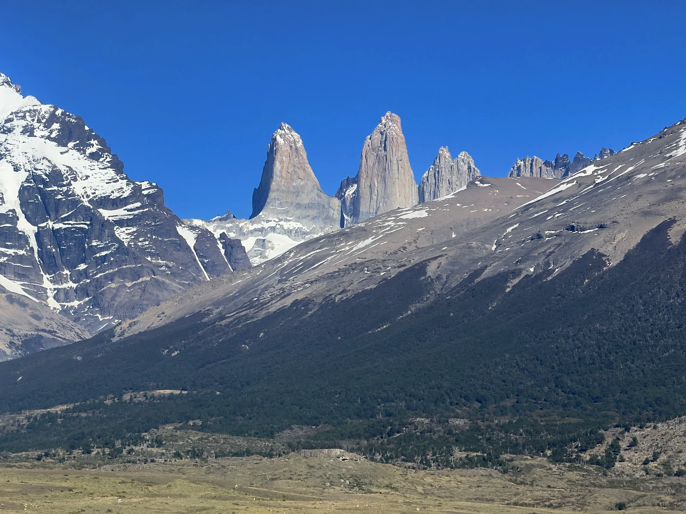

**Dia 1 (14/10): chegada e Puerto Natales.** Voamos de São Paulo a Punta Arenas, com conexão em Santiago, retiramos o carro e seguimos pela estrada até Puerto Natales. No fim do dia, a Costanera, o calçadão à beira do canal, rende uma caminhada curta. Ali ficam o Muelle Histórico, um antigo cais do qual restam só os pilares de madeira dentro da água, e as estátuas que viraram símbolo da cidade.

**Dia 2 (15/10): mirantes de carro.** Primeiro contato com o parque, de carro. Paramos na vista das torres a partir da estrada, na Cascada Paine e em lagoas com guanacos na beira. No fim da tarde, fizemos o Salto Grande e a caminhada curta até o Mirador Cuernos, de frente para os Cuernos del Paine e o Lago Nordenskjöld.

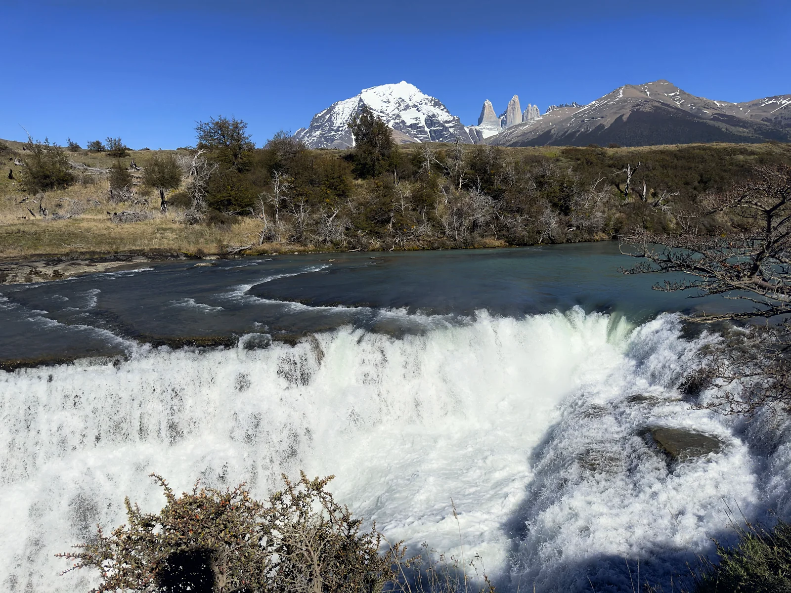

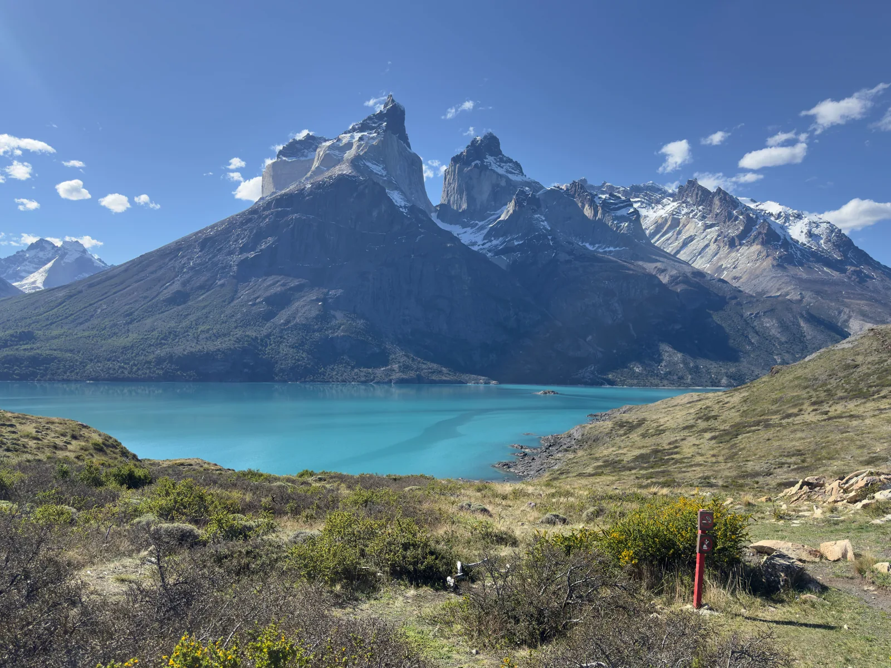

**Dia 3 (16/10): trilha da Base Torres.** É a caminhada mais famosa do parque. As fontes citam de 20 a 21 km ida e volta, cerca de 680 m de desnível e de 8 a 10 horas. A trilha sobe o vale do Rio Ascencio, passa pelo Paso de los Vientos e pelo Refugio Chileno, mais ou menos na metade, e termina com uma subida íngreme por pedras soltas até a lagoa aos pés das torres. Saia cedo e leve comida e água para o dia inteiro.

**Dia 4 (17/10): Lago Grey.** A praia do Lago Grey, no setor oeste do parque, é coberta de pedras e recebe icebergs azuis que se desprendem do Glaciar Grey. Pegamos tempo fechado, com chuva no horizonte, e mesmo assim foi um dos dias mais bonitos da viagem.

**Dia 5 (18/10): Lago Pehoé e as estradas do parque.** Dedicamos o dia a dirigir devagar pelas estradas internas, com o maciço do Paine sempre à frente, como na foto de capa deste guia. Paramos de novo no Salto Grande e na passarela da ilha do Lago Pehoé.

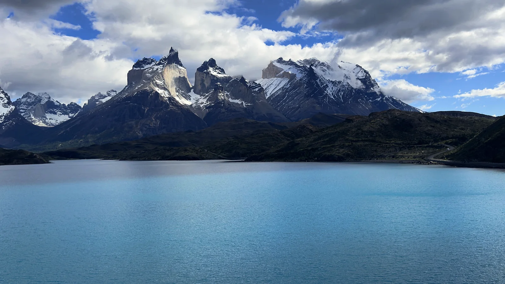

Cada dia no parque mostrou uma paisagem diferente: a subida de pedras até as torres, os icebergs do Lago Grey sob chuva e a calmaria do Lago Pehoé no dia seguinte.

:::galeria
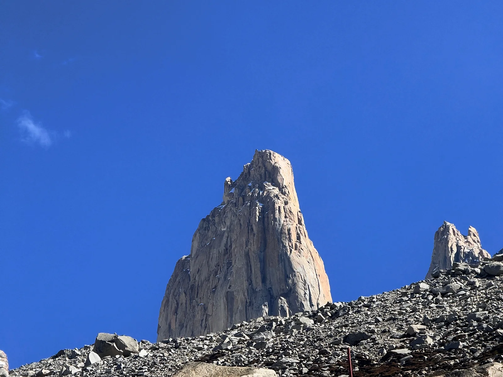

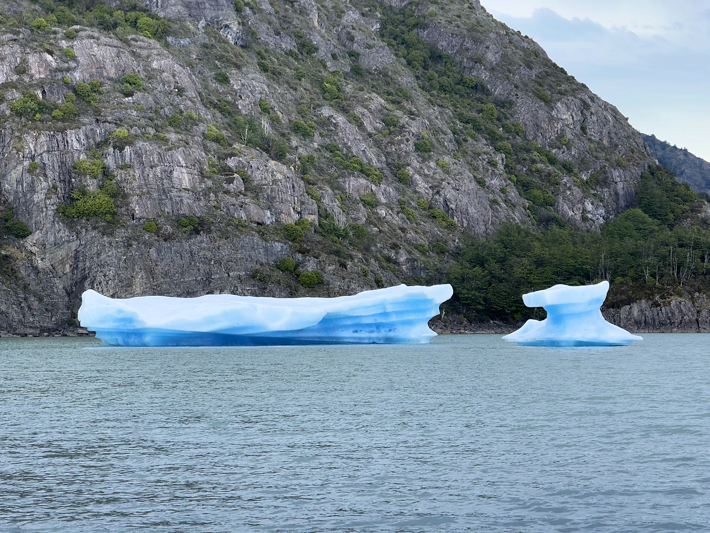

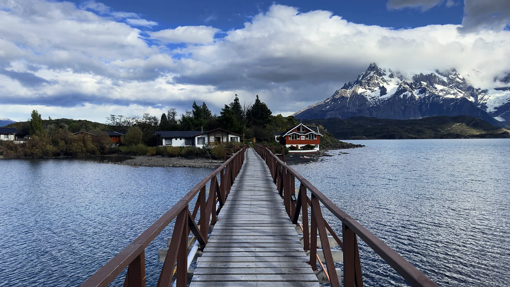
:::

:::alerta
Em Torres del Paine, as trilhas têm horários máximos de entrada e de saída, que a administração do parque publica a cada temporada. Confira os horários do dia antes de começar uma caminhada longa. Ande só pelas trilhas marcadas e não faça fogo fora das áreas permitidas: o parque já sofreu grandes incêndios, e as regras são aplicadas com rigor.
:::

## El Calafate e o Glaciar Perito Moreno (19 a 22/10)

**Dia 6 (19/10): fronteira e El Calafate.** Saímos de Puerto Natales, cruzamos a fronteira para a Argentina e seguimos pela Ruta 40 até El Calafate, à beira do Lago Argentino. A cidade é a porta de entrada para o Parque Nacional Los Glaciares e tem a melhor estrutura de hotéis e restaurantes da região.

**Dia 7 (20/10): navegação pelo Lago Argentino.** Fizemos uma navegação de dia inteiro saindo do porto de Punta Bandera. O barco percorreu os canais do lago entre icebergs, passou pelo canal Upsala e pelo Glaciar Spegazzini e terminou em frente à parede do Perito Moreno. O céu estava fechado, com nuvens baixas, e foi justamente com essa luz que o gelo apareceu mais azul.

:::galeria
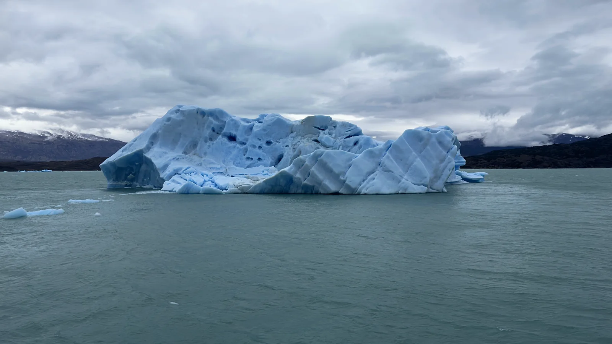

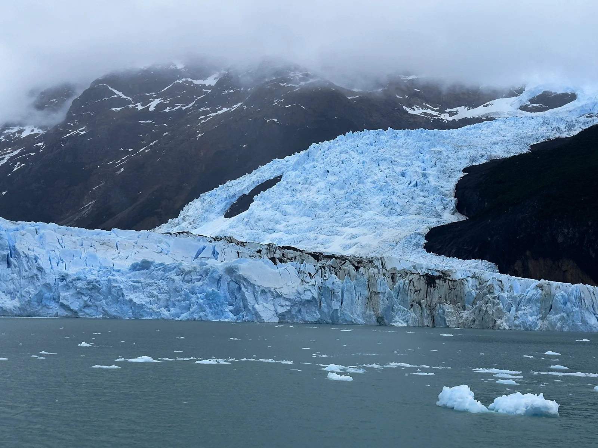

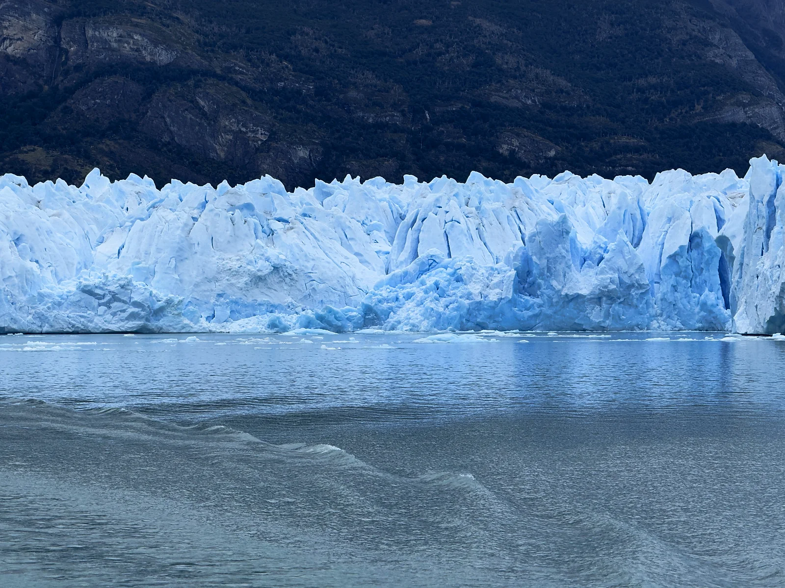
:::

**Dia 8 (21/10): passarelas do Perito Moreno.** O glaciar fica a cerca de 80 km de El Calafate, por uma estrada asfaltada. Pouco antes de chegar, a estrada já mostra o glaciar inteiro, descendo das montanhas até o lago. Nas passarelas, uma rede de caminhos de madeira na península de frente para o gelo, passamos o dia inteiro: dá para ver a parede de vários ângulos e esperar pelos desprendimentos de blocos de gelo, anunciados por estalos fortes.

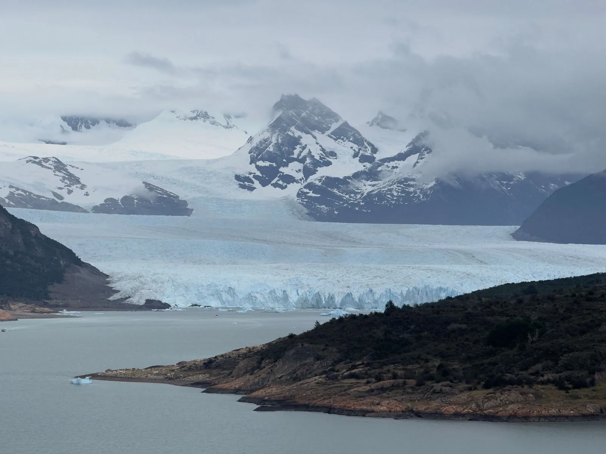

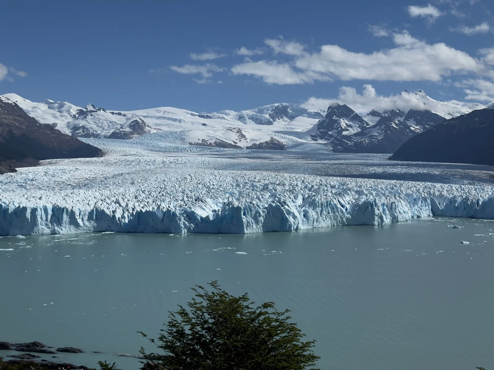

O ingresso do Parque Nacional Los Glaciares é cobrado na entrada do setor do Perito Moreno. A tabela oficial da Administración de Parques Nacionales prevê 50% de desconto no segundo dia de visita, dentro de 72 horas a partir da primeira entrada. Esse desconto ajuda quem pretende voltar ao glaciar ou combinar o parque com El Chaltén.

## El Chaltén, a capital nacional do trekking (22 a 26/10)

El Chaltén é uma vila pequena, criada aos pés do Cerro Fitz Roy e do Cerro Torre, e se apresenta como a capital nacional do trekking da Argentina. As principais trilhas começam na própria vila, sem carro e sem traslado.

**Dia 9 (22/10): estrada até El Chaltén.** O trajeto de El Calafate segue pela Ruta 40 e pela Ruta 23, à beira do Lago Viedma. Nos últimos quilômetros, o Fitz Roy aparece de frente para a estrada. Vale parar no portal do parque, na chegada à vila.

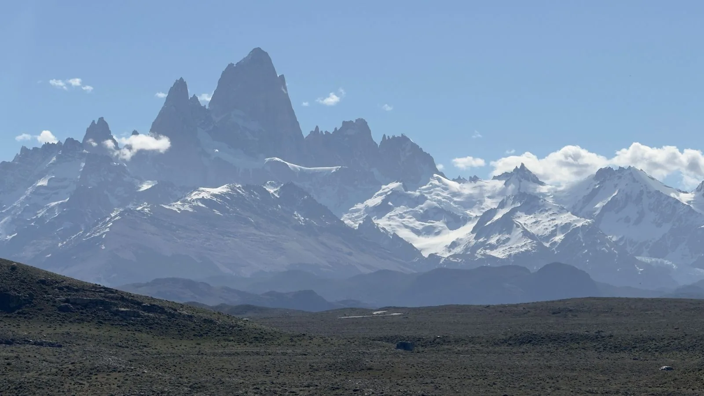

**Dia 10 (23/10): Laguna Torre.** A trilha segue o vale do Rio Fitz Roy até a lagoa aos pés do Cerro Torre, com o glaciar descendo até a água. As fontes citam cerca de 11 km em cada sentido e de 7 a 8 horas ida e volta. O desnível é mais suave que o da Laguna de los Tres, e por isso ela é uma boa primeira trilha.

**Dia 11 (24/10): Ruta 23, Chorrillo del Salto e Lago del Desierto.** No dia de descanso das pernas, usamos o carro para seguir a Ruta 23 ao norte da vila. A estrada vira rípio e acompanha rios de água clara até o Lago del Desierto. No caminho ficam o Chorrillo del Salto, uma cachoeira a poucos minutos de caminhada do estacionamento, e vários pontos com vista para o Fitz Roy.

:::galeria
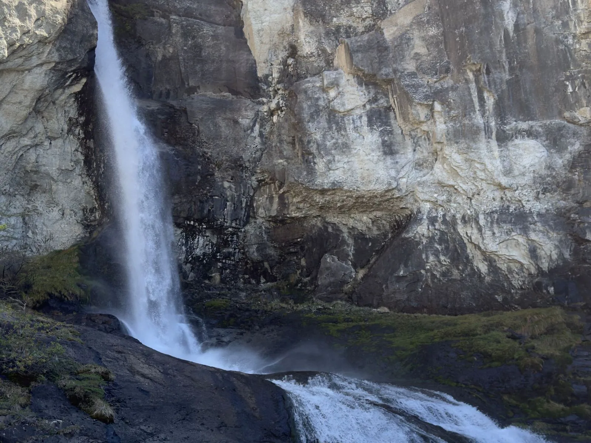

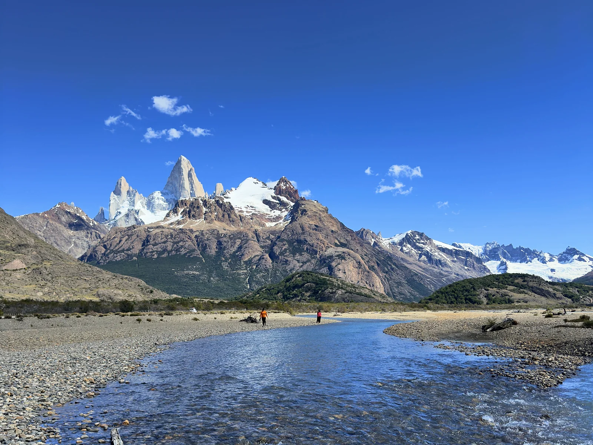

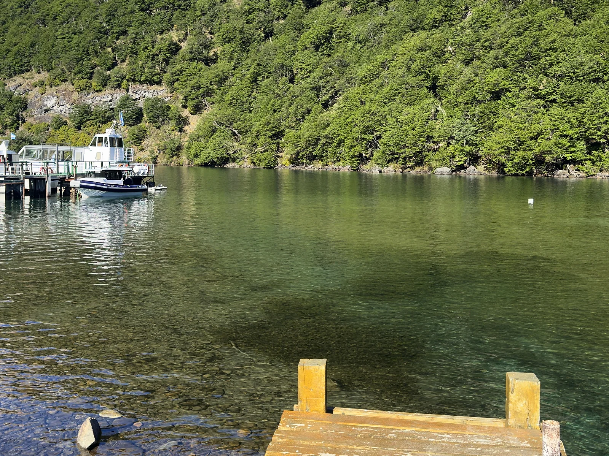
:::

**Dia 12 (25/10): trilha do Fitz Roy até a Laguna Capri.** A trilha que leva à Laguna de los Tres, aos pés do Fitz Roy, é a mais conhecida da região. As fontes citam de 20 a 25 km ida e volta e de 8 a 10 horas, com o último trecho subindo cerca de 400 m de desnível em uma hora, a partir do acampamento Poincenot. Nós fizemos uma versão mais curta: subimos até a Laguna Capri e o mirante do Fitz Roy logo adiante e voltamos pelo mirante do Río de las Vueltas, no começo da trilha.

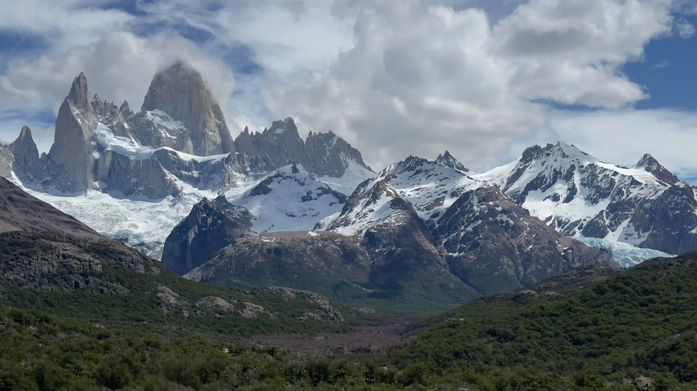

Para os dias de vento forte ou de montanha encoberta, há trilhas curtas que saem da vila, como a do Mirador de los Cóndores, com vista para El Chaltén e o vale. O Chorrillo del Salto também funciona como plano B.

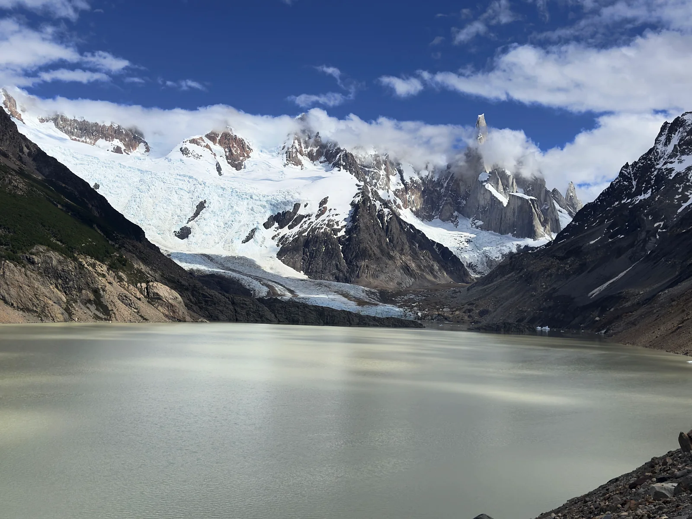

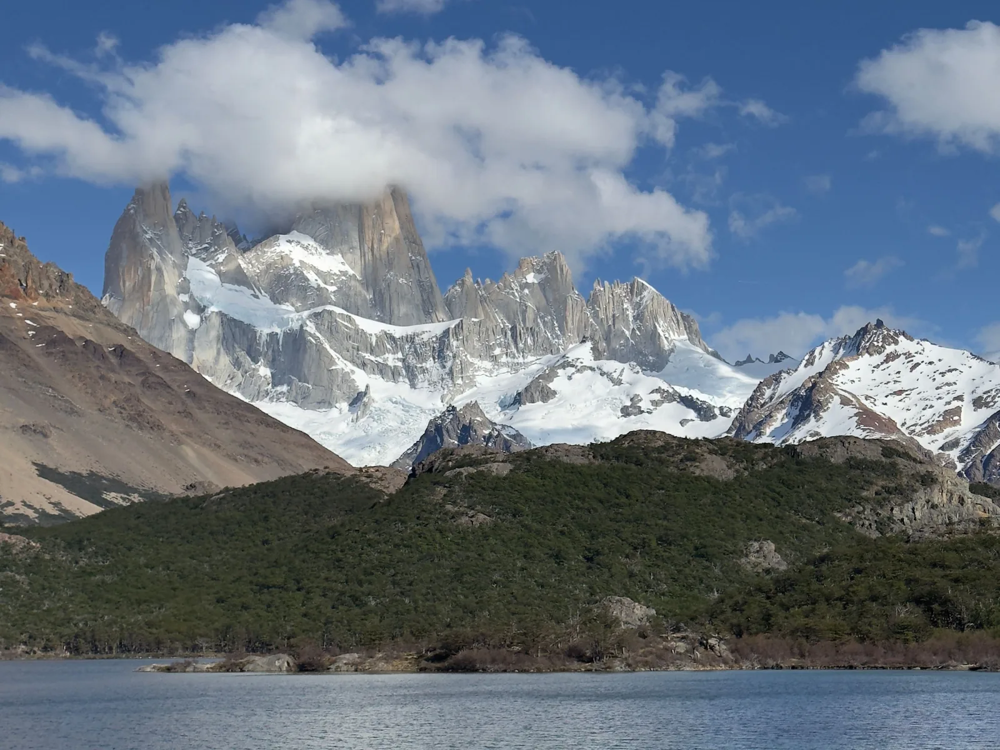

À noite, a vila compensa o esforço do dia. El Chaltén tem cervejarias artesanais e restaurantes de cozinha patagônica, em que o cordeiro aparece em quase todo cardápio.

:::dica
A Administración de Parques Nacionales cobra um passe diário no portal de El Chaltén do Parque Nacional Los Glaciares, com tarifas atualizadas em junho de 2026. Desde março de 2026, a vila também cobra uma taxa turística de quem visita El Chaltén sem dormir lá. Confira valores e regras antes de ir, porque mudaram várias vezes nos últimos anos.
:::

## Punta Arenas e o Estreito de Magalhães (26 a 28/10)

**Dia 13 (26/10): estrada até Punta Arenas.** É o dia mais longo de carro: de El Chaltén, voltamos a El Calafate, cruzamos a fronteira para o Chile e seguimos até Punta Arenas, à beira do Estreito de Magalhães. Saímos cedo, com o sol da manhã ainda baixo sobre as montanhas.

**Dia 14 (27/10): pinguins na Isla Magdalena.** A ilha fica a cerca de 35 km de Punta Arenas e faz parte do Monumento Natural Los Pingüinos. O acesso é só de barco, e as saídas começam bem cedo: o nosso barco partiu por volta das 7h. Na ilha, uma trilha demarcada sobe até o farol, entre as tocas dos pinguins-de-magalhães, que andam pela grama e pela praia de pedras sem se importar com os visitantes.

:::galeria
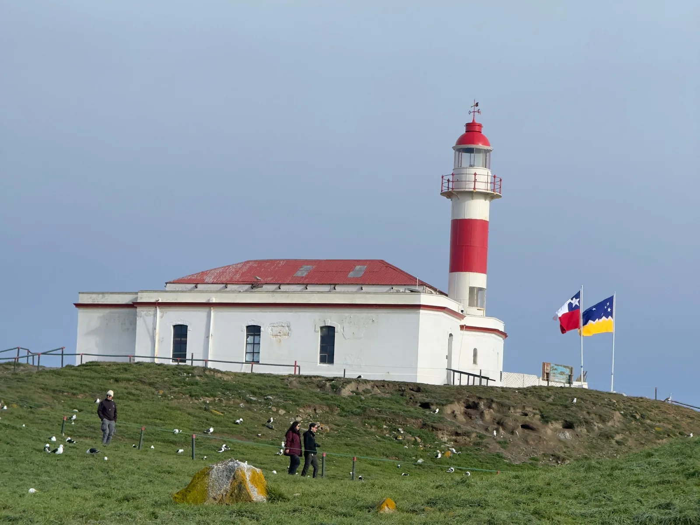

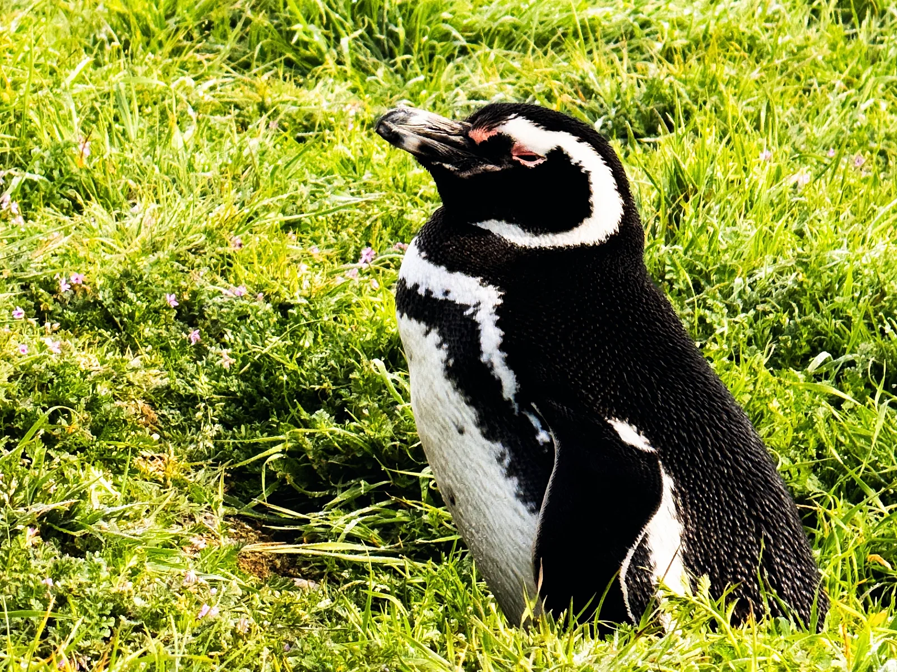

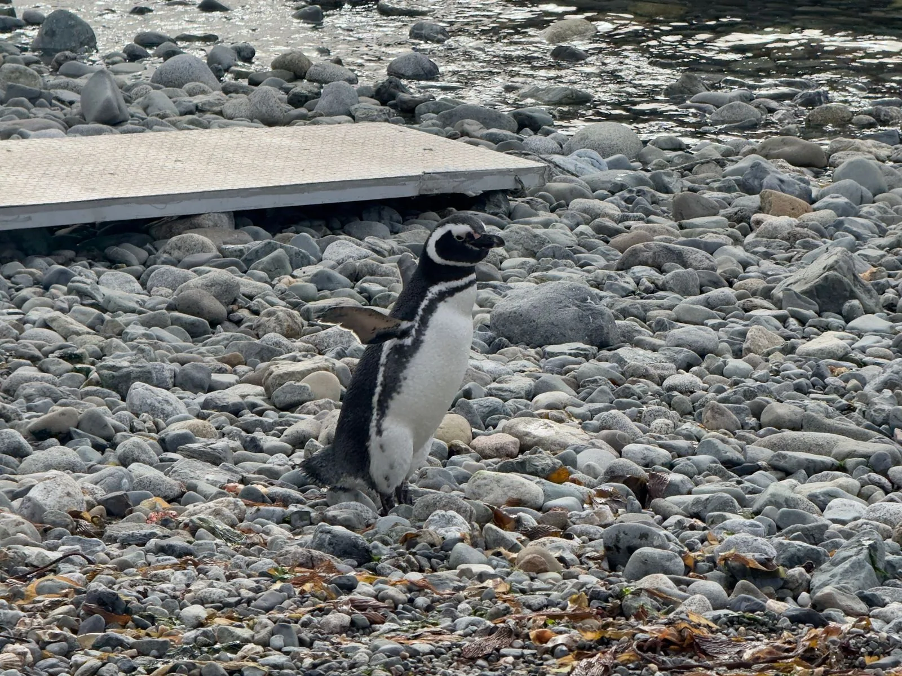
:::

Na volta, o barco cruzou com golfinhos no estreito. Já perto da cidade, passamos por um antigo píer de concreto tomado por uma colônia de cormorões.

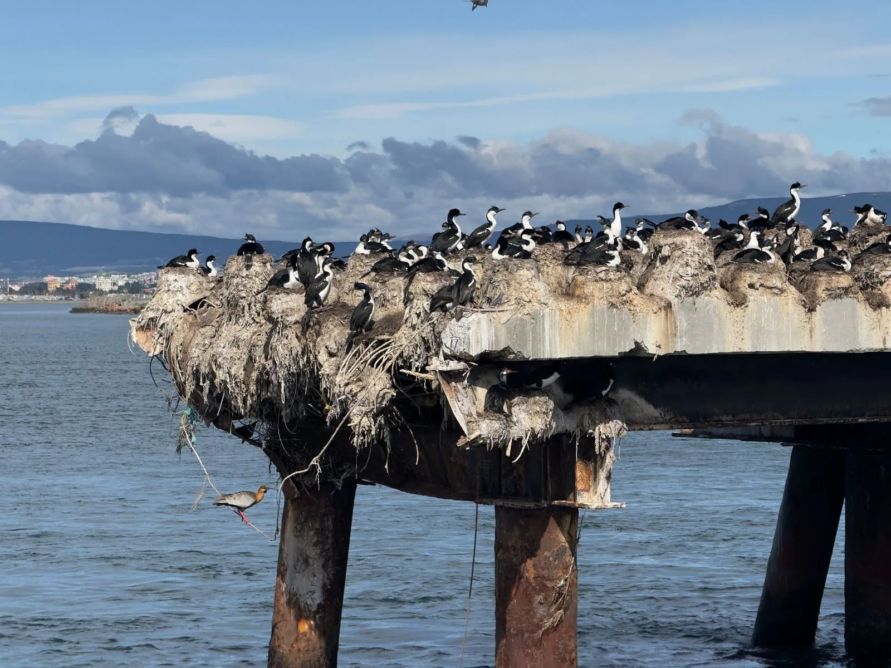

**Dia 15 (28/10): voo de volta.** Com o aeroporto a cerca de 20 km do centro, o último dia é só de devolver o carro e embarcar para Santiago e São Paulo.

:::alerta
A navegação até a Isla Magdalena depende do vento e do estado do mar no Estreito de Magalhães, e as saídas podem ser canceladas no mesmo dia. Por isso, o passeio ficou no penúltimo dia, e não no último: se fosse cancelado, ainda haveria uma chance de remarcar. Mantenha a distância indicada dos pinguins e não saia da trilha demarcada.
:::

## Checklist de roupas em camadas

O clima da Patagônia muda em minutos, e o vento faz a sensação de frio despencar. A solução é vestir camadas que você tira e põe ao longo do dia:

- **Segunda pele:** blusa e calça térmicas, de tecido sintético ou lã merino, para os dias frios e as primeiras horas da manhã.
- **Fleece:** a camada intermediária, que esquenta sem pesar na mochila.
- **Corta-vento impermeável:** a peça mais importante da mala. Garante proteção contra o vento e a chuva nas trilhas, nos mirantes e no barco.
- **Calça de trekking:** de secagem rápida. Uma calça impermeável por cima ajuda nos dias de chuva.
- **Bota de trekking:** amaciada antes da viagem, com boa aderência para rípio, pedras soltas e trechos de lama.
- **Acessórios:** gorro, luvas, buff ou gola, óculos de sol e protetor solar. Mesmo no frio, o sol queima.
- **Bastões de caminhada:** aliviam os joelhos nas descidas longas da Base Torres e das trilhas de El Chaltén.
- **Mochila de ataque:** com garrafa de água, lanche e uma camada extra de roupa nas trilhas longas.

## Perguntas frequentes

### Dá para fazer a Patagônia chilena e argentina de carro alugado?

Dá. Alugue o carro com uma locadora que tenha autorização para levar veículos à Argentina e peça o documento de saída já na reserva. Na nossa viagem, a Salfa, reservada pela Rentcars, forneceu a autorização. Confira também se o seguro cobre a Argentina durante todo o período.

### Quantos dias são necessários para esse roteiro?

Fizemos o circuito em 15 dias e 14 noites, com tempo para as trilhas principais e dias de folga para o clima. Com menos tempo, a primeira coisa a cortar seria uma das noites em Puerto Natales ou em El Chaltén. A margem antes do voo de volta deve continuar no roteiro.

### Outubro é uma boa época para a Patagônia?

Para nós, foi. Outubro tem dias longos, trilhas abertas e menos gente que o verão. Em troca, o clima é mais instável, com dias frios e de chuva. Leve roupas de inverno e monte o roteiro com dias de folga.

### Por que começar em Puerto Natales e terminar em Punta Arenas?

Para chegar ao fim da viagem perto do aeroporto. O trecho mais longo, entre El Chaltén e Punta Arenas, fica com uma noite e um dia de margem antes do voo internacional. Assim, um atraso por vento, neve ou fila na fronteira não ameaça a volta.

### Precisa reservar a entrada de Torres del Paine com antecedência?

Sim. A entrada é comprada pela internet, no sistema da Conaf, e o QR Code é apresentado na portaria. As hospedagens dentro do parque são reservadas à parte. Confirme as regras da temporada no site do parque antes de ir.

## Fontes consultadas

- [ChileAtiende: autorização de saída temporária de carros de locadora para a Argentina](https://www.chileatiende.gob.cl/fichas/18693)
- [Aduana do Chile: registro de locadoras para a saída de veículos à Argentina](https://www.aduana.cl/solicitud-de-registro-de-empresa-rent-a-car-para-la-salida-temporal-de/aduana/2020-11-18/123148.html)
- [Avis Chile: condições para cruzar a fronteira com carro alugado](https://avis.cl/pdf/T&C_CruceFrontera.pdf)
- [Pases Parques (Conaf): entrada do Parque Nacional Torres del Paine](https://www.pasesparques.cl/en/puerto-natales-298/parque-nacional-torres-del-paine-3412)
- [Parque Nacional Torres del Paine: boletim informativo da temporada](https://parquetorresdelpaine.cl/wp-content/uploads/2025/10/Boletin-informativo-pntp-1.pdf)
- [Calendario Chile: guia de Torres del Paine em 2026](https://www.calendariochile.com/turismo/guia-para-visitar-el-parque-nacional-torres-del-paine-en-2026-circuitos-reservas-y-mejores-fechas)
- [Chile Travel: Parque Nacional Torres del Paine](https://chile.travel/atractivos/parque-nacional-torres-del-paine/)
- [Nomades: trilha da Base Torres](https://www.nomades.com/blog/trekking-base-torres-todo-debes-saber/)
- [Patagonia Scout: Mirador Las Torres](https://patagoniascout.pages.dev/hikes/mirador-las-torres)
- [Kimkim: Puerto Natales a El Calafate](https://www.kimkim.com/ab/puerto-natales-to-el-calafate)
- [Minimalist Journeys: fronteira entre El Calafate e Puerto Natales](https://www.minimalistjourneys.com/el-calafate-puerto-natales-bus-guide/)
- [Argentina.travel: Glaciar Perito Moreno](https://www.argentina.travel/actividades/glaciar-perito-moreno)
- [Parques Nacionales da Argentina: tarifas de acesso](https://www.argentina.gob.ar/parquesnacionales/tarifas)
- [Misiones Online: taxa turística em El Chaltén](https://misionesonline.net/2026/03/04/el-chalten-cobraran-una-tasa-turistica/)
- [El Espectador: estrada de El Calafate a El Chaltén](https://www.elespectador.com/turismo/rumbo-al-corazon-de-la-patagonia/)
- [Welcome Argentina: El Chaltén, capital nacional do trekking](https://www.welcomeargentina.com/elcalafate/poblacion-el-chalten.html)
- [Chaltén Mountain Guides: trilha da Laguna de los Tres](https://chaltenmountainguides.com/?p=1513)
- [Viajeros Callejeros: o que fazer em El Chaltén](https://www.viajeroscallejeros.com/que-hacer-en-el-chalten/)
- [Ruta0: El Calafate a Punta Arenas](https://www.ruta0.com/ruta/internacional/el-calafate-a-paso-internacional-casas-viejas-a-punta-arenas/mas-corta/)
- [Viaje na Viagem: Patagônia de carro](https://www.viajenaviagem.com/?p=84471)
- [Chile Travel: Isla Magdalena e os pinguins](https://chile.travel/blog/la-magica-isla-en-medio-de-la-patagonia-que-esta-repleta-de-pinguinos/)
- [Nomades: navegação à Isla Magdalena](https://www.nomades.com/punta-arenas/navegacion-isla-magdalena-id318)
- [Ministério de Energia do Chile: horário único da região de Magallanes](https://energia.gob.cl/noticias/nacional/gobierno-anuncia-horario-unico-para-la-region-de-magallanes)
