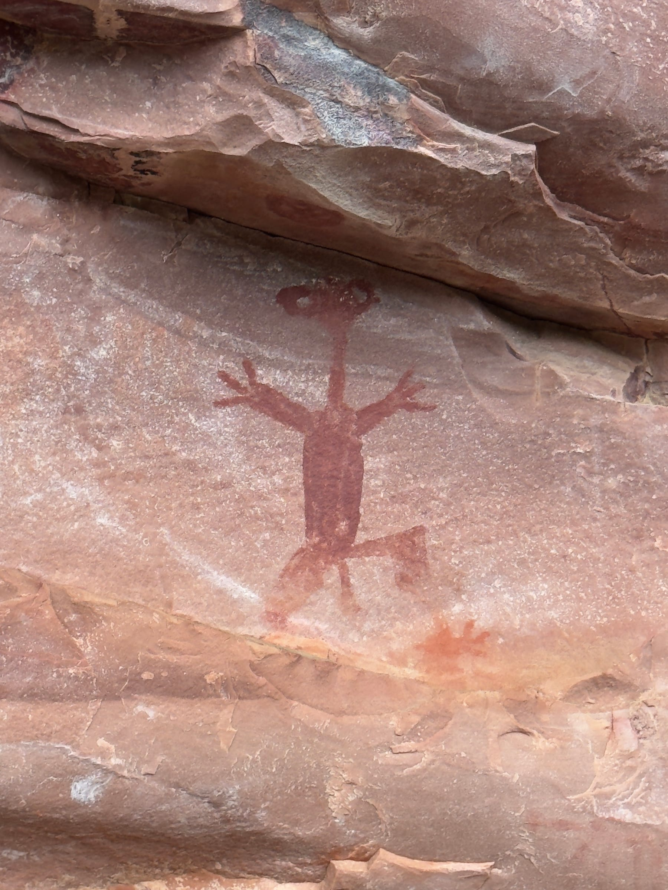
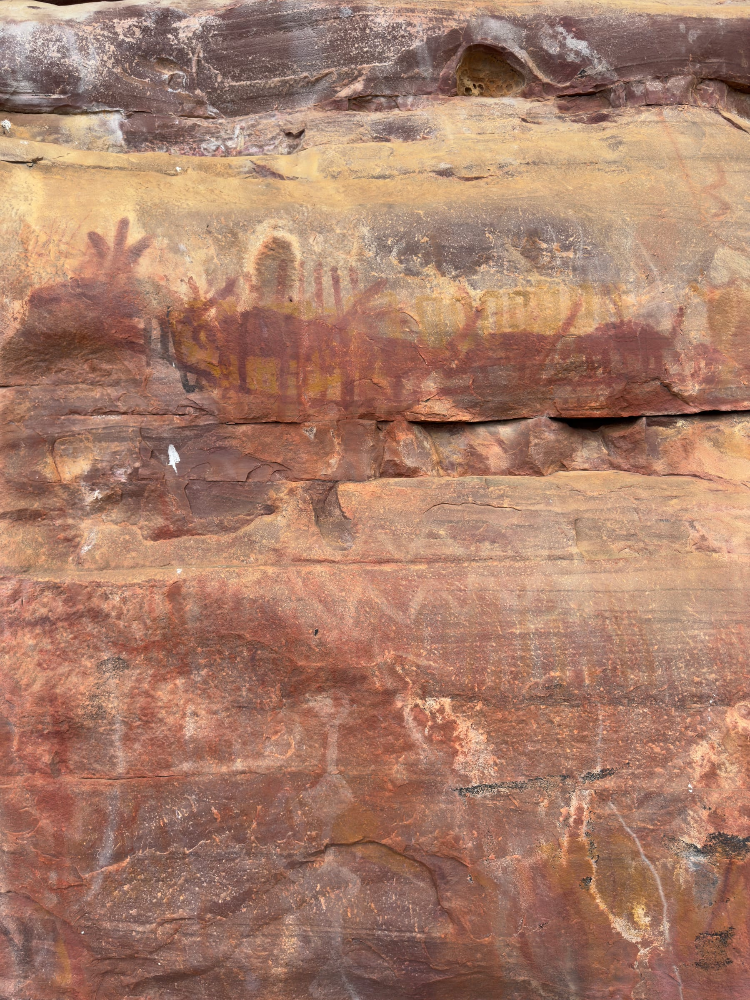
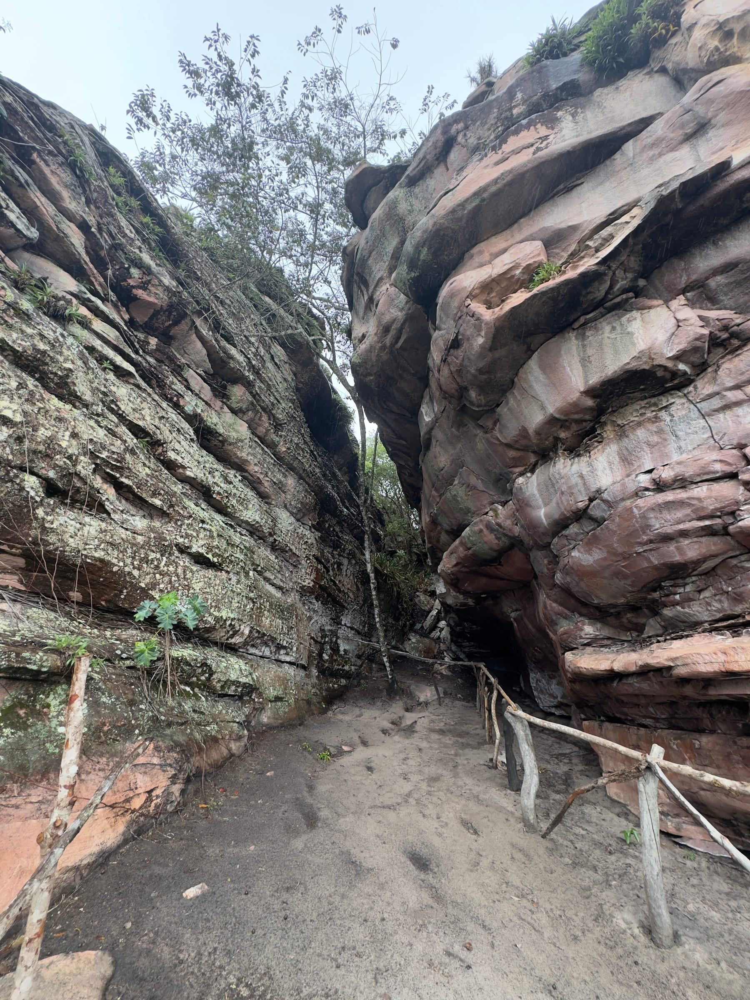
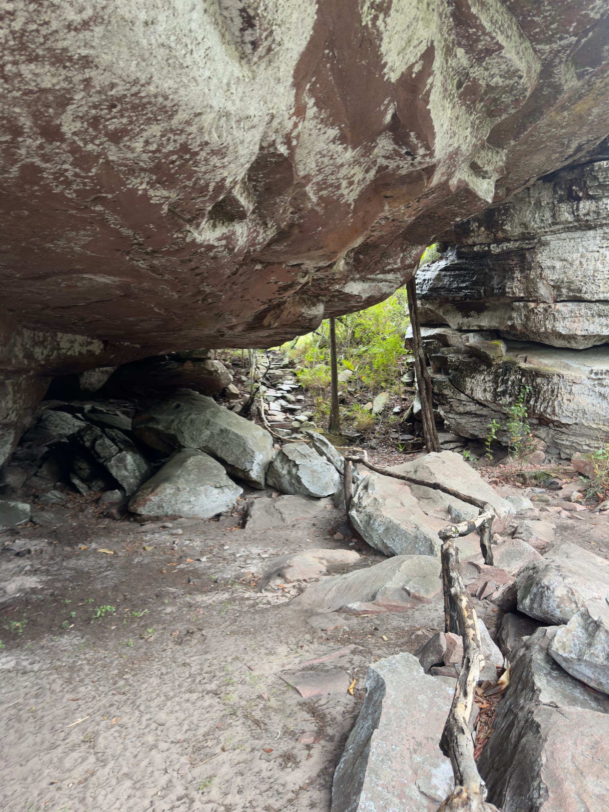
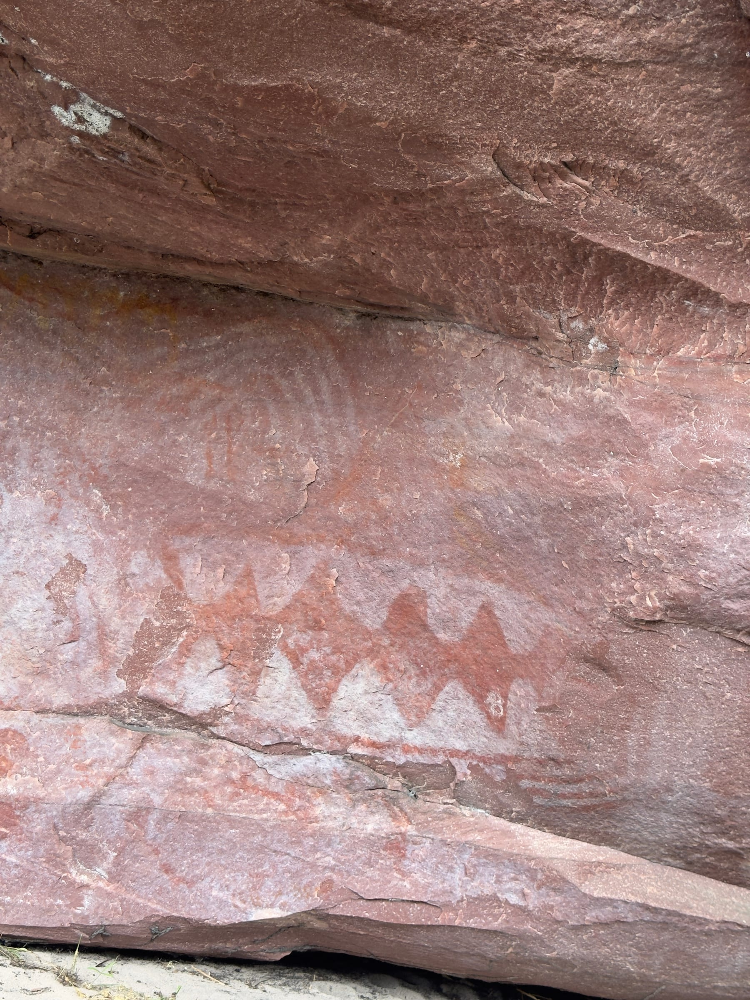
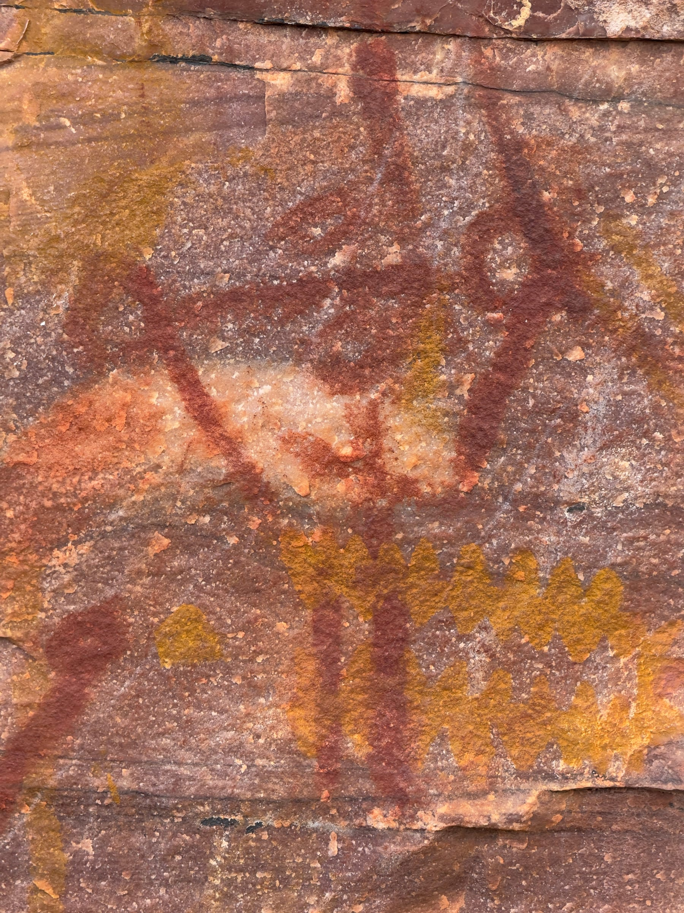
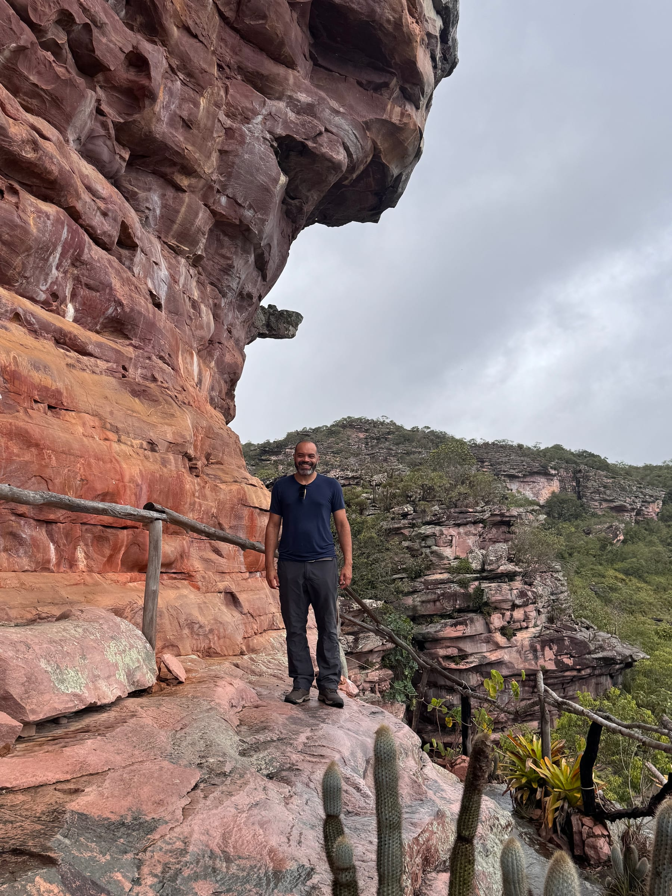
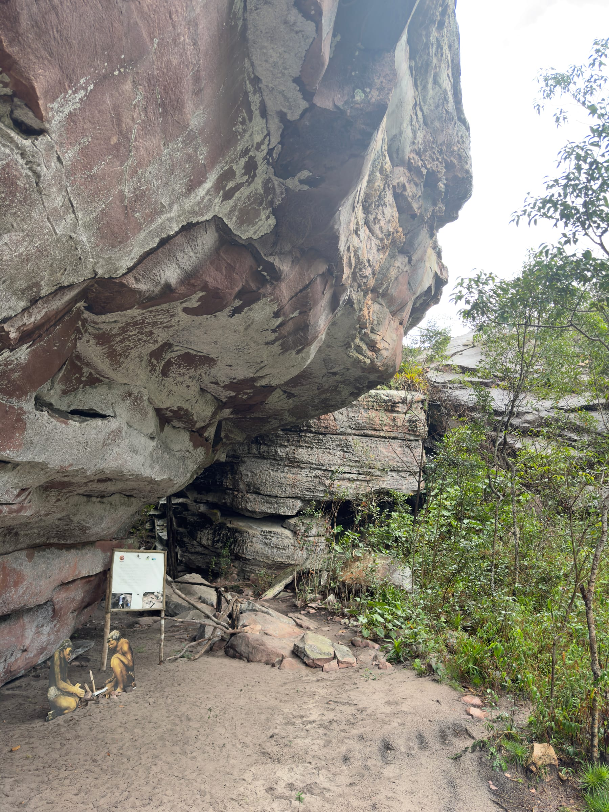

A Serra das Paridas guarda um dos conjuntos de pinturas rupestres mais impressionantes da Chapada Diamantina: só na área aberta à visitação, são mais de mil pinturas em paredões e abrigos de arenito. A visita é curta e leve, sempre com guia, e combina muito bem com a Cachoeira do Mosquito no mesmo dia.

Este guia explica o que é o complexo, como funciona a visita e como encaixá-la no roteiro. Para planejar o restante da viagem, veja o [guia de Lençóis](/blog/o-que-fazer-em-lencois-chapada-diamantina/) e o [roteiro completo pela Chapada Diamantina](/blog/roteiro-chapada-diamantina/). **As informações foram pesquisadas em novembro de 2026.** Taxas e regras mudam, por isso confirme antes de ir.

## O que é o Complexo Serra das Paridas

O complexo fica na zona rural de Lençóis, na região de Tanquinho, e reúne 18 sítios arqueológicos, dos quais só uma parte está aberta ao público. As pinturas foram encontradas em 2005, depois de um incêndio na vegetação, por catadores de mangaba. O proprietário da área chamou o arqueólogo Carlos Etchevarne, da UFBA, que confirmou a importância do achado, e o sítio passou a receber visitantes por volta de 2008.

### As pinturas

As pinturas foram feitas com pigmentos minerais, em tons de vermelho, amarelo, preto e branco. Os vermelhos e amarelos da arte rupestre costumam vir de óxidos de ferro. Os temas incluem figuras humanas, animais e muitos grafismos geométricos. A ocupação humana da área é estimada em pelo menos 8 mil anos, mas a idade exata das pinturas ainda é discutida pelos pesquisadores.

### De onde vem o nome

Há mais de uma explicação para o nome. A mais citada liga "Paridas" a uma das pinturas, que lembraria uma mulher grávida de cócoras. Outra versão, contada por fazendeiros da região, fala das vacas que costumavam parir no local. Os moradores mais antigos chamavam a área de Serra das Guaribas.

## Como é a visita

A caminhada é curta, de cerca de 300 metros, por uma trilha leve demarcada com cercas de madeira, que passa entre paredões e abrigos sob a rocha. O tempo de visita varia de 40 minutos a três horas, conforme o interesse do grupo.

O guia conduz a leitura das pinturas em cada parada: aponta as figuras humanas, os animais e os grafismos, e explica as hipóteses sobre o significado de cada painel. Sem essa interpretação, muitas pinturas passam despercebidas.

Entre os abrigos, a trilha chega a mirantes naturais com vista para a serra, um bom momento para uma pausa.

:::alerta
A visita não pode ser feita por conta própria. É obrigatório contratar um guia credenciado ou uma agência e comprar o voucher com antecedência em Lençóis, antes de seguir para o complexo. Os valores mais recentes do site oficial são de R$ 60 por pessoa de taxa de visitação, além do guia do parque. Ajude a preservar o sítio: não toque nas rochas nem nas pinturas, não use flash perto dos pigmentos e siga só as trilhas e passarelas demarcadas.
:::

## Como chegar e roteiro combinado

O complexo fica a cerca de 35 a 40 km de Lençóis, ao norte da cidade. O acesso é pela BR-242, com um trecho final em estrada de terra. Funciona todos os dias, das 8h às 18h, segundo o site oficial.

:::logistica
Combine a Serra das Paridas com a [Cachoeira do Mosquito](/blog/cachoeira-do-mosquito-chapada-diamantina/) no mesmo dia. As duas ficam na mesma região, ao norte de Lençóis, e as agências costumam vender o passeio combinado, com transporte e guia. Pela manhã, as pinturas; à tarde, a trilha e o banho no poço da cachoeira.
:::

## Perguntas frequentes

### Precisa de guia para visitar a Serra das Paridas?

Sim. O guia é obrigatório, e o voucher deve ser comprado com antecedência em Lençóis, com agência ou guia credenciado.

### Quanto custa a visita?

O site oficial informa taxa de visitação de R$ 60 por pessoa. O guia do parque custa R$ 60 para grupos de até cinco pessoas, ou R$ 12 por pessoa em grupos a partir de seis. Pacotes de agência costumam incluir transporte e a Cachoeira do Mosquito.

### A trilha é difícil?

Não. São cerca de 300 metros de caminhada leve, com tempo total de visita entre 40 minutos e três horas.

## Fontes consultadas

Acesso em novembro de 2026.

- [Serra das Paridas: site oficial do complexo arqueológico](https://www.serradasparidas.com.br/)
- [Guia Chapada Diamantina: pinturas rupestres da Chapada Diamantina](https://www.guiachapadadiamantina.com.br/uma-arte-milenar/)
- [Guia Chapada Diamantina: complexo arqueológico de Lençóis](https://www.guiachapadadiamantina.com.br/complexo-arqueologico-de-lencois-convida-a-viajar-pela-pre-historia/)
- [Wikipédia: Serra das Paridas](https://pt.wikipedia.org/wiki/Serra_das_Paridas)
- [Jornal da Chapada: Complexo Arqueológico Serra das Paridas](https://jornaldachapada.com.br/2023/11/24/chapada-complexo-arqueologico-serra-das-paridas-e-um-tesouro-na-regiao-do-municipio-de-lencois/)
- [Espaço Arqueológico: Complexo Arqueológico Serra das Paridas](https://espacoarqueologico.blogspot.com/2011/04/complexo-arqueologico-serras-da-paridas_12.html)
- [Agência Sertão Lab (UNEB): projeto de pesquisa na Serra das Paridas](https://agenciasertaolab.uneb.br/grupo-de-pesquisa-bahia-arqueologica-e-uneb-seabra-lancam-projeto-no-complexo-arqueologico-serra-das-paridas-em-lencois/)
- [Zentur: Cachoeira do Mosquito e Serra das Paridas](https://zentur.tur.br/atrativo/roteiro-05-cachoeira-do-mosquito-e-serra-das-paridas/)
