Durante 16 dias de maio de 2025, um motorhome da Cruise America foi a nossa casa no Alasca. Dormimos nele as 15 noites da viagem, de Anchorage ao Círculo Polar Ártico e de volta pela Península Kenai, cozinhamos nele boa parte das refeições e fizemos dele o nosso abrigo contra a chuva, a neve e o sol que quase não se punha.

Este guia reúne o que aprendemos sobre a parte prática dessa escolha: o aluguel, as regras das locadoras para estradas como a Dalton Highway, onde dormir, como lidar com água, frio e despejo, e o que muda ao dirigir um veículo grande nas estradas do Alasca. O roteiro completo, dia a dia, está no [roteiro de 16 dias pelo Alasca de motorhome](/blog/roteiro-alasca-16-dias-motorhome/). **As informações práticas foram pesquisadas em novembro de 2026.** Contratos, tarifas e regras mudam a cada temporada, por isso confirme tudo com a locadora e com os órgãos oficiais antes de viajar. As fontes estão no fim do artigo.

## Por que motorhome no Alasca

O Alasca é enorme, e boa parte das estradas atravessa regiões com pouquíssima estrutura. Na Dalton Highway, na Tok Cut-Off e em longos trechos da Alaska Highway, as cidades ficam a horas umas das outras. Com o motorhome, a cama, a cozinha e o banheiro vão junto, e o dia termina onde a estrada e a luz permitirem.

Na prática, isso mudou a viagem de três formas:

- **Sem depender de hotel.** Pudemos dormir no Círculo Polar Ártico, à beira de um lago na Tok Cut-Off e de frente para a Resurrection Bay, em Seward, lugares em que não haveria hospedagem por perto.
- **Horários livres.** Em maio, no interior, o sol fica acima do horizonte até depois das 22h. Chegamos à Finger Mountain às 21h47 e à placa do Círculo Polar às 23h18, sem nos preocupar com o check-in.
- **Refeições a bordo.** Jantamos dentro do motorhome em Palmer e em Seward, e fizemos lanches nas mesas de piquenique dos campings. Nas regiões remotas, isso resolve a falta de restaurantes.

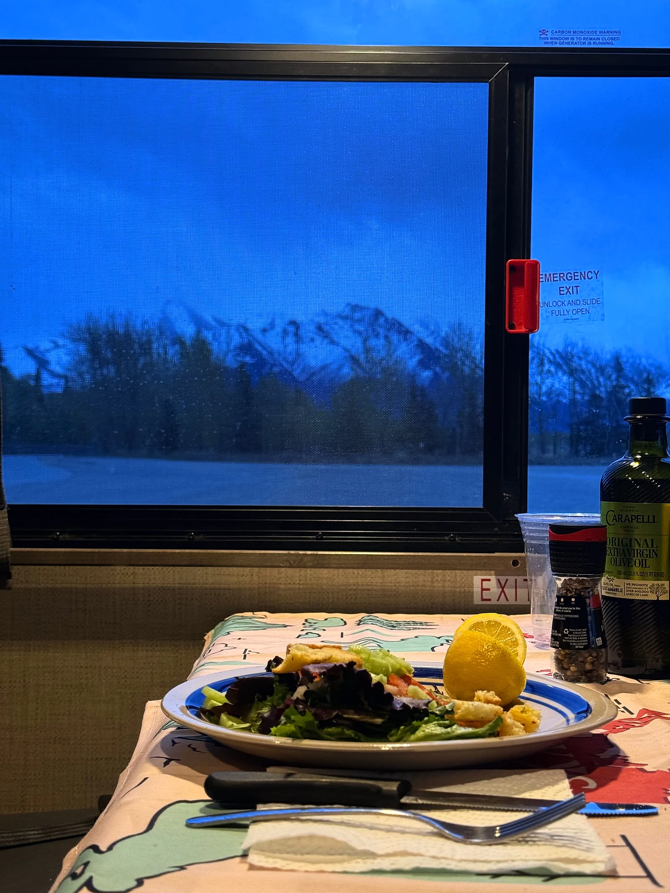

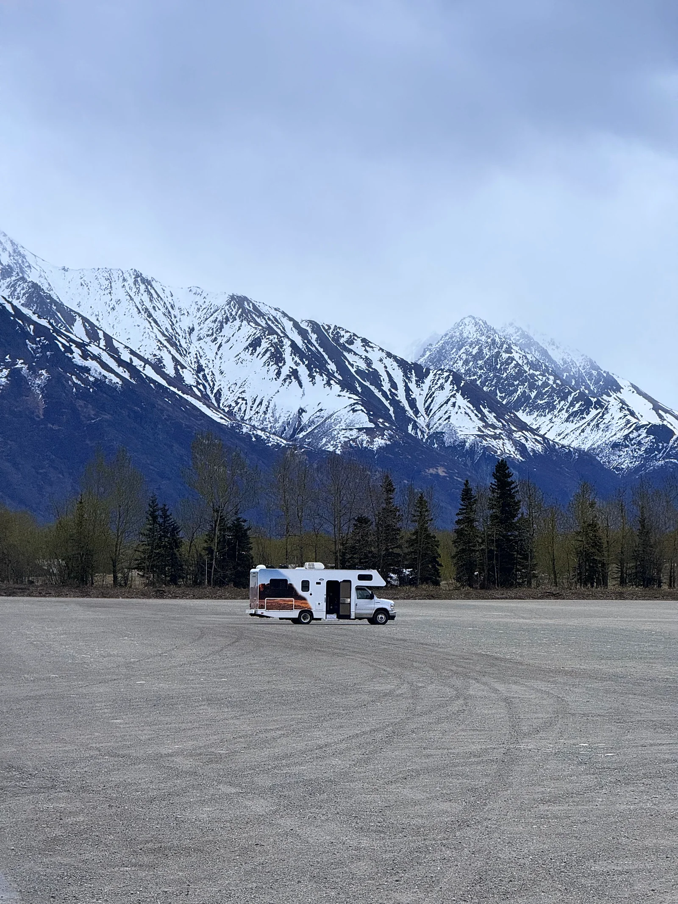

O outro lado é o ritmo. Um motorhome é mais lento que um carro, gasta mais combustível e exige atenção redobrada em curvas, subidas e estradas de cascalho. Ele também não cabe em qualquer estacionamento de cidade.

## Retirada e devolução em Anchorage

O que fazer na cidade e nos arredores, com dicas para os dias de retirada e devolução, está no guia de [Anchorage e arredores](/blog/anchorage-e-arredores-o-que-fazer/).

Retiramos e devolvemos o motorhome em Anchorage, onde fica o maior aeroporto do estado. Isso permitiu montar o roteiro como um circuito fechado, sem taxa de devolução em outra cidade. O nosso era um motorhome classe C, aquele com a cama sobre a cabine do motorista, montado sobre um chassi Ford.

No primeiro dia, com o motorhome já na mão, ainda sobrou tempo para estacionar e organizar tudo antes de pegar a estrada no dia seguinte. Vale reservar a tarde da retirada para isso.

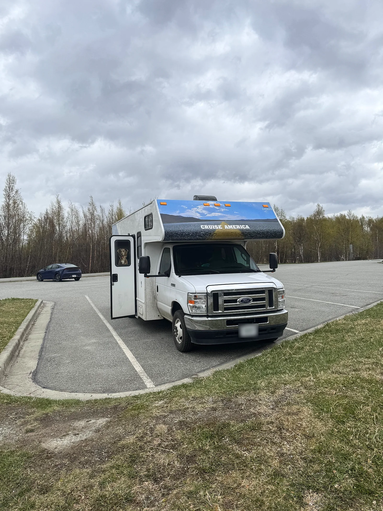

:::dica
Na retirada, peça uma demonstração completa e teste tudo antes de sair: aquecimento, fogão, geladeira, gerador, bomba de água, descarga, válvulas dos tanques de despejo e nível do propano. Confira também o estepe e as ferramentas. Na Dalton ou na Tok Cut-Off, a próxima oficina pode estar a centenas de quilômetros.
:::

## Regras das locadoras: a Dalton Highway e as estradas de cascalho

A Dalton Highway é o caso mais delicado. A estrada tem 414 milhas (666 km), é quase toda de cascalho e foi feita para os caminhões que abastecem os campos de petróleo de Prudhoe Bay. Muitas locadoras restringem a Dalton no contrato, e as que permitem costumam impor limites de trecho, de veículo ou de época.

Os contratos que consultamos mostram como as regras variam:

| Locadora | O que diz o contrato sobre a Dalton | Observação |
|---|---|---|
| Great Alaskan Holidays | Proíbe a Dalton do Círculo Polar a Prudhoe Bay | Em estradas restritas, limite de 25 mph (40 km/h) e checagem dos pneus traseiros a cada 10 a 15 milhas |
| Fraserway | Restringe o trecho de Coldfoot a Prudhoe Bay a caminhonetes 4x4, de 15 de junho a 15 de setembro | Dirigir em área restrita anula o seguro e a cobertura de danos |
| Cruise America | Os termos que encontramos, numa cópia de revendedor sem data, permitem "todas as estradas públicas e/ou numeradas" do Alasca e proíbem "estradas secundárias sem pavimento" | A empresa diz que pode restringir estradas conforme as condições; violar as regras anula a cobertura de danos |

Nós levamos o motorhome até o Círculo Polar Ártico, na milha 115, e voltamos no dia seguinte. No balcão da retirada, não fomos informados de nenhuma restrição para esse trecho da Dalton. Mesmo assim, os contratos padrão da maioria das locadoras do Alasca restringem estradas não pavimentadas ou exigem autorização específica, e danos causados pelo cascalho, como pneus furados e para-brisa trincado, costumam ficar fora da cobertura do seguro. Antes de subir além de Livengood, onde começa a Dalton, confira **por escrito** as cláusulas do seu contrato e até onde o seguro cobre. Como foram os dois dias na estrada, com combustível e checklist de segurança, está no [guia da Dalton Highway e do Círculo Polar Ártico](/blog/dalton-highway-circulo-polar-artico-alasca/).

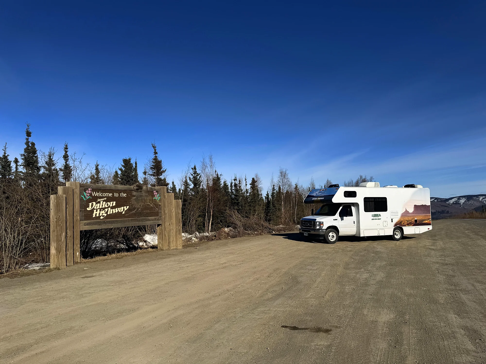

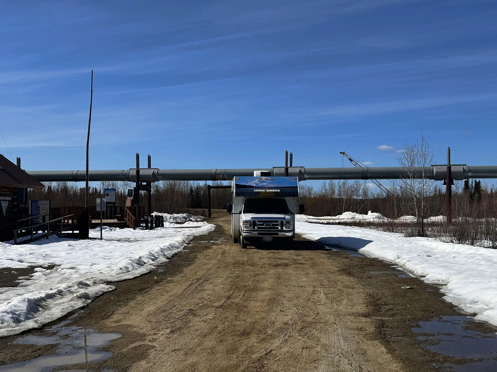

:::alerta
Na Dalton, a própria Cruise America recomenda, num artigo sobre pernoites no Alasca, manter a velocidade em 35 mph (56 km/h) ou menos para evitar furos e estouros, e levar um estepe que você saiba trocar, porque a ajuda pode demorar. A BLM, que administra as terras da estrada, pede faróis acesos o tempo todo. Não há sinal de celular na maior parte do trajeto.
:::

Outras estradas que aparecem nas listas de restrição das locadoras são a Denali Highway, a McCarthy Road e a Nabesna Road, todas de cascalho. A Denali Park Road, dentro do parque, tem regras próprias do Serviço Nacional de Parques: em maio, antes dos ônibus da temporada, os carros particulares costumam poder ir até Teklanika, na milha 30.

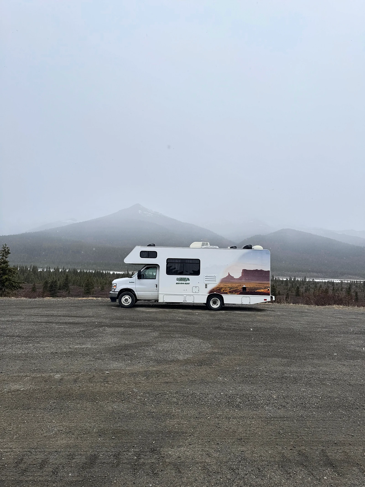

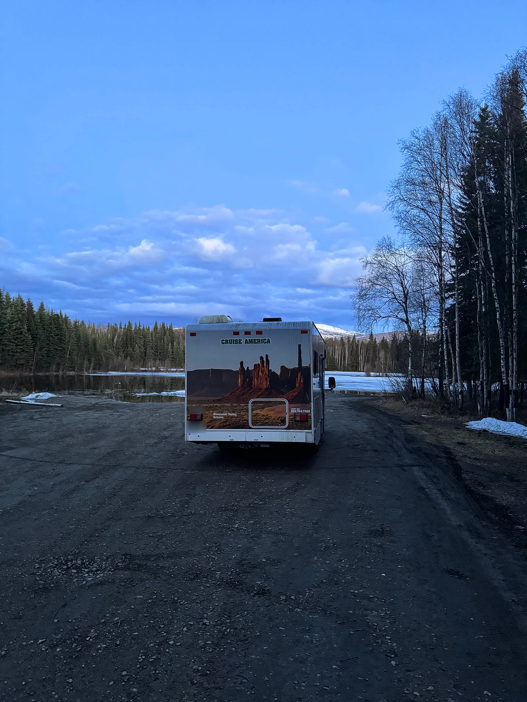

## Dirigir um motorhome nas estradas do Alasca

As estradas principais do roteiro, como a Parks, a Richardson, a Glenn, a Seward e a Alaska Highway, são asfaltadas e bem sinalizadas. Mesmo assim, o Alasca tem particularidades:

- **Ondulações do congelamento.** O turismo oficial do estado avisa que mesmo as rodovias pavimentadas têm ondulações causadas pelo congelamento do solo e buracos. Num motorhome, elas sacodem tudo o que estiver solto dentro.
- **Faróis acesos e ultrapassagem.** A lei do Alasca exige faróis acesos na maioria das rodovias. Se cinco ou mais veículos se acumularem atrás de você, encoste para deixá-los passar.
- **Fauna na pista.** Vimos alces à beira da estrada em Seward e perto de Kalifornsky Beach, na Península Kenai. Para parar e observar, use os acostamentos largos e as áreas de estacionamento.
- **Neve em maio.** Pegamos neve no trecho alto da Parks Highway, a caminho do Denali, no [Thompson Pass](/blog/valdez-richardson-highway-thompson-pass-alasca/) e na Glenn Highway. Nos dias de neve, reduza a velocidade e aumente a distância do veículo da frente.
- **Condições em tempo real.** O site Alaska 511, do governo do estado, mostra fechamentos, obras e câmeras das estradas.

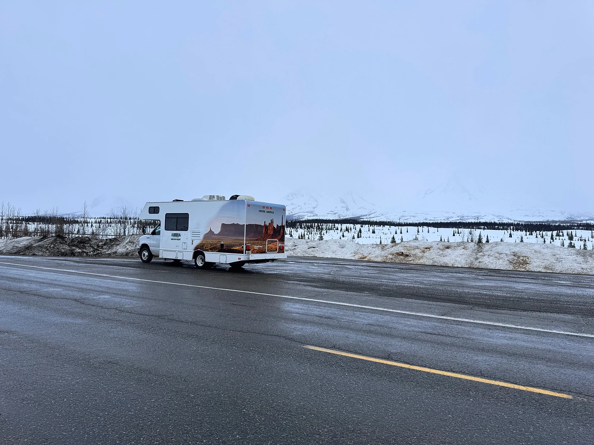

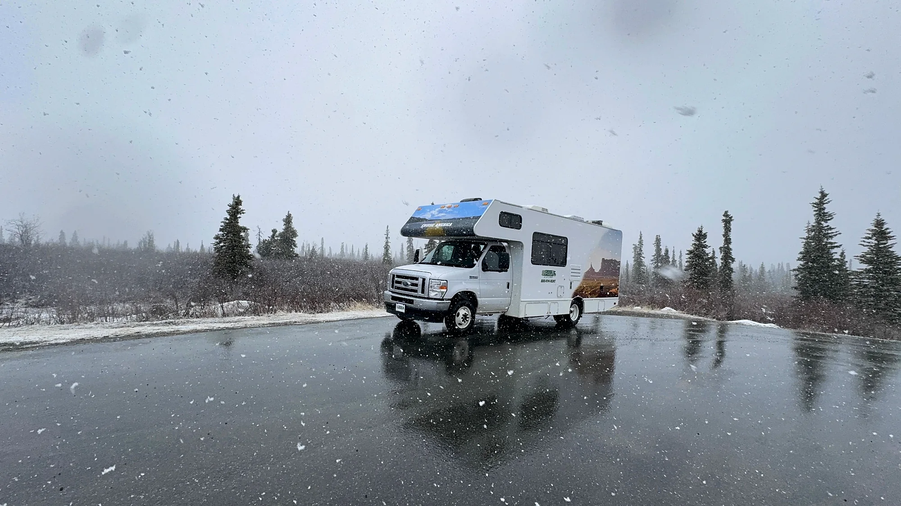

:::galeria
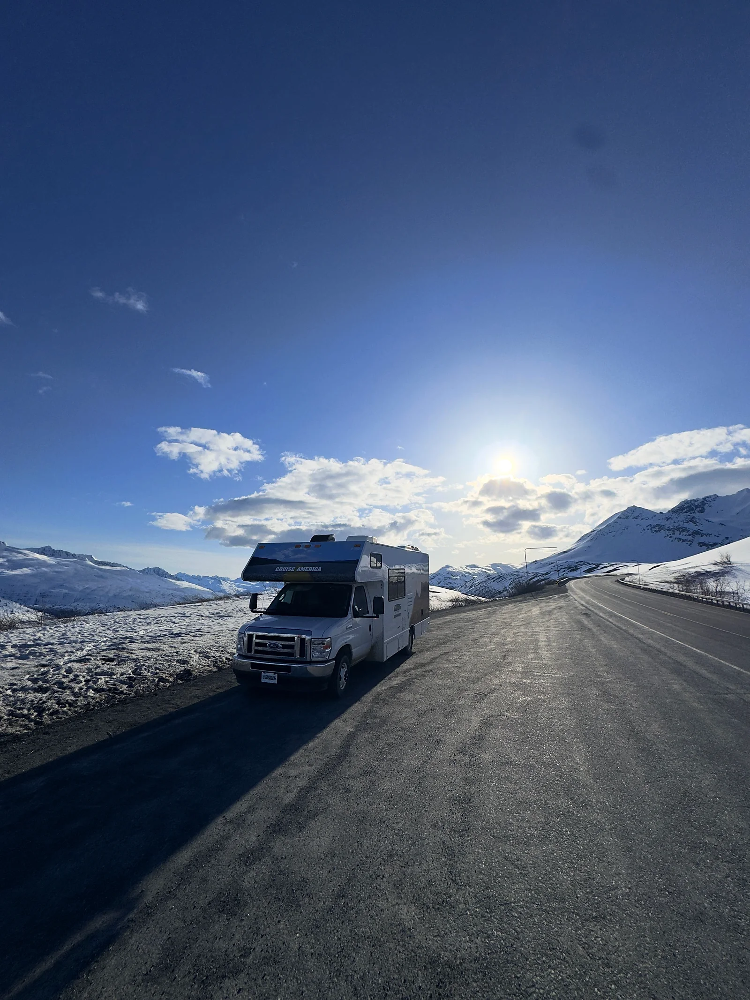

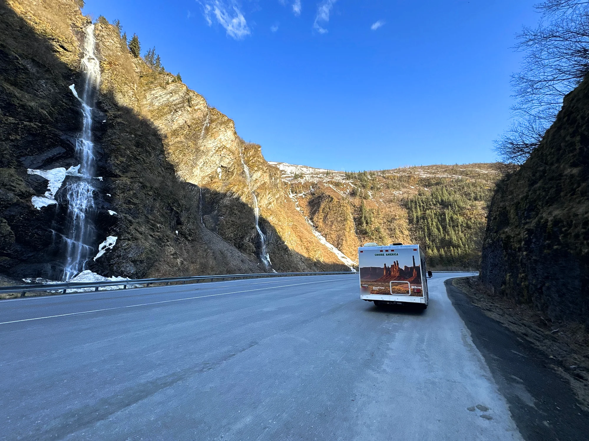

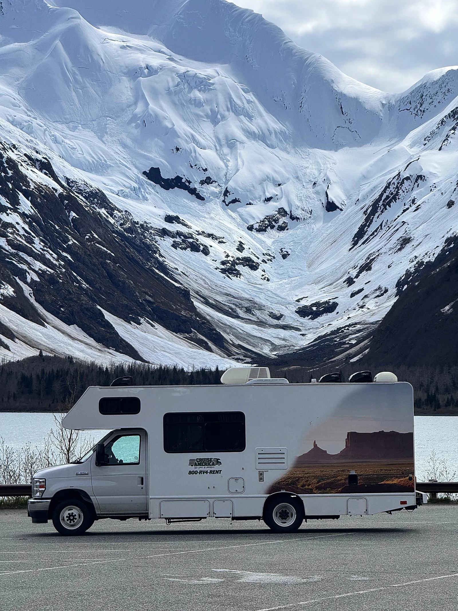
:::

### O túnel de Whittier com motorhome

Para chegar a Whittier, é preciso passar pelo túnel Anton Anderson, que os carros dividem com a ferrovia. O tráfego muda de sentido a cada meia hora e os veículos esperam num pátio, separados por tipo. Segundo o Departamento de Transportes do Alasca, a altura normal permitida é de até 14 pés (4,3 m) e a largura de até 10 pés (3 m). O pedágio vale para ida e volta e muda conforme o comprimento do veículo. Pela tabela oficial em vigor desde 2015, um motorhome com menos de 28 pés (8,5 m) sem reboque paga US$ 13, e um de 28 pés ou mais, US$ 22. O pagamento aceita dinheiro, Visa e Mastercard, e o bilhete também pode ser comprado pela internet. Também há regras para o propano: recipientes portáteis podem passar com até 100 libras (45 kg) no total.

:::dica
Consulte o horário do túnel no site do Departamento de Transportes antes de sair e chegue com folga. Se perder a janela, a próxima saída no mesmo sentido só vem em cerca de uma hora, e os trens de carga usam o túnel à noite, quando ele fecha para os carros.
:::

## Onde dormir: campings e pernoite fora de camping

Em maio, muitos campings ainda estão fechados ou funcionando parcialmente. A maioria abre de maio a setembro, e os da BLM na Dalton operam por ordem de chegada, sem reservas. Por isso, combinamos campings com estrutura e pernoites em áreas abertas à beira da estrada.

**Campings com estrutura.** Em Chena Lakes, perto de Fairbanks, ficamos numa vaga de cascalho entre as árvores, com mesa de piquenique. Na região de Sterling, na Península Kenai, jantamos e tomamos o café da manhã numa mesa de piquenique de frente para a água.

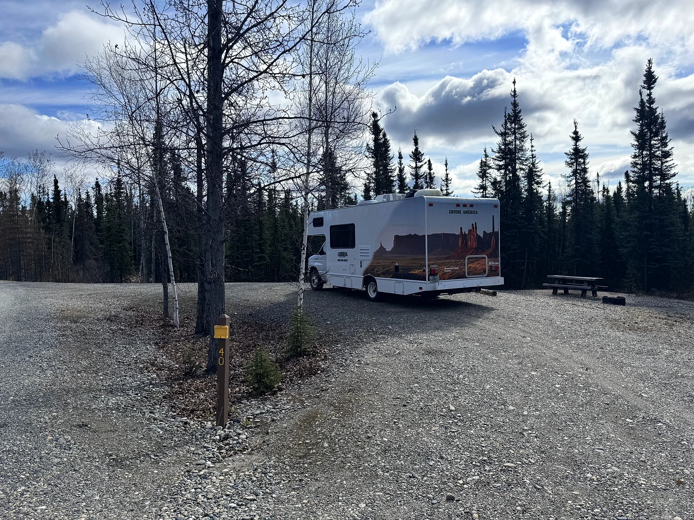

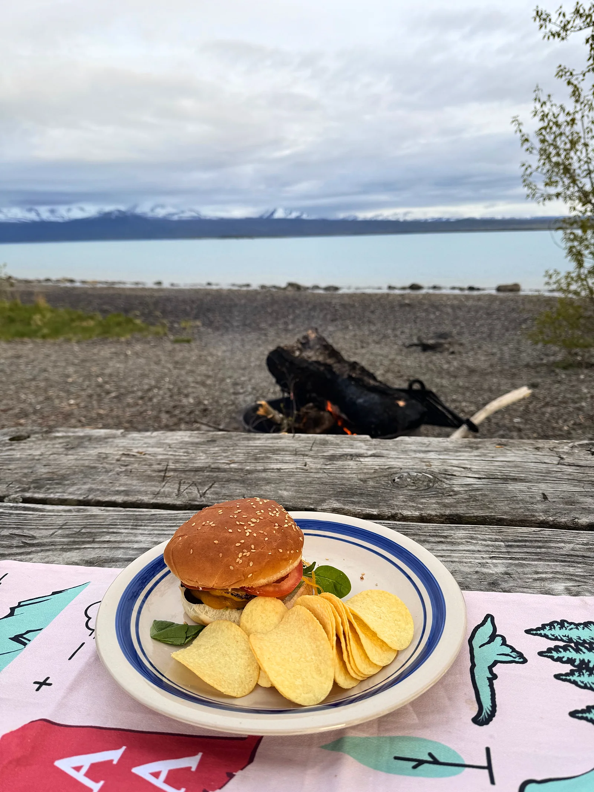

**Pernoite fora de camping.** O Alasca é conhecido por permitir pernoite em boa parte das rodovias. Segundo o turismo oficial do estado, o pernoite deve ser feito só em acostamentos e áreas de parada sem placa de "no camping", fora de propriedades particulares e sem bloquear acessos. A Cruise America lembra que ele costuma ser proibido nas áreas urbanas e que, fora dos campings, não há água nem eletricidade. Foi assim que dormimos na Tok Cut-Off, num pátio de cascalho a cerca de 30 km de Tok, e na Chena Hot Springs Road, à beira de um lago. Para Seward e Homer, onde as prefeituras mantêm campings na orla e no Spit, veja o [guia de Seward e do Exit Glacier](/blog/seward-exit-glacier-alasca/) e o [guia de Homer e da Península Kenai](/blog/homer-peninsula-kenai-alasca/).

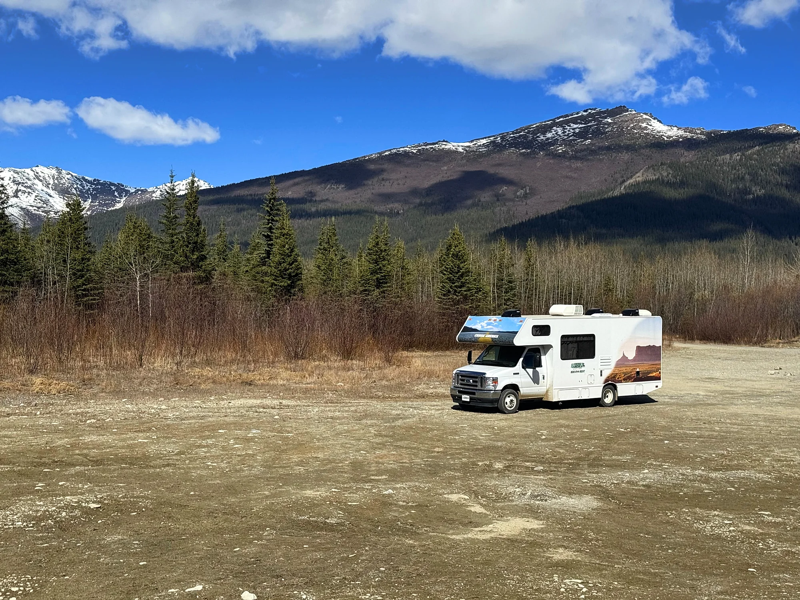

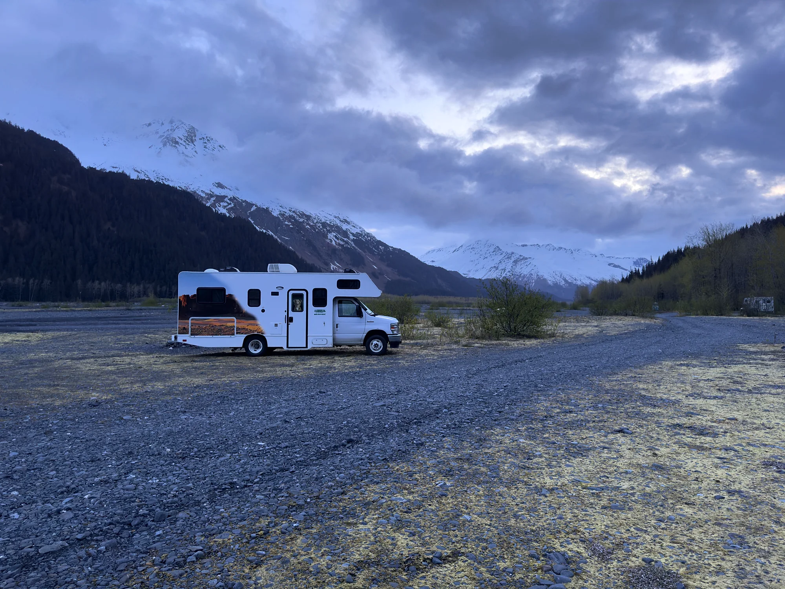

**No Círculo Polar Ártico.** Passamos a noite de 8 para 9 de maio no Círculo Polar. No começo de maio, ainda havia muita neve acumulada na região, e o acesso ao camping oficial da BLM, o Arctic Circle Campground, cerca de 1 km adiante, estava fechado e tomado pela neve. Por isso, acabamos dormindo no estacionamento da placa.

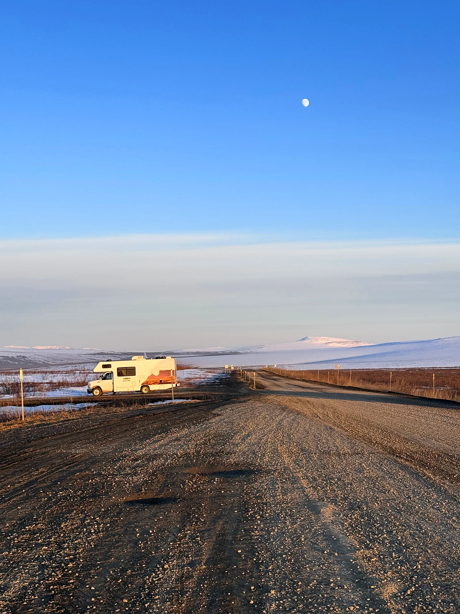

:::alerta
Há placas no local proibindo o pernoite na área do monumento, o Arctic Circle Wayside. Com o acesso aberto, o lugar regulamentado para passar a noite é o Arctic Circle Campground, da BLM, cerca de 1 km adiante, por uma estrada lateral que sai do fim do estacionamento. Ele tem 19 vagas, banheiros secos e nenhuma água, custa US$ 12 por noite e funciona por ordem de chegada, sem reservas, mais ou menos de maio a setembro. No começo da temporada, confira se o acesso já foi liberado.

Em qualquer lugar, antes de parar para dormir fora de um camping, procure placas de proibição e certifique-se de que não está em terra particular. Na Dalton, a BLM limita o acampamento disperso a 14 dias no mesmo lugar e pede que todo o lixo seja levado embora. Em cidades como Anchorage, Fairbanks, Seward e Homer, prefira campings ou parques de motorhome.
:::

## Água, aquecimento e propano

Um motorhome como o nosso é autossuficiente por alguns dias: tem tanque de água limpa, tanques para a água usada e o esgoto, aquecimento e fogão a propano e um gerador. Fora dos campings com ligação, tudo depende do que está nos tanques.

- **Água.** Em maio, muitos campings ainda não têm ligações de água nas vagas. Encha o tanque sempre que encontrar um ponto de abastecimento, principalmente antes de trechos isolados. Na Dalton, o Five Mile Campground, na milha 60, tem água potável; o Arctic Circle Campground não tem.
- **Aquecimento.** As noites de maio são frias nas regiões altas e no interior. O aquecimento funciona com o propano, e o ventilador gasta a bateria. Monitore os dois.
- **Propano.** Comece a viagem com o cilindro cheio e reabasteça nas cidades maiores. O fogão, o aquecimento e, em muitos modelos, a geladeira dependem dele.
- **Gerador.** Ele recarrega as baterias e alimenta as tomadas quando não há ligação elétrica. Respeite os horários de silêncio dos campings.

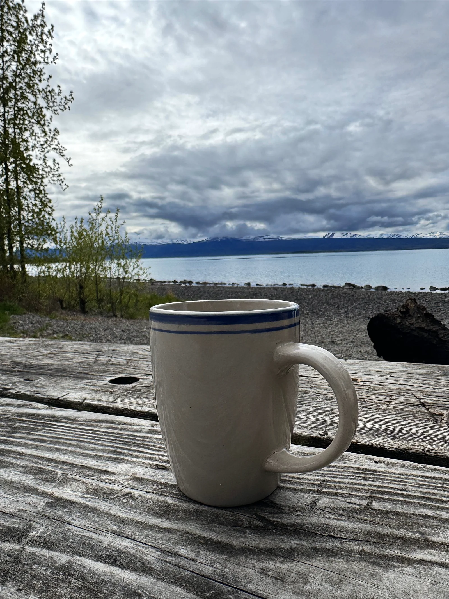

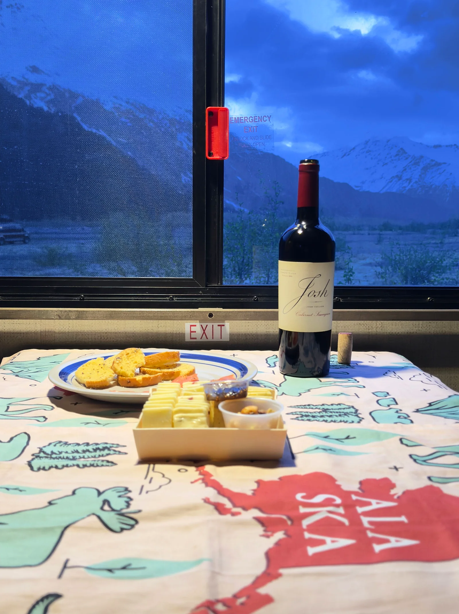

## Despejo: as dump stations

Os tanques de água usada e de esgoto precisam ser esvaziados em pontos próprios, as dump stations. O turismo oficial do Alasca recomenda incluir essas paradas no planejamento, porque elas nem sempre ficam perto dos campings. Nas cidades maiores, há pontos em postos de combustível e parques de motorhome.

Na Dalton, segundo a BLM, o único ponto de despejo da estrada fica no Five Mile Campground, na milha 60, logo ao norte do rio Yukon. O uso custa US$ 5, pago em dinheiro, cheque ou cartão. Para pagar com cartão, é preciso baixar o aplicativo Recreation.gov antes de sair de Fairbanks, porque não há sinal no local.

:::dica
Esvazie os tanques e encha a água limpa em Fairbanks antes de subir a Dalton, e de novo na volta. Na Península Kenai, com cidades mais próximas umas das outras, é mais fácil encontrar pontos de despejo.
:::

## Vida a bordo com o sol de maio

O que mais surpreende em maio é a luz. Na Finger Mountain, em 8 de maio, o sol só tocou o horizonte por volta das 22h20, e em Fairbanks o crepúsculo civil contínuo começa por volta de 17 de maio. Na prática, a noite quase não escurece. Uma máscara de dormir e cortinas bem fechadas fazem diferença para descansar.

A outra surpresa é o silêncio. Nos pernoites fora de camping, como na Tok Cut-Off e na Chena Hot Springs Road, acordamos sem nenhum outro veículo à vista, com montanhas e lagos ainda congelados na janela.

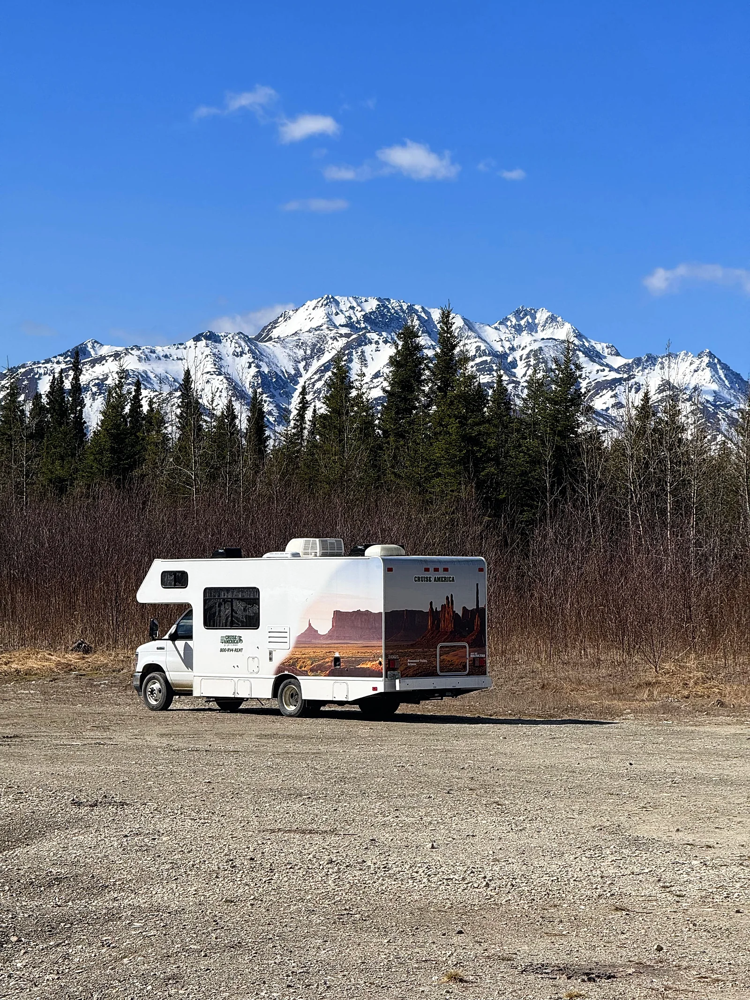

## O que entra no custo

O orçamento completo, com três cenários de 16 dias para duas pessoas, está no [guia de quanto custa viajar para o Alasca](/blog/quanto-custa-viajar-para-o-alasca/).

O preço de uma viagem de motorhome no Alasca vai muito além da diária. Na hora de orçar, considere:

- **Diária do motorhome:** varia com o tamanho do veículo e a época. As semanas de maio e de setembro costumam ser mais baratas que o pico do verão.
- **Quilometragem:** as locadoras cobram por milha rodada ou vendem pacotes de milhas. Num circuito como o nosso, com a Dalton e a volta por Tok e Valdez, a distância é grande.
- **Kits:** utensílios de cozinha e roupa de cama costumam ser cobrados à parte.
- **Combustível e propano:** um motorhome classe C consome bem mais que um carro, e o combustível é mais caro nas regiões remotas.
- **Campings e despejo:** os campings da BLM na Dalton custam US$ 12 por noite, e a dump station do Five Mile, US$ 5 por uso. Os parques de motorhome com ligação elétrica e de água cobram bem mais.
- **Pedágio do túnel de Whittier:** US$ 13 ida e volta para motorhomes com menos de 28 pés, ou US$ 22 para os maiores, pela tabela oficial.
- **Seguro e franquia:** confira o que a cobertura básica inclui e o que fica de fora, como pneus, para-brisa e estradas restritas.

:::dica
Reserve com bastante antecedência e fique de olho nas promoções. Nós reservamos o motorhome meses antes, aproveitando uma promoção de Black Friday, o que reduziu bastante o valor da diária e dos pacotes de milhas para maio.
:::

## Guias de cada região

Para cada etapa da viagem, há um guia com o que fizemos, distâncias e dicas práticas: o [roteiro completo de 16 dias](/blog/roteiro-alasca-16-dias-motorhome/), o [Denali em maio](/blog/denali-national-park-em-maio-alasca/), [Fairbanks, Chena Hot Springs e North Pole](/blog/fairbanks-chena-hot-springs-north-pole-alasca/), a [Dalton Highway e o Círculo Polar Ártico](/blog/dalton-highway-circulo-polar-artico-alasca/), [Valdez e a Richardson Highway](/blog/valdez-richardson-highway-thompson-pass-alasca/), [Seward e o Exit Glacier](/blog/seward-exit-glacier-alasca/), [Homer e a Península Kenai](/blog/homer-peninsula-kenai-alasca/) e [Whittier e o Túnel Anton Anderson](/blog/whittier-tunel-anton-anderson-alasca/). Para planejar, veja também [quanto custa viajar para o Alasca](/blog/quanto-custa-viajar-para-o-alasca/), a [melhor época para ir](/blog/melhor-epoca-para-ir-ao-alasca-maio/) as [5 estradas mais cênicas do Alasca](/blog/estradas-mais-cenicas-do-alasca-road-trip/), as [geleiras de fácil acesso sem cruzeiro](/blog/geleiras-do-alasca-sem-cruzeiro/) e [Anchorage e arredores](/blog/anchorage-e-arredores-o-que-fazer/).

## Perguntas frequentes

### Dá para levar um motorhome alugado até o Círculo Polar Ártico?

Depende do contrato. A maioria das locadoras do Alasca restringe estradas não pavimentadas ou exige autorização específica, e danos no cascalho costumam ficar fora do seguro. Algumas permitem só parte da Dalton. A Great Alaskan Holidays, por exemplo, proíbe o trecho do Círculo Polar a Prudhoe Bay. Antes de reservar, peça à sua locadora, por escrito, a lista de estradas permitidas e confirme a cobertura do seguro.

### Pode dormir em qualquer lugar com motorhome no Alasca?

Não em qualquer lugar. O pernoite fora de camping é aceito em acostamentos e áreas de parada sem placa de proibição, fora de terras particulares e sem bloquear acessos. Nas cidades, ele costuma ser proibido. No Círculo Polar Ártico, há placas proibindo o pernoite na área do monumento; com o acesso aberto, use o Arctic Circle Campground, da BLM, a cerca de 1 km dali, por US$ 12 a noite.

### Maio é uma boa época para viajar de motorhome no Alasca?

Para nós, foi. As estradas estavam vazias, os dias eram longuíssimos e a Denali Park Road estava aberta a carros particulares até Teklanika. Em troca, parte dos campings ainda estava fechada ou sem ligação de água, e pegamos neve em três passagens altas.

### Onde esvaziar os tanques do motorhome na Dalton Highway?

No Five Mile Campground, na milha 60, o único ponto de despejo da estrada segundo a BLM. O uso custa US$ 5. Para pagar com cartão, baixe o aplicativo Recreation.gov antes de sair de Fairbanks.

### Motorhome pode passar pelo túnel de Whittier?

Pode. O túnel Anton Anderson recebe motorhomes, que esperam num pátio separado e pagam US$ 13 ou US$ 22 de pedágio, ida e volta, conforme o comprimento. A altura normal permitida é de até 14 pés (4,3 m). Confira o horário no site do Departamento de Transportes do Alasca antes de sair.

## Fontes consultadas

- [Great Alaskan Holidays: estradas restritas e proibidas para os motorhomes](https://www.greatalaskanholidays.com/alaska-rv-rentals/important-rental-information/restrictions-on-operating-the-motorhome/)
- [Fraserway: termos e condições do aluguel](https://rent.fraserway.com/rent-terms-conditions.html)
- [Termos e condições da Cruise America (cópia de revendedor)](http://www.usandcanadatravel.com/motorhome_hire/cruise_america/terms_and_condition.shtml)
- [Cruise America: pernoite fora de camping no Alasca](https://www.cruiseamerica.com/trip-inspiration/boondocking-in-alaska)
- [Alaska Travel: estradas proibidas pelas locadoras](https://alaskatravel.com/blog/banned-roads-in-alaska)
- [Travel Alaska: dicas para viajar de motorhome no Alasca](https://www.travelalaska.com/explore-alaska/articles/tips-rv-travel-alaska)
- [Travel Alaska: Dalton Highway saindo de Fairbanks](https://www.travelalaska.com/explore-alaska/itineraries/dalton_highway_road_trip_from_fairbanks)
- [BLM: recreação na Dalton Highway (campings, despejo e regras)](https://www.blm.gov/learn/interpretive-centers/arctic-interagency-visitor-center/dalton-highway-recreation)
- [BLM: Arctic Circle Wayside](https://www.blm.gov/visit/arctic-circle-wayside)
- [NPS Denali: abertura da Denali Park Road até Teklanika em 2025](https://www.nps.gov/dena/learn/news/road-open-tek-2025.htm)
- [Departamento de Transportes do Alasca: túnel de Whittier](https://dot.alaska.gov/creg/whittiertunnel/)
- [Departamento de Transportes do Alasca: perguntas frequentes do túnel de Whittier](https://dot.alaska.gov/creg/whittiertunnel/faq.shtml)
- [Departamento de Transportes do Alasca: tarifas do túnel de Whittier](https://dot.alaska.gov/creg/whittiertunnel/tolls.shtml)
- [Departamento de Transportes do Alasca: horários do túnel de Whittier](https://dot.alaska.gov/creg/whittiertunnel/schedule.shtml)
- [Outdoorsy: alugar um motorhome no Alasca](https://www.outdoorsy.com/blog/renting-an-rv-in-alaska-cost-timing-and-how-to-plan-it)
- [Explore Fairbanks: crepúsculo contínuo no verão](https://www.explorefairbanks.com/blog/post/70-straight-days-of-sunshine/)
