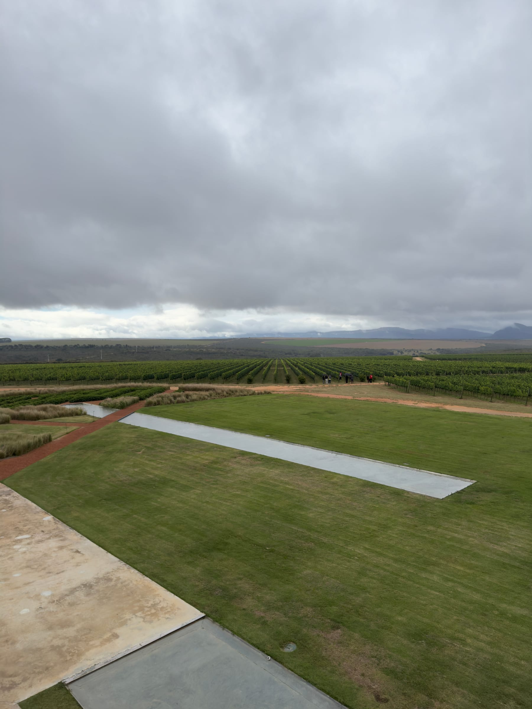
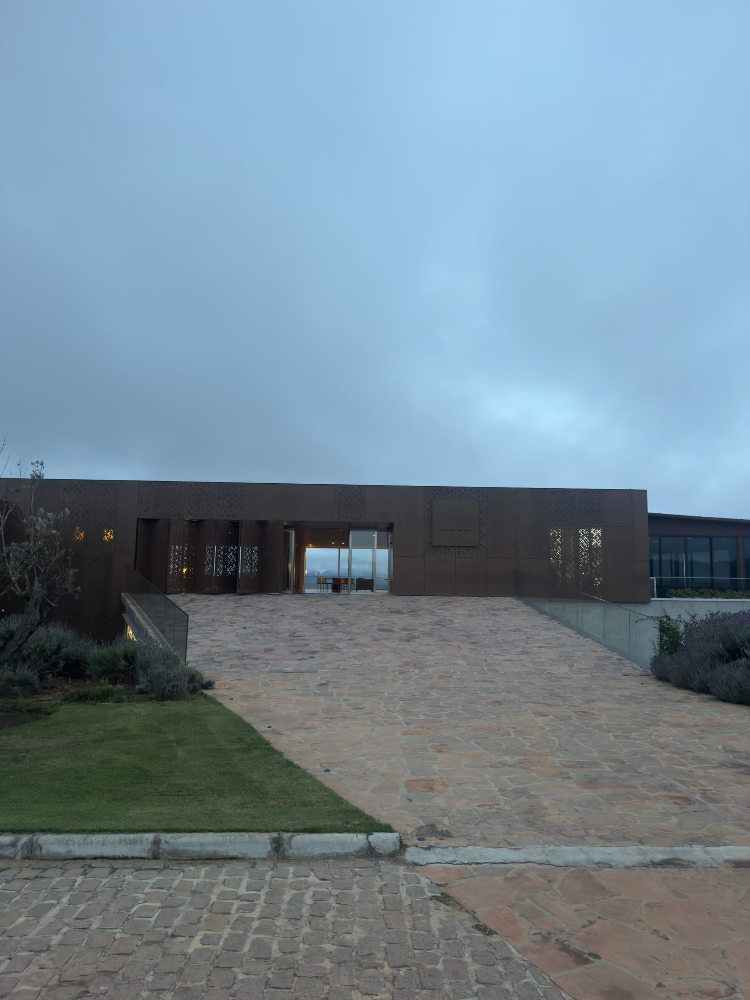
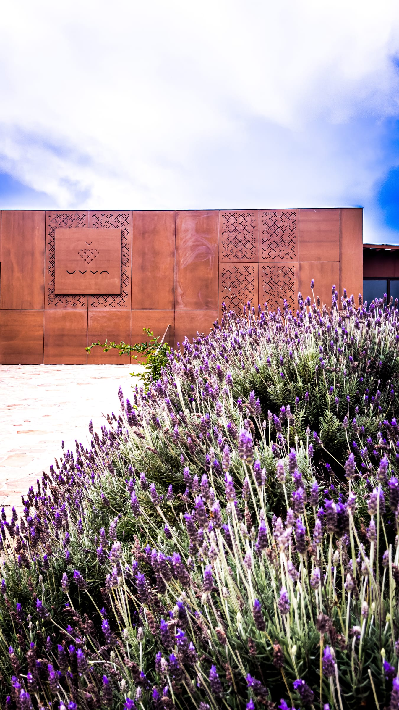
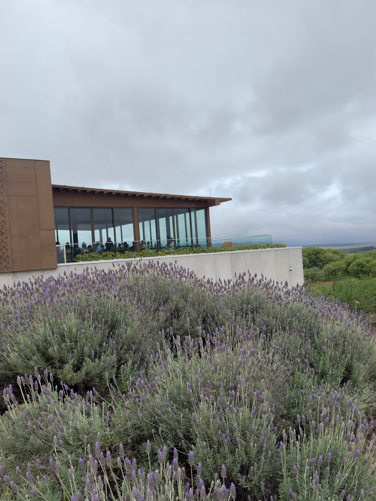
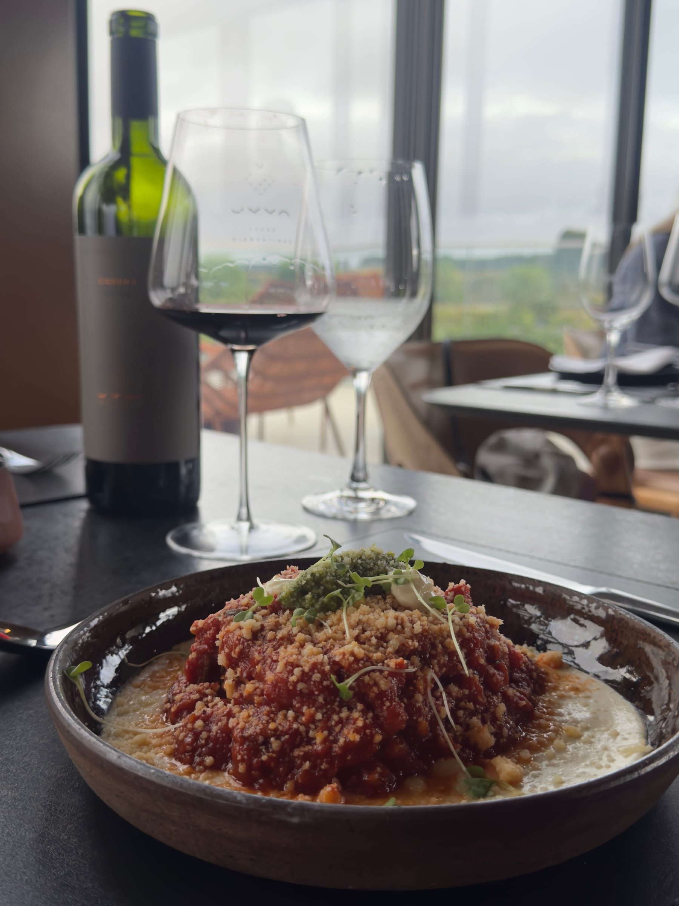
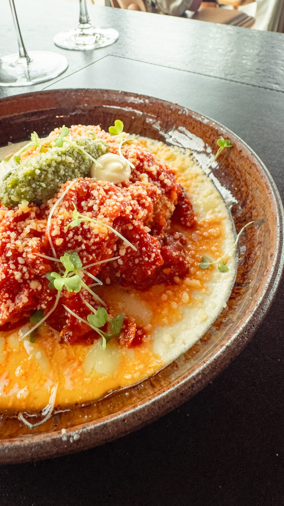
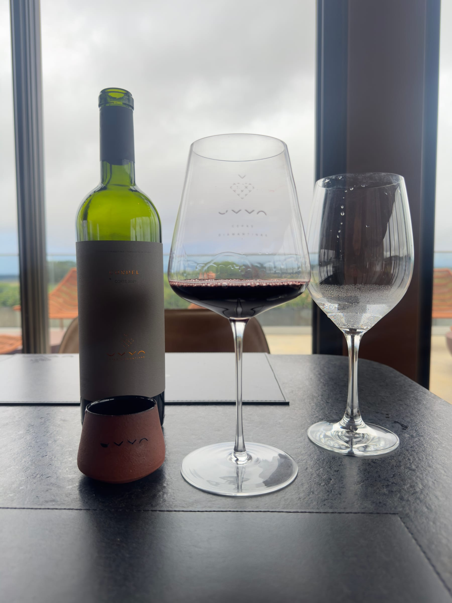
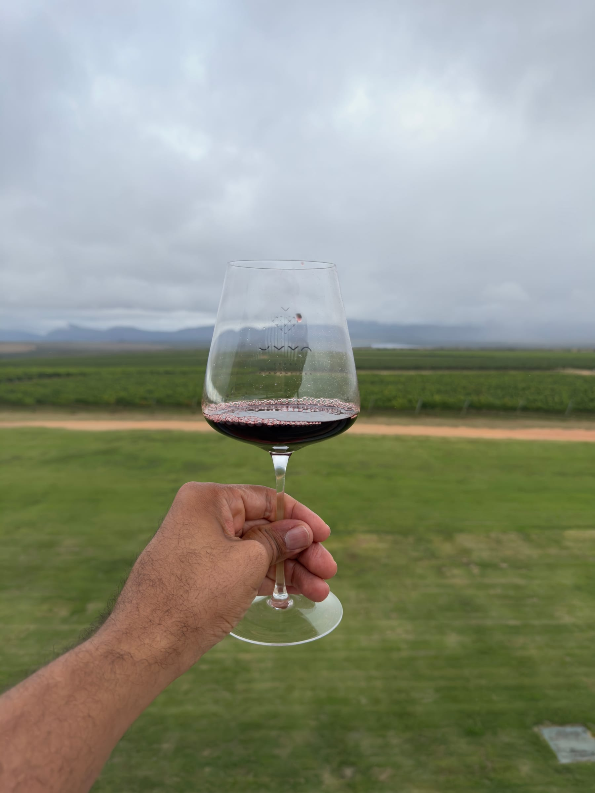
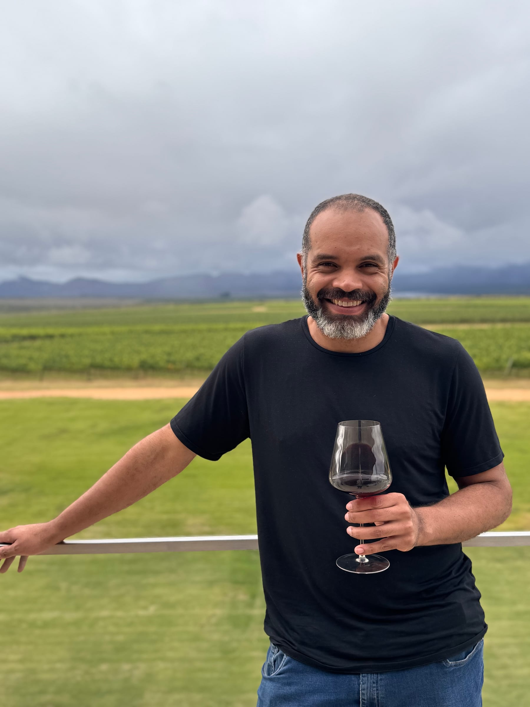

A Vinícola UVVA mostrou que a Chapada Diamantina também é terra de vinho. A cerca de 25 minutos de Mucugê, ela reúne vinhedos de altitude, um prédio contemporâneo integrado à paisagem e o restaurante Arenito, onde almoçamos com vista para os parreirais.

Este guia conta como é a visita e o almoço e o que você precisa saber para reservar. Para encaixar a vinícola no roteiro, veja também o [guia de Mucugê](/blog/o-que-fazer-em-mucuge-chapada-diamantina/) e o [roteiro completo pela Chapada Diamantina](/blog/roteiro-chapada-diamantina/). **As informações foram pesquisadas em novembro de 2026.** Preços, horários e regras mudam, por isso confirme no site oficial antes de ir.

## Vinhos de inverno no alto da serra

A UVVA é um dos projetos pioneiros de vinhos finos na Chapada Diamantina. Os vinhedos ficam a cerca de 1.200 metros de altitude, em 52 hectares com nove variedades de uva, numa fazenda da família Borré. Os primeiros vinhos foram produzidos em 2018, e a vinícola foi inaugurada em 2022.

O segredo está na dupla poda, técnica difundida pela EPAMIG que inverte o ciclo da videira. Na UVVA, as podas acontecem em setembro e em janeiro, e a colheita fica para junho e julho, os meses mais secos e frios da região. Daí o nome "vinhos de inverno", como os blends da trilogia Bateia, Cordel e Diamã.

### Arquitetura integrada à paisagem

O prédio tem quatro andares e foi pensado para conversar com a paisagem: fachadas em tons terrosos, cobogós que filtram a luz e grandes panos de vidro voltados para os vinhedos. A vinícola descreve o projeto como contemporâneo e sustentável.

## O almoço no restaurante Arenito

O Arenito é o restaurante da vinícola, comandado pelo chef André Chequer, e foi incluído pela revista Wine Enthusiast entre os 57 melhores restaurantes de vinícolas do mundo. O salão é envidraçado e se abre para os parreirais, com a serra ao fundo.

A experiência à mesa combina pratos com produtos regionais tratados de forma sofisticada e a harmonização com os rótulos da casa. No nosso almoço, o destaque foi um ragu com farofa e ervas frescas, servido sobre um creme macio, bem alinhado à proposta autoral do Arenito. Almoçar olhando para os vinhedos de onde vem o vinho da taça é o que torna o programa tão especial.

:::alerta
O Arenito funciona exclusivamente com reserva prévia, feita pelo site oficial da vinícola. No agendamento, é cobrado um sinal de R$ 80 por pessoa para confirmar a mesa. Segundo o regulamento da vinícola, esse valor é integralmente convertido em consumação de alimentos no restaurante. Pela alta procura, reserve com boa antecedência.
:::

## Visitação, cave e loja

Além do almoço, a vinícola oferece visitas. Na mais completa, de cerca de duas horas, um enólogo conduz o grupo pelos vinhedos, pelas salas de tanques e pela cave subterrânea, onde ficam as barricas. A visita passa também pelo espaço expositivo, que recebeu obras do artista visual baiano Marcos Zacarides.

| Item | Como funciona |
|---|---|
| Visitação simples | R$ 160 por pessoa, valor convertido em crédito na loja |
| Dias | Terça a domingo, inclusive feriados; fechada às segundas |
| Horários de visita | Das 10h às 12h e das 14h às 17h30 |
| Reserva | Obrigatória, pelo site oficial |
| Idade | Menores de 12 anos não podem entrar na propriedade |

Na loja, dá para comprar os rótulos da casa para levar. A vinícola também vende pela loja online.

:::alerta
Menores de 12 anos não podem entrar na vinícola, e a compra e o consumo de vinho são permitidos só a partir dos 18 anos. Se estiver viajando com crianças, planeje outro programa para elas nesse dia.
:::

## Logística e dicas práticas

A UVVA fica às margens da BA-142, a cerca de 25 km do centro de Mucugê, por estrada asfaltada. São de 25 a 30 minutos de carro. Para conhecer a cidade e outros atrativos da região, consulte o [guia de Mucugê](/blog/o-que-fazer-em-mucuge-chapada-diamantina/).

:::logistica
Vai degustar? Defina antes quem será o motorista da rodada ou contrate um transfer a partir de Mucugê. Assim todos aproveitam os vinhos com tranquilidade, e ninguém dirige na estrada depois de beber.
:::

*Nota de transparência: a experiência na Vinícola UVVA foi realizada e custeada integralmente por nós, de forma independente e sem qualquer vínculo comercial ou cortesia. Nossas avaliações refletem exclusivamente a experiência real vivida no local.*

## Perguntas frequentes

### Precisa reservar para almoçar na Vinícola UVVA?

Sim. O restaurante Arenito funciona só com reserva prévia pelo site oficial, com sinal de R$ 80 por pessoa, integralmente convertido em consumação de alimentos no restaurante.

### Quanto custa visitar a Vinícola UVVA?

A visitação simples custa R$ 160 por pessoa, valor que pode ser usado em compras na loja. Confirme os preços dos outros tipos de visita no site oficial.

### Pode levar crianças?

Não. Segundo a vinícola, menores de 12 anos não podem entrar na propriedade.

## Fontes consultadas

Acesso em novembro de 2026.

- [Vinícola UVVA: visitação](https://vinicolauvva.com.br/tours/visitacao/)
- [Vinícola UVVA: enoturismo](https://vinicolauvva.com.br/enoturismo/)
- [Vinícola UVVA: trilogia de blends](https://vinicolauvva.com.br/blog/trilogia-uvva/)
- [Exame: os vinhos de inverno da UVVA](https://exame.com/casual/com-vinhos-de-inverno-vinicola-uvva-quer-que-a-chapada-diamantina-vire-referencia-no-setor/)
- [Brasil de Vinhos: Arenito entre os melhores restaurantes de vinícolas do mundo](https://brasildevinhos.com.br/arenito-da-vinicola-uvva-entre-os-57-melhores-restaurantes-de-vinicolas-do-mundo-segundo-a-wine-enthusiast/)
- [CNN Brasil: onde os chefs comem, com André Chequer](https://www.cnnbrasil.com.br/viagemegastronomia/gastronomia/onde-os-chefs-comem-com-andre-chequer-na-chapada-diamantina/)
- [Vem pra Bahia: onde fica e como é o passeio na UVVA](https://vemprabahia.com.br/vinicola-uvva-onde-fica-como-e-e-quanto-custa-o-passeio/)
- [Atravessar Fronteiras: a vinícola cinematográfica da Chapada](https://atravessarfronteiras.com.br/2025/08/26/descubra-a-uvva-a-vinicola-cinematografica-da-chapada-diamantina/)
